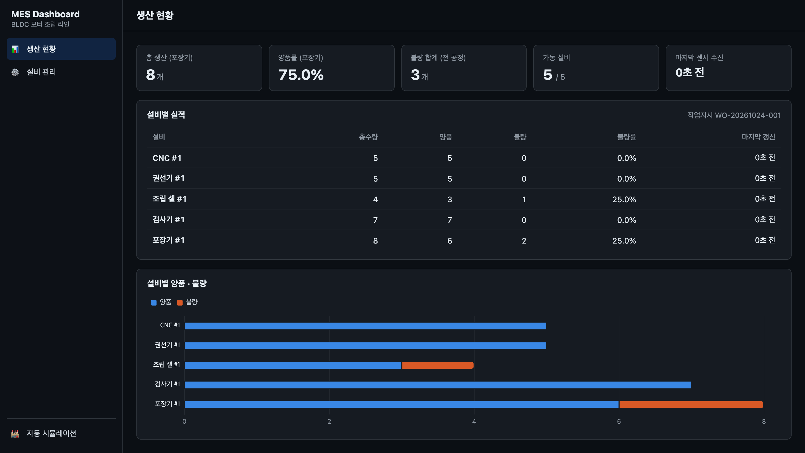
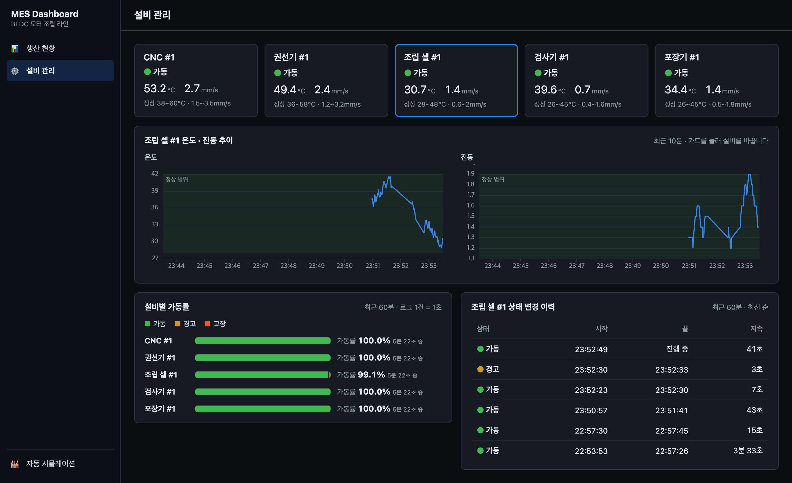
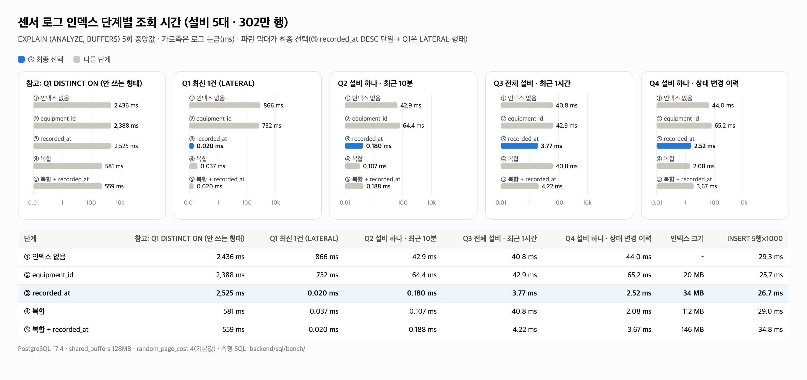

# MES Study — MES 대시보드

실제 제조회사에서 쓸 법한 **MES(생산실행시스템) 대시보드**를 직접 만들면서 MES에 어떤 기능이 있는지, 제조 KPI와 운영 개념이 무엇인지 익히는 학습·포트폴리오 프로젝트입니다.

가상 **BLDC 모터 조립 라인**의 설비 5대(CNC · 권선기 · 조립 셀 · 검사기 · 포장기)가 내는 센서 · 생산 데이터를 서버(Spring Boot · PostgreSQL)에 모으고, 대시보드가 2초마다 조회해서 보여 줍니다.

```
자동 시뮬레이션(3D) ──1초마다 POST──> Spring Boot ──> PostgreSQL ──> 조회 API ──2초마다 GET──> 생산 현황 · 설비 관리
```

## 주요 기능

### 관리자 모드

MES 기능 단위로 메뉴를 나눴습니다. 서버에 저장된 데이터로 채운 화면은 생산 현황 · 설비 관리 두 개이고, 아직 데이터가 없는 메뉴는 사이드바에서 숨겼습니다(주소로는 열리는 빈 페이지).

| 페이지 | MES 기능 | 상태 |
|---|---|---|
| 생산 현황 (`/`) | 생산 모니터링 | 서버 데이터 연결 |
| 설비 관리 (`/equipment`) | 설비 관리 · 보전 | 서버 데이터 연결 |
| 작업지시 관리 · 품질 관리 · 자재/재고 · 실적 리포트 | – | 숨김(빈 페이지) |

두 화면 모두 2초마다 조회 API를 다시 부릅니다. 서버가 응답하지 않으면 "서버에 연결할 수 없습니다"를 띄우고 마지막으로 받은 값은 그대로 두며, 서버가 돌아오면 저절로 복구합니다.

#### 생산 현황



- **요약**: 총 생산(라인 마지막 공정인 포장기 수량), 양품률, 전 공정 불량 합계, 가동 설비(RUN이면서 5초 안에 수신), 마지막 센서 수신 시각
- **설비별 실적 표 · 막대 차트**: 라인 순서로 총수량 · 양품 · 불량 · 불량률. 실적은 택트 타임마다 늘어납니다.

#### 설비 관리



- **상태 카드**: 상태(가동 · 경고 · 고장, 3D와 같은 색) · 온도 · 진동 · 정상 범위. 범위를 벗어난 값은 빨간색, 5초 넘게 수신이 없으면 "통신 끊김". 카드를 누르면 아래 내용이 그 설비로 바뀝니다.
- **온도 · 진동 추이**: 선택한 설비의 최근 10분, 정상 범위를 띠로 표시. 단위가 달라 차트를 둘로 나눴습니다.
- **가동률**: 설비별 최근 60분 상태 비율(로그 1건 = 1초)
- **상태 변경 이력**: 선택한 설비의 최근 60분 상태 구간(`LAG` 윈도 함수). 5초 넘게 수신이 끊긴 곳도 구간을 나눕니다.

단계별 계획서는 [docs/plans/](docs/plans/)에 있습니다. 이번 대시보드는 [dashboard-monitoring-api.md](docs/plans/dashboard-monitoring-api.md)이고, 1~7단계 계획서는 삭제한 브라우저 시뮬레이션 엔진 기반 화면의 기록입니다.

### 자동 시뮬레이션

사이드바 아래 **자동 시뮬레이션**(`/simulator`)은 **더미 센서 데이터 발생기(Producer)** 입니다. 열면 1초마다 설비 5대의 난수 데이터를 만들어 서버로 보냅니다. 3D 화면은 그 데이터를 그대로 보여 줍니다. 대시보드로는 브라우저 뒤로 가기로 돌아옵니다.


- **전송**: 1초(`setInterval` 1000ms)마다 `POST http://localhost:8080/api/v1/sensor-logs/bulk` (axios). 서버가 꺼져 있어도 오류를 무시하고 계속 돕니다.
- **데이터**: 설비별 `equipmentId`, `timestamp`(ISO, 밀리초 포함), `status`, `workOrderId`(고정 `WO-20261024-001`), `metrics`(온도 · 진동), `production`(누적 총수량 · 양품 · 불량)
- **센서 주기(1초)**: 온도 · 진동은 직전 값에서 매초 조금씩(정상 범위 폭의 ±5% 안) 움직이고, 설비별 정상 범위를 벗어나지 않습니다(소수점 첫째 자리).
- **생산 주기(택트 타임)**: 설비마다 택트 타임(CNC 45초 · 권선 40초 · 조립 50초 · 검사 30초 · 포장 25초)이 지날 때마다 `totalCount`가 1 늘고, 95%는 양품 · 5%는 불량으로 셉니다. 그 사이의 전송은 직전 누적 수량을 그대로 보냅니다.
- **상태**: 평소에는 `RUN`입니다. 불량이 나면 `WARN` 또는 `DOWN`(반반)으로 3~5초 바뀌었다가 `RUN`으로 돌아옵니다. `DOWN` 동안은 택트 타이머가 멈춥니다.
- **3D 표시**: 설비 모델 · 작업자 · 경광등(가동 초록 · 경고 노랑 · 고장 빨강) · 바닥 띠가 상태를 따라 움직이고, 라벨에 온도 · 진동을 보여 줍니다. 출하장은 포장기 양품, 폐기함은 전 설비 불량 합계입니다. 버퍼 선반과 자재 랙은 정적으로 표시합니다.

```json
[
  {
    "equipmentId": "CNC_01",
    "timestamp": "2026-10-24T14:53:02.432Z",
    "status": "RUN",
    "workOrderId": "WO-20261024-001",
    "metrics": { "temperature": 49.4, "vibration": 2.8 },
    "production": { "totalCount": 12, "goodCount": 11, "badCount": 1 }
  }
]
```

## 기술 스택

| 구분 | 사용 기술 |
|---|---|
| 프레임워크 | Vue 3.5, TypeScript 6.0, Vite 8 |
| 라우팅 | vue-router 5 |
| 3D | three.js, TresJS 5 + cientos |
| 통신 | axios (센서 데이터 전송, 대시보드 2초 폴링) |
| 차트 | ECharts 6 + vue-echarts (선 · 막대만 등록) |
| 테스트·품질 | Vitest 5, ESLint 10 (typescript-eslint, eslint-plugin-vue) |
| 백엔드 | Spring Boot 3.5, Java 17, MyBatis, PostgreSQL(로컬 17.4에서 확인), Gradle |

- 자동 시뮬레이션이 보내는 데이터는 `backend/`의 Spring Boot 서버(`localhost:8080`)가 받아 PostgreSQL에 저장합니다.
- TypeScript 7.0은 typescript-eslint가 아직 지원하지 않아 6.0을 씁니다.

## 실행 방법

Node 22.12 이상이 필요합니다(`.nvmrc` 참고).

```bash
nvm use
cd frontend
npm install
npm run dev        # 개발 서버
npm test           # 단위 테스트 (Vitest)
npm run lint       # 린트
npm run build      # 타입 검사 + 프로덕션 빌드
```

### 백엔드 (센서 로그 수신 서버)

Java 17과 PostgreSQL이 필요합니다. Gradle은 래퍼(`gradlew`)를 쓰므로 따로 설치하지 않아도 됩니다.

1. DB를 만듭니다. `mes`는 개발용, `mes_test`는 테스트 전용입니다.
   ```bash
   createdb mes
   createdb mes_test
   ```
2. 설정 파일을 복사하고 `password`에 로컬 DB 비밀번호를 적습니다. `application.properties`는 `.gitignore`에 있어 커밋되지 않고, 저장소에는 비밀번호 자리를 비운 `application.properties.example`만 올라갑니다. 테스트(`mes_test`)도 같은 계정을 씁니다. 계정 이름이 `postgres`가 아니면 `username`도 고칩니다.
   ```bash
   cp backend/src/main/resources/application.properties.example backend/src/main/resources/application.properties
   ```
3. 실행합니다. 서버가 뜰 때 테이블이 없으면 `schema.sql`로 만듭니다.
   ```bash
   cd backend
   ./gradlew bootRun   # http://localhost:8080
   ./gradlew test      # 테스트 (mes_test DB 사용)
   ```

프론트 개발 서버(`npm run dev`, `localhost:5173`)에서 자동 시뮬레이션을 열면 1초마다 데이터가 저장됩니다.

| 테이블 | 저장 방식 |
|---|---|
| `equipment_sensor_log` | 설비별 상태 · 온도 · 진동을 1초마다 INSERT(시계열 로그) |
| `production_performance` | (작업지시, 설비)마다 한 행. 최신 누적 수량으로 UPSERT하고, 지금 값보다 작은 수량(늦게 도착한 요청)으로는 덮어쓰지 않음 |

| API | 내용 |
|---|---|
| `POST /api/v1/sensor-logs/bulk` | 센서 로그 수신. 정상이면 `200 {"sensorLogs":n,"productions":m}`, 필수 값이 없거나 형식이 틀리면 `400 {"message":"..."}` |
| `GET /api/v1/equipment/latest` | 설비별 최신 로그 1건 |
| `GET /api/v1/equipment/{id}/sensor-logs?minutes=10` | 설비 하나의 최근 로그(시간순) |
| `GET /api/v1/equipment/status-summary?minutes=60` | 설비 · 상태별로 머문 초 |
| `GET /api/v1/equipment/{id}/status-changes?minutes=60` | 설비 하나의 상태 구간(최신 순) |
| `GET /api/v1/production-performance` | 작업지시 · 설비별 누적 실적 |

조회 API의 `minutes`는 1~1440만 받고, 벗어나거나 숫자가 아니면 400입니다. 설계: [수신 API](docs/plans/backend-sensor-log-api.md) · [조회 API](docs/plans/dashboard-monitoring-api.md)

### 센서 로그 인덱스 비교 실험

센서 로그는 1초에 5행씩 계속 쌓이고, 대시보드는 2초마다 "최근 n분"을 읽습니다. 어떤 인덱스가 맞는지 302만 행(설비 5대 · 50대 두 가지) × 인덱스 5단계 × 쿼리 5개를 `EXPLAIN (ANALYZE, BUFFERS)`로 비교했습니다.



- **`recorded_at DESC` 단일 인덱스**를 골랐습니다. 조회 4개가 40~870ms에서 0.02~3.8ms로 줄었습니다.
- `(equipment_id, recorded_at)` 복합 인덱스는 설비 5대에서는 이득이 작고 설비 조건이 없는 조회에 쓰이지 않았습니다(설비 50대에서는 12배 차이).
- `equipment_id` 단일 인덱스는 값이 5종뿐이라 오히려 1.5배 느려졌습니다.
- 설비별 최신 1건은 `DISTINCT ON`(2.5초) 대신 `LATERAL ... LIMIT 1`(0.02ms)로 정했습니다.

결과 · 실행 계획 원문 · 해석: [docs/experiments/sensor-log-index/](docs/experiments/sensor-log-index/README.md)

## 아키텍처

```
자동 시뮬레이션: 1초마다 상태 진행 (producer/) ──┬─> POST /api/v1/sensor-logs/bulk (axios) ──> backend/
                                                └─> 3D 화면 (provide/inject)

backend/: Controller ──> Service(@Transactional, metrics · production 분리) ──┬─> SensorLogMapper ──> equipment_sensor_log
                                                                              └─> ProductionPerformanceMapper ──> production_performance
          QueryController ──> QueryService(기간 검사) ──> SensorLogQueryMapper · ProductionQueryMapper ──> 조회 SQL

대시보드: usePolling(2초) ──> api/dashboard.ts (axios) ──> 조회 API
          views/ ──> dashboard/ (계산 함수 · 카드 · 차트)
```

- 대시보드 첫 화면에는 three.js가 들어가지 않습니다. 3D 코드는 자동 시뮬레이션 화면이 열릴 때 따로 불러옵니다.
- 앞 요청이 끝나지 않았으면 다음 폴링은 건너뛰어, 서버가 느려도 요청이 쌓이지 않습니다.

### 폴더 구조

```
frontend/src/
├── router.ts     # 페이지 라우팅 (관리자 모드 페이지 + 전체 화면 자동 시뮬레이션)
├── layout/       # 관리자 모드 레이아웃: 사이드바, 헤더(페이지 제목)
├── views/        # 페이지: 생산 현황, 설비 관리, (숨김) 작업지시 · 품질 · 자재 · 리포트, 자동 시뮬레이션
├── api/          # 조회 API 호출 함수 · 응답 타입 (axios)
├── composables/  # usePolling: 2초 폴링
├── charts/       # ECharts 등록(선 · 막대), 차트 색
├── dashboard/    # 대시보드 계산 함수와 컴포넌트(상태 카드, 추이 · 실적 차트, 가동률, 연결 안내)
├── producer/     # 자동 시뮬레이션: 설비 정의, 더미 센서 데이터 생성, 1초 전송(axios), seed 난수
└── scene/        # 3D 장면(TresJS): 라인 배치, 설비 모델, 사람, 컨베이어, 자재 랙
```

```
backend/src/main/
├── java/com/messtudy/backend/
│   ├── controller/   # 수신(SensorLogController) · 조회(EquipmentQueryController, ProductionQueryController)
│   ├── service/      # 수신: 분리 · 검증 · 트랜잭션 / 조회: 기간(1~1440분) 검사
│   ├── mapper/       # MyBatis 매퍼: 다중 INSERT, UPSERT, 조회 SQL(LATERAL, LAG 윈도 함수)
│   └── config/       # CORS(GET · POST), 400 오류 응답
└── resources/
    ├── application.properties.example  # 복사해서 application.properties로 씀(실제 파일은 커밋 안 함)
    ├── schema.sql    # 테이블 2개 + recorded_at 인덱스
    └── mapper/       # 매퍼 SQL(XML)

backend/sql/bench/    # 인덱스 비교 실험 SQL · 실행 스크립트(서버는 실행하지 않음)
```

## 개발 방식

### 브랜치 전략

| 브랜치 | 역할 | 규칙 |
|---|---|---|
| `main` | 배포 브랜치 | 직접 커밋 금지. `dev` 또는 `hotfix/*`에서 PR로만 병합하고, 병합 시 버전 태그(`v0.1.0` 등)를 붙인다 |
| `dev` | 개발 통합 브랜치 | 기능 브랜치의 PR 대상. 항상 빌드·테스트가 통과하는 상태를 유지한다 |
| `feature/<모듈 이름>` | 기능 개발 | `dev`에서 분기 → PR로 `dev`에 병합 → 브랜치 삭제 |
| `hotfix/<작업명>` | 배포본 긴급 수정 | `main`에서 분기 → `main`과 `dev` 양쪽에 병합 |

기능을 만들기 전에 [docs/plans/](docs/plans/)에 계획서(목표, 아키텍처, 완료 기준)를 먼저 쓰고, 구현하면서 바뀐 점도 같은 문서에 기록합니다.

### 커밋 메시지 규칙

[Conventional Commits](https://www.conventionalcommits.org/ko/v1.0.0/) 형식을 따릅니다.

```
<type>(<scope>): <요약>
```

- type: `feat`, `fix`, `refactor`, `test`, `docs`, `chore`, `style`, `perf`
- scope: `dashboard`, `simulator`, `scene`, `backend` 등
- 예: `feat(backend): 센서 로그 수신 API 추가`
