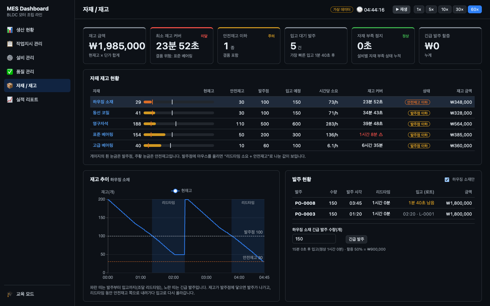
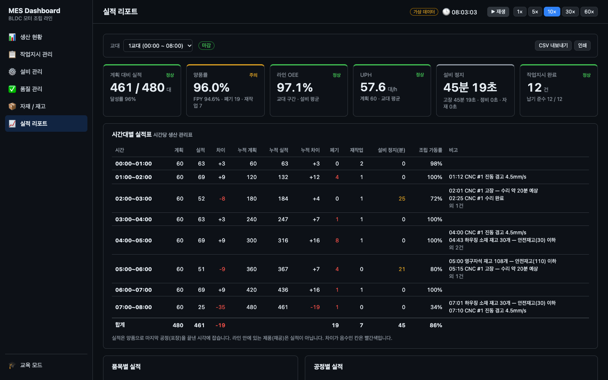

# MES Study — MES 대시보드

브라우저에서 동작하는 **MES(생산실행시스템) 대시보드**입니다. 실제 제조회사에서 쓸 법한 대시보드를 직접 만들면서 MES에 어떤 기능이 있는지, 제조 KPI와 운영 개념이 무엇인지 익히는 학습·포트폴리오 프로젝트입니다.

데이터는 브라우저 안의 시뮬레이션 엔진이 돌리는 가상 **BLDC 모터 조립 라인**에서 나옵니다. 생산 계획 → 작업지시 하달 → 공정 이동 → 설비 모니터링 → 실적·품질 집계로 이어지는 생산 흐름을 생산관리자 입장에서 봅니다.


## 주요 기능

### 관리자 모드

MES 기능 단위로 페이지를 나눴습니다. 모든 페이지는 같은 가상 공장을 보며, 앱을 열면 바로 생산이 시작됩니다. 헤더에서 일시정지와 배속(1~60×)을 조절할 수 있습니다.
페이지마다 **개념 설명** 패널이 있어서, 화면을 보면서 해당 개념을 바로 확인할 수 있습니다.

| 페이지 | MES 기능 | 화면 내용 | 익히는 개념 | 상태 |
|---|---|---|---|---|
| 생산 현황 | 생산 모니터링 | KPI 카드 6종, 시간대별 생산 추이, 최근 알람 | 계획 대비 실적, UPH, OEE, WIP, 리드타임, Little의 법칙 | ✅ |
| 설비 관리 | 설비 관리·보전 | 설비 상태판과 예방정비 요청, OEE 분해, 시간 구성, 비가동 사유 파레토, MTBF·MTTR, 센서 추이, 비가동 이력 | 6대 손실, 계획·비계획 정지, 설비 손실 vs 라인 손실, 파레토 분석, MTBF/MTTR, 예지보전 | ✅ |
| 작업지시 관리 | 작업지시·생산 실행 | 상태 흐름, 작업지시 목록(진척·예상 완료·납기 여유), 하달·보류·우선순위, 투입 순서 규칙, 공정별 진행, 일정(간트), 작업지시 생성 | 작업지시 생명주기, 하달과 투입, 디스패칭(FIFO·우선순위·EDD), 납기 준수율, 작업지시 리드타임 | ✅ |
| 품질 관리 | 품질·추적성 | 양품률·직행률·RTY·재작업·폐기 손실, 시간대별 품질 추이, 불량 유형 파레토, 공정별 수율, 제품 이력 역추적, 자재 로트 정추적 | 불량 처리(재작업·폐기), FPY vs 최종 양품률, RTY, 숨은 공장, 4M, LOT 추적성, 품질 비용 | ✅ |
| 자재/재고 | 자재 관리 | 재고 금액·재고 커버·결품 위험·자재 부족 정지, 재고 현황(안전재고·발주점 게이지), 톱니형 재고 추이와 조달 리드타임, 발주 대장과 긴급 발주, BOM 전개와 소요량(총소요 → 순소요) | BOM, MRP 기초, 조달 리드타임, 발주점과 안전재고, 재고 모형, 재고 커버리지, 결품, 재고 비용 | ✅ |
| 실적 리포트 | 성과 분석 | 교대 선택(8시간 3교대), 교대 요약 KPI, 시간대별 실적표(비고 자동 기록), 품목별·공정별 실적, 인수인계 메모, CSV 내보내기·인쇄 | 교대(Shift), 교대·일일 생산 보고, 시간당 생산 관리표, 달성률 vs 가동률 vs OEE, 인수인계, 실적 집계 기준, 보고 주기 | ✅ |






벽면 TV용 **관제판 모드**도 만들 예정입니다. 전체 진행 계획은 [docs/dashboard-plan.md](docs/dashboard-plan.md)에, 단계별 계획서는 [docs/plans/](docs/plans/)에 있습니다.

### 자동 시뮬레이션

사이드바 아래 **자동 시뮬레이션**(`/simulator`)은 대시보드가 보는 가상 공장을 3D로만 보여 주는 전체 화면입니다. 조작 패널 없이 열면 바로 돌아가고, 대시보드로는 브라우저 뒤로 가기로 돌아옵니다.


- 설비는 가동 중에만 움직이고, 바닥 띠와 경광등으로 상태(가동·대기·고장·정비)를 보여 줍니다. 제품이 컨베이어를 따라 공정 사이를 이동하고, 불량품은 폐기함으로 갑니다.

## 기술 스택

| 구분 | 사용 기술 |
|---|---|
| 프레임워크 | Vue 3.5, TypeScript 6.0, Vite 8 |
| 상태·라우팅 | Pinia 4, vue-router 5 |
| 차트 | ECharts 6 (vue-echarts) |
| 3D | three.js, TresJS 5 + cientos |
| 테스트·품질 | Vitest 5, ESLint 10 (typescript-eslint, eslint-plugin-vue) |

- 백엔드는 없습니다. 시뮬레이션 엔진이 브라우저 안에서 데이터를 만듭니다.
- TypeScript 7.0은 typescript-eslint가 아직 지원하지 않아 6.0을 씁니다.

## 실행 방법

Node 22.12 이상이 필요합니다(`.nvmrc` 참고).

```bash
nvm use
cd frontend
npm install
npm run dev        # 개발 서버
npm test           # 단위 테스트 (Vitest)
npm run lint       # 린트
npm run build      # 타입 검사 + 프로덕션 빌드
```

## 아키텍처

시뮬레이션 엔진(데이터)과 화면(표현)을 분리했습니다. 엔진은 Vue·three.js에 의존하지 않는 순수 TypeScript이고, 화면은 엔진 상태를 읽어서 그리기만 합니다. 사용자 조작은 엔진에 **명령(Command)** 으로만 전달합니다.

```
기준정보(MasterData) ─┐
                     ├─> SimEngine.tick() ──> SimState ──┬─> KPI 계산 (domain/)
사용자 명령(Command) ─┘                                   ├─> 관리자 모드: 대시보드 페이지
                                                         └─> 자동 시뮬레이션: 3D 화면
```

- KPI는 상태에 저장하지 않고, 필요할 때 `SimState`에서 계산합니다.
- 같은 seed와 같은 명령이면 결과가 항상 같습니다.
- 대시보드 첫 화면에는 three.js가 들어가지 않습니다. 3D 코드는 자동 시뮬레이션 화면이 열릴 때 따로 불러옵니다.

### 폴더 구조

```
frontend/src/
├── sim/          # 헤드리스 시뮬레이션 엔진: 엔진, 명령, 센서·고장·수리 시간 모델, seed 난수, 배속 시계
├── domain/       # 타입(기준정보·실행 데이터)과 계산 함수: KPI, 생산 계획·실적, 설비 보전 지표, 투입 순서 규칙, 작업지시 진척·예상 완료, 품질 지표, 추적성, 재고 지표, 소요량 계산, 교대 달력 · 실적 리포트 집계, CSV
├── scenarios/    # 기본 공장 기준정보(불량 유형 · 안전재고 포함), 자유 체험 생산 계획, 엔진 생성
├── stores/       # Pinia: 엔진 실행 루프(sim)
├── router.ts     # 페이지 라우팅 (관리자 모드 페이지 + 전체 화면 자동 시뮬레이션)
├── layout/       # 관리자 모드 레이아웃: 사이드바, 헤더(시뮬 시각·재생·배속)
├── views/        # 페이지: 생산 현황, 설비 관리, 작업지시 관리, 품질 관리, 자재/재고, 실적 리포트, 자동 시뮬레이션
├── dashboard/    # 대시보드 컴포넌트: KPI 카드, 생산 추이 차트, 알람, 개념 설명 패널
│   ├── equipment/  # 설비 관리: 상태판, OEE 분해·시간 구성·파레토·센서 차트, 고장 지표, 비가동 이력
│   ├── workOrders/ # 작업지시 관리: 상태 흐름, 목록, 상세(공정별 진행), 일정 차트, 생성 폼
│   ├── quality/    # 품질 관리: 품질 추이·불량 파레토 차트, 공정별 수율, 제품 이력(역추적), 자재 로트(정추적)
│   ├── materials/  # 자재/재고: 재고 현황, 재고 추이 차트, 발주 현황·긴급 발주, BOM 소요량
│   └── report/     # 실적 리포트: 교대 요약, 시간대별 실적표, 품목별·공정별 실적, 인수인계 메모
├── charts/       # ECharts 등록(쓰는 차트만)과 차트 공통 색
├── concepts/     # 페이지별 개념 설명 문구
├── scene/        # 3D 장면(TresJS): 라인 배치, 설비 모델, 사람, 컨베이어, 제품, 자재 랙
└── ui/           # 표시 형식 함수(시간 · 비율 · 금액 · 이름)
```

### 엔진과 화면의 연결

엔진은 매 프레임 돌지만 Vue 화면은 그만큼 자주 다시 그릴 필요가 없어서, 갱신 경로를 둘로 나눴습니다.

| 경로 | 갱신 주기 | 쓰는 곳 |
|---|---|---|
| `sim.getEngine().state` (반응성 없음) | 매 프레임 | 3D: 설비 애니메이션, 제품 위치 |
| `sim.state` (`shallowRef`) | 250ms | Vue 템플릿: 대시보드 KPI·차트, 라벨, 패널 |

- `shallowRef`로 감싸서 Vue가 엔진 상태를 깊숙이까지 추적하지 않게 했습니다.
- 제품은 `InstancedMesh` 하나로 그려서 개수가 늘어도 draw call은 1회입니다.
- 한 프레임에 처리하는 tick은 최대 240회입니다. 탭이 백그라운드에 있다가 돌아와도 밀린 시간을 한꺼번에 돌리지 않습니다.

## 시뮬레이션 모델

### 기본 공장 (BLDC 모터 조립 라인)

하우징 가공 → 스테이터 권선 → 조립 → 검사 → 포장 순서로 흐르는 5공정 라인입니다. 표준형(A)과 고급형(B)은 같은 경로를 지나고, B는 조립·검사가 조금 더 오래 걸리며 고급 베어링을 씁니다.

| 공정 | 작업장 | 표준 CT (A / B) | 불량률 |
|---|---|---|---|
| 10 | 하우징 가공 (CNC) | 45s / 45s | 1% |
| 20 | 스테이터 권선 | 40s / 40s | 1% |
| 30 | 조립 | 50s / 60s | 0.5% |
| 40 | 검사 | 30s / 35s | 2% |
| 50 | 포장 | 25s / 25s | 0% |

- 작업장별 입력 버퍼 용량은 5개입니다.
- 병목은 조립이며, 이론상 최대 생산량은 시간당 약 68대입니다.
- 자유 체험(대시보드)은 **8시간 동안 A 360대 · B 120대**(시간당 60대) 계획으로 시작하고, 이를 40대씩 작업지시 12건으로 나눠 하달합니다.
- 작업지시 납기는 계획 속도로 그 로트까지 만들었어야 하는 시각입니다(1번 0:40, 2번 1:20, …, 12번 8:00). 라인 능력이 계획보다 약 13% 높아 시간이 갈수록 계획보다 앞서고, CNC 고장(약 20분)도 그 여유로 흡수해 기본 상태에서는 모두 납기를 지킵니다. 보류나 긴급 작업지시로 지연 위험을 만들어 볼 수 있습니다.

| 설비 | 센서 (경고 / 위험) | 마모 (가동 1시간당 / 시작값) | 고장 수리 (표준, 범위) / 예방정비 |
|---|---|---|---|
| CNC #1 (하우징 가공) | 온도 65 / 80°C · 진동 4.5 / 7.1mm/s | 0.30 / 0.30 | 20분 (15~30분) / 5분 |
| 권선기 #1 | 온도 65 / 80°C · 진동 4.5 / 7.1mm/s | 0.04 / 0.10 | 15분 (11~23분) / 5분 |
| 조립 셀·검사기·포장기 | 온도 55 / 70°C · 진동 2.8 / 4.5mm/s | 0.04 / 0.10 | 15분 (11~23분) / 5분 |

CNC는 마모가 빨라서, 자유 체험에서는 약 1시간 12분에 진동 경고가 뜨고 약 2시간에 고장납니다. 그 전에 마모로 치수 불량이 늘어납니다.

| 자재 | 사용처 (BOM) | 초기 재고 | 안전재고 | 발주점 / 발주량 | 리드타임 (정상 / 긴급) |
|---|---|---|---|---|---|
| 하우징 소재 | 하우징 가공, A·B 1개 | 200 | 30 | 100 / 150 | 60분 / 15분 |
| 동선 코일 | 스테이터 권선, A·B 1개 | 200 | 30 | 100 / 150 | 60분 / 15분 |
| 영구자석 | 조립, A·B 4개 | 800 | 110 | 500 / 600 | 90분 / 20분 |
| 표준 베어링 | 조립, A 2개 | 300 | 50 | 200 / 300 | 90분 / 20분 |
| 고급 베어링 | 조립, B 2개 | 100 | 10 | 60 / 100 | 90분 / 20분 |

발주점 = 정상 리드타임 동안의 소요량 + 안전재고로 잡아, 기본 상태에서는 결품이 나지 않습니다(예: 하우징 시간당 약 70개 × 1시간 + 30 = 100). 안전재고는 자유 체험에서 측정한 소비 속도로 정했습니다. 자유 체험 8시간 동안 재고가 안전재고까지 내려가는 일은 5번(첫 번째는 2:42 표준 베어링) 있지만 결품은 없습니다.

### 엔진 동작 규칙

- 시간 단위는 시뮬레이션 1초이며, `tick()` 한 번이 1초입니다.
- tick 처리 순서
  1. 명령 적용
  2. 자재 입고: 도착 예정 시각이 된 발주를 재고에 더합니다.
  3. 설비 상태 갱신: 수리·정비 진행, 마모 누적, 센서 갱신, 고장 판정
  4. 가공 완료 처리(하류 설비부터): 품질을 판정해 재작업 유형 불량은 같은 설비에서 한 번 다시 가공하고, 그 밖의 불량은 폐기하며, 양품은 다음 버퍼로 옮깁니다. 다음 버퍼가 가득 차 있으면 `BLOCKED`가 됩니다.
  5. 작업지시 투입: 투입 순서 규칙대로, 첫 공정 버퍼에 빈자리가 있는 만큼 투입합니다.
  6. 가공 시작: 정비 요청이 있으면 `PM`에 들어갑니다. 아니면 BOM 자재를 차감하고 가공을 시작하며, 자재가 없으면 `STARVED_MATERIAL`이 됩니다.
  7. 자동 발주: 재고 + 입고 예정 수량이 발주점 이하인 자재를 발주합니다.
  8. 비가동 이력 갱신, 상태별 시간 누적, 1분마다 재고 · 1시간마다 설비 누적값 기록
- 명령은 다음 tick 시작 시 적용됩니다. 일시정지 중에는 시간을 진행하지 않고 바로 적용해 화면에 즉시 반영합니다.

**설비 상태**

| 상태 | 의미 |
|---|---|
| `RUN` | 가공 중 |
| `STARVED` | 처리할 일은 남았는데 입력 버퍼가 비어 대기 중 |
| `BLOCKED` | 가공은 끝났는데 다음 버퍼가 가득 차서 대기 중 |
| `STARVED_MATERIAL` | 가공할 제품은 있는데 BOM 자재가 부족함 (FIFO라 맨 앞 제품이 막히면 뒤도 기다림) |
| `DOWN` | 고장 수리 중 (가공 중이던 제품은 수리 후 이어서 가공) |
| `PM` | 예방정비 중 (요청하면 현재 제품을 마친 뒤 시작) |
| `IDLE` | 처리할 일이 없음 |

**마모 · 센서 · 고장**

- 무작위 고장(MTBF) 대신 마모 기반으로 모델링했습니다. 고장 전에 센서 경고와 불량 증가라는 **전조**가 먼저 나타나게 하려는 것입니다.
- **마모도**(0~1)는 가동 중에만 쌓입니다. 0.5부터 불량률이 오르고, 0.7부터 고장 확률이 생기며, 1이 되면 반드시 고장납니다.
- **센서**: 진동은 마모도의 제곱, 온도는 1.5제곱에 비례해 오릅니다. 온도는 시정수 5분의 1차 지연으로 진동보다 늦게 반응합니다.
- **경보 판정**: 측정 잡음 때문에 같은 경고가 반복되지 않도록 두 가지 규칙을 둡니다.
  - 히스테리시스 8%: 경보 단계가 내려가려면 임계값보다 8% 이상 낮아져야 합니다.
  - 진동은 가동 중에만 판정합니다. 정지 중에는 직전 단계를 유지하고, 수리·예방정비를 마치면 해제합니다.
- **복구**: 고장 수리는 마모도를 0.2로, 예방정비는 0으로 되돌립니다.
- **수리 시간**: 고장마다 표준 수리 시간의 0.75~1.5배(삼각분포, 최빈값 1.0)로 정합니다. 대부분 표준 근처에서 끝나고 가끔 길어집니다. 예방정비는 계획된 작업이라 시간이 고정입니다. 고장 알림은 표준(예상) 시간을 알리고, 실제 시간은 비가동 이력에 남습니다.
- 난수 스트림을 품질 판정·불량 유형·고장·센서·수리 시간 용도별로 나눠, 한 모델을 바꿔도 다른 모델의 결과가 흔들리지 않게 했습니다.

**자재**

- BOM 자재는 그 자재를 쓰는 작업장에서 가공을 시작할 때 차감합니다.
- **자재 로트**: 시작 재고와 입고(발주)마다 로트 번호를 붙이고, 먼저 들어온 로트부터 씁니다(FIFO). 제품마다 쓴 로트와 수량을 남겨 추적성(역추적 · 정추적)에 씁니다.
- 발주한 자재는 정상 리드타임이 지나면 입고됩니다. 긴급 발주는 리드타임이 짧은 대신 단가에 할증이 붙고, 할증은 누적 비용으로 기록합니다.
- **알림**: 재고가 발주점 이하가 되면 정보(자동 발주가 나가는 정상 흐름), 안전재고 이하로 처음 내려가면 경고, 자재가 없어 설비가 멈추면 위험 알림을 냅니다. 안전재고는 발주에 쓰지 않고 경고 기준으로만 씁니다.
- **기록**: 입고가 끝난 발주도 발주 대장에 입고 시각 · 로트와 함께 남기고, 자재별 누적 소비량과 1분 간격 재고 이력(최근 24시간)을 남깁니다.

**품질 · 불량 유형 · 재작업**

- 불량 여부는 난수 한 번으로 정합니다(공정 불량률 + 마모 불량률). 그 값이 공정 불량률 안이면 원인은 **공정 산포**, 넘으면 **설비 마모**입니다.
- 불량 유형은 공정 · 원인별로 정해 둔 목록에서 비중대로 고릅니다(공정별 1~4종, 모두 14종).

| 공정 | 재작업 유형 | 폐기 유형 | 마모 원인 유형 |
|---|---|---|---|
| 하우징 가공 | 버 잔존 | 표면 찍힘 | 치수 불량(내경) |
| 스테이터 권선 | 권선 수 불량 | 절연 피막 손상 | 장력 불균일 |
| 조립 | 체결 토크 불량 | 베어링 압입 불량 | 압입 위치 편차 |
| 검사 | 외관 불량 | 소음·진동 초과, 역기전력 미달 | 측정 지그 오차 |
| 포장 | — | — | 포장 밀봉 불량(재작업) |

- **재작업**: 재작업 유형이면 폐기하지 않고 같은 설비에서 사이클타임만큼 한 번 다시 가공합니다. 그동안 설비는 새 제품을 받지 못합니다. 다시 불량이면 폐기하고, 자재는 다시 쓰지 않습니다.
- 마모 원인 유형은 포장을 빼면 모두 폐기라, 설비 마모가 쌓이면 폐기가 늘어납니다.

**비가동 이력**

- 설비가 고장(`DOWN`) · 예방정비(`PM`) · 자재 부족(`STARVED_MATERIAL`)으로 멈추면 설비, 사유, 시작·종료 시각, 표준 시간을 한 건씩 기록합니다(최근 200건).
- 공급 대기 · 막힘은 가공할 때마다 몇 초씩 생겼다 사라지는 라인 흐름 손실이라 한 건씩 기록하지 않고, 상태별 누적 시간으로만 봅니다.

**교대 · 실적 집계**

- 교대는 시뮬레이션 경과 시각을 8시간씩 나눈 것입니다(1교대 00:00 ~ 08:00, 2교대 08:00 ~ 16:00, 3교대 16:00 ~ 24:00). 실제 공장 시각은 쓰지 않습니다.
- 자유 체험은 1교대 동안의 계획만 있고, 작업지시 12건이 약 7시간 반에 모두 끝나 2교대부터는 실적이 없습니다. 작업지시를 더 만들어 계속 돌리면 다음 교대 보고서가 채워집니다.
- 엔진은 정시(1시간)마다 설비별 누적값(상태별 시간, 가공 수, 불량 수, 표준 시간)을 기록합니다(최근 7일). 두 시점의 차이로 교대 · 시간대의 가동률과 OEE를 계산합니다.

**생산 계획 · 작업지시**

- 생산 계획은 "언제까지 무엇을 몇 개" 만들지 정한 기준값입니다. 계획 대비 실적 계산에만 쓰고, 생산 동작은 바꾸지 않습니다.
- 작업지시 상태는 `PLANNED → RELEASED → IN_PROGRESS → COMPLETED`이며, 중간에 `HELD`(보류)로 바뀔 수 있습니다.
- 양품과 폐기 수량의 합이 지시 수량에 도달하면 작업지시가 완료됩니다. 폐기분은 다시 투입하지 않으므로, 불량이 나면 그만큼 계획에 못 미칩니다.
- **투입 순서 규칙(디스패칭)**: 하달 순(FIFO), 우선순위(기본, 같으면 하달 순), 납기 빠른 순(EDD, 납기 없으면 맨 뒤) 중 하나로 다음에 투입할 작업지시를 고릅니다. 규칙은 첫 공정 투입 순서만 정하고, 투입된 뒤에는 라인이 FIFO라 순서가 바뀌지 않습니다.
- 보류하면 새 투입만 멈추고 라인 안 제품은 끝까지 흐릅니다. 해제하면 보류 전 상태로 돌아갑니다.
- 상태가 바뀐 시각(생성·하달·첫 투입·완료)을 남겨, 작업지시 리드타임(하달 → 완료)을 대기 시간(하달 → 첫 투입)과 작업 시간(첫 투입 → 완료)으로 나눠 봅니다.

**KPI 계산**

- **OEE 가용성**: 계획 가동 시간(전체 − 예방정비) 중 비계획 정지(고장·자재 부족)를 뺀 비율입니다. 예방정비는 계획된 정지라 손실로 보지 않습니다.
- **MTBF · MTTR**: MTBF는 가동(`RUN`) 시간 ÷ 고장 횟수, MTTR은 끝난 수리 시간의 평균입니다. 고장은 가동 중에만 나므로 가동 시간을 기준으로 합니다.
- **손실 구분**: 고장·자재 부족은 비계획 정지, 예방정비는 계획 정지, 공급 대기·막힘은 라인 손실입니다. 라인 손실은 설비 OEE에 넣지 않고 설비 관리 화면에서 따로 보여 줍니다.
- **예상 완료(작업지시)**: 라인 안 제품은 투입 순서대로, 아직 투입하지 않은 수량은 투입 순서 규칙대로 줄 세우고, 품목별 병목 처리 시간(사이클타임 ÷ 설비 대수의 최댓값)을 누적한 뒤 병목 뒤 공정 시간을 더합니다. 지금 멈춘 작업장(설비가 모두 고장·정비 중)을 아직 거쳐야 하면 다시 돌 때까지의 예상 시간(고장은 표준 수리 시간 − 경과, 정비는 남은 시간)을 더합니다. 앞으로 날 고장과 불량은 반영하지 않는 근사값입니다.
- **납기 준수율(OTD)**: 납기가 있는 완료 작업지시 중 납기 안에 끝낸 비율입니다.
- **최종 양품률 · 직행률(FPY) · RTY**: 최종 양품률은 끝난 제품(완료 + 폐기) 중 양품 완료 비율(재작업으로 살린 제품 포함), 직행률은 한 번도 불량 없이 완료한 비율, RTY는 공정별 1차 합격률(재작업 가공 제외)의 곱입니다.
- **폐기 손실**: 폐기품에 실제로 들어간 자재 로트 수량 × 자재 단가입니다.
- **소비 속도 · 재고 커버**: 소비 속도는 최근 1시간 동안 늘어난 누적 소비량(입고와 섞이지 않음), 재고 커버는 현재고 ÷ 소비 속도입니다. 재고 커버가 다음 입고까지 남은 시간(입고 예정이 없으면 정상 리드타임)보다 짧으면 결품 위험으로 봅니다.
- **소요량(MRP 기초)**: 총소요 = 남은 생산 수량 × BOM 수량입니다. 남은 생산 수량은 끝나지 않은 작업지시의 미투입 수량에, 라인 안에서 그 자재를 아직 쓰지 않은 제품을 더한 것입니다. 순소요 = 총소요 + 안전재고 − 현재고 − 입고 예정이고, 양수면 그만큼 더 들어와야 남은 생산을 마칩니다. 날짜별 전개(계획 발주)는 하지 않습니다.
- **교대 · 시간대 실적**: 제품이 끝난(완료 · 폐기) 시각이 구간 안이면 그 구간 실적입니다(교대 경계에 걸친 제품은 끝난 교대의 실적). 계획은 계획선의 구간 차이, 설비 정지 시간은 설비별 고장 · 정비 · 자재 부족 시간의 합(설비 2대가 10분씩 서면 20분), 가동률 · OEE는 정시 기록의 차이로 계산합니다. 진행 중인 구간은 지금까지로 계산합니다.
- **병목**: 실효 사이클타임(현재 사이클타임 ÷ 설비 대수)이 가장 긴 작업장입니다. 품목별 사이클타임은 남은 작업지시 수량으로 가중평균합니다. 누적 가동률로 판단하면 시작 직후 투입 버퍼가 늘 차 있는 첫 공정이 병목처럼 보여서 부하 기준을 씁니다.

## 개발 방식

### 브랜치 전략

| 브랜치 | 역할 | 규칙 |
|---|---|---|
| `main` | 배포 브랜치 | 직접 커밋 금지. `dev` 또는 `hotfix/*`에서 PR로만 병합하고, 병합 시 버전 태그(`v0.1.0` 등)를 붙인다 |
| `dev` | 개발 통합 브랜치 | 기능 브랜치의 PR 대상. 항상 빌드·테스트가 통과하는 상태를 유지한다 |
| `feature/<모듈 이름>` | 기능 개발 | `dev`에서 분기 → PR로 `dev`에 병합 → 브랜치 삭제 |
| `hotfix/<작업명>` | 배포본 긴급 수정 | `main`에서 분기 → `main`과 `dev` 양쪽에 병합 |

기능을 만들기 전에 [docs/plans/](docs/plans/)에 계획서(목표, 아키텍처, 완료 기준)를 먼저 쓰고, 구현하면서 바뀐 점도 같은 문서에 기록합니다.

### 커밋 메시지 규칙

[Conventional Commits](https://www.conventionalcommits.org/ko/v1.0.0/) 형식을 따릅니다.

```
<type>(<scope>): <요약>
```

- type: `feat`, `fix`, `refactor`, `test`, `docs`, `chore`, `style`, `perf`
- scope: `sim`, `domain`, `dashboard`, `scene`, `ui` 등
- 예: `feat(sim): 설비 상태 전이 로직 추가`
