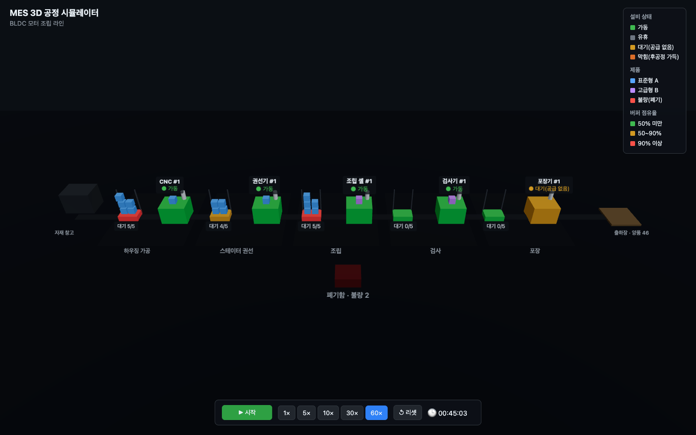
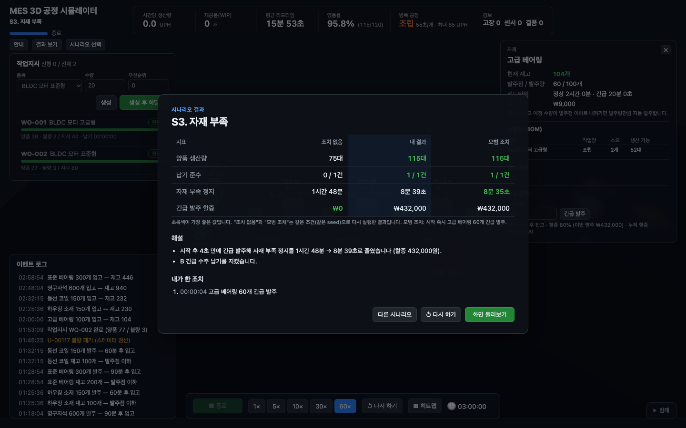
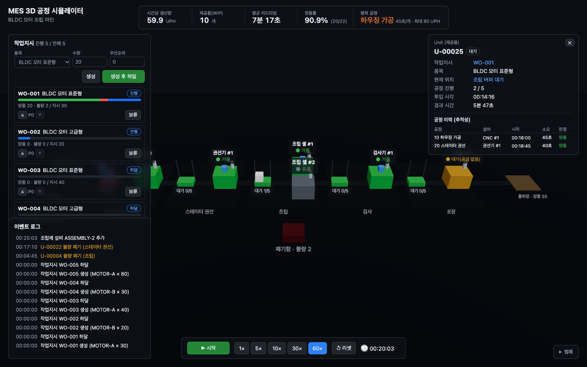
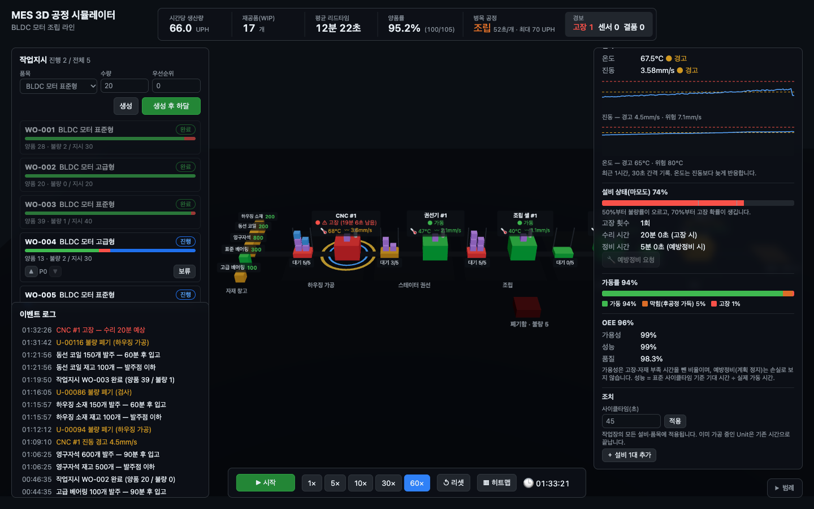

# Simple MES Simulation Web

브라우저에서 동작하는 **3D MES 공정 시뮬레이션 웹 앱**입니다.
가상 모터 조립 라인에서 작업지시 하달 → 공정 이동 → 설비 상태 모니터링 → 실적·품질 집계로 이어지는 생산 라이프사이클을 생산관리자 입장에서 체험할 수 있습니다.



## 체험 시나리오

첫 화면에서 시나리오를 고르면 상황 설명(브리핑)을 보고 시작합니다. 시나리오마다 3시간(60배속으로 약 3분)이 주어지고, 시간이 다 되면 결과표가 나옵니다. 결과표는 **조치 없음 / 내 결과 / 모범 조치**를 나란히 비교합니다. "조치 없음"과 "모범 조치"는 같은 조건(같은 seed)으로 화면 없이 다시 실행한 결과입니다.

| 시나리오 | 상황 | 배우는 것 | 조치 없음 → 모범 조치 |
|---|---|---|---|
| **S1. 라인 밸런싱 불균형** | 조립 사이클타임이 90초로 늘었는데 모든 설비가 바빠 보인다 | 병목(제약 이론), Little의 법칙 | 생산량 116 → 231대, 리드타임 25분 → 7.5분 |
| **S2. 설비 돌발 장애** | CNC 마모가 진행된 채로 시작, 진동 경고가 뜬다 | 계획 정지 vs 비계획 정지, 예지보전 | 고장 1 → 0회, 정지 20분 → 5분, 생산량 190 → 200대 |
| **S3. 자재 부족** | 고급 베어링이 B 10대분뿐인데 B 40대 긴급 수주 | BOM ↔ 자재 ↔ 일정, 긴급 발주 비용과 납기 | 자재 정지 1시간 48분 → 9분, 납기 0/1 → 1/1, 생산량 75 → 115대 |
| **자유 체험** | 기본 공장을 시간 제한 없이 조작 | — | — |



## 저장소 구조

```
.
├── frontend/   # Vue 3 + TypeScript + TresJS(three.js) + Pinia 웹 앱
└── backend/    # (예정) 필요해지는 시점에 추가
```

## 실행 방법

Node 22.12 이상이 필요합니다(`.nvmrc` 참고).

```bash
nvm use
cd frontend
npm install
npm run dev        # 개발 서버
npm test           # 단위 테스트 (Vitest)
npm run build      # 타입체크 + 프로덕션 빌드
```

## 아키텍처

시뮬레이션 엔진(데이터)과 3D 화면(표현)을 분리합니다. 3D 화면은 엔진 상태를 그대로 그리기만 하고, 사용자 조작은 엔진에 **명령(Command)** 으로만 전달합니다.

```
기준정보(MasterData) ─┐
                     ├─> SimEngine.tick() ──> SimState ──> KPI 계산 / 3D 화면 / UI 패널
사용자 명령(Command) ─┘
```

| 경로 | 역할 |
|---|---|
| `frontend/src/domain/types.ts` | 기준정보(품목·라우팅·작업장·설비·자재·BOM)와 실행 데이터(작업지시·Unit·설비 상태·센서·재고·발주·실적·이벤트) 타입 |
| `frontend/src/domain/equipment.ts` | 설비 이름·규격 조회 (실행 중 추가된 설비는 같은 작업장 설비의 이름·규격을 물려받음) |
| `frontend/src/domain/kpi.ts` | UPH, WIP, 리드타임, 양품률, 가동률, OEE, 병목(부하 기준) 계산 (상태에 저장하지 않고 매번 계산) |
| `frontend/src/sim/engine.ts` | 헤드리스 시뮬레이션 엔진 (Vue/three.js 의존 없음) |
| `frontend/src/sim/commands.ts` | 사용자 명령 정의 (작업지시 생성·하달·보류·우선순위 변경, 사이클타임 변경, 설비 추가, 예방정비 요청, 긴급 발주) |
| `frontend/src/sim/sensors.ts` | 센서 모델: 마모도 → 온도·진동, 경고·위험 판정(히스테리시스) |
| `frontend/src/sim/failure.ts` | 고장 모델: 마모도 → 초당 고장 확률, 마모로 인한 추가 불량률 |
| `frontend/src/sim/rng.ts` | seed 기반 난수 생성기 — 같은 seed와 같은 명령이면 항상 같은 결과 |
| `frontend/src/sim/clock.ts` | 실제 경과 시간 × 배속 → 이번 프레임에 돌릴 tick 수 계산 |
| `frontend/src/scenarios/baseline.ts` | 기본 공장: BLDC 모터 조립 라인 기준정보 |
| `frontend/src/scenarios/demo.ts` | 자유 체험 시작 작업지시(A/B 5건) |
| `frontend/src/scenarios/lineBalancing.ts` · `breakdown.ts` · `materialShortage.ts` | 시나리오 S1~S3 정의: 기준정보 조정, 초기 작업지시, 브리핑, 모범 조치, 결과 해설 규칙 |
| `frontend/src/scenarios/runner.ts` | 시나리오 엔진 생성, 시각별 명령을 적용하며 화면 없이 실행, 결과 지표·결과표 생성 |
| `frontend/src/stores/sim.ts` | Pinia 스토어: 엔진 실행 루프, 재생·정지·배속, 시나리오 불러오기·제한 시간, 명령 전달과 조치 기록 |
| `frontend/src/stores/scenario.ts` | Pinia 스토어: 화면 단계(랜딩 → 브리핑 → 진행 → 결과)와 결과표 |
| `frontend/src/stores/selection.ts` | Pinia 스토어: 선택된 객체(설비·작업장·Unit·작업지시·자재) |
| `frontend/src/stores/view.ts` | Pinia 스토어: 화면 표시 옵션(히트맵) |
| `frontend/src/scene/` | 3D 장면 (TresJS): 라인 배치, 설비, 버퍼 선반, 이동하는 Unit, 자재 랙 |
| `frontend/src/ui/` | 화면 위 오버레이: KPI 바, 작업지시 패널, 상세 패널, 이벤트 로그, 시뮬 컨트롤, 범례 |
| `frontend/src/ui/scenario/` | 랜딩(시나리오 선택), 브리핑, 좌상단 시나리오 바, 결과표 |

### 엔진과 화면의 연결

엔진은 매 프레임 돌지만 Vue 화면은 그만큼 자주 다시 그릴 필요가 없습니다. 그래서 갱신 경로를 둘로 나눴습니다.

| 경로 | 갱신 주기 | 쓰는 곳 |
|---|---|---|
| `sim.getEngine().state` (반응성 없음) | 매 프레임 | 3D: 설비 색, 스핀들 회전, Unit 위치 |
| `sim.state` (`shallowRef`) | 250ms | Vue 템플릿: 라벨, 버퍼 수량, 시계, 출하·폐기 수 |

- 엔진 상태는 `shallowRef`로 감싸서 Vue가 객체 깊숙이까지 변경을 추적하지 않게 했습니다(성능).
- 엔진은 Unit을 즉시 옮기지만 화면에서는 Unit이 목표 위치를 부드럽게 따라가게 해 이동을 표현합니다. 투입된 Unit은 자재 창고에서 출발하고, 완료되면 출하장으로, 불량이면 폐기함으로 이동한 뒤 사라집니다.
- Unit은 `InstancedMesh` 하나로 그려서 개수가 늘어도 draw call은 1회입니다.
- 한 프레임에 처리하는 tick 수는 최대 240으로 제한했습니다. 탭이 백그라운드에 있다가 돌아와도 밀린 시간을 한꺼번에 돌리지 않습니다.

### 엔진 동작 규칙

- 시간 단위는 시뮬레이션 1초이며, `tick()` 한 번이 1초입니다.
- tick 처리 순서
  1. 명령 적용
  2. 자재 입고: 도착 예정 시각이 된 발주가 재고에 더해집니다.
  3. 설비 상태 갱신: 수리·정비 진행, 마모 누적, 센서 갱신, 고장 판정
  4. 가공 완료 처리(하류 설비부터): 품질을 판정해 불량은 폐기하고 양품은 다음 버퍼로 옮깁니다(가득 차 있으면 `BLOCKED`).
  5. 작업지시 투입: 첫 공정 버퍼에 빈자리가 있는 만큼 투입합니다.
  6. 가공 시작: 정비 요청이 있으면 `PM`에 들어갑니다. 그렇지 않으면 BOM 자재를 차감하고 가공을 시작하며, 자재가 없으면 `STARVED_MATERIAL`이 됩니다.
  7. 자동 발주: 재고 + 입고 예정 수량이 발주점 이하인 자재를 발주합니다.
  8. 상태별 시간 누적
- 설비 상태
  - `RUN`: 가공 중
  - `STARVED`: 처리할 일이 남아 있는데 입력 버퍼가 비어 대기 중
  - `BLOCKED`: 가공은 끝났는데 다음 버퍼가 가득 차서 대기 중
  - `STARVED_MATERIAL`: 가공할 Unit은 있는데 BOM 자재가 부족 (라인은 FIFO라 맨 앞 Unit이 막히면 뒤 Unit도 기다림)
  - `DOWN`: 고장 수리 중 (가공 중이던 Unit은 설비에 남아 수리 후 이어서 가공)
  - `PM`: 예방정비 중 (요청하면 현재 Unit을 마친 뒤 시작)
  - `IDLE`: 처리할 일이 없음
- 마모·센서·고장
  - **마모도**(0~1)는 가동 중에만 쌓입니다. 0.5부터 불량률이 오르고, 0.7부터 고장 확률이 생기며, 1이 되면 반드시 고장납니다.
  - **센서**: 진동은 마모도의 제곱, 온도는 1.5제곱에 비례해 오릅니다. 온도는 시정수 5분의 1차 지연으로 진동보다 늦게 반응합니다.
  - 무작위 고장(MTBF) 대신 마모 기반으로 모델링했습니다. 고장 전에 센서 경고와 불량 증가라는 **전조**가 먼저 나타나게 하려는 것입니다.
  - **경보 판정**
    - 히스테리시스 8%: 경보 단계가 내려가려면 임계값보다 8% 이상 낮아져야 합니다.
    - 진동은 가동 중에만 판정합니다. 정지 중에는 직전 경보 단계를 유지하고, 수리·예방정비를 마치면 해제합니다.
    - 측정 잡음 때문에 같은 경고가 반복되던 문제를 이 두 규칙으로 막았습니다.
  - **복구**: 고장 수리는 마모도를 0.2로, 예방정비는 0으로 되돌립니다.
  - 난수 스트림을 품질·고장·센서 용도별로 나눠, 한 모델을 바꿔도 다른 모델의 결과가 흔들리지 않게 했습니다.
- 자재
  - BOM 자재는 그 자재를 쓰는 작업장에서 가공을 시작할 때 차감합니다.
  - 정상 발주 리드타임이 지나면 입고됩니다. 긴급 발주는 리드타임이 짧은 대신 단가에 할증이 붙고, 할증은 누적 비용으로 기록됩니다.
- OEE 가용성: 계획 가동 시간(전체 − 예방정비) 중 비계획 정지(고장·자재 부족)를 뺀 비율입니다. 예방정비는 계획된 정지라 손실로 보지 않습니다.
- 명령은 다음 tick 시작 시 적용됩니다. 일시정지 중에는 시간 진행 없이 바로 적용해(`applyPendingCommands`) 화면에 즉시 반영합니다.
- 병목은 **부하 기준**으로 판단합니다. 실효 사이클타임(현재 사이클타임 ÷ 설비 대수)이 가장 긴 작업장이 병목이며, 품목별 사이클타임은 남은 작업지시 수량으로 가중평균합니다. 누적 가동률로 판단하면 시작 직후 투입 버퍼가 늘 차 있는 첫 공정이 병목처럼 보이기 때문입니다.
- 작업지시 상태는 `PLANNED → RELEASED → IN_PROGRESS → COMPLETED`이며, 중간에 `HELD`(보류)로 바뀔 수 있습니다. 양품과 폐기 수량의 합이 지시 수량에 도달하면 완료됩니다(폐기분은 재투입하지 않음).

### 기본 공장 (BLDC 모터 조립 라인)

| 공정 | 작업장 | 표준 CT (A / B) | 불량률 |
|---|---|---|---|
| 10 | 하우징 가공 (CNC) | 45s / 45s | 1% |
| 20 | 스테이터 권선 | 40s / 40s | 1% |
| 30 | 조립 | 50s / 60s | 0.5% |
| 40 | 검사 | 30s / 35s | 2% |
| 50 | 포장 | 25s / 25s | 0% |

작업장별 입력 버퍼 용량은 5개입니다.

| 설비 | 센서 (경고 / 위험) | 마모 (가동 1시간당 / 시작값) | 수리 / 예방정비 |
|---|---|---|---|
| CNC #1 (하우징 가공) | 온도 65 / 80°C · 진동 4.5 / 7.1mm/s | 0.30 / 0.30 | 20분 / 5분 |
| 권선기 #1 | 온도 65 / 80°C · 진동 4.5 / 7.1mm/s | 0.04 / 0.10 | 15분 / 5분 |
| 조립 셀·검사기·포장기 | 온도 55 / 70°C · 진동 2.8 / 4.5mm/s | 0.04 / 0.10 | 15분 / 5분 |

데모(seed 2026)에서는 CNC 진동 경고가 약 1시간 9분에 나오고, 약 1시간 32분에 고장납니다.

| 자재 | 사용처 (BOM) | 초기 재고 | 발주점 / 발주량 | 리드타임 (정상 / 긴급) |
|---|---|---|---|---|
| 하우징 소재 | 하우징 가공, A·B 1개 | 200 | 100 / 150 | 60분 / 15분 |
| 동선 코일 | 스테이터 권선, A·B 1개 | 200 | 100 / 150 | 60분 / 15분 |
| 영구자석 | 조립, A·B 4개 | 800 | 500 / 600 | 90분 / 20분 |
| 표준 베어링 | 조립, A 2개 | 300 | 160 / 300 | 90분 / 20분 |
| 고급 베어링 | 조립, B 2개 | 100 | 60 / 100 | 90분 / 20분 |

발주점은 정상 리드타임 동안의 소요량보다 크게 잡았습니다. 그래서 기본 상태에서는 결품이 나지 않습니다(데모 4시간 실행 시 자재 부족 정지 0초).

## 개발 기록

### 2026-10-14 · 저장소 초기 설정 (`chore`)
- 모노레포 구조(`frontend/`)를 만들고 README·PR 템플릿·`.nvmrc`(Node 22)를 추가했습니다.
- Vite 8, Vue 3.5, TypeScript 6.0, Pinia 4, TresJS 5 + cientos, three.js 0.186, Vitest 5, ESLint 10을 구성했습니다.
- TypeScript 7.0은 `typescript-eslint`가 아직 지원하지 않아 6.0을 사용합니다. `@vue/eslint-config-typescript`는 의존성에 high 취약점이 있어 쓰지 않고, `typescript-eslint`와 `eslint-plugin-vue`로 직접 설정했습니다.

### 2026-10-14 · 시뮬레이션 엔진 (`feature/sim-engine`)
- 도메인 타입, 헤드리스 시뮬레이션 엔진, KPI 계산, 기본 공장 기준정보를 구현했습니다.
- 지원하는 명령: 작업지시 생성·하달·보류(재하달), 작업장 사이클타임 변경, 설비 추가
- 테스트 14개
  - 작업지시가 5개 공정을 순서대로 거쳐 완료되는지
  - 보류 시 투입이 멈추는지, 우선순위대로 투입되는지, 불량이 폐기되는지
  - 보존 법칙: 4시간 동안 매 tick `투입 = 양품 + 폐기 + WIP`
  - 결정성: 같은 seed면 같은 결과, 다른 seed면 다른 결과
  - 병목 상황에서 상류 설비는 `BLOCKED`, 하류 설비는 `STARVED`가 되는지
  - 사이클타임이 표준보다 느려지면 OEE 성능이 떨어지는지
  - 잘못된 명령과 기준정보를 거부하는지
- 시나리오 S1(라인 밸런싱) 검증 결과: 조립 CT를 90초로 늘린 상태에서 측정
  | 조치 | UPH | 평균 WIP | 평균 리드타임 |
  |---|---|---|---|
  | 기본 공장 (조립 CT 50초) | 72 | 18.9 | 812s |
  | 조립 CT 90초 (병목) | 40 | 18.6 | 1521s |
  | └ 비병목인 가공을 30초로 단축 | 40 | 18.6 | 1542s |
  | └ 병목인 조립 설비 1대 증설 | 80 | 10.1 | 451s |

  비병목을 개선하면 생산량이 그대로이고, 병목을 개선해야 생산량이 오르고 WIP가 줄어듭니다.

### 2026-10-14 · 3D 기본 장면 (`feature/3d-scene`)
- TresJS로 라인 3D 장면을 구현했습니다.
  - 배치: 자재 창고 → 5개 작업장(입력 버퍼 선반 + 설비) → 출하장, 그리고 폐기함
  - 설비: 상태별 색과 상태 이름 라벨을 표시합니다. 가동 중에는 스핀들이 회전해 색 외에 움직임으로도 상태를 알 수 있습니다.
  - 버퍼: 쌓인 Unit 높이로 WIP를 보여 주고, 점유율에 따라 받침판 색이 초록(50% 미만) → 노랑(90% 미만) → 빨강으로 바뀝니다.
  - Unit: 제품별 색(A 파랑 / B 보라)으로 공정 사이를 이동하고, 불량은 빨강으로 바뀌어 폐기함으로 갑니다.
- Pinia 스토어(`stores/sim.ts`)로 실행 루프를 만들었습니다: 재생·정지, 배속(1·5·10·30·60×), 리셋
- 하단 시뮬 컨트롤과 우측 범례(설비 상태, 제품, 버퍼 점유율)를 추가했습니다.
- 엔진 최적화: 설비 STARVED/IDLE 판정이 완료된 Unit까지 매 tick 훑던 것을 라인 안 Unit만 보도록 바꿨습니다. 결정성 테스트로 동작이 그대로인 것을 확인했습니다.
- 테스트 8개 추가(총 22개): 배속 시계 계산, 3D 배치(버퍼 slot 겹침 없음, 설비 추가 시 재배치)
- 브라우저 확인(헤드리스 Chrome)
  - 60배속 45초 실행: 조립 앞 버퍼 5/5(빨강), 권선 앞 4/5(노랑), 포장은 공급 대기, 고급형 B 투입, 양품 46 / 불량 2
  - 리셋하면 시계 0, Unit과 카운터 초기화, 콘솔 오류 없음
- 알려진 한계: 작업지시 투입은 첫 공정 버퍼를 항상 가득 채우므로 하우징 가공 앞 버퍼는 늘 빨강입니다. 투입량을 제한하는 방식(CONWIP 등)은 이후 시나리오 단계에서 검토합니다.

### 2026-10-14 · 인터랙션 (`feature/interaction`)



- **클릭 선택 → 상세 패널**
  - 3D에서 설비·버퍼 선반·작업장 바닥·Unit을 클릭하면 우측 상세 패널이 열립니다. 선택한 객체는 파란 링(Unit은 흰색, 1.5배 크기)으로 강조됩니다.
  - 빈 곳을 클릭하거나 `Esc`를 누르면 선택이 해제됩니다.
  - 상세 패널끼리 링크로 이동할 수 있습니다: 설비 → 작업장 / 가공 중 Unit, 작업장 → 설비 / 대기 Unit, Unit → 작업지시 / 현재 위치.
- **상세 패널 내용**
  - 설비: 상태, 가공 중 Unit과 남은 시간, 상태별 시간 비율 막대, OEE(가용성·성능·품질)
  - 작업장: 버퍼 점유, 품목별 표준/현재 사이클타임, 소속 설비, 대기 Unit과 대기 시간
  - Unit: 현재 위치, 공정 진행, 공정 이력(설비·시각·소요·판정) — 추적성
  - 작업지시: 수량·시각, 라인 안의 Unit
- **작업장 조치**: 사이클타임 변경, 설비 1대 추가 (설비·작업장 상세 패널에서 실행)
- **작업지시 패널**: 생성 / 생성 후 하달, 하달·보류·재하달, 우선순위 ▲▼, 진척 막대(양품·불량·라인 안)
- **KPI 바**: 시간당 생산량, 재공품, 평균 리드타임, 양품률, 병목 공정(실효 CT와 이론 최대 UPH). 병목을 클릭하면 해당 작업장 상세가 열립니다.
- **이벤트 로그**: 최근 50건. 클릭하면 관련 객체의 상세 패널이 열립니다.
- **엔진 변경**
  - `SET_WORK_ORDER_PRIORITY` 명령 추가
  - `CREATE_WORK_ORDER`에 `release` 옵션 추가: 생성과 동시에 하달합니다. UI가 다음 작업지시 id를 추측하지 않아도 됩니다.
  - `applyPendingCommands()` 공개: 일시정지 중 조작을 즉시 반영합니다.
  - 병목 판단을 누적 가동률 기준에서 **부하 기준**으로 변경했습니다. 시작 20분 시점에 누적 가동률로는 하우징 가공(100%)이 병목으로 잘못 표시됐습니다.
- **화면 정리**
  - 3D 라벨이 화면 패널 위로 겹치던 문제를 고쳤습니다(`SceneLabel`에서 z-index 범위 제한).
  - 실행 중 추가된 설비에 이름을 붙입니다(`ASSEMBLY-2` → "조립 셀 #2").
- 테스트 30개(신규 8개): 우선순위 변경, 생성 후 하달, 일시정지 중 명령 적용, 부하 기준 병목과 병목 이동, 품목 가중 사이클타임, 표시 형식·설비 이름
- 브라우저 확인(헤드리스 Chrome, 60배속 20분 실행 후)
  - 조립 설비 클릭 → 설비 상세. 설비 추가 후 병목이 조립(53초/개)에서 하우징 가공(45초/개)으로 이동
  - 작업장 → 대기 Unit 링크 → Unit 이력. 작업지시 생성 후 하달 → 목록에 `하달` 상태로 추가
  - 이벤트 클릭 → 작업지시 상세. 빈 곳 클릭 → 패널 닫힘. 콘솔 오류 없음
- 알려진 한계
  - 기본 카메라 각도에서는 같은 작업장의 설비 여러 대가 앞뒤로 겹쳐 보입니다(카메라를 돌리면 구분됨). 카메라 포커스 이동은 다듬기 단계에서 다룹니다.
  - 데스크톱 화면(1280px 이상) 기준 배치이며, 좁은 화면 대응은 하지 않았습니다.

### 2026-10-14 · 센서·고장·자재 (`feature/sensors-failures-materials`)



- **센서**: 설비마다 온도·진동 센서가 있습니다.
  - 3D 라벨에 현재 값을 단계별 색으로 표시합니다.
  - 경고·위험이면 설비 바닥 링이 맥박처럼 깜박이고, 위험이면 링이 더 빠르게 깜박입니다.
  - 진동이 위험 구간이면 가동 중인 설비가 흔들립니다.
- **고장·예방정비**: 마모 기반 고장 모델을 넣었습니다.
  - 고장 나면 설비가 빨간색으로 깜박이고, 라벨에 수리 남은 시간을 표시합니다.
  - 예방정비 요청 버튼이 있습니다. 요청하면 현재 Unit을 마친 뒤 정비를 시작하고, 끝나면 마모도가 초기화됩니다.
- **자재**
  - BOM 자재 소비, 자동 발주와 입고, 긴급 발주(할증), 결품 시 `STARVED_MATERIAL`을 구현했습니다.
  - 자재 창고 자리에 자재별 재고 막대(자재 랙)를 놓았습니다. 막대 높이가 재고량이고, 색은 정상 / 발주점 이하 / 결품입니다.
- **상세 패널**
  - 설비: 센서 현재값, 최근 1시간 추이 그래프(경고·위험 임계선 포함), 마모도 막대(불량·고장 시작점 표시), 고장 횟수, 예방정비 요청
  - 자재(신규): 재고, 발주점·발주량, 리드타임, 단가, 사용처(BOM)와 지금 재고로 만들 수 있는 수량, 입고 예정, 긴급 발주(할증 미리보기, 누적 할증)
- **KPI 바**: `경보` 타일을 추가했습니다(고장 · 센서 경고 · 결품 수). 클릭하면 가장 급한 대상의 상세가 열립니다.
- **히트맵**: 하단 컨트롤의 토글로 작업장 바닥을 평균 가동률 색으로 칠합니다.
- **OEE 가용성**: 고장·자재 부족 시간을 반영합니다. 예방정비는 손실로 보지 않습니다.
- 설비 상태에 `STARVED_MATERIAL`(자재 부족)·`DOWN`(고장)·`PM`(예방정비)을 추가했고, 범례에 센서·자재 랙·히트맵 색을 추가했습니다.
- **카메라**
  - 왼쪽 패널에 가리던 CNC와 자재 창고가 보이도록 시점 중심을 왼쪽으로 옮겼습니다.
  - 따로 있던 창고 상자 자리에 자재 랙을 합쳤습니다.
- 브라우저에서 확인하며 고친 것
  - 같은 진동 경고가 이벤트 로그에 수 초 간격으로 반복됐습니다.
    - 원인 1: 측정 잡음 때문에 임계값을 오르내렸습니다.
    - 원인 2: 설비가 멈출 때마다 진동이 떨어졌다가 가동을 재개하면 다시 올랐습니다.
    - 히스테리시스 8%와 정지 중 단계 유지를 넣은 뒤로, 데모에서 고장 전 경고는 1회만 나옵니다.
  - 경보 타일이 발주점 이하 자재를 늘 "자재 4"로 셌습니다. 발주점 이하는 자동 발주가 나가는 정상 흐름이라, 실제 결품만 세도록 바꿨습니다. `MATERIAL_LOW` 이벤트도 경고에서 정보로 낮췄습니다.
  - 데모 작업지시(약 3시간 분량)가 끝나기 전에 CNC가 고장나지 않았습니다. CNC 마모 속도를 0.25에서 0.3/h로 올려, 데모 1.5시간 안팎(60배속으로 약 1분 30초)에 고장이 나도록 했습니다.
- 테스트 52개(신규 22개)
  - 센서·고장 모델: 단계 판정, 히스테리시스, 정지 중 단계 유지, 고장 확률·마모 불량률
  - 마모는 가동 중에만 쌓이는지, 경고가 고장보다 먼저 오는지, 센서 이력 보관
  - 고장 후 같은 Unit을 이어서 가공하는지, 예방정비 흐름, 예방정비가 가용성에 영향이 없는지
  - **S2**: 전조를 무시하면 예방정비보다 정지 시간이 길고 생산량이 적은지
  - BOM 차감, 결품 정지, FIFO 대기, 자동 발주·입고, 긴급 발주 할증
  - **S3**: 긴급 발주 시 자재 부족 정지가 줄고 작업지시가 더 빨리 끝나는지
- 브라우저 확인(헤드리스 Chrome, 데모 60배속)
  - 1:11 진동 경고 → 1:33 CNC 고장
  - 경보 타일 클릭 → CNC 상세(고장 · 19분 남음)
  - 수리 후 예방정비 요청 → 현재 Unit 완료 후 PM 시작
  - 자재 상세에서 긴급 발주 → 입고 예정에 15분짜리 긴급 발주 추가
  - 히트맵 토글. 콘솔 오류 없음
- 알려진 한계
  - 상세 패널을 열면 라인 오른쪽(포장·출하장)이 패널에 가려집니다.
  - 자재 랙 막대가 깊이 방향으로 나란히 있어 기본 시점에서는 서로 겹쳐 보입니다. 라벨로 구분할 수 있습니다.

### 2026-10-14 · 시나리오와 결과표 (`feature/scenarios`)
- **시나리오 S1~S3와 자유 체험**
  - 시나리오마다 기본 공장을 조정해, 다루는 문제만 남겼습니다. S1은 고장·자재 제약을 빼고 조립 CT를 90초로 늘렸습니다. S2는 CNC만 마모·고장이 일어나게 했습니다. S3는 고급 베어링을 20개로 줄였습니다.
  - 시나리오 정의에는 브리핑(상황), 살펴볼 것(힌트), 배우는 것, 제한 시간(3시간), 모범 조치, 결과 해설 규칙이 들어 있습니다.
- **화면 단계**: 랜딩(시나리오 카드, 3D 장면 자동 회전) → 브리핑 → 진행(좌상단에 시나리오·진행 막대·남은 시간) → 결과표
- **결과표**
  - 제한 시간에 정확히 멈춥니다. 같은 seed로 "조치 없음"과 "모범 조치"를 화면 없이 다시 실행해 내 결과와 비교합니다.
  - 지표별로 가장 좋은 값을 초록색으로 표시합니다.
  - 해설은 사용자가 한 조치와 결과에 따라 달라집니다. 예를 들어 S1에서 비병목만 개선하면 "라인 생산량은 가장 느린 공정이 정합니다"라고 짚어 줍니다.
  - "내가 한 조치" 기록을 시각과 함께 보여 줍니다.
  - 버튼: 다시 하기, 다른 시나리오, 화면 둘러보기(종료 상태로 둘러보기, "결과 보기"로 다시 열기)
- **조치 기록**: 사용자가 보낸 명령을 시각과 함께 기록합니다. 기록된 조치를 다시 실행하면 화면에서 겪은 결과와 똑같습니다(테스트로 확인).
- **작업지시 납기 표시**: 납기가 있는 작업지시에 납기 시각을 표시하고, 지나면 "지연"으로 표시합니다.
- **엔진**: 평균 WIP 계산을 위해 WIP × 시간 누적값(`wipSeconds`)을 추가했습니다.
- **기본 공장 조정**: 표준 베어링 발주점을 160에서 200으로 올렸습니다. A만 생산하면 리드타임 동안 약 180개가 필요해 결품이 났습니다.
- 수치를 맞추며 고친 것
  - S1·S2에서 생산량이 오르자 자재가 부족해져 결과가 흐려졌습니다(S2는 모범 조치가 오히려 생산량이 적었음). 자재가 주제가 아닌 시나리오는 자재 제약을 뺐습니다.
  - S3는 조치하지 않아도 납기를 지켜서, 납기를 2시간으로 당기고 고급 베어링 정상 입고를 2시간 뒤로 늦췄습니다.
  - S2의 불량 수는 예방정비 여부와 관계없이 난수에 따라 갈려 학습 포인트와 반대로 읽힐 수 있었습니다. 그래서 결과표 지표를 시간당 생산량으로 바꿨습니다.
- **화면 정리**
  - 랜딩에서는 3D 라벨이 소개 문구 위로 비치지 않게 숨깁니다.
  - 좌상단 시나리오 바가 작업지시 패널과 겹치지 않게 정리했습니다.
- 테스트 62개(신규 10개)
  - 시나리오 시작 상태와 제한 시간
  - S1~S3 모범 조치가 조치 없음보다 나은지(핵심 지표별)
  - 화면 조치와 기록 재실행의 결과가 같은지
  - 결과표·해설 생성, S1 비병목 개선 해설
- 브라우저 확인(헤드리스 Chrome, 60배속으로 끝까지 실행)
  - S1: 3분 39초에 조립 설비 추가 → 결과 228대(조치 없음 116, 모범 231)
  - S3: 시작 직후 고급 베어링 60개 긴급 발주 → 자재 정지 1시간 48분 → 8분 39초, 납기 1/1, 할증 432,000원
  - 결과 닫기 후 재생 버튼 "■ 종료"로 비활성, "결과 보기"로 다시 열기, "시나리오 선택"으로 랜딩 복귀. 콘솔 오류 없음

### 2026-10-14 · 카메라 조작 개선 (`feature/camera-controls`)
- 원래도 휠 확대·드래그 회전은 됐지만, 쓰기 불편한 점과 조작법이 드러나지 않는 점을 고쳤습니다.
- **휠**: 화면 중심이 아니라 **마우스 커서 위치를 향해** 확대/축소합니다(`zoomToCursor`). 확대 범위도 3~60으로 넓혔습니다.
- **오른쪽 드래그**: 시점을 옆으로 이동(팬)합니다.
  - 시점 중심은 공장 범위를 벗어나지 않게 제한합니다.
  - 경계에서는 시점 중심과 카메라를 함께 되돌려 이동만 멈추게 했습니다. 처음에는 시점 중심만 되돌려서, 멀리 끌면 라인이 뒤집혀 보이는 문제가 있었습니다.
- **왼쪽 드래그**: 회전합니다. 회전·이동에 감쇠를 넣어 부드럽게 멈춥니다.
- **⟲ 시점 버튼**: 처음 시점으로 되돌립니다. 랜딩(자동 회전)에서 시나리오로 들어갈 때도 처음 시점으로 맞춥니다.
- 하단에 조작 안내 한 줄을 표시합니다. 하단 컨트롤과 안내는 왼쪽 패널과 오른쪽 범례 사이 영역의 가운데에 둡니다.
- 확인한 것: 드래그를 설비 위에서 시작하거나 빈 곳에서 끝내도 선택이 바뀌지 않습니다(포인터 이벤트 라이브러리가 클릭과 드래그를 구분).
- 브라우저 확인(헤드리스 Chrome)
  - 검사기 위에서 휠 → 검사기가 커서 근처에 머문 채 확대
  - 오른쪽 드래그 → 방향을 유지한 채 이동, 멀리 끌면 출하장 부근에서 멈춤
  - ⟲ 시점 → 처음 구도로 복귀. 콘솔 오류 없음

### 2026-10-15 · 제조 현장 디테일 (`feature/factory-details`)
상자 모양이던 설비와 제품을 실제 라인처럼 보이게 다듬었습니다. 엔진은 바꾸지 않았고, 화면에 보이는 모습만 바뀝니다.
- **설비 모델**: 작업장마다 다른 모델을 씁니다(`scene/machines/`). 가동 중에만 움직이고, 일시정지하면 멈춥니다.
  - 하우징 가공: 유리창이 달린 CNC. 스핀들이 돌며 좌우로 이송합니다.
  - 스테이터 권선: 플라이어 암이 돌고 구리선 보빈이 풀립니다.
  - 조립: 작업대 위 로봇 팔이 부품 트레이와 작업물 사이를 오갑니다.
  - 검사: 비전 카메라 아래로 스캔 빔이 지나갑니다. 작업물이 검사를 마치고 나가면 **실제 판정 결과**에 따라 OK(초록)·NG(빨강) 램프가 켜집니다.
  - 포장: 작업물을 상자에 담고 누름판이 내려와 덮개를 접습니다.
- **설비 상태 표시**: 몸체 색 대신 바닥 띠(상태색)와 경광등(빨강 고장 점멸, 노랑 대기·막힘·자재 부족, 초록 가동, 파랑 예방정비)으로 보여 줍니다.
- **사람**(`scene/people/`): 설비마다 작업자(주황 조끼)가 서 있고 가동 중에는 손을 움직입니다. 검사 공정은 흰 옷 검사원이 태블릿을 들고 있습니다. 설비가 고장·예방정비 중이면 파란 작업복 정비사가 공구함을 들고 나타납니다.
- **물류·바닥**(`scene/props/`)
  - 공정 사이를 벨트 컨베이어로 이었습니다. 시뮬레이션이 진행 중이면 벨트 무늬가 흐릅니다.
  - 자재 창고에 팔레트 랙을 두었습니다. 자재를 쓰는 공정 앞을 오가는 AGV도 추가했습니다(분위기 연출용이며 재고와는 연결하지 않음).
  - 출하장 팔레트에는 양품이 완료될 때마다 상자가 쌓입니다(27개가 차면 새 팔레트). 폐기함은 윗면이 열린 통으로 바꾸었습니다.
  - 바닥 격자와 노란 안전 통로 선을 그렸습니다. 통로 때문에 폐기함을 조금 앞으로 옮겼습니다.
- **제품**: 정육면체 대신 축이 달린 원통형 모터 모양입니다. 크기는 같아서 버퍼에 쌓이는 간격도 같습니다.
- 클릭 판정: 설비 모델 전체를 덮는 투명 판정 상자를 두었습니다. 다만 작업대 위 가운데는 비워 두어, 가공 중인 작업물을 따로 클릭할 수 있습니다.
- 범례에 경광등 설명과 사람 구분을 추가했습니다.
- 테스트: 컨베이어 구간이 서로 겹치지 않고 설비 위치를 피하는지 확인하는 테스트 2개를 추가했습니다(64개).
- 브라우저 확인(헤드리스 Chrome): S1 진행 화면과 확대 화면, S2에서 CNC 고장 시 정비사가 나타나는 것을 확인했습니다. 콘솔 오류는 없었습니다.

## 브랜치 전략

| 브랜치 | 역할 | 규칙 |
|---|---|---|
| `main` | 배포 브랜치 | 직접 커밋 금지. `develop` 또는 `hotfix/*`에서 PR로만 병합하고 병합 시 버전 태그(`v0.1.0` 등)를 붙인다 |
| `develop` | 개발 통합 브랜치 | 기능 브랜치의 PR 대상. 항상 빌드·테스트가 통과하는 상태를 유지한다 |
| `feature/<작업명>` | 기능 개발 | `develop`에서 분기 → PR로 `develop`에 병합 → 브랜치 삭제 |
| `hotfix/<작업명>` | 배포본 긴급 수정 | `main`에서 분기 → `main`과 `develop` 양쪽에 병합 |

## 커밋 메시지 규칙

[Conventional Commits](https://www.conventionalcommits.org/ko/v1.0.0/) 형식을 따릅니다.

```
<type>(<scope>): <요약>
```

- type: `feat`, `fix`, `refactor`, `test`, `docs`, `chore`, `style`, `perf`
- scope: `frontend`, `backend`, `sim`, `scene`, `ui` 등
- 예: `feat(sim): 설비 상태 전이 로직 추가`
