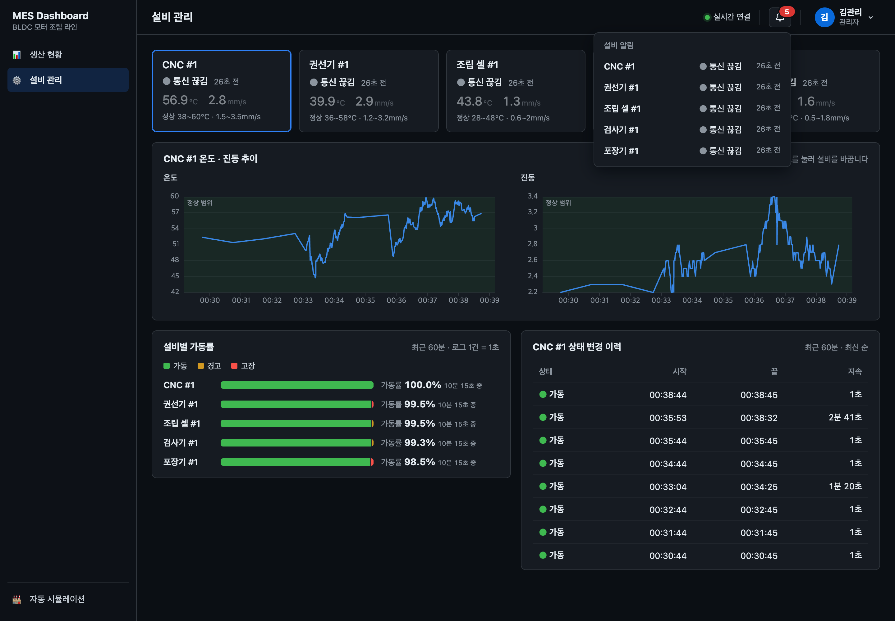
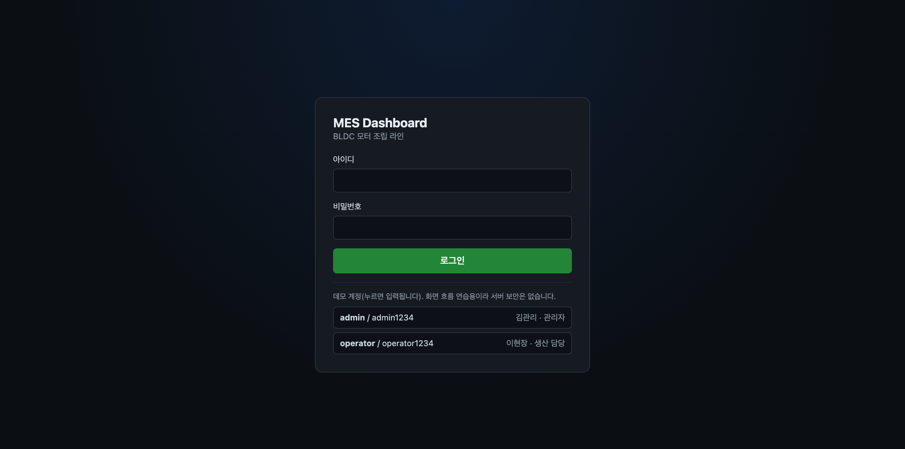
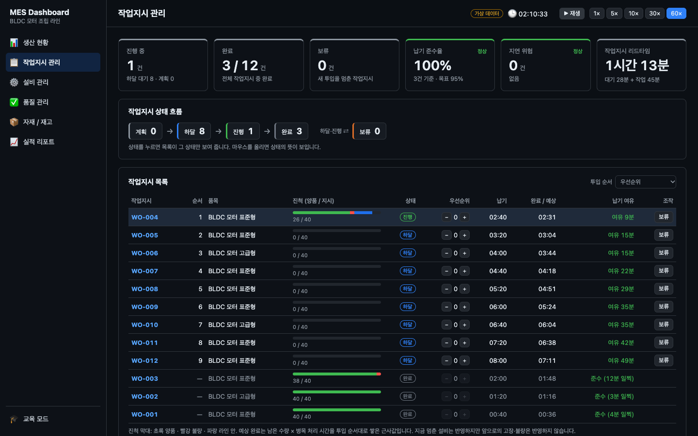
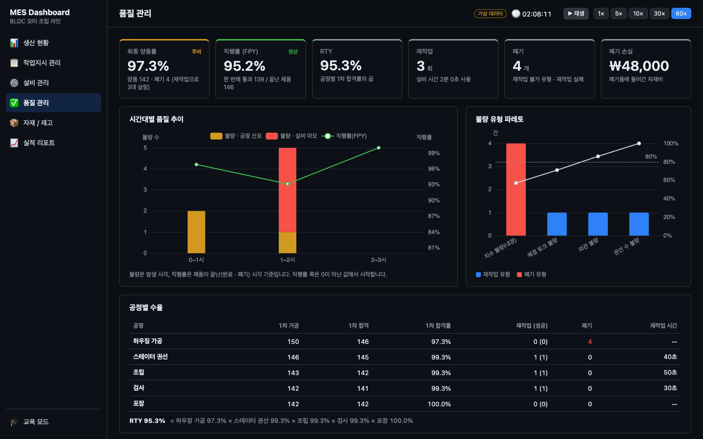

# MES Study — MES 대시보드

실제 제조회사에서 쓸 법한 **MES(생산실행시스템) 대시보드**를 직접 만들면서 MES에 어떤 기능이 있는지, 제조 KPI와 운영 개념이 무엇인지 익히는 학습·포트폴리오 프로젝트입니다.

가상 **BLDC 모터 조립 라인**의 설비 5대(CNC · 권선기 · 조립 셀 · 검사기 · 포장기)가 내는 센서 · 생산 데이터를 서버(Spring Boot · PostgreSQL)에 모으고, 대시보드가 2초마다 조회해서 보여 줍니다.

```
자동 시뮬레이션(3D) ──1초마다 POST──> Spring Boot ──> PostgreSQL ──> 조회 API ──2초마다 GET──> 생산 현황 · 설비 관리
                                     └─ 센서 원본은 메모리 1분 요약(DB) + 1시간 Parquet 파일로
```

## 주요 기능

### 관리자 모드

MES 기능 단위로 메뉴를 나눴습니다. 서버에 저장된 데이터로 채운 화면은 생산 현황 · 작업지시 관리 · 설비 관리 · 품질 관리 네 개이고, 아직 데이터가 없는 메뉴는 사이드바에서 숨겼습니다(주소로는 열리는 빈 페이지). 앞으로의 순서는 [MES 기능 로드맵](docs/plans/mes-roadmap.md)(작업지시 → OEE → 품질, 세 단계 모두 마침)에 있고, 그 뒤로 [비가동 사유](docs/plans/downtime.md)를 붙였습니다.

| 페이지 | MES 기능 | 상태 |
|---|---|---|
| 생산 현황 (`/`) | 생산 모니터링 | 서버 데이터 연결 |
| 작업지시 관리 (`/work-orders`) | 작업지시 · 생산 실행 | 서버 데이터 연결 |
| 설비 관리 (`/equipment`) | 설비 관리 · 보전 | 서버 데이터 연결 |
| 품질 관리 (`/quality`) | 품질 관리 | 서버 데이터 연결 |
| 자재/재고 · 실적 리포트 | – | 숨김(빈 페이지) |

#### 로그인 · 헤더



- **로그인 화면(`/login`)**: 데모 계정 `admin` / `admin1234`(김관리 · 관리자), `operator` / `operator1234`(이현장 · 생산 담당). 로그인하지 않고 대시보드 주소를 열면 로그인 화면으로 가고, 로그인하면 원래 주소로 돌아옵니다. **프론트 화면 흐름 연습용이라 서버 인증은 없습니다**(조회 API는 지금도 열려 있음). 자동 시뮬레이션은 설비 역할이라 로그인 없이 열립니다.
- **서버 연결**: `● 실시간 연결` / `● 연결 끊김 · 마지막 응답 n초 전`
- **설비 알림**: 고장 · 통신 끊김 · 경고 설비 수 배지와 목록. 항목을 누르면 설비 관리에서 그 설비를 선택해 엽니다(`/equipment?equipment=ID`).
- **사용자 메뉴**: 원형 프로필(사진이 없으면 성 한 글자) · 이름 · 역할, 로그아웃. 다른 탭에서 로그아웃하거나 로그아웃 뒤 뒤로 가기로 돌아와도 로그인 화면으로 보냅니다.
- 설비별 최신 로그는 레이아웃에서 2초에 한 번만 조회해 헤더와 페이지가 나눠 씁니다.



모든 화면이 2초마다 조회 API를 다시 부릅니다. 서버가 응답하지 않으면 "서버에 연결할 수 없습니다"를 띄우고 마지막으로 받은 값은 그대로 두며, 서버가 돌아오면 저절로 복구합니다.

#### 생산 현황


- **진행 중 작업지시**: 번호 · 품목, 포장 양품 / 지시 수량 진척, 예상 완료 시각. 진행 중인 지시가 없으면 작업지시 관리로 가는 안내
- **라인 OEE**: 구간(오늘 · 최근 1시간 · 최근 8시간)의 라인 OEE = 포장기 양품 × 병목(조립) 기준 택트 ÷ 계획 가동 시간, 계산 근거 문구, 시간대별 추이 막대(1시간 구간은 5분, 그 밖은 1시간 칸). 작업지시가 없던 칸은 0%가 아니라 빈 칸입니다.
- **요약**: 총 생산(라인 마지막 공정인 포장기 수량), 양품률, 전 공정 불량 합계, 가동 설비(RUN이면서 5초 안에 수신), 마지막 센서 수신 시각
- **설비별 실적 표 · 막대 차트**: 진행 중 작업지시의 라인 순서별 총수량 · 양품 · 불량 · 불량률. 실적은 택트 타임마다 늘어납니다.

#### 작업지시 관리



- **흐름**: 등록(계획) → 하달 → 진행 → 완료, 하달 · 진행 중에는 보류할 수 있고 보류 해제하면 다시 하달 상태가 됩니다. 상태에서 할 수 없는 버튼은 보이지 않고, 서버도 409로 거절합니다.
- **진행 중 지시는 서버가 고릅니다**: 라인 하나는 한 번에 지시 하나만 생산합니다(DB 부분 유니크 인덱스로 보장). 라인이 비면 하달된 지시 중 우선순위 높은 순 → 하달 빠른 순으로 진행하고, 포장기 양품이 지시 수량에 이르면 완료한 뒤 다음 지시로 넘어갑니다.
- **목록**: 상태별 개수(누르면 그 상태만), 품목 · 진척(포장 양품 / 지시) · 우선순위 · 납기(지났으면 "지연") · 상태 · 하달/보류/보류 해제 버튼
- **상세**: 등록 · 하달 · 시작 · 완료 시각, 예상 완료(남은 수량 × 병목 기준 택트, 예상이 납기 뒤면 "지연 위험"), 공정별 양품 진척과 공정 사이 재공, 그 지시가 진행 중이던 시간만의 라인 · 설비별 OEE. 선택한 지시는 주소(`?workOrder=`)에 남습니다.

#### 설비 관리


- **상태 카드**: 상태(가동 · 대기 · 경고 · 고장, 3D와 같은 색) · 온도 · 진동 · 정상 범위. 범위를 벗어난 값은 빨간색, 5초 넘게 수신이 없으면 "통신 끊김". 카드를 누르면 아래 내용이 그 설비로 바뀝니다.
- **설비별 OEE**: OEE와 가동률 · 성능 · 품질 막대(값을 글자로 같이 표시), 가장 큰 손실(고장 · 대기 · 속도 저하 · 불량, 초). 구간은 생산 현황과 같이 씁니다. 아래 [OEE 계산](#oee-계산) 참고.
- **비가동**: 고장(DOWN)이 이어진 동안을 정지 한 건으로 묶어 사유를 받습니다.
  - 알람이 있는 고장은 알람에 연결된 사유가 **자동**으로 붙습니다(예: 포장재 소진 → 자재 결품).
  - 알람 없이 60초 이상 멈춘 정지는 **사유 입력 대기**로 목록에 남고, 작업자가 대분류별 선택 상자에서 사유를 고릅니다. 자동 사유도 고칠 수 있고, 입력자(로그인 이름) · 시각이 남습니다.
  - 60초 미만 정지(주로 불량 뒤 3~5초)는 **순간 정지**로 묶고 사유를 받지 않습니다.
  - 사유 파레토(정지 시간 많은 순, 누적 80%까지 굵게, 사유 미입력 · 순간 정지는 뒤에 따로)와 KPI(정지 시간 · 정지 수 · 사유 미입력 · 순간 정지). 구간은 OEE와 같이 씁니다. 설계: [downtime.md](docs/plans/downtime.md)
- **온도 · 진동 추이**: 선택한 설비의 최근 10분, 정상 범위를 띠로 표시. 단위가 달라 차트를 둘로 나눴습니다.
- **상태 비율**: 설비별 최근 60분 상태 비율(로그 1건 = 1초). 작업지시가 없던 대기도 들어가는 단순 비율이라 OEE 가동률과 다릅니다.
- **상태 변경 이력**: 선택한 설비의 최근 60분 상태 구간(`LAG` 윈도 함수). 5초 넘게 수신이 끊긴 곳도 구간을 나눕니다.

#### 품질 관리



- **요약 카드**: 직행률(공정별 합격률의 곱), 양품률(완성품 ÷ (완성품 + 불량)), 불량 수(전 공정), 완성품(포장 양품). 구간은 생산 현황 · 설비 관리의 OEE 구간과 같이 씁니다.
- **불량 유형 파레토**: 많은 순서의 가로 막대와 "n개 · 누적 n%". 누적 80%를 채우는 유형은 굵게 보입니다. 누적 % 선은 세로축이 두 개가 되어 그리지 않았습니다. 유형 기록 전에 난 불량은 "미분류"로 맨 뒤에 둡니다.
- **시간대별 불량률**: 전 공정 불량 ÷ 생산(칸은 OEE 추이와 같음). 생산이 없던 칸은 빈 칸입니다.
- **공정별 합격률 · 작업지시별 불량**: 공정마다 생산 · 양품 · 불량 · 합격률 막대, 구간 안에 생산한 작업지시의 완성품 · 불량 · 가장 많은 유형. 설계: [quality.md](docs/plans/quality.md)

#### OEE 계산

OEE(설비 종합 효율) = 가동률 × 성능 × 품질. 시간은 1분 요약의 상태별 초(받은 센서 값 1건 = 1초), 수량은 생산 이벤트로 셉니다. 구간 시작은 분 단위로 내림합니다(최대 1분 차이).

| 값 | 식 |
|---|---|
| 계획 가동 시간 | 작업지시가 진행 중이던 초. 지시가 없어 쉰 시간은 계획 정지라 빼고, 앞 공정을 기다린 대기는 넣는다(가동률 손실) |
| 가동률 | (RUN + WARN 초) ÷ 계획 가동 시간 |
| 성능 | 기준 택트 × 생산 수 ÷ 가동 시간(최대 100%). 경고 중 감속이 손실이 된다 |
| 품질 | 양품 ÷ 생산 수 |
| 라인 OEE | 포장기 양품 × 병목 기준 택트 ÷ 라인 계획 가동 시간 |

분모가 0이면 "–"로 보입니다. 설계와 정한 이유: [oee.md](docs/plans/oee.md)

단계별 계획서는 [docs/plans/](docs/plans/)에 있습니다. 이번 대시보드는 [dashboard-monitoring-api.md](docs/plans/dashboard-monitoring-api.md)이고, 1~7단계 계획서는 삭제한 브라우저 시뮬레이션 엔진 기반 화면의 기록입니다.

### 자동 시뮬레이션

사이드바 아래 **자동 시뮬레이션**(`/simulator`)은 **더미 센서 데이터 발생기(Producer)** 입니다. 열면 서버의 진행 중 작업지시를 생산하며 1초마다 설비 5대의 데이터를 서버로 보냅니다. 3D 화면은 그 데이터를 그대로 보여 줍니다. 대시보드로는 브라우저 뒤로 가기로 돌아옵니다.


- **시작**: `POST /api/v1/producer/runs`로 실행 ID와 진행 중 작업지시 · 설비별 저장 수량을 받아 **그 수량부터 이어 셉니다**(새로 고쳐도 0부터 다시 세지 않음). 서버가 꺼져 있으면 3초마다 다시 시도합니다.
- **전송**: 1초(`setInterval` 1000ms)마다 `POST /api/v1/sensor-logs/bulk`에 실행 ID 헤더(`X-Producer-Run-Id`)를 붙여 보냅니다. 응답에 담긴 진행 중 지시가 바뀌면 그 지시의 저장 수량을 받아 갈아탑니다.
- **한 탭만 전송**: 시뮬레이터를 다른 탭에서 열면 나중 탭이 넘겨받고, 먼저 탭은 409를 받아 "다른 탭에서 실행 중" 안내와 함께 전송을 멈춥니다("이 탭에서 다시 시작"으로 되찾기).
- **데이터**: 설비별 `equipmentId`, `timestamp`(ISO, 밀리초 포함), `status`, `alarmCode`(알람 고장 중일 때만), `workOrderId`, `metrics`(온도 · 진동), `production`(누적 총수량 · 양품 · 불량, `defects`: 유형 코드별 누적 불량). 진행 중 지시가 없으면 `workOrderId` · `production`을 빼고 보냅니다.
- **센서 주기(1초)**: 온도 · 진동은 직전 값에서 매초 조금씩(정상 범위 폭의 ±5% 안) 움직이고, 설비별 정상 범위를 벗어나지 않습니다(소수점 첫째 자리).
- **라인 생산(공정 연결)**: 뒤 공정은 앞 공정이 넘겨준 양품이 있어야 1개를 투입하고, 택트 타임(CNC 45초 · 권선 40초 · 조립 50초 · 검사 30초 · 포장 25초) 뒤 완성합니다(95% 양품 · 5% 불량, 불량은 뒤로 넘어가지 않음). 첫 공정은 불량으로 버려진 만큼 더 투입해 결국 지시 수량을 정확히 채웁니다. 가장 느린 조립이 병목이 됩니다.
- **불량 유형**: 불량이 나면 그 설비의 유형 2개 중 하나를 비중대로 고릅니다(예: 조립은 체결 불량 70% · 부품 누락 30%). 유형 목록은 서버 기준정보(`defect_type`)와 같고, 다시 시작하면 저장된 유형별 수부터 이어 셉니다.
- **상태**: 가공 중이면 `RUN`, 만들 것이 없으면(지시 없음 · 앞 공정 양품 대기) `IDLE`. 불량이 나면 `WARN` 또는 `DOWN`(반반)으로 3~5초 바뀌고, `DOWN` 동안은 투입 · 가공이 멈춥니다. 가공 중에는 가끔(가공 300초에 한 번꼴) 30~60초짜리 속도 저하 `WARN`이 생기고, `WARN` 동안은 1초에 0.75초분만 가공합니다(OEE 성능 손실).
- **긴 정지**: 가공 중 가끔 60~180초짜리 `DOWN`이 생깁니다. 알람 고장(가공 40분에 한 번꼴)은 설비 알람 2개 중 하나를 `alarmCode`로 같이 보내고, 알람 없는 정지(가공 60분에 한 번꼴, 자재 결품 · 작업자 부재처럼 설비가 모르는 이유)는 코드 없이 보냅니다. 알람 목록은 서버 기준정보(`equipment_alarm`)와 같습니다.
- **3D 표시**: 설비 모델 · 작업자 · 경광등(가동 초록 · 대기 파랑 · 경고 노랑 · 고장 빨강) · 바닥 띠가 상태를 따라 움직이고, 라벨에 온도 · 진동을 보여 줍니다. 위쪽에 생산 중인 작업지시와 진척을 띄웁니다. 출하장은 포장기 양품, 폐기함은 전 설비 불량 합계입니다.

```json
[
  {
    "equipmentId": "CNC_01",
    "timestamp": "2026-10-24T14:53:02.432Z",
    "status": "RUN",
    "workOrderId": "WO-20261028-001",
    "metrics": { "temperature": 49.4, "vibration": 2.8 },
    "production": { "totalCount": 12, "goodCount": 11, "badCount": 1, "defects": { "MACHINING_DIMENSION": 1 } }
  }
]
```

## 기술 스택

| 구분 | 사용 기술 |
|---|---|
| 프레임워크 | Vue 3.5, TypeScript 6.0, Vite 8 |
| 라우팅 | vue-router 5 |
| 3D | three.js, TresJS 5 + cientos |
| 통신 | axios (센서 데이터 전송, 대시보드 2초 폴링) |
| 차트 | ECharts 6 + vue-echarts (선 · 막대만 등록) |
| 테스트·품질 | Vitest 5, ESLint 10 (typescript-eslint, eslint-plugin-vue) |
| 백엔드 | Spring Boot 3.5, Java 17, MyBatis, PostgreSQL(로컬 17.4에서 확인), Gradle |

- 자동 시뮬레이션이 보내는 데이터는 `backend/`의 Spring Boot 서버(`localhost:8080`)가 받아 PostgreSQL에 저장합니다.
- TypeScript 7.0은 typescript-eslint가 아직 지원하지 않아 6.0을 씁니다.

## 실행 방법

Node 22.12 이상이 필요합니다(`.nvmrc` 참고).

```bash
nvm use
cd frontend
npm install
npm run dev        # 개발 서버
npm test           # 단위 테스트 (Vitest)
npm run lint       # 린트
npm run build      # 타입 검사 + 프로덕션 빌드
```

### 백엔드 (센서 로그 수신 서버)

Java 17과 PostgreSQL이 필요합니다. Gradle은 래퍼(`gradlew`)를 쓰므로 따로 설치하지 않아도 됩니다.

1. DB를 만듭니다. `mes`는 개발용, `mes_test`는 테스트 전용입니다.
   ```bash
   createdb mes
   createdb mes_test
   ```
2. 설정 파일을 복사하고 `password`에 로컬 DB 비밀번호를 적습니다. `application.properties`는 `.gitignore`에 있어 커밋되지 않고, 저장소에는 비밀번호 자리를 비운 `application.properties.example`만 올라갑니다. 테스트(`mes_test`)도 같은 계정을 씁니다. 계정 이름이 `postgres`가 아니면 `username`도 고칩니다.
   ```bash
   cp backend/src/main/resources/application.properties.example backend/src/main/resources/application.properties
   ```
3. 실행합니다. 서버가 뜰 때 테이블이 없으면 `schema.sql`로 만들고, 기준정보(품목 2종 · 설비 5대 · 불량 유형 10종 · 비가동 사유 10종 · 설비 알람 10종)를 넣습니다.
   - OEE(2026-10)의 센서 로그 `work_order_id` 열과 `production_event` 테이블은 서버를 다시 켜면 기존 DB에도 생깁니다(지울 필요 없음). 그 전 로그는 작업지시가 NULL이라 OEE 계획 가동 시간에서 빠집니다.
   - 품질(2026-10)의 `defect_type` · `production_defect` · `defect_event` 테이블도 서버를 다시 켜면 생깁니다. 그 전에 난 불량은 유형이 없어 품질 화면에 "미분류"로 보입니다.
   - 비가동(2026-10)의 `downtime_reason` · `equipment_alarm` · `downtime` 테이블도 서버를 다시 켜면 생깁니다. 그 전의 정지는 기록이 없어 비가동 파레토에 들어가지 않습니다.
   - 1분 요약(2026-10)의 `equipment_sensor_minute` · `equipment_status_change` 테이블도 서버를 다시 켜면 생기고, 처음 한 번 기존 `equipment_sensor_log`로 채워집니다(지난 OEE · 상태 이력이 그대로 보임). 원본 테이블은 더 이상 쓰지 않지만 지우지 않습니다. 1초 원본은 서버를 띄운 폴더의 `data/spool`(받는 중) · `data/archive/sensor-log`(1시간 Parquet)에 남습니다(gitignore).
   - 작업지시 추가(2026-10) 전에 만든 DB라면 `production_performance`에 외래 키가 없습니다. 이 테이블을 지우고(`DROP TABLE production_performance;`) 서버를 다시 켜면 외래 키와 함께 다시 만듭니다(옛 실적은 사라짐).
   ```bash
   cd backend
   ./gradlew bootRun   # http://localhost:8080
   ./gradlew test      # 테스트 (mes_test DB 사용)
   ```

프론트 개발 서버(`npm run dev`, `localhost:5173`)에서 자동 시뮬레이션을 열면 1초마다 데이터가 저장됩니다. 작업지시 관리에서 지시를 등록 · 하달하면 생산이 시작됩니다.

| 테이블 | 저장 방식 |
|---|---|
| `item` · `equipment` · `defect_type` | 기준정보: 품목, 설비(라인 순서 · 기준 택트), 설비별 불량 유형 |
| `work_order` | 작업지시. 상태 · 우선순위 · 납기와 하달 · 시작 · 완료 시각. 진행 중은 부분 유니크 인덱스로 최대 1건 |
| `producer_run` | 지금 데이터를 보낼 수 있는 시뮬레이터 실행 ID(행 1개) |
| `equipment_sensor_minute` | 센서 1분 요약: 설비 · 분 · 작업지시마다 1행. 온도 · 진동의 평균(합 ÷ 개수) · 최대 · 최소, 상태별 초(RUN · WARN · DOWN · IDLE), 마지막 값. 서버 메모리에서 모았다가 분이 끝나면 UPSERT로 합친다 |
| `equipment_status_change` | 설비 상태 이력: 상태가 바뀔 때만 1행(시작 · 끝, 진행 중이면 끝이 NULL) |
| `equipment_sensor_log` | (2026-10까지) 1초 원본 시계열. 지금은 넣지 않고 1분 요약을 처음 채울 때만 읽는다 |
| `production_performance` | (작업지시, 설비)마다 한 행(둘 다 외래 키). 최신 누적 수량으로 UPSERT하고, 지금 값보다 작은 수량(늦게 도착한 요청)으로는 덮어쓰지 않음 |
| `production_event` | 누적 수량이 늘 때마다 늘어난 양품 · 불량을 한 행(전송 시각). 구간 · 시간대별 OEE · 품질 생산 수 |
| `production_defect` | (작업지시, 설비, 유형)마다 누적 불량 수 한 행. (설비, 유형) 쌍 외래 키로 다른 설비의 유형을 막음 |
| `defect_event` | 유형별 누적이 늘 때마다 늘어난 수를 한 행. 구간별 불량 유형 파레토 |
| `downtime_reason` · `equipment_alarm` | 기준정보: 비가동 사유(대분류 · 사유), 설비 알람과 알람마다 자동으로 붙일 사유 |
| `downtime` | 정지 한 건: 설비의 DOWN 로그가 5초 안으로 이어지는 동안 한 행(시작 · 마지막 시각, 초 = DOWN 로그 수). 알람 · 사유 · 출처(AUTO · MANUAL) · 입력자 · 입력 시각. (설비, 알람) 쌍 외래 키로 다른 설비의 알람을 막음 |

| API | 내용 |
|---|---|
| `POST /api/v1/producer/runs` | 시뮬레이터 시작(넘겨받기). `runId`와 진행 중 작업지시(설비별 저장 수량 포함) |
| `POST /api/v1/sensor-logs/bulk` | 센서 로그 수신(헤더 `X-Producer-Run-Id` 필수). 정상이면 `200 {"sensorLogs":n,"productions":m,"workOrder":{...}\|null}`, 형식 오류 · 설비에 없는 불량 유형 · 유형별 합이 불량 수 초과 · 설비에 없는 알람 · DOWN이 아닌 행의 `alarmCode`는 400, 밀려난 실행 · 헤더 없음 409 |
| `GET /api/v1/items` · `GET /api/v1/equipment` | 품목 · 설비 기준정보 |
| `GET /api/v1/work-orders?status=` | 작업지시 목록 + 진척(포장 양품). `status`는 반복해서 여러 개 |
| `GET /api/v1/work-orders/current` · `/{id}` | 진행 중(없으면 204) · 한 건 상세(설비별 수량 · 유형별 누적 불량), 없는 번호는 404 |
| `POST /api/v1/work-orders` | 등록 `{itemCode, plannedQty(1~10000), priority?(0~9), dueAt?}` → 201 |
| `POST /api/v1/work-orders/{id}/release` · `hold` · `resume` | 하달 · 보류 · 보류 해제. 지금 상태에서 안 되면 409 |
| `GET /api/v1/oee?range=today\|1h\|8h` | 구간의 라인 OEE와 설비별 가동률 · 성능 · 품질 · 손실 초(기본 `today`, 그 밖은 400) |
| `GET /api/v1/oee/trend?range=` | 시각 칸마다 라인 OEE(1시간은 5분, 그 밖은 1시간 칸, 서울 기준 정각). 지시가 없던 칸은 없음 |
| `GET /api/v1/work-orders/{id}/oee` | 작업지시 하나의 OEE(그 지시가 진행 중이던 시간만), 없는 번호는 404 |
| `GET /api/v1/quality?range=today\|1h\|8h` | 구간의 직행률 · 양품률 · 불량 수 · 완성품, 공정별 합격률, 불량 유형 파레토(누적 비율 · 미분류), 작업지시별 불량 |
| `GET /api/v1/quality/trend?range=` | 시각 칸마다 불량률(전 공정). 생산이 없던 칸은 없음 |
| `GET /api/v1/downtime-reasons` | 비가동 사유 목록(대분류 · 순서) |
| `GET /api/v1/downtimes/summary?range=` | 구간의 정지 시간 · 정지 수(60초 이상) · 사유 미입력 · 순간 정지와 사유 파레토(누적 비율) |
| `GET /api/v1/downtimes?range=&pending=true` | 구간의 60초 이상 · 진행 중 정지 목록(진행 중 먼저 · 최근 순). `pending=true`면 사유 없는 것만 |
| `PUT /api/v1/downtimes/{id}/reason` | 사유 입력 · 고치기 `{reasonCode, enteredBy}` → 출처 MANUAL. 없는 정지 404, 없는 사유 · 빈 입력자 400 |
| `GET /api/v1/equipment/latest` | 설비별 최신 로그 1건(메모리. 서버를 막 띄워 비었으면 1분 요약의 마지막 값) |
| `GET /api/v1/equipment/{id}/sensor-logs?minutes=10` | 설비 하나의 최근 로그(시간순). 10분 이하는 메모리의 1초 값, 넘으면 1분마다 평균 1점 |
| `GET /api/v1/equipment/status-summary?minutes=60` | 설비 · 상태별로 머문 초(1분 요약 + 메모리) |
| `GET /api/v1/equipment/{id}/status-changes?minutes=60` | 설비 하나의 상태 구간(최신 순, 상태 이력 테이블) |
| `GET /api/v1/production-performance` | 작업지시 · 설비별 누적 실적 |

조회 API의 `minutes`는 1~1440만 받고, 벗어나거나 숫자가 아니면 400입니다. 설계: [수신 API](docs/plans/backend-sensor-log-api.md) · [조회 API](docs/plans/dashboard-monitoring-api.md) · [1분 요약](docs/plans/sensor-rollup.md) · [작업지시](docs/plans/work-order.md) · [OEE](docs/plans/oee.md) · [품질](docs/plans/quality.md) · [비가동](docs/plans/downtime.md)

### 센서 저장 구조 개선: 1분 요약 · 원본 아카이브

설비가 수십 ~ 수천 대로 늘어도 버티도록, 1초마다 DB에 1행씩 넣던 센서 원본을 **서버 메모리에서 1분 요약으로 모아 분마다 1행만** 넣고, 1초 원본은 **1시간 단위 Parquet 파일**로 보관하게 바꿨습니다. 먼저 k6로 설비 5 ~ 2,000대를 재현해 문제를 숫자로 남기고(Before), 같은 조건으로 다시 쟀습니다(After).

| 지표 | Before | After |
|---|---:|---:|
| 센서 저장량(설비 50대 × 7일) | 4,163MB | **129MB**(1/32) |
| 1초 원본 1건 보관 | DB 144B | **Parquet 3.2B** |
| DB WAL(설비 200대) | 57.8KB/초 | **2.1KB/초** |
| 수신 응답 p99(설비 2,000대) | 715ms | **2.7ms** |
| OEE 7일 조회 | 2,563ms | **47ms** |
| OEE 정확도 · `kill -9` 뒤 요약 | — | 원본과 같음 · 손실 0 |

- p99는 응답 시간을 빠른 순서로 늘어놓았을 때 99번째 백분위 값입니다. p99 715ms는 100건 중 1건이 715ms보다 느렸다는 뜻입니다.
- 측정해 보니 일부 요청이 1초까지 느려진 원인은 DB 쓰기가 아니라, **모든 수신 요청이 하나씩 차례로 지나가야 하는 라인 잠금**이었습니다(연결 10개 중 9개 대기). 센서만 보낸 요청은 작업지시를 바꾸지 않으므로 이 잠금을 건너뛰고 설비별 잠금만 잡게 바꿨습니다.
- 서버가 죽어도 먼저 디스크에 남긴 스풀 파일로 요약을 다시 만듭니다(Redis · Kafka 없이 서버 한 대 기준).

문제 → 근거(캡처) → 원인 → 선택지 비교 → 해결 → 결과: [docs/experiments/sensor-rollup/](docs/experiments/sensor-rollup/README.md) · 계획: [docs/plans/sensor-rollup.md](docs/plans/sensor-rollup.md)

### 센서 로그 인덱스 비교 실험

> 1분 요약(위) 전의 원본 테이블 실험입니다. 지금 대시보드 조회는 메모리 · 1분 요약 · 상태 이력을 읽습니다.

센서 로그는 1초에 5행씩 계속 쌓이고, 대시보드는 2초마다 "최근 n분"을 읽습니다. 어떤 인덱스가 맞는지 302만 행(설비 5대 · 50대 두 가지) × 인덱스 5단계 × 쿼리 5개를 `EXPLAIN (ANALYZE, BUFFERS)`로 비교했습니다.


- **`recorded_at DESC` 단일 인덱스**를 골랐습니다. 조회 4개가 40~870ms에서 0.02~3.8ms로 줄었습니다.
- `(equipment_id, recorded_at)` 복합 인덱스는 설비 5대에서는 이득이 작고 설비 조건이 없는 조회에 쓰이지 않았습니다(설비 50대에서는 12배 차이).
- `equipment_id` 단일 인덱스는 값이 5종뿐이라 오히려 1.5배 느려졌습니다.
- 설비별 최신 1건은 `DISTINCT ON`(2.5초) 대신 `LATERAL ... LIMIT 1`(0.02ms)로 정했습니다.

결과 · 실행 계획 원문 · 해석: [docs/experiments/sensor-log-index/](docs/experiments/sensor-log-index/README.md)

## 아키텍처

```
자동 시뮬레이션: 시작(POST /producer/runs) ──> 1초마다 라인 진행 (producer/) ──┬─> POST /sensor-logs/bulk (+ 실행 ID) ──> backend/
                                                                              └─> 3D 화면 (provide/inject)

backend/: SensorLogController ──> ProducerService(실행 ID 확인, 실적이 있으면 라인 잠금) ──> SensorLogService(설비별 잠금, metrics · production 분리, 생산 · 불량 이벤트 · 정지 · 상태 이력)
                                                                         │    └─> SensorArchive(스풀 CSV) · SensorAggregator(메모리 1분 버킷 · 최근 10분)
                                                                         └─> WorkOrderService.advanceLine(완료 판정 → 다음 지시 선택)
          SensorRollupJobs ──> SensorRollupService: 1초마다 끝난 분 → SensorMinuteMapper(UPSERT) · 10초마다 끝난 시간 스풀 → Parquet · 시작할 때 스풀로 복구
          WorkOrderController ──> WorkOrderService(등록 · 상태 전환, 라인 잠금) ──> WorkOrderMapper
          OeeController ──> OeeService(구간 · 비율 계산) ──> SensorRollupService(상태 초: 요약 + 메모리) · OeeMapper(개수 합계 SQL)
          QualityController ──> QualityService(직행률 · 파레토 계산) ──> QualityMapper(유형 · 작업지시별 합계) · OeeMapper(설비별 개수)
          DowntimeController ──> DowntimeService(파레토 계산 · 사유 입력) ──> DowntimeQueryMapper(겹친 초 합계 · 목록)
          QueryController ──> QueryService(기간 검사) ──> SensorRollupService(최신 · 10분: 메모리, 상태 비율: 요약, 이력: 상태 이력) · ProductionQueryMapper

대시보드: usePolling(2초) ──> api/dashboard.ts · api/workOrders.ts · api/oee.ts · api/quality.ts · api/downtime.ts (axios) ──> 조회 · 작업지시 API
          views/ ──> dashboard/ (계산 함수 · 카드 · 차트)
```

- 대시보드 첫 화면에는 three.js가 들어가지 않습니다. 3D 코드는 자동 시뮬레이션 화면이 열릴 때 따로 불러옵니다.
- 앞 요청이 끝나지 않았으면 다음 폴링은 건너뛰어, 서버가 느려도 요청이 쌓이지 않습니다.
- 작업지시 상태를 바꾸는 트랜잭션(하달 · 보류 · 실적이 있는 1초 전송의 완료 판정)은 PostgreSQL advisory lock(라인 잠금)으로 한 번에 하나씩 돌아, 다음 지시 고르기가 겹치지 않습니다. 센서만 온 전송은 지시를 바꾸지 않으므로 설비별 잠금만 잡아 서로 기다리지 않습니다.

### 폴더 구조

```
frontend/src/
├── router.ts     # 페이지 라우팅 (관리자 모드 페이지 + 전체 화면 로그인 · 자동 시뮬레이션), 로그인 검사
├── auth/         # 데모 계정, 로그인 상태(localStorage), 로그인 검사 · redirect
├── layout/       # 관리자 모드 레이아웃: 사이드바, 헤더(페이지 제목 · 서버 연결 · 설비 알림 · 사용자 메뉴)
├── views/        # 페이지: 생산 현황, 작업지시 관리, 설비 관리, 품질 관리, (숨김) 자재 · 리포트, 자동 시뮬레이션
├── api/          # 조회 · 작업지시 · 시뮬레이터 API 호출 함수 · 응답 타입 (axios)
├── composables/  # usePolling(2초 폴링), useNow(1초 시계), useDisclosure(드롭다운 여닫기)
├── charts/       # ECharts 등록(선 · 막대), 차트 색
├── dashboard/    # 대시보드 계산 함수와 컴포넌트(상태 카드, 추이 · 실적 차트, 상태 비율, 작업지시 진척 · 등록 폼, OEE 표 · 추이 · 구간 선택, 파레토 막대(불량 유형 · 비가동 사유 공통) · 불량률 추이, 정지 목록 · 사유 입력, 연결 안내)
├── producer/     # 자동 시뮬레이션: 설비 정의, 더미 센서 데이터 생성, 라인 공정 연결, 시작 · 1초 전송(axios), seed 난수
└── scene/        # 3D 장면(TresJS): 라인 배치, 설비 모델, 사람, 컨베이어, 자재 랙
```

```
backend/src/main/
├── java/com/messtudy/backend/
│   ├── controller/   # 수신(SensorLogController, ProducerController) · 작업지시(WorkOrderController) · OEE · 품질 · 비가동 · 기준정보 · 조회
│   ├── service/      # 수신: 실행 ID · 분리 · 검증 · 트랜잭션 / 센서: 메모리 1분 요약 · 스풀 · Parquet · 복구 / 작업지시: 등록 · 상태 전환 · 다음 지시 선택 / OEE · 품질 · 비가동: 비율 계산 · 사유 입력 / 조회: 기간 검사
│   ├── mapper/       # MyBatis 매퍼: 다중 INSERT, UPSERT(1분 요약 합치기 · 덮어쓰기), 조건부 상태 전환 UPDATE, 조회 SQL(LATERAL, date_bin)
│   └── config/       # CORS(GET · POST · PUT), 400 · 404 · 409 오류 응답
└── resources/
    ├── application.properties.example  # 복사해서 application.properties로 씀(실제 파일은 커밋 안 함)
    ├── schema.sql    # 기준정보(불량 유형 · 비가동 사유 · 설비 알람 포함) · 작업지시 · 시뮬레이터 실행 · 수신 테이블, 인덱스, 기준정보 시드
    └── mapper/       # 매퍼 SQL(XML)

backend/sql/bench/    # 인덱스 비교 실험 SQL · 실행 스크립트(서버는 실행하지 않음)
bench/sensor-rollup/  # 1분 요약 Before/After 측정: k6 부하 · pgbench · 3,024만 행 조회 · 정확도 · kill -9 복구 · 캡처 스크립트
```

## 개발 방식

### 브랜치 전략

| 브랜치 | 역할 | 규칙 |
|---|---|---|
| `main` | 배포 브랜치 | 직접 커밋 금지. `dev` 또는 `hotfix/*`에서 PR로만 병합하고, 병합 시 버전 태그(`v0.1.0` 등)를 붙인다 |
| `dev` | 개발 통합 브랜치 | 기능 브랜치의 PR 대상. 항상 빌드·테스트가 통과하는 상태를 유지한다 |
| `feature/<모듈 이름>` | 기능 개발 | `dev`에서 분기 → PR로 `dev`에 병합 → 브랜치 삭제 |
| `hotfix/<작업명>` | 배포본 긴급 수정 | `main`에서 분기 → `main`과 `dev` 양쪽에 병합 |

기능을 만들기 전에 [docs/plans/](docs/plans/)에 계획서(목표, 아키텍처, 완료 기준)를 먼저 쓰고, 구현하면서 바뀐 점도 같은 문서에 기록합니다.

### 커밋 메시지 규칙

[Conventional Commits](https://www.conventionalcommits.org/ko/v1.0.0/) 형식을 따릅니다.

```
<type>(<scope>): <요약>
```

- type: `feat`, `fix`, `refactor`, `test`, `docs`, `chore`, `style`, `perf`
- scope: `dashboard`, `simulator`, `scene`, `backend` 등
- 예: `feat(backend): 센서 로그 수신 API 추가`
