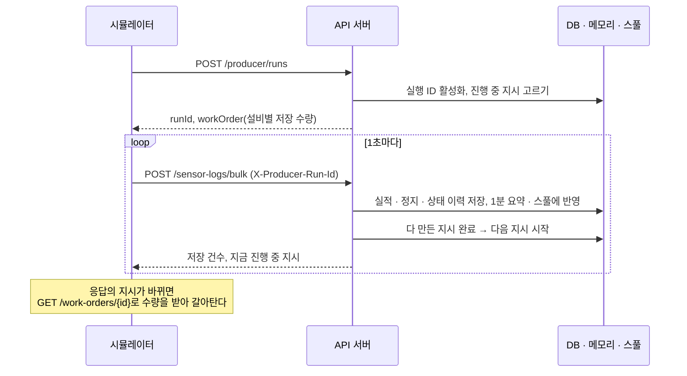
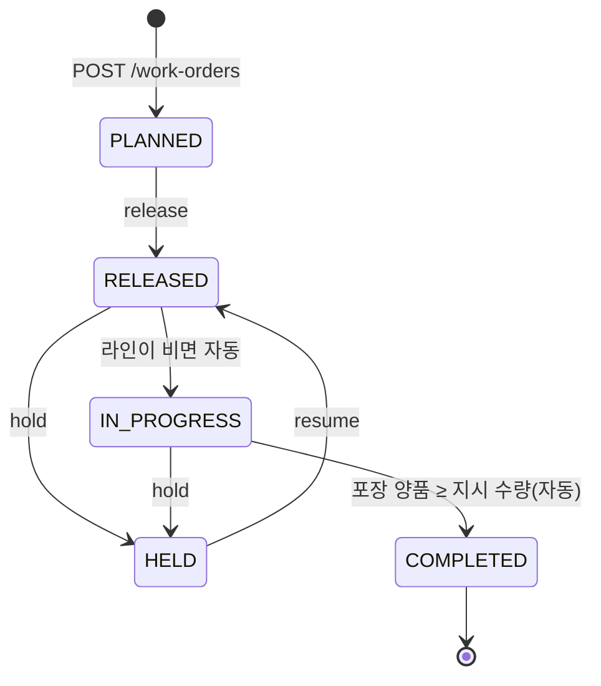

# API 문서

백엔드(Spring Boot)가 제공하는 REST API의 요청 · 응답 형식입니다. 엔드포인트 한 줄 요약은 [README](../README.md#백엔드-센서-로그-수신-서버)에 있고, 여기에는 필드 설명 · 예시 · 오류를 적습니다.
예시 응답은 개발 서버에서 실제로 받은 값이며, 목록은 앞 1~2건만 남겼습니다.

## 공통

| 항목 | 내용 |
|---|---|
| 기본 주소 | `http://localhost:8080/api/v1` |
| 형식 | 요청 · 응답 모두 JSON(UTF-8) |
| 인증 | 없음. 대시보드 로그인은 프론트에서만 하는 데모 기능이라 API는 누구나 부를 수 있습니다 |
| CORS | `app.cors.allowed-origins`(기본 `http://localhost:5173`)에서 오는 `GET` · `POST` · `PUT`만 허용 |
| 시각 | ISO 8601, 시간대 오프셋 포함. DB에서 읽은 시각은 `+00:00`(UTC), 조회 구간 `from` · `to`는 `+09:00`(서울)으로 나옵니다. 오프셋을 보고 해석하세요 |
| 비율 | 0~1 소수. 분모가 0이면 `null`(화면에서는 "–") |

### 조회 구간 `range`

OEE · 품질 · 비가동 조회는 같은 구간 값을 씁니다. 없으면 `today`입니다.

| 값 | 구간 | 추이(`/trend`) 칸 크기 |
|---|---|---|
| `today` | 서울 기준 오늘 00:00 ~ 지금 | 1시간(3600초) |
| `1h` | 지금 − 1시간 ~ 지금 | 5분(300초) |
| `8h` | 지금 − 8시간 ~ 지금 | 1시간(3600초) |

칸은 서울 기준 정각에 맞춥니다. 생산(OEE는 작업지시)이 없던 칸은 `points`에 들어가지 않습니다.

### 오류 응답

오류는 모두 `{"message": "이유"}` 한 가지 모양입니다.

| 코드 | 언제 | 예시 |
|---|---|---|
| 400 | 필수 값 없음 · 형식 오류 · 범위 밖 · DB 제약 위반(글자 수 · 숫자 범위 · 없는 코드) | `{"message":"range: today · 1h · 8h 중 하나여야 합니다(2d)"}` |
| 404 | 없는 작업지시 · 정지 | `{"message":"작업지시가 없습니다(NOPE)"}` |
| 409 | 지금 상태에서 할 수 없는 전환, 밀려난 시뮬레이터의 전송 | `{"message":"다른 시뮬레이터가 실행 중입니다. 이 시뮬레이터를 쓰려면 다시 시작하세요"}` |

---

## 1. 시뮬레이터 수신

3D 시뮬레이터(설비 역할)가 시작할 때 실행 ID를 받고, 그 뒤 1초마다 설비 5대의 데이터를 한 요청으로 보냅니다.
데이터는 마지막에 시작한 시뮬레이터 하나만 보낼 수 있습니다(다른 탭에서 시작하면 앞 탭은 409를 받고 멈춥니다).



### `POST /producer/runs` — 시작(넘겨받기)

본문 없음. 새 실행 ID를 활성으로 만들고, 진행 중 지시가 없으면 하달된 지시 중 하나를 진행으로 올립니다.

```json
{
  "runId": "5b0c1f3e-6a0d-4f0e-9f57-2a3d0c8e1b44",
  "workOrder": null
}
```

`workOrder`는 진행 중 지시가 있으면 [작업지시 상세](#get-work-ordersworkorderid--상세)와 같은 모양입니다. 시뮬레이터는 `performance[]`의 수량부터 이어 셉니다.

### `POST /sensor-logs/bulk` — 1초 데이터

헤더 `X-Producer-Run-Id: {runId}`가 필요합니다. 본문은 설비별 데이터 배열입니다.

```json
[
  {
    "equipmentId": "CNC_01",
    "timestamp": "2026-10-30T08:15:02.120Z",
    "status": "RUN",
    "metrics": { "temperature": 48.2, "vibration": 2.3 },
    "workOrderId": "WO-20261030-001",
    "production": {
      "totalCount": 12,
      "goodCount": 11,
      "badCount": 1,
      "defects": { "MACHINING_DIMENSION": 1 }
    }
  },
  {
    "equipmentId": "WINDER_01",
    "timestamp": "2026-10-30T08:15:02.120Z",
    "status": "DOWN",
    "alarmCode": "WINDER_WIRE_BREAK",
    "metrics": { "temperature": 41.0, "vibration": 1.9 },
    "workOrderId": "WO-20261030-001",
    "production": { "totalCount": 10, "goodCount": 10, "badCount": 0 }
  }
]
```

| 필드 | 필수 | 설명 |
|---|---|---|
| `equipmentId` | O | 설비 ID(`GET /equipment`) |
| `timestamp` | O | 측정 시각(오프셋 포함 ISO 8601) |
| `status` | O | `RUN` 가동 · `WARN` 경고 · `DOWN` 고장/정지 · `IDLE` 대기 |
| `metrics.temperature` · `metrics.vibration` | `metrics`는 O, 값은 선택 | 숫자. `NUMERIC(5,2)` 범위를 넘으면 400 |
| `alarmCode` | 선택 | `DOWN`일 때만. 그 설비의 알람 코드여야 하며, 알람에 묶인 사유가 정지에 자동으로 붙습니다 |
| `workOrderId` · `production` | 둘 다 있거나 둘 다 없음 | 진행 중 지시가 없으면(설비 대기) 둘 다 뺍니다 |
| `production.totalCount` · `goodCount` · `badCount` | O | **누적** 수량(0 이상 정수). 서버는 늘어난 만큼만 생산 이벤트로 남기고, 지금보다 작은 값으로는 덮어쓰지 않습니다 |
| `production.defects` | 선택 | `{불량 유형 코드: 누적 수}`. 합은 `badCount` 이하, 코드는 그 설비의 유형이어야 합니다 |

**응답 200**

```json
{ "sensorLogs": 5, "productions": 5, "workOrder": { "workOrderId": "WO-20261030-001", "plannedQty": 40 } }
```

| 필드 | 설명 |
|---|---|
| `sensorLogs` | 받은 센서 값 수. 같은 설비의 마지막으로 받은 시각 이하인 행(재전송 · 늦게 온 요청)은 버리고 세지 않습니다 |
| `productions` | 추가 · 갱신한 실적 행 수 |
| `workOrder` | 처리 뒤 진행 중인 지시(없으면 `null`). 이 요청으로 지시가 완료되면 다음 지시가 담깁니다 |

**오류**: 형식 오류 · 유형별 합 > `badCount` · `DOWN`이 아닌 행의 `alarmCode` · 설비에 없는 유형/알람 코드 → 400(아무것도 저장하지 않음). 헤더 없음 · 밀려난 실행 ID → 409.

> 같은 설비의 요청이 겹쳐 순서가 바뀌면 앞선 초가 버려지므로, 시뮬레이터는 앞 요청이 끝난 뒤 다음 요청을 보냅니다(늦어진 초는 다음 요청에 함께 담음).

---

## 2. 기준정보

### `GET /items` — 품목

```json
[
  { "itemCode": "MOTOR_A", "itemName": "BLDC 모터 표준형 A" },
  { "itemCode": "MOTOR_B", "itemName": "BLDC 모터 고출력형 B" }
]
```

### `GET /equipment` — 설비(라인 순서)

```json
[
  { "equipmentId": "CNC_01", "equipmentName": "CNC #1", "workCenterName": "하우징 가공", "lineOrder": 1, "standardTactSec": 45 },
  { "equipmentId": "WINDER_01", "equipmentName": "권선기 #1", "workCenterName": "스테이터 권선", "lineOrder": 2, "standardTactSec": 40 }
]
```

`standardTactSec`: 1개를 만드는 기준 시간(초). OEE 성능 계산에 씁니다.

---

## 3. 설비 모니터링

센서 원본은 DB에 넣지 않고 서버 메모리(최근 10분) · 1분 요약 테이블 · Parquet 파일에 나눠 둡니다([설계](plans/sensor-rollup.md)). 아래 조회는 메모리와 1분 요약을 합쳐 답합니다.
`minutes`는 1~1440이며, 벗어나거나 숫자가 아니면 400입니다.

### `GET /equipment/latest` — 설비별 최신 로그 1건

```json
[
  { "equipmentId": "ASSEMBLY_01", "recordedAt": "2026-10-28T17:03:44.385+00:00", "status": "RUN", "temperature": 31.2, "vibration": 0.8 },
  { "equipmentId": "CNC_01", "recordedAt": "2026-10-28T17:03:44.385+00:00", "status": "RUN", "temperature": 39.6, "vibration": 3.3 }
]
```

메모리의 마지막 값이고, 서버를 막 띄워 메모리가 비었으면 1분 요약의 마지막 값입니다. 화면은 `recordedAt`이 5초보다 오래되면 "통신 끊김"으로 봅니다.

### `GET /equipment/{equipmentId}/sensor-logs?minutes=10` — 최근 로그(시간순)

```json
[
  { "recordedAt": "2026-10-30T08:15:01.120Z", "status": "RUN", "temperature": 48.1, "vibration": 2.3 },
  { "recordedAt": "2026-10-30T08:15:02.120Z", "status": "RUN", "temperature": 48.2, "vibration": 2.3 }
]
```

10분 이하는 1초 원본, 10분을 넘으면 1분마다 평균 1점입니다(`status`는 그 분의 마지막 상태). 없는 설비는 빈 배열입니다.

### `GET /equipment/status-summary?minutes=60` — 설비 · 상태별 머문 초

```json
[
  { "equipmentId": "CNC_01", "status": "DOWN", "seconds": 8 },
  { "equipmentId": "CNC_01", "status": "RUN", "seconds": 3592 }
]
```

로그 1건 = 1초입니다. 0초인 상태는 빠집니다.

### `GET /equipment/{equipmentId}/status-changes?minutes=60` — 상태 구간(최신부터)

```json
[
  { "status": "RUN", "startedAt": "2026-10-30T08:10:05Z", "endedAt": null, "seconds": 297 },
  { "status": "DOWN", "startedAt": "2026-10-30T08:08:00Z", "endedAt": "2026-10-30T08:10:05Z", "seconds": 125 }
]
```

`endedAt`이 `null`이면 진행 중입니다. 5초 넘게 로그가 끊기면 마지막 로그 + 1초에 끝난 것으로 보입니다. 첫 구간의 시작은 조회 시작 시각으로 자릅니다.

---

## 4. 작업지시



- 진행 중(`IN_PROGRESS`)은 라인에 최대 1건입니다.
- 라인이 비면 하달된 지시 중 **우선순위 높은 순 → 처음 하달한 순**으로 하나를 진행으로 올립니다. 등록 · 전환 · 1초 수신 때마다 확인합니다.
- 완료 판정의 실적은 마지막 공정(포장기)의 양품 수(`completedQty`)입니다.

### `GET /work-orders?status=RELEASED&status=HELD` — 목록

`status`는 반복해서 여러 개를 줄 수 있고, 없으면 전체입니다. 최대 200건이며, 진행 → 하달 → 보류 → 계획 → 완료(최근 완료 순) 순서입니다. 그 안에서는 우선순위, 하달 순으로 정렬합니다.

```json
[
  {
    "workOrderId": "WO-20261028-001",
    "itemCode": "MOTOR_A",
    "itemName": "BLDC 모터 표준형 A",
    "plannedQty": 40,
    "completedQty": 25,
    "status": "IN_PROGRESS",
    "priority": 5,
    "dueAt": null,
    "createdAt": "2026-10-27T16:13:28.362+00:00",
    "releasedAt": "2026-10-27T16:13:28.447+00:00",
    "startedAt": "2026-10-27T16:13:28.447+00:00",
    "completedAt": null
  }
]
```

| 필드 | 설명 |
|---|---|
| `status` | `PLANNED` 계획 · `RELEASED` 하달 · `IN_PROGRESS` 진행 · `HELD` 보류 · `COMPLETED` 완료 |
| `priority` | 0~9, 클수록 먼저 |
| `completedQty` | 마지막 공정(포장기) 양품 수 = 실적 |
| `releasedAt` · `startedAt` | 처음 하달 · 처음 진행된 시각. 보류 뒤에도 바뀌지 않아 원래 순서를 지킵니다 |

알 수 없는 `status` → 400.

### `GET /work-orders/{workOrderId}` — 상세

목록 한 행에 설비별 수량(`performance`, 라인 순서)을 붙입니다.

```json
{
  "workOrderId": "WO-20261028-001",
  "status": "IN_PROGRESS",
  "plannedQty": 40,
  "completedQty": 25,
  "…": "목록과 같은 필드",
  "performance": [
    {
      "equipmentId": "CNC_01",
      "equipmentName": "CNC #1",
      "lineOrder": 1,
      "standardTactSec": 45,
      "totalCount": 40,
      "goodCount": 36,
      "badCount": 4,
      "defects": { "MACHINING_SURFACE": 1, "MACHINING_DIMENSION": 3 }
    }
  ]
}
```

`defects`: 유형 코드별 누적 불량(없으면 `{}`). 없는 번호 → 404.

### `GET /work-orders/current` — 진행 중 지시

상세와 같은 모양입니다. 진행 중인 지시가 없으면 **204**(본문 없음)입니다.

### `POST /work-orders` — 등록

```json
{ "itemCode": "MOTOR_A", "plannedQty": 40, "priority": 7, "dueAt": "2026-10-31T09:00:00+09:00" }
```

| 필드 | 필수 | 설명 |
|---|---|---|
| `itemCode` | O | `GET /items`에 있는 품목 |
| `plannedQty` | O | 1~10,000 정수 |
| `priority` | 선택 | 0~9 정수, 없으면 5 |
| `dueAt` | 선택 | 납기(ISO 8601). 비우면 납기 없음 |

**201**과 함께 상세를 돌려줍니다. 계획(`PLANNED`) 상태로 만들어지며, 번호는 서울 날짜 기준 `WO-YYYYMMDD-001`부터 매깁니다. 값이 틀리면 400입니다.

### `POST /work-orders/{workOrderId}/release` · `/hold` · `/resume` — 상태 전환

본문 없음. 전환 뒤의 상세를 돌려줍니다.

| 동작 | 가능한 상태 | 결과 |
|---|---|---|
| `release` 하달 | `PLANNED` | `RELEASED`. 라인이 비어 있으면 바로 `IN_PROGRESS`가 되어 돌아옵니다 |
| `hold` 보류 | `RELEASED` · `IN_PROGRESS` | `HELD`. 진행 중이던 지시면 다음 지시가 진행됩니다 |
| `resume` 보류 해제 | `HELD` | `RELEASED`(처음 하달 순서를 그대로 씀) |

없는 번호 → 404, 지금 상태에서 할 수 없는 전환 → 409(`"완료 상태인 작업지시는 보류할 수 없습니다(WO-…)"`).

### `GET /production-performance` — 전체 누적 실적

```json
[
  { "workOrderId": "WO-20261027-001", "equipmentId": "CNC_01", "totalCount": 2, "goodCount": 2, "badCount": 0, "lastUpdatedAt": "2026-10-27T06:51:39.065+00:00" }
]
```

모든 (작업지시, 설비)의 현재 누적 수량입니다.

---

## 5. OEE

OEE = 가동률 × 성능 × 품질입니다. 계획 가동 시간은 작업지시가 있던 초만 셉니다. 계산 방법과 정한 이유는 [oee.md](plans/oee.md)에 있습니다.

### `GET /oee?range=today` — 라인 OEE와 설비별 분해

```json
{
  "from": "2026-10-30T16:12:26.732+09:00",
  "to": "2026-10-30T17:12:26.732+09:00",
  "line": {
    "oee": 0.652,
    "plannedSec": 1917,
    "goodCount": 25,
    "bottleneckEquipmentId": "ASSEMBLY_01",
    "bottleneckTactSec": 50
  },
  "equipment": [
    {
      "equipmentId": "CNC_01",
      "equipmentName": "CNC #1",
      "lineOrder": 1,
      "standardTactSec": 45,
      "plannedSec": 1917,
      "runSec": 1909,
      "downSec": 8,
      "idleSec": 0,
      "totalCount": 40,
      "goodCount": 36,
      "badCount": 4,
      "availability": 0.996,
      "performance": 0.943,
      "quality": 0.9,
      "oee": 0.845,
      "loss": { "downSec": 8, "idleSec": 0, "speedSec": 109, "defectSec": 180 }
    }
  ]
}
```

| 필드 | 설명 |
|---|---|
| `line.oee` | 포장기 양품 × 병목(기준 택트가 가장 긴 설비) 택트 ÷ 라인 계획 가동 시간 |
| `plannedSec` | 계획 가동 시간(작업지시가 있던 초) |
| `runSec` | `RUN` + `WARN` 초 |
| `availability` | `runSec` ÷ `plannedSec` |
| `performance` | 총생산 × 기준 택트 ÷ `runSec` |
| `quality` | 양품 ÷ 총생산 |
| `loss` | 손실 초: 고장(`downSec`) · 대기(`idleSec`) · 속도 저하(`speedSec`) · 불량을 만드느라 쓴 시간(`defectSec`) |

### `GET /oee/trend?range=1h` — 시각 칸별 라인 OEE

```json
{
  "from": "2026-10-30T16:12:26.814+09:00",
  "to": "2026-10-30T17:12:26.814+09:00",
  "bucketSec": 300,
  "points": [
    { "bucketStart": "2026-10-30T16:15:00+09:00", "oee": 0.71, "plannedSec": 300, "goodCount": 4, "bottleneckEquipmentId": "ASSEMBLY_01", "bottleneckTactSec": 50 }
  ]
}
```

`points` 한 칸은 `line`과 같은 필드에 `bucketStart`가 붙은 것입니다. 작업지시가 없던 칸은 빠집니다.

### `GET /work-orders/{workOrderId}/oee` — 작업지시 하나의 OEE

`/oee`와 같은 `line` · `equipment`에 `workOrderId`가 붙습니다. `from`은 시작 시각, `to`는 완료 시각(진행 중이면 `null`)입니다. 그 지시가 진행 중이던 시간만 셉니다. 없는 번호 → 404.

---

## 6. 품질

계산 방법은 [quality.md](plans/quality.md)에 있습니다.

### `GET /quality?range=today`

```json
{
  "from": "2026-10-30T00:00:00+09:00",
  "to": "2026-10-30T17:12:26.900+09:00",
  "summary": { "fpy": 0.82, "yield": 0.91, "badCount": 9, "finishedCount": 25 },
  "equipment": [
    { "equipmentId": "CNC_01", "equipmentName": "CNC #1", "lineOrder": 1, "totalCount": 40, "goodCount": 36, "badCount": 4, "passRate": 0.9 }
  ],
  "defects": [
    { "defectCode": "MACHINING_DIMENSION", "defectName": "가공 치수 불량", "equipmentId": "CNC_01", "equipmentName": "CNC #1", "count": 3, "cumulativeRatio": 0.33 },
    { "defectCode": null, "defectName": "미분류", "equipmentId": null, "equipmentName": null, "count": 1, "cumulativeRatio": 1.0 }
  ],
  "workOrders": [
    { "workOrderId": "WO-20261028-001", "itemCode": "MOTOR_A", "status": "IN_PROGRESS", "finishedCount": 25, "badCount": 9, "topDefectName": "가공 치수 불량" }
  ]
}
```

| 필드 | 설명 |
|---|---|
| `summary.fpy` | 직행률 = 생산이 있는 공정들의 합격률(`passRate`) 곱 |
| `summary.yield` | 양품률 = 완성품 ÷ (완성품 + 전 공정 불량) |
| `summary.finishedCount` | 완성품 = 포장기 양품 |
| `defects` | 불량 유형 파레토(많은 순). 유형 없이 난 불량은 `defectCode: null`, "미분류"로 맨 뒤 |
| `workOrders` | 구간 안에 생산이 있던 작업지시. `topDefectName`은 유형 있는 불량이 없으면 `null` |

### `GET /quality/trend?range=today`

```json
{
  "from": "2026-10-30T00:00:00+09:00",
  "to": "2026-10-30T17:12:26.980+09:00",
  "bucketSec": 3600,
  "points": [
    { "bucketStart": "2026-10-30T09:00:00+09:00", "totalCount": 120, "badCount": 6, "defectRate": 0.05 }
  ]
}
```

`defectRate` = 전 공정 불량 ÷ 전 공정 생산. 생산이 없던 칸은 빠집니다.

---

## 7. 비가동

같은 설비의 `DOWN` 로그가 5초 안으로 이어지는 동안을 정지 한 건으로 묶습니다. 60초 이상이면 사유를 받고, 그보다 짧으면 순간 정지입니다. 자세한 내용은 [downtime.md](plans/downtime.md)에 있습니다.

### `GET /downtime-reasons` — 사유 목록(대분류 · 순서)

```json
[
  { "reasonCode": "BREAKDOWN_MECH", "category": "설비 고장", "reasonName": "기계 고장" },
  { "reasonCode": "BREAKDOWN_ELEC", "category": "설비 고장", "reasonName": "전기 · 제어 고장" }
]
```

### `GET /downtimes/summary?range=today` — 요약 · 사유 파레토

```json
{
  "from": "2026-10-30T00:00:00+09:00",
  "to": "2026-10-30T17:12:27.142+09:00",
  "summary": { "downSec": 540, "stopCount": 3, "pendingCount": 1, "pendingSec": 120, "microSec": 60, "reasonSec": 360 },
  "reasons": [
    { "kind": "REASON", "reasonCode": "BREAKDOWN_MECH", "reasonName": "기계 고장", "category": "설비 고장", "seconds": 360, "count": 2, "cumulativeRatio": 0.67 },
    { "kind": "PENDING", "reasonCode": null, "reasonName": "사유 미입력", "category": null, "seconds": 120, "count": 1, "cumulativeRatio": 0.89 },
    { "kind": "MICRO", "reasonCode": null, "reasonName": "순간 정지", "category": null, "seconds": 60, "count": 12, "cumulativeRatio": 1.0 }
  ]
}
```

| 필드 | 설명 |
|---|---|
| `summary.downSec` | 구간 안 전체 정지 시간(초) |
| `summary.stopCount` | 60초 이상 정지 수(사유 있음 + 사유 미입력) |
| `summary.pendingCount` · `pendingSec` | 60초 이상인데 사유가 없는 정지 |
| `summary.microSec` | 60초 미만이고 사유 없는 순간 정지 시간 |
| `reasons[].kind` | `REASON` 사유 있음(시간 많은 순) → `PENDING` 사유 미입력 → `MICRO` 순간 정지 순서 |

### `GET /downtimes?range=today&pending=false` — 정지 목록

60초 이상이거나 진행 중인 정지를 최대 100건 돌려줍니다. 진행 중인 것이 먼저, 그다음 최근 시작 순입니다. `pending=true`면 사유 없는 것만 돌려줍니다.

```json
{
  "from": "2026-10-30T00:00:00+09:00",
  "to": "2026-10-30T17:12:27.223+09:00",
  "downtimes": [
    {
      "id": 31,
      "equipmentId": "WINDER_01",
      "equipmentName": "권선기 #1",
      "workOrderId": "WO-20261028-001",
      "startedAt": "2026-10-30T07:40:12Z",
      "lastSeenAt": "2026-10-30T07:42:16Z",
      "durationSec": 125,
      "ongoing": false,
      "alarmCode": "WINDER_WIRE_BREAK",
      "alarmName": "선 끊김",
      "reasonCode": "BREAKDOWN_MECH",
      "reasonName": "기계 고장",
      "category": "설비 고장",
      "reasonSource": "AUTO",
      "reasonBy": null,
      "reasonAt": null
    }
  ]
}
```

| 필드 | 설명 |
|---|---|
| `durationSec` | 멈춘 초(받은 `DOWN` 로그 수) |
| `ongoing` | 마지막 로그가 10초 안이면 아직 멈춰 있는 것 |
| `reasonSource` | `AUTO` 알람으로 자동 · `MANUAL` 작업자 입력 · `null` 사유 없음 |
| `reasonBy` · `reasonAt` | 작업자가 넣었을 때 입력자 · 입력 시각 |

### `PUT /downtimes/{id}/reason` — 사유 입력 · 고치기

```json
{ "reasonCode": "MATERIAL_SHORTAGE", "enteredBy": "김작업" }
```

- 고친 정지 한 건(목록 한 행과 같은 모양)을 돌려줍니다. `reasonSource`는 `MANUAL`이 되고, 알람 코드는 그대로 남습니다.
- 사유 목록에 없는 코드, 빈 입력자, 100자를 넘는 입력자는 400입니다.
- 없는 정지는 404입니다.
