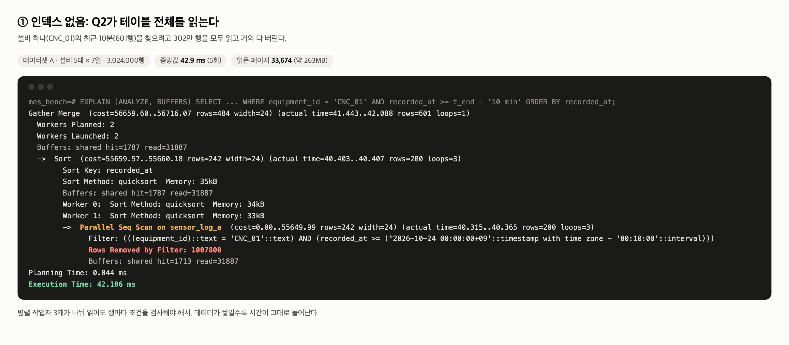
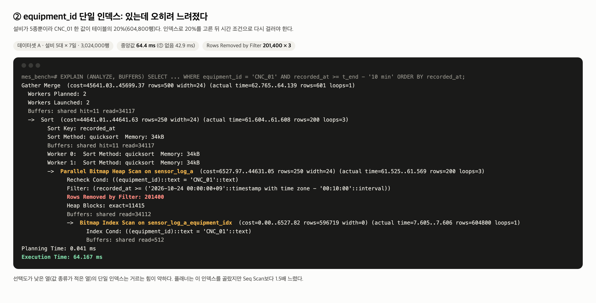
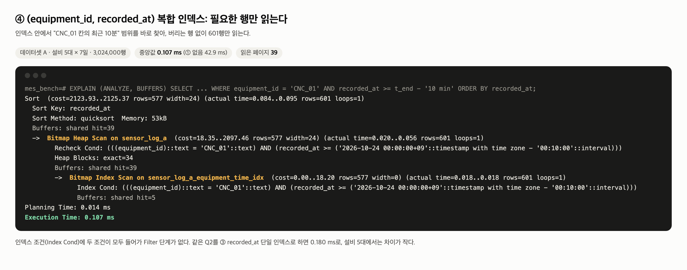
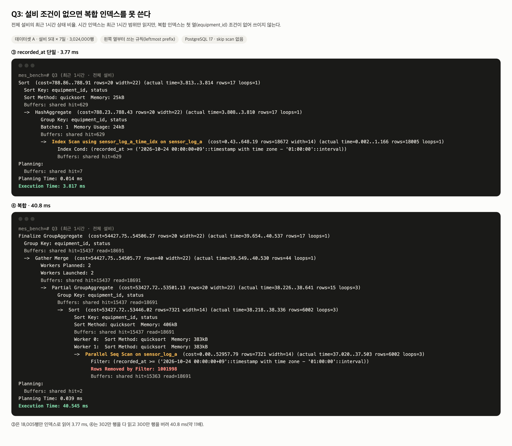
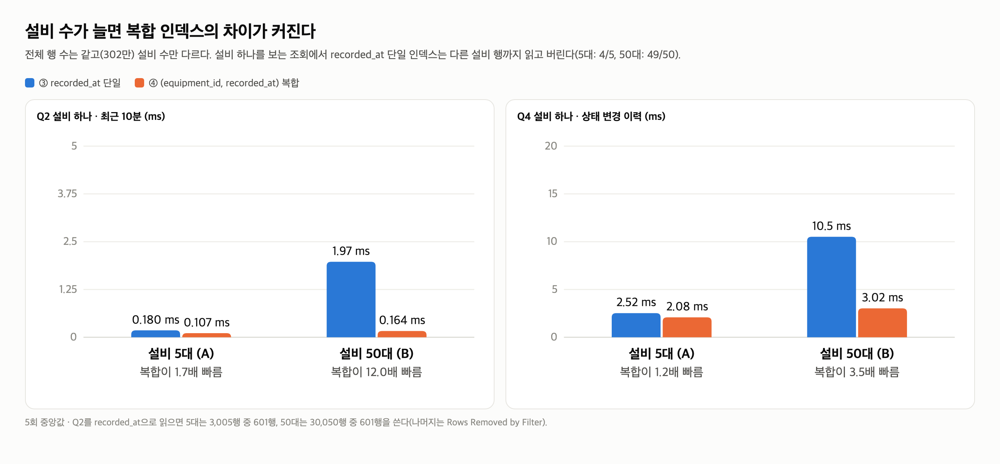

# 센서 로그 인덱스 비교 실험

대시보드 조회 API 4개가 `equipment_sensor_log`(1초에 설비 수만큼 쌓이는 시계열)를 2초마다 읽는다. 어떤 인덱스를 둘지 실행 계획으로 비교해서 정했다. 계획: [`docs/plans/dashboard-monitoring-api.md` 7절](../../plans/dashboard-monitoring-api.md)

## 결론

- **`recorded_at DESC` 단일 인덱스 하나만 둔다.** 설비 5대 · 302만 행에서 조회 4개가 모두 4ms 안에 끝난다(인덱스 없음: 40~870ms).
- **설비별 최신 1건은 `LATERAL ... LIMIT 1` 형태로 둔다.** 같은 인덱스가 있어도 `DISTINCT ON`은 0.5~2.5초, LATERAL은 0.02ms다.
- `(equipment_id, recorded_at)` 복합 인덱스는 설비 5대에서는 이득이 작고(Q2 0.18 → 0.11ms), 설비 조건이 없는 Q3에는 쓰이지 않으며(40.8ms), 크기는 3.3배다. **설비가 수십 대로 늘면 다시 본다**(50대에서 Q2 12배 차이).
- `equipment_id` 단일 인덱스는 넣지 않는다. 플래너가 쓰긴 했지만 오히려 1.5배 느려졌다.

적용: [`backend/src/main/resources/schema.sql`](../../../backend/src/main/resources/schema.sql)의 `equipment_sensor_log_recorded_at_idx`

## 실험 조건

| 항목 | 값 |
|---|---|
| DB | PostgreSQL 17.4, 실험 전용 DB `mes_bench` (설정 기본값: shared_buffers 128MB · random_page_cost 4 · 병렬 작업자 2) |
| 데이터셋 A | 설비 5대 × 7일 × 1초 = **3,024,000행** (테이블 263MB) ← 실제 대시보드와 같은 설비 수 |
| 데이터셋 B | 설비 50대 × 16.8시간 × 1초 = **3,024,000행** (테이블 244MB) ← 행 수는 같고 설비 수만 다름 |
| 상태 분포 | RUN 85% · IDLE 7% · WARN 5% · DOWN 3%, 2분 단위로 유지 |
| 측정 | `EXPLAIN (ANALYZE, BUFFERS)` 6회 실행, 첫 회(캐시 데우기)를 버리고 5회 중앙값 |
| 기준 시각 | `now()` 대신 데이터 마지막 시각 `2026-10-24 00:00:00+09` (언제 다시 돌려도 같은 결과) |

| 단계 | 인덱스 |
|---|---|
| ① | 없음 (기본 키만) |
| ② | `equipment_id` |
| ③ | `recorded_at DESC` |
| ④ | `(equipment_id, recorded_at DESC)` |
| ⑤ | ④ + ③ 둘 다 |

| 쿼리 | 내용 | 실제 API |
|---|---|---|
| Q1 | 설비별 최신 1건 (`DISTINCT ON` / `LATERAL` 두 형태) | `GET /equipment/latest` |
| Q2 | 설비 하나의 최근 10분 | `GET /equipment/{id}/sensor-logs` |
| Q3 | 전체 설비의 최근 1시간 상태별 초 | `GET /equipment/status-summary` |
| Q4 | 설비 하나의 최근 1시간 상태 변경 이력(`LAG`/`LEAD`) | `GET /equipment/{id}/status-changes` |

## 결과: 데이터셋 A (설비 5대)


| 단계 | Q1 DISTINCT ON | Q1 LATERAL | Q2 | Q3 | Q4 | 인덱스 크기 | INSERT 5행×1000 |
|---|---:|---:|---:|---:|---:|---:|---:|
| ① 없음 | 2,436 ms | 866 ms | 42.9 ms | 40.8 ms | 44.0 ms | – | 29.3 ms |
| ② equipment_id | 2,388 ms | 732 ms | 64.4 ms | 42.9 ms | 65.2 ms | 20 MB | 25.7 ms |
| **③ recorded_at** | 2,525 ms | **0.020 ms** | **0.180 ms** | **3.77 ms** | **2.52 ms** | **34 MB** | 26.7 ms |
| ④ 복합 | 581 ms | 0.037 ms | 0.107 ms | 40.8 ms | 2.08 ms | 112 MB | 29.0 ms |
| ⑤ 복합 + recorded_at | 559 ms | 0.020 ms | 0.188 ms | 4.22 ms | 3.67 ms | 146 MB | 34.8 ms |

### ① 인덱스 없음: 601행을 찾으려고 302만 행을 읽는다



Q2는 병렬 Seq Scan으로 테이블 전체(33,674페이지)를 읽고 1,007,800 × 3행을 버린다. 지금은 40ms지만 데이터가 쌓이는 만큼 늘어난다. Q1 LATERAL은 설비마다 전체를 한 번씩 읽어(5번) 866ms다.

### ② equipment_id 단일: 인덱스가 있는데 더 느리다



설비가 5종이라 CNC_01 한 값이 604,800행(20%)이다. 플래너는 이 인덱스로 Bitmap Heap Scan을 골랐지만, 고른 행이 테이블 거의 모든 페이지에 흩어져 있어 결국 34,117페이지를 읽고 시간 조건으로 201,400 × 3행을 버렸다. **64.4ms로 Seq Scan(42.9ms)보다 1.5배 느리다.** 계획서에서는 "플래너가 무시할 것"이라고 예상했는데, 실제로는 골랐고 손해를 봤다. 값 종류가 적은 열 하나만으로는 거르는 힘이 약하다는 점은 같다.

### ③ recorded_at 단일 vs ④ 복합



복합 인덱스는 "CNC_01 칸의 최근 10분"을 인덱스 안에서 바로 찾아 601행만 읽는다(39페이지, 0.107ms). recorded_at 단일은 최근 10분 3,005행을 읽고 다른 설비 2,404행을 버리지만(46페이지, 0.180ms), **설비가 5대라 버리는 양이 작아 차이가 0.07ms다.**



Q3처럼 설비 조건 없이 시간만 거는 조회에서는 복합 인덱스를 쓰지 못한다. 복합 인덱스는 `equipment_id`로 먼저 정렬되어 있어 "최근 1시간"이 설비 칸마다 흩어져 있고, PostgreSQL 17에는 첫 열을 건너뛰는 skip scan이 없다. 그래서 ④에서 Q3는 Seq Scan(40.8ms)으로 돌아간다. ③은 최근 1시간 18,005행만 읽어 3.77ms다.

### ⑤ 둘 다 두면: 복합 인덱스는 거의 쓰이지 않는다

⑤에서 플래너는 Q2 · Q3 · Q4 · Q1 LATERAL 모두 `recorded_at` 인덱스를 골랐다. 복합 인덱스는 Q1 DISTINCT ON(쓰지 않는 형태)에서만 쓰였다. 인덱스 크기는 34MB → 146MB, INSERT 시간은 26.7 → 34.8ms(5,000행 기준)로 늘었는데 조회는 빨라지지 않았다.

## 결과: 설비 수(선택도)의 영향 (A 5대 vs B 50대)



| 쿼리 | A ③ recorded_at | A ④ 복합 | B ③ recorded_at | B ④ 복합 |
|---|---:|---:|---:|---:|
| Q2 설비 하나 · 10분 | 0.180 ms | 0.107 ms (1.7배) | 1.97 ms | 0.164 ms (**12배**) |
| Q4 설비 하나 · 1시간 이력 | 2.52 ms | 2.08 ms (1.2배) | 10.5 ms | 3.02 ms (**3.5배**) |
| Q3 전체 설비 · 1시간 | 3.77 ms | 40.8 ms | 14.6 ms | 49.7 ms |

설비가 많을수록 시간 인덱스로 읽은 행 중 다른 설비 행의 비율이 커진다(Q2: 5대는 3,005행 중 601행, 50대는 30,050행 중 601행). 복합 인덱스는 설비 수와 상관없이 필요한 601행만 읽는다.

B의 ⑤에서도 플래너는 Q2에 `recorded_at` 인덱스를 골라 1.69ms가 걸렸다(복합만 있을 때 0.164ms). 기본값 `random_page_cost = 4`(HDD 기준)가 복합 인덱스로 흩어진 페이지를 읽는 비용을 크게 잡기 때문이다. 같은 상태에서 `SET random_page_cost = 1.1`(SSD 기준)로 바꾸면 복합 인덱스를 골라 0.69ms가 됐다. 설비가 늘어 복합 인덱스를 추가할 때는 이 설정도 같이 봐야 한다.

## 쿼리 형태: DISTINCT ON vs LATERAL

| | ① 없음 | ③ recorded_at | ④ 복합 |
|---|---:|---:|---:|
| A · DISTINCT ON | 2,436 ms | 2,525 ms | 581 ms |
| A · LATERAL | 866 ms | **0.020 ms** | 0.037 ms |
| B · DISTINCT ON | 2,219 ms | 2,084 ms | 2,811 ms |
| B · LATERAL | 5,727 ms | **0.196 ms** | 0.225 ms |

`DISTINCT ON`은 설비마다 첫 행만 남기려고 결국 모든 행(또는 인덱스 전체)을 훑는다. 복합 인덱스로 정렬을 건너뛰어도 302만 행을 다 읽어 0.5~2.8초다. `LATERAL ... ORDER BY recorded_at DESC LIMIT 1`은 설비마다 인덱스 맨 앞 몇 행만 보고 멈춘다. 같은 인덱스로도 쿼리 모양에 따라 10만 배 넘게 차이 난다.

## INSERT 비용

5행 다중 INSERT 1,000번(5,000행) 시간, 3회 중앙값:

| 데이터셋 | ① 0개 | ③ 1개(34MB) | ④ 1개(112MB) | ⑤ 2개 |
|---|---:|---:|---:|---:|
| A | 29.3 ms | 26.7 ms | 29.0 ms | 34.8 ms |
| B | 21.9 ms | 25.1 ms | 32.3 ms | 31.3 ms |

수신 API는 1초에 한 번 5행을 넣으므로 한 번에 약 0.03ms 수준이다. 인덱스 1~2개의 INSERT 비용은 이 규모에서 문제가 되지 않는다. 측정 오차(±5ms)가 있어 ①과 ③의 순서가 뒤바뀐 것은 의미가 없다.

## 주의할 점

- **`recorded_at` 인덱스로 최신 1건을 찾는 건 모든 설비가 계속 로그를 보낸다는 전제다.** LATERAL은 최신 시각부터 거꾸로 읽다가 그 설비 행을 만나면 멈춘다. 실적 테이블에는 있는데 로그가 오래 끊긴 설비가 있으면, 그 설비 행을 만날 때까지 인덱스를 길게 읽는다. 장비가 꺼진 채로 남는 경우가 생기면 복합 인덱스를 다시 검토한다.
- 데이터가 모두 메모리(OS 캐시)에 올라온 상태의 측정이다. 디스크에서 읽으면 Seq Scan과 인덱스의 차이는 더 커진다.
- 노트북 한 대에서 잰 값이라 절대 시간보다 단계 사이의 비율과 실행 계획 모양을 봐야 한다.

## 실험 뒤에 바뀐 것

- **Q4(상태 변경 이력) 쿼리 모양** (2026-10-26, 설비 관리 화면 작업 중): 실험 때는 `LAG`로 바뀐 지점만 찾고 `LEAD`로 끝을 붙였다. 그런데 수신이 끊긴 시간까지 한 구간으로 이어 붙는 문제가 있어서 쿼리를 고쳤다. 지금은 5초 넘게 비면 구간을 나누고, 구간 길이는 로그 수로 센다(`LAG` → 시작 표시 → `SUM() OVER`로 구간 번호 → `GROUP BY`). 읽는 범위(설비 하나 · 최근 1시간)와 실행 계획(`recorded_at` 인덱스 Index Scan Backward)은 같다. 데이터셋 A · ③ 인덱스에서 3회 실행했을 때 4.7~5.8ms로, 실험 때 2.52ms보다 그룹핑만큼 늘었다. 이 폴더의 측정값과 `03-queries.sql`은 실험 당시의 쿼리 그대로 둔다.

## 다시 돌리기

```bash
createdb mes_bench
export PGPASSWORD=...   # 로컬 DB 비밀번호
psql -d mes_bench -f backend/sql/bench/01-seed.sql   # 약 20초
backend/sql/bench/run.sh                             # 약 5분, 이 폴더의 csv · plans/를 덮어쓴다
```

| 파일 | 내용 |
|---|---|
| `backend/sql/bench/01-seed.sql` | 데이터셋 A · B 생성 |
| `backend/sql/bench/02-indexes.sql` | 단계별 인덱스(`-v stage=1~5`) |
| `backend/sql/bench/03-queries.sql` | 측정 쿼리 5개(API와 같은 SQL) |
| `backend/sql/bench/04-insert-cost.sql` | INSERT 비용 측정(ROLLBACK으로 데이터는 남기지 않음) |
| `backend/sql/bench/run.sh` | 전체 실행 |
| `results.csv` · `index-sizes.csv` · `insert-cost.csv` | 측정값 원본 |
| `plans/{a,b}-stage{1-5}-{쿼리}.txt` | 실행 계획 원문 50개 |
