# 센서 로그 1분 요약 · 원본 아카이브

> 계획: [`docs/plans/sensor-rollup.md`](../../plans/sensor-rollup.md). 앞 실험: [센서 로그 인덱스 실험](../sensor-log-index/README.md)
>
## 1. 한눈에 보기

설비마다 1초에 1행씩 DB에 쌓던 센서 원본을 **서버 메모리에서 1분 요약(평균 · 최대 · 최소 · 상태별 초)으로 모아 DB에는 분마다 1행만** 넣고, 1초 원본은 **1시간 단위 Parquet 파일**로 보관했다. 측정해 보니 일부 요청이 1초까지 느려진 원인은 DB 쓰기가 아니라, **모든 수신 요청이 하나씩 차례로 지나가야 하는 라인 잠금**이었다. 센서만 보낸 요청은 작업지시를 바꾸지 않으므로 이 잠금을 건너뛰고 **설비별 잠금**만 잡게 바꿨다. 서버가 죽어도 스풀 파일로 요약을 다시 만든다.

| 지표 | Before | After | 변화 |
|---|---:|---:|---:|
| 센서 저장량(설비 50대 × 7일, 같은 데이터) | 4,163MB | 129MB | **1/32** |
| 설비 200대 1년 환산 DB 저장량 | 846GB | 약 26GB | 1/32 |
| 1초 원본 보관(1행) | DB 144바이트 | Parquet 3.2바이트 | **1/45** |
| DB WAL(설비 200대) | 57.8KB/초 | 2.1KB/초 | **1/27** |
| DB에 쓰는 행(설비 200대) | 200행/초 | 3.8행/초 | 1/53 |
| 수신 응답 p99(설비 2,000대, 초당 2,000건) | 715ms | **2.7ms** | 1/265 |
| OEE 7일 조회(설비 50대) | 2,563ms | **47ms** | 55배 |
| OEE 정확도(7일 · 설비 50대) | — | 원본과 차이 **0초** | 같음 |
| `kill -9` 뒤 요약 | 메모리분 손실 | 스풀로 복구, 원본 수와 **같음** | 손실 없음 |

> **p50 · p95 · p99**: 응답 시간을 빠른 순서로 늘어놓았을 때 50 · 95 · 99번째 백분위 값이다. p99 715ms는 "100건 중 1건은 715ms보다 느렸다"는 뜻이다. 평균은 느린 소수를 가리므로 이 값들을 본다. 이렇게 맨 끝 몇 %만 느려지는 현상을 **꼬리 지연**(tail latency)이라고 한다.

## 2. 문제 상황

설비마다 1초에 1행이 `equipment_sensor_log`에 쌓인다. 설비 5대 라인에서는 문제가 없지만, 실제 공장은 설비가 수십 ~ 수백 대다.

| 설비 | 1초 | 하루 | 1년 |
|---:|---:|---:|---:|
| 5 | 5행 | 43만 행 | 1.6억 행 |
| 50 | 50행 | 432만 행 | 15.8억 행 |
| 200 | 200행 | 1,728만 행 | 63억 행 |

걱정한 것은 세 가지다.

1. **스토리지**: 행과 인덱스가 설비 수에 비례해 매일 늘어난다
2. **쓰기 병목**: 1초마다 설비 수만큼 INSERT · 인덱스 갱신 · WAL · 커밋
3. **조회**: OEE가 원본 행을 하나씩 세서(1행 = 1초), 구간이 길수록 느려진다

## 3. 재현과 근거

### 측정 조건

| 항목 | 값 |
|---|---|
| 장비 | MacBook Pro M3 Pro(11코어) · 메모리 36GB, 부하 발생기(k6)와 서버 · DB가 같은 노트북 |
| DB | PostgreSQL 17.4(x86_64 빌드, Rosetta), 설정 기본값(shared_buffers 128MB · synchronous_commit on · max_wal_size 1GB) |
| 서버 | 백엔드 jar(Spring Boot 3.5 · Java 17), HikariCP 기본 풀 10개. 측정 전용 DB · 포트 8081 |
| 수신 부하 | k6 `constant-arrival-rate`: 설비마다 1초에 1번, 1행씩 따로 POST(실제 공장처럼 설비 · 게이트웨이가 각자 보냄). 작업지시 없는 센서 로그만 |
| 측정 구간 | 5 · 50 · 200대: 데우기 1분 뒤 4분. 500 · 1,000 · 2,000대(한계 찾기): 데우기 30초 뒤 2분 |
| 상태 분포 | 설비 · 2분 구간마다 RUN 85% · IDLE 7% · WARN 5% · DOWN 3% |
| DB 지표 | 측정 시작 · 끝의 `pg_stat_database` · `pg_stat_wal` 차이, 1초마다 `pg_stat_activity` |
| 조회 | 설비 50대 × 7일 × 1초 = 3,024만 행(`mes_bench_query`), `EXPLAIN (ANALYZE, BUFFERS)` 6회 중 첫 회를 버린 5회 중앙값 |

### 수신: 설비 200대까지는 문제가 없다

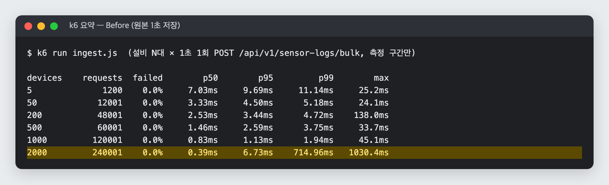

| 설비 | 초당 요청 | p50 | p95 | p99 | 최대 | 실패 | DB INSERT/초 | WAL/초 | 잠금 대기(평균 · 최대) |
|---:|---:|---:|---:|---:|---:|---:|---:|---:|---:|
| 5 | 5 | 7.03ms | 9.69ms | 11.14ms | 25ms | 0% | 5 | 1.8KB | 0 · 0 |
| 50 | 50 | 3.33ms | 4.50ms | 5.18ms | 24ms | 0% | 50 | 14.5KB | 0 · 0 |
| 200 | 200 | 2.53ms | 3.44ms | 4.72ms | 138ms | 0% | 200 | 57.8KB | 0.02 · 4 |
| 500 | 502 | 1.46ms | 2.59ms | 3.75ms | 34ms | 0% | 498 | 144.7KB | 0.04 · 6 |
| 1,000 | 1,004 | 0.83ms | 1.13ms | 1.94ms | 45ms | 0% | 999 | 287.7KB | 0.1 · 9 |
| **2,000** | 2,006 | 0.39ms | 6.73ms | **714.96ms** | **1,030ms** | 0% | 1,992 | 569.5KB | 0.5 · **9** |

- 200대에서 p95 3.44ms, 실패 0%. **수신 지연은 재현되지 않았다.** 설비가 늘수록 오히려 빨라진 것은 요청이 잦아 JVM(JIT) · CPU가 계속 데워진 상태라서로 보인다
- **2,000대에서 꼬리 지연이 생겼다.** 절반(p50)은 0.39ms로 빠른데, 100건 중 1건(p99)은 715ms 넘게 걸렸고 가장 느린 건은 1초다. 초당 2,000건이므로 매초 20건 정도가 0.7초 넘게 기다린 셈이다

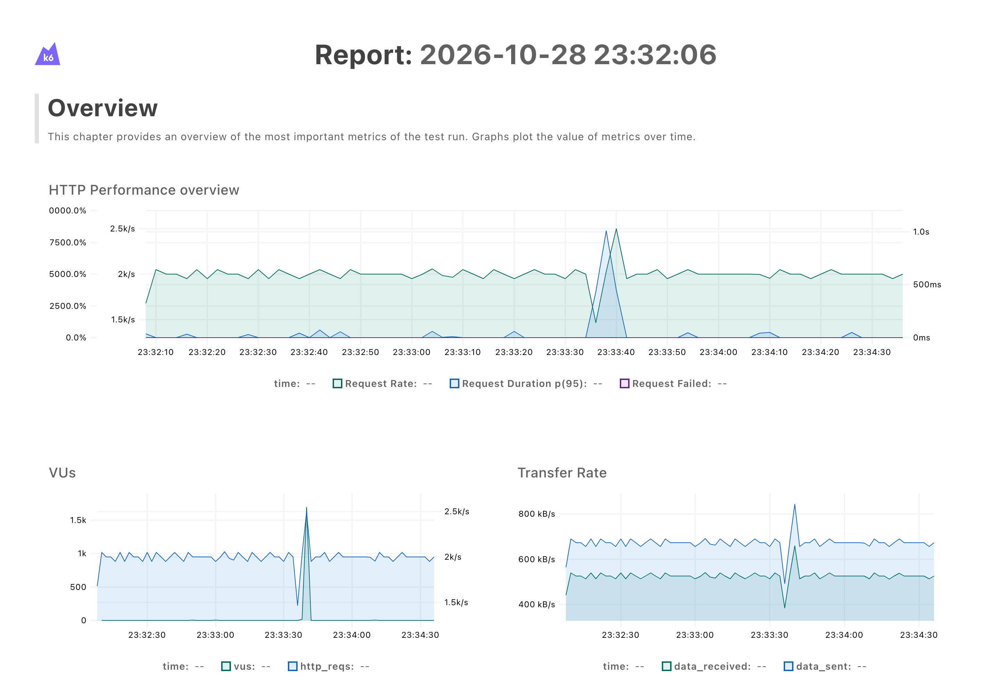

### 꼬리 지연의 순간: 연결 10개 중 9개가 라인 잠금을 기다린다

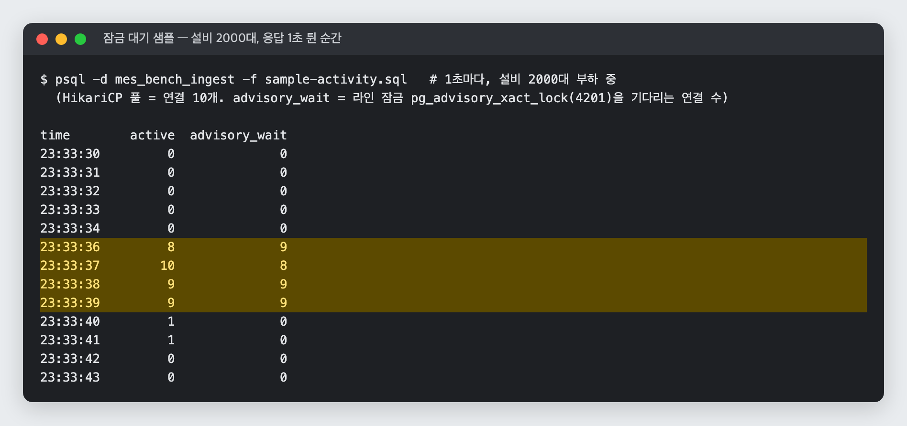

응답이 1초로 튄 23:33:36 ~ 39에 DB 연결 10개(HikariCP 풀 전부) 중 8 ~ 9개가 라인 잠금 `pg_advisory_xact_lock(4201)`을 기다렸다. 라인 잠금은 라인 전체에 하나뿐이라, 수신 요청은 모두 이 잠금을 하나씩 차례로 지나간다. 창구가 하나뿐인 은행과 같다. 실적이 들어오면 "작업지시 완료 → 다음 지시 시작"을 판단하는데, 두 요청이 동시에 판단하면 같은 지시를 두 번 완료하는 식으로 꼬일 수 있어서 둔 잠금이다. 그런데 실적 없이 온도 · 진동 · 상태만 보낸 센서 요청도 같은 줄에 섰다. 그래서 **트랜잭션 하나가 잠깐 느려지면 뒤의 요청이 전부 줄을 선다.** 그 트랜잭션이 왜 느려졌는지(체크포인트 · 자동 VACUUM · GC)는 이번 측정으로 확정하지 못했다.

### 요청 1건의 DB 시간: 센서 INSERT는 일부다

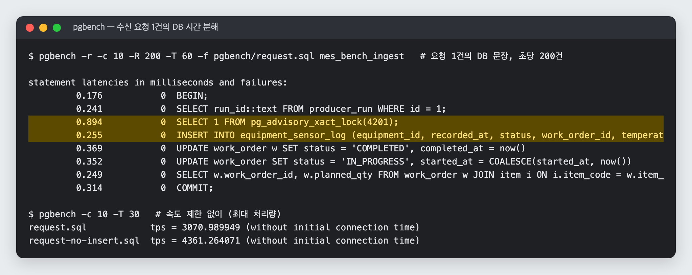

같은 문장을 pgbench로 돌려(초당 200건, 연결 10개) 문장별로 나눴다.

| 문장 | 시간 | 비중 |
|---|---:|---:|
| 라인 잠금 `pg_advisory_xact_lock(4201)` | 0.894ms | 31% |
| 작업지시 완료 판정 UPDATE + 다음 지시 시작 UPDATE | 0.721ms | 25% |
| COMMIT | 0.314ms | 11% |
| **센서 로그 INSERT** | **0.255ms** | **9%** |
| 실행 ID 확인 · 진행 중 지시 조회 · BEGIN | 0.666ms | 23% |

- 센서 INSERT를 빼면 DB 최대 처리량이 **3,071 → 4,361건/초(+42%)**
- 하지만 센서 저장을 1분 요약으로 바꿔도 **요청마다 도는 잠금 · 작업지시 확인은 그대로 남는다.** 수신 지연(특히 2,000대의 꼬리)은 센서 저장 방식만으로는 크게 줄지 않을 것으로 예상한다

### 저장량: 진짜 문제

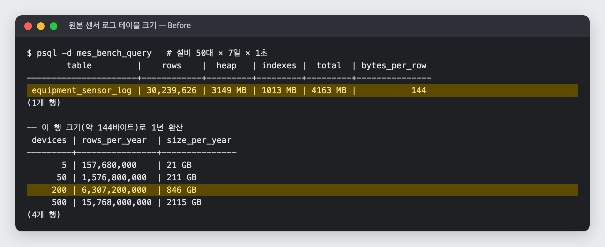

설비 50대 × 7일 = 3,024만 행이 **4.16GB**(테이블 3.15GB + 인덱스 1.01GB), 1행 약 144바이트다.

| 설비 | 하루 | 1년 | WAL/일(측정) |
|---:|---:|---:|---:|
| 5 | 59MB | 21GB | 0.15GB |
| 50 | 593MB | 211GB | 1.2GB |
| 200 | 2.4GB | **846GB** | 4.8GB |
| 500 | 5.9GB | 2.1TB | 11.9GB |

WAL은 요청 1건에 약 295바이트(센서 행 + 인덱스 + 커밋 + 작업지시 UPDATE)로, 설비 수에 그대로 비례한다.

### 조회: 구간이 길수록 읽는 행이 늘어난다

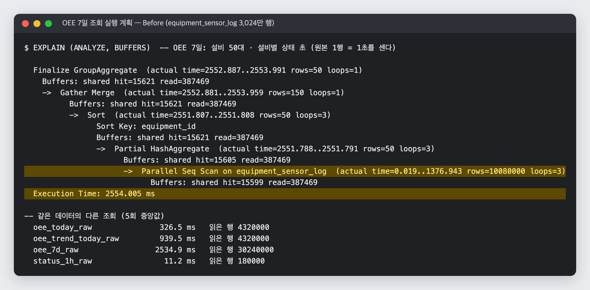

| 조회 | 시간(중앙값) | 읽은 행 |
|---|---:|---:|
| OEE 요약 "오늘"(24시간) | 326.5ms | 432만 |
| OEE 추이 "오늘"(1시간 칸) | 939.5ms | 432만 |
| OEE 7일(리포트 구간) | **2,534.9ms** | **3,024만**(병렬 Seq Scan) |
| 상태 비율 최근 60분(2초마다 호출) | 11.2ms | 18만 |

OEE는 "상태별 몇 초"를 원본 행 수로 세므로, 구간 길이 × 설비 수만큼 행을 읽는다. 인덱스로는 줄일 수 없다(읽을 행 자체가 많다).

## 4. 원인 분석

측정으로 본 순위:

1. **저장량**: 200대 1년 846GB. 행 수 자체가 원인이라 인덱스 · 튜닝으로 줄일 수 없다
2. **긴 구간 조회**: OEE 7일 2.5초. 원본 행을 세는 구조라 데이터가 쌓일수록 느려진다
3. **꼬리 지연**: 2,000대에서 p99 715ms(100건 중 1건이 0.7초 넘게 걸림). 원인은 센서 INSERT보다 **모든 수신 요청이 차례로 지나가는 라인 잠금**이다. 센서 INSERT는 요청 DB 시간의 9%
4. **쓰기량(WAL)**: 200대 하루 4.8GB. 저장량과 같은 이유로 설비 수에 비례

**예상과 달랐던 점**: 처음에는 "1초마다 저장 → I/O 병목"을 걱정했지만, 이 장비에서는 초당 1,000건까지 p99 2ms 이하였다. 문제는 쓰기 속도보다 **쌓이는 양**과 **쌓인 것을 다시 세는 조회**였다. 느려진 요청은 쓰기 I/O가 아니라 라인 잠금에서 줄을 서느라 생겼다.

## 5. 선택지 비교

| 방법 | 쓰기 I/O | 스토리지 | 긴 구간 조회 | 꼬리 지연(p99, 잠금) | 추가 인프라 | 판단 |
|---|---|---|---|---|---|---|
| 인덱스 조정 | 그대로 | 그대로 | 거의 그대로 | 그대로 | 없음 | 앞 실험에서 이미 맞췄다. 읽을 **행 수 자체**가 문제(측정: 7일 3,024만 행) |
| 여러 요청을 모아 배치 INSERT | 커밋은 줄어듦 | 그대로 | 그대로 | 그대로 | 없음 | 행 · WAL · 저장량이 그대로다. 측정 안 함 |
| 날짜 파티션 + 오래된 원본 삭제 | 그대로 | 보관 기간만큼 | 조금 나아짐 | 그대로 | 없음 | 원본을 버려야 하고, OEE는 여전히 원본을 센다. 측정 안 함 |
| TimescaleDB 연속 집계 · 압축 | 원본 INSERT는 남음 | 압축으로 줄어듦 | 빠름 | 그대로 | DB 확장 | 좋은 선택지. 이번에는 원리를 직접 구현해 보이려고 다음 단계로 둔다. 측정 안 함 |
| Redis에 집계 | 크게 줄어듦 | 줄어듦 | 빠름 | 그대로 | Redis | 서버 한 대에서는 스풀 복구로 같은 안전성을 얻는다. 서버를 늘릴 때 다시 본다 |
| Kafka + 스트림 집계 | 크게 줄어듦 | 줄어듦 | 빠름 | 해결 | Kafka | 대규모 표준 구조지만 지금 규모에 비해 무겁다 |
| **메모리 1분 요약 + 스풀 + Parquet + 설비별 잠금 (선택)** | **1/27(WAL)** | **1/32** | **55배** | **p99 1/265** | **없음** | 쓰기 · 저장 · 조회를 함께 줄이고 원본도 남긴다. 스풀은 Kafka의 "먼저 디스크에 남기고 나중에 집계"를 작게 구현한 것 |

## 6. 해결 방법

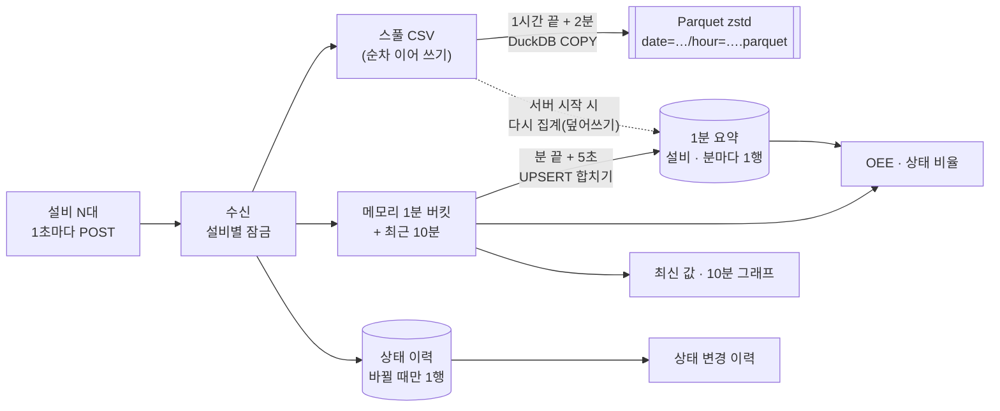

| 결정 | 이유 |
|---|---|
| 요약에 **상태별 초**를 넣는다 | 상태는 평균을 낼 수 없다. OEE가 원본에서 세던 `count(*) FILTER (WHERE status = 'DOWN')`을 `sum(down_sec)`으로 그대로 바꿀 수 있다(정확도 8절) |
| 평균은 **합 ÷ 개수**로 저장(`GENERATED` 열) | 분이 끝난 뒤 늦게 온 값을 UPSERT로 합쳐도 평균이 정확하다 |
| 키에 **작업지시**를 넣는다 | OEE는 작업지시가 있던 시간만 계획 시간으로 센다. 한 분 안에서 지시가 바뀌어도 원본과 같은 값 |
| **상태 이력** 테이블을 따로 | 1분 요약은 "얼마나"는 알지만 "언제부터"는 모른다. 바뀔 때만 1행이라 작다(이전 행 `ended_at` 채우기). 실무 MES의 설비 상태 이력과 같은 모양 |
| 1초 원본은 **스풀 → 1시간 Parquet** | Parquet은 이어 쓰기가 안 된다. 스풀(순차 쓰기)을 거쳐 한 시간에 파일 하나로 묶는다(작은 파일 문제 회피). DuckDB 하나로 변환 · 조회 · 복구를 모두 한다 |
| 서버가 죽으면 **스풀로 복구** | 원본이 먼저 디스크에 있으니 다시 집계하면 같은 값이다. 다시 집계한 분은 **덮어쓴다**(합치면 이미 넣은 분이 두 번 더해진다). Redis 없이 서버 한 대에서 손실 0 |
| 메모리 · 스풀은 **DB 쓰기가 끝난 뒤** 넣는다 | 실적 저장이 실패해 롤백되면 메모리도 그대로여야 한다. 설비별 잠금을 쥔 채 넣어서 같은 설비의 다음 요청이 옛 상태를 읽지 않는다 |
| 센서만 온 요청은 **설비별 잠금** | 라인 잠금은 작업지시 완료 · 다음 지시 시작을 한 줄로 처리하려고 둔 것이다. 센서만 온 요청은 지시를 바꾸지 않는다. 같은 설비의 정지 · 상태 이력만 한 줄이면 된다 |
| 같은 설비의 **마지막 시각 이하는 버린다** | 재전송된 요청이 요약 · 원본에 두 번 들어가지 않게(비가동 추적과 같은 규칙) |

## 7. 결과

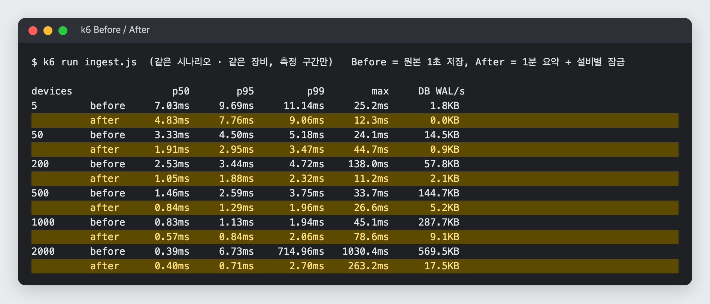

### 수신

| 설비 | p50 | p95 | p99 | 최대 | DB 행/초 | WAL/초 | 잠금 대기 최대 |
|---:|---|---|---|---|---|---|---|
| 5 | 7.03 → 4.83ms | 9.69 → 7.76ms | 11.14 → 9.06ms | 25 → 12ms | 5 → 0.1 | 1.8KB → 0.0KB | 0 → 0 |
| 50 | 3.33 → 1.91ms | 4.50 → 2.95ms | 5.18 → 3.47ms | 24 → 45ms | 50 → 1.1 | 14.5 → 0.9KB | 0 → 0 |
| 200 | 2.53 → 1.05ms | 3.44 → 1.88ms | 4.72 → 2.32ms | 138 → 11ms | 200 → 3.8 | 57.8 → 2.1KB | 4 → 0 |
| 500 | 1.46 → 0.84ms | 2.59 → 1.29ms | 3.75 → 1.96ms | 34 → 27ms | 498 → 9.4 | 144.7 → 5.2KB | 6 → 0 |
| 1,000 | 0.83 → 0.57ms | 1.13 → 0.84ms | 1.94 → 2.06ms | 45 → 79ms | 999 → 18.7 | 287.7 → 9.1KB | 9 → 0 |
| **2,000** | 0.39 → 0.40ms | 6.73 → **0.71ms** | 714.96 → **2.70ms** | 1,030 → **263ms** | 1,992 → 37.1 | 569.5 → 17.5KB | **9 → 0** |

- **2,000대의 꼬리 지연이 사라졌다**(p99 715ms → 2.7ms). 센서 요청이 라인 잠금 줄에 서지 않아 잠금 대기가 0이 됐다. 같은 2,000대에서 실패 0%
- DB에 쓰는 행이 1/50 이상 줄었다. 남은 쓰기는 분마다 요약 UPSERT(200대: 초당 3.3행)와 상태가 바뀔 때의 이력(초당 0.8행)이다
- 설비 5대의 WAL이 0에 가까운 이유: 센서만 온 요청은 이제 DB에 아무것도 쓰지 않는다(잠금 · 실행 ID 확인만)
- 50 · 1,000대의 **최대값**은 오히려 늘었다(24 → 45ms, 45 → 79ms). 측정 4분 · 2분 중 한두 건이다. 원인은 확인하지 못했고 p99는 비슷하다
- 커밋 수는 그대로다(요청마다 트랜잭션 하나). 쓰기가 없는 커밋이라 WAL은 거의 없다

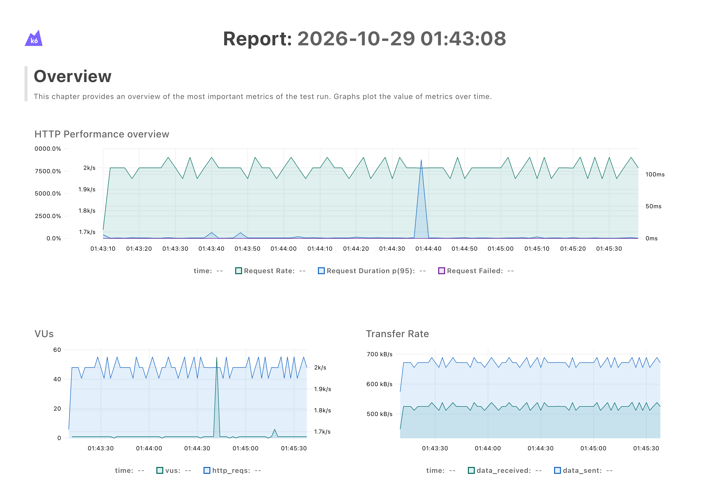

### 저장량

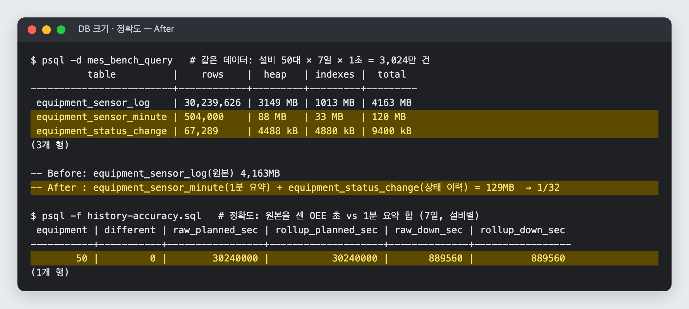

| 같은 데이터(설비 50대 × 7일) | 행 | 크기 |
|---|---:|---:|
| Before: 원본 `equipment_sensor_log` | 3,024만 | 4,163MB |
| After: 1분 요약 `equipment_sensor_minute` | 50.4만 | 120MB |
| After: 상태 이력 `equipment_status_change` | 6.7만 | 9.4MB |

- 요약 1행은 약 250바이트로 원본 1행(144바이트)보다 넓지만, 행이 1/60이라 합치면 **1/32**
- 설비 200대 1년: Before 846GB → After 약 26GB(설비 1대 · 하루 0.37MB로 환산)
- 상태 이력 행 수는 시험 데이터가 2분마다 상태를 바꾼 탓에 실제보다 많다

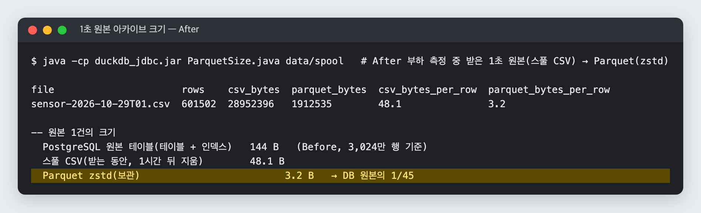

| 1초 원본 1건 | 크기 |
|---|---:|
| PostgreSQL 원본(테이블 + 인덱스) | 144B |
| 스풀 CSV(받는 동안만) | 48.1B |
| **Parquet zstd(보관)** | **3.2B** |

After 부하 측정 중 받은 60만 건으로 쟀다. 시험 데이터는 상태가 2분씩 같고 값이 좁은 범위라 압축이 잘 되는 편이다. 실제 센서 값은 더 클 수 있다.

개발 서버에서 시뮬레이터를 돌리자 02:02(01시가 끝나고 2분 뒤)에 `hour=01.parquet`이 생기고 01시 스풀이 지워졌다. DuckDB로 파일을 바로 SQL 조회한 값이 같은 서버의 1분 요약(DB)과 설비 5대 모두 같다(행 수 · 평균 · 최대 · 고장 초).

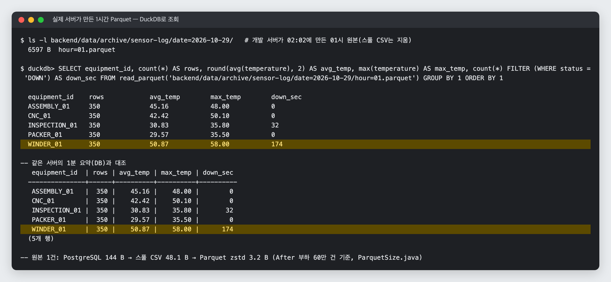

### 조회

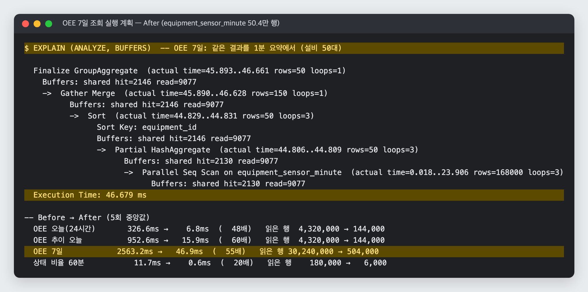

| 조회(설비 50대) | Before | After | 읽은 행 |
|---|---:|---:|---|
| OEE 요약 "오늘"(24시간) | 326.6ms | **6.8ms**(48배) | 432만 → 14.4만 |
| OEE 추이 "오늘" | 952.6ms | **15.9ms**(60배) | 432만 → 14.4만 |
| OEE 7일 | 2,563.2ms | **46.9ms**(55배) | 3,024만 → 50.4만 |
| 상태 비율 최근 60분 | 11.7ms | **0.6ms**(20배) | 18만 → 6,000 |

같은 세션에서 원본 · 요약 쿼리를 번갈아 잰 값이다(`data/after/queries.csv`). 실제 API는 여기에 아직 DB에 안 넣은 메모리 버킷(최대 1분 + 5초)을 더한다.

## 8. 정확도 · 복구 확인

- **OEE 정확도**: 같은 3,024만 행에서 원본을 센 OEE 초와 1분 요약 합을 설비마다 비교했다. 50대 모두 계획 · 가동 · 고장 · 대기 초가 **같다**(`history-accuracy.sql`, 위 캡처). 테스트 `SensorRollupServiceDbTest`도 DB에 넣은 요약 + 메모리를 합친 값이 원본 count와 같은지 본다
- **서버 강제 종료**: 설비 50대 부하 중 `kill -9`

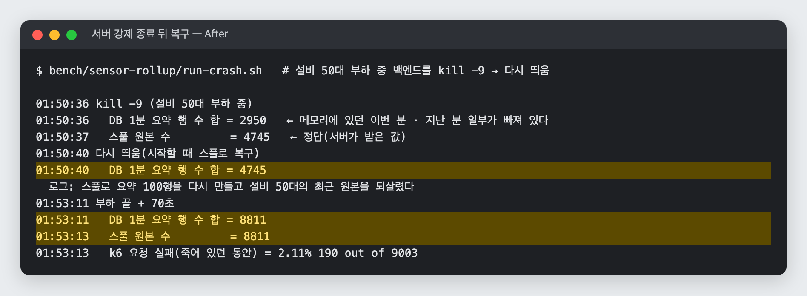

| 시점 | DB 요약 행 수 합 | 스풀 원본 수(정답) |
|---|---:|---:|
| `kill -9` 직후 | 2,950 | 4,745 |
| 다시 띄운 직후(스풀로 복구) | **4,745** | 4,745 |
| 부하 끝 + 70초 | **8,811** | 8,811 |

죽어 있던 약 4초 동안의 요청 190건(2.1%)은 k6에서 실패로 나왔다. 서버가 받지 못한 값이라 요약에도 없다(설비 쪽 재전송의 몫).

- **대시보드**: 새 구조에서 화면이 그대로 동작한다(최신 값 · 10분 1초 그래프는 메모리, OEE · 비가동 · 상태 비율은 요약, 이력은 상태 이력 테이블)

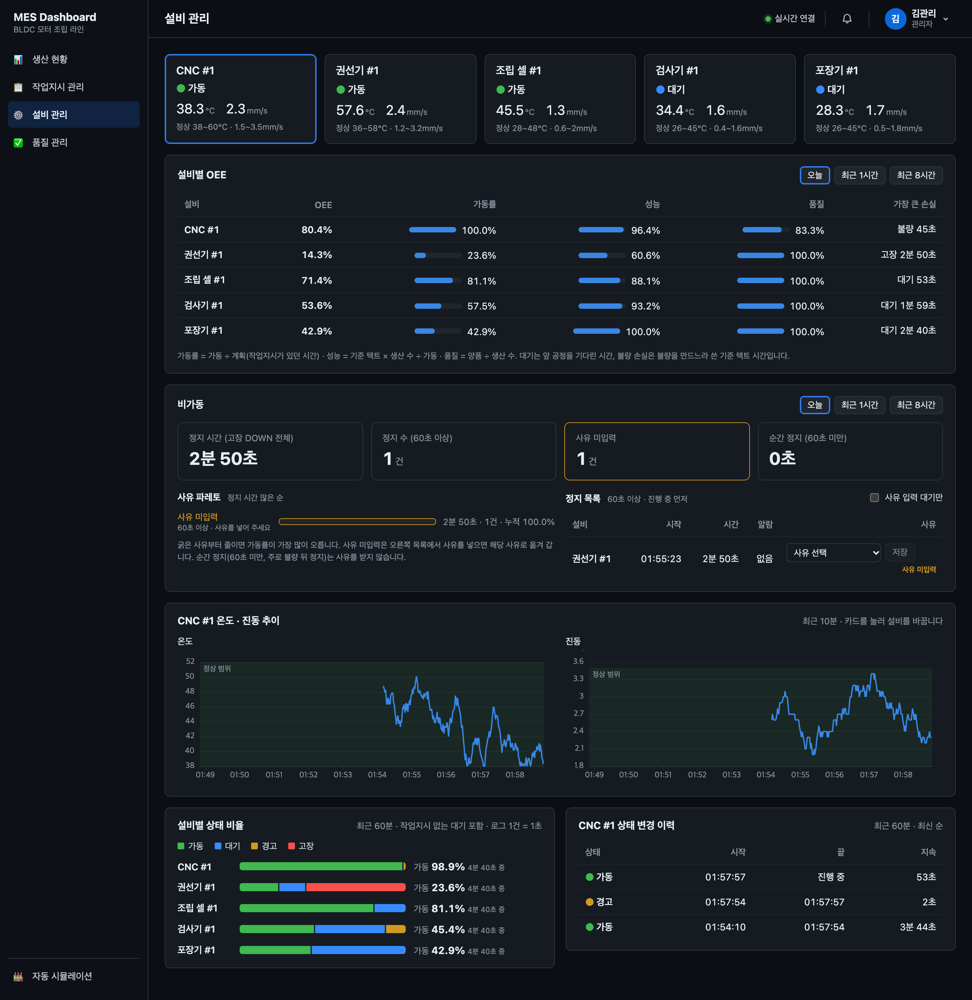

## 9. 한계와 다음 단계

| 한계 | 내용 · 다음 단계 |
|---|---|
| 서버 한 대 전제 | 집계가 서버 메모리에 있다. 백엔드를 여러 대로 늘리면 설비별로 같은 서버에 보내거나(Kafka 파티션 키 = 설비) Redis로 집계 상태를 나눠야 한다 |
| 전원 손실 | 스풀은 요청마다 OS 버퍼까지 쓰고 `fsync`는 하지 않는다. 앱이 죽으면 남지만 컴퓨터 전원이 나가면 마지막 몇 초를 잃을 수 있다 |
| 실적 요청은 여전히 한 줄 | 부하 측정은 센서만 보낸 경우(k6, 요청 1건 = 설비 1대)다. 실적(`workOrderId` · `production`)이 든 요청은 지금도 라인 잠금을 잡으므로 실적 요청끼리는 하나씩 처리된다. 시뮬레이터처럼 수집기가 라인 전체를 한 요청으로 묶어 보내면 실적 요청이 1초에 1건이라 문제가 없다. 하지만 설비마다 실적을 따로 보내면 실적 요청이 설비 수만큼 늘어 라인 잠금 줄이 다시 길어질 수 있다. 이 경우는 재지 않았다. 다음 단계: 실적을 포함한 k6 시나리오로 측정하고, 필요하면 작업지시 완료 · 시작 판단을 요청마다 하지 않고 주기 작업(예: 1초마다)으로 옮겨 라인 잠금을 수신 경로에서 뺀다 |
| 분 단위 경계 | OEE · 상태 비율의 구간 시작을 분 단위로 내림한다(최대 1분 차이). 작업지시 기준 OEE는 오차가 없다 |
| 순서가 뒤바뀐 원본 | 같은 설비의 마지막 시각보다 이른 값은 재전송으로 보고 버린다. 설비가 오래 쌓았다가 한꺼번에 보내는 경우 시간순으로 보내야 한다 |
| 아카이브 위치 | 로컬 폴더. S3 · MinIO로 바꾸면 경로만 달라진다. Parquet은 DuckDB · Athena로 바로 SQL 조회가 된다 |
| 측정 환경 | 노트북 한 대에서 부하 발생기 · 서버 · DB가 함께 돌았다. 절대값보다 Before/After 비율을 봐야 한다 |

## 10. 다시 돌리기

```bash
export PGPASSWORD=...   # 로컬 DB 비밀번호
createdb mes_bench_ingest; createdb mes_bench_query
brew install k6

# 수신 부하(백엔드 jar를 8081 · mes_bench_ingest로 띄운다). Before는 바꾸기 전 커밋(dev db9fcad)의 jar로 돌린다
(cd backend && ./gradlew bootJar)
bench/sensor-rollup/run-ingest.sh after "5 50 200"
WARMUP_SEC=30 MEASURE_SEC=120 bench/sensor-rollup/run-ingest.sh after-limit "500 1000 2000"
python3 bench/sensor-rollup/summarize.py docs/experiments/sensor-rollup/data/after
bench/sensor-rollup/run-pgbench.sh before              # 요청 1건의 DB 문장별 시간
bench/sensor-rollup/run-crash.sh                       # kill -9 복구

# 조회(3,024만 행, 약 4분 + 요약 채우기 약 1.5분)
psql -d mes_bench_query -f backend/src/main/resources/schema.sql
psql -d mes_bench_query -f bench/sensor-rollup/history-seed.sql
psql -d mes_bench_query -f backend/src/main/resources/schema.sql   # 원본으로 1분 요약 · 상태 이력 채우기
bench/sensor-rollup/run-queries.sh after
psql -d mes_bench_query -v t_end="'2026-10-28 00:00:00+09'" -f bench/sensor-rollup/history-accuracy.sql

# Parquet 크기(스풀 → Parquet)
java -cp ~/.gradle/caches/modules-2/files-2.1/org.duckdb/duckdb_jdbc/1.1.3/*/duckdb_jdbc-1.1.3.jar \
  bench/sensor-rollup/ParquetSize.java data/spool /tmp/parquet
```

## 파일

| 파일 | 내용 |
|---|---|
| `bench/sensor-rollup/ingest.js` | k6 수신 부하 시나리오 |
| `bench/sensor-rollup/run-ingest.sh` | 백엔드를 띄우고 설비 수마다 k6 · DB 카운터 · 잠금 샘플을 남긴다 |
| `bench/sensor-rollup/run-pgbench.sh` · `pgbench/*.sql` | 요청 1건의 DB 문장별 시간 · 최대 처리량 |
| `bench/sensor-rollup/history-seed.sql` · `history-queries.sql` · `run-queries.sh` | 3,024만 행 조회 비교 |
| `bench/sensor-rollup/summarize.py` | `data/<label>/summary.csv` 정리 |
| `bench/sensor-rollup/run-crash.sh` · `SpoolCount.java` | `kill -9` 복구 확인 |
| `bench/sensor-rollup/history-accuracy.sql` | 원본 count와 1분 요약 합 비교 |
| `bench/sensor-rollup/ParquetSize.java` | 스풀 CSV → Parquet 크기 |
| `bench/sensor-rollup/capture.py` | 터미널 출력 · k6 리포트를 PNG로 캡처 |
| `data/before/` · `data/before-limit/` | Before 원자료(k6 요약 · 리포트 HTML, DB 카운터, 1초 샘플, 실행 계획) |
| `data/after/` · `data/after-limit/` · `data/crash/` | After 원자료(+ 조회 비교 · 정확도 · Parquet 크기 · 복구) |
