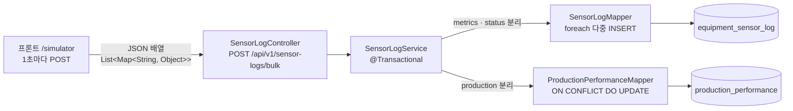
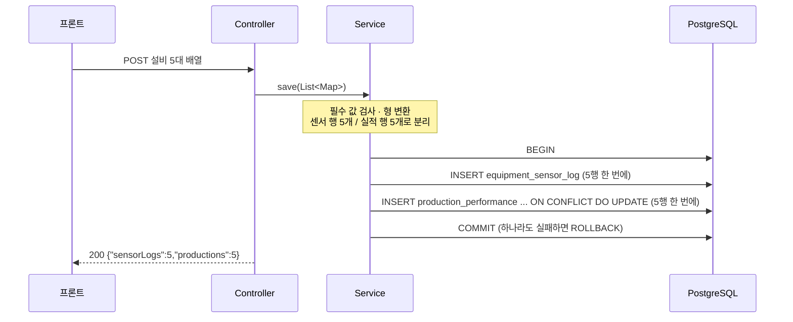

# 백엔드 계획: 센서 로그 수신 API

> 브랜치: `feature/sensor-log-api`. 데이터를 보내는 쪽은 프론트의 자동 시뮬레이션(`/simulator`, `frontend/src/producer/`)이다.

## 1. 목표

자동 시뮬레이션이 1초마다 보내는 설비 데이터를 받아 **PostgreSQL에 저장하는 Spring Boot 서버**를 만든다.
요청 한 번에 들어 있는 정보를 성격에 따라 두 테이블로 나눠 저장한다.

| 정보 | 성격 | 저장 방식 |
|---|---|---|
| `metrics`(온도 · 진동)와 `status` | 시계열 로그: 1초마다 새로 쌓인다 | `equipment_sensor_log`에 매번 INSERT |
| `production`(누적 수량) | 현재 값: 작업지시 · 설비마다 최신 값 하나만 있으면 된다 | `production_performance`에 UPSERT(있으면 갱신, 없으면 추가) |

## 2. 이 단계에서 익히는 개념

| 개념 | 한 줄 설명 | 이 단계에서 보는 곳 |
|---|---|---|
| 계층형 구조 | Controller(요청 · 응답) → Service(업무 규칙 · 트랜잭션) → Mapper(SQL)로 역할을 나눈다 | 패키지 구성 |
| 트랜잭션 원자성 | 여러 SQL을 "모두 성공 아니면 모두 취소"로 묶는다 | 서비스 메서드의 `@Transactional` |
| 시계열 로그 vs 현재 상태 | 로그는 계속 쌓고(INSERT), 현재 상태는 한 행을 고친다(UPDATE) | 테이블 2개 |
| UPSERT | 같은 키 행이 있으면 갱신, 없으면 추가. PostgreSQL은 `ON CONFLICT ... DO UPDATE` | 실적 매퍼 XML |
| 다중 INSERT | 여러 행을 SQL 한 번에 넣어 DB 왕복을 줄인다 | MyBatis `<foreach>` |
| CORS | 다른 출처(포트가 다르면 다른 출처)의 브라우저 요청은 서버가 허용해야 받을 수 있다 | `WebConfig` |

## 3. 기술 스택

| 구분 | 사용 기술 |
|---|---|
| 프레임워크 | Spring Boot 3.x, Java 17 |
| 빌드 | Gradle(래퍼 `gradlew` 포함, 따로 설치 불필요) |
| 영속성 | MyBatis(mybatis-spring-boot-starter) |
| DB | PostgreSQL 15(로컬 Homebrew). 요청서는 16이지만 쓰는 문법(`ON CONFLICT`, TIMESTAMPTZ)은 15와 같다 |
| 테스트 | JUnit 5, MockMvc, 로컬 PostgreSQL의 테스트 전용 DB |

## 4. 아키텍처



### 4.1 요청 한 건의 처리 흐름



## 5. 수신 데이터

프론트가 보내는 형식(설비 5대가 한 배열):

```json
[
  {
    "equipmentId": "CNC_01",
    "timestamp": "2026-10-24T14:53:02.432Z",
    "status": "RUN",
    "workOrderId": "WO-20261024-001",
    "metrics": { "temperature": 49.4, "vibration": 2.8 },
    "production": { "totalCount": 12, "goodCount": 11, "badCount": 1 }
  }
]
```

DTO 클래스는 만들지 않고 컨트롤러에서 `List<Map<String, Object>>`로 그대로 받는다. 분리 · 형 변환은 서비스에서 한다.

| 받은 값 | 저장 위치 | 변환 |
|---|---|---|
| `equipmentId` | 두 테이블 `equipment_id` | 문자열 |
| `timestamp` | `equipment_sensor_log.recorded_at` | ISO 문자열 → `OffsetDateTime` |
| `status` | `equipment_sensor_log.status` | 문자열 |
| `metrics.temperature` · `vibration` | `equipment_sensor_log` | 숫자 → `BigDecimal` |
| `workOrderId` | `production_performance.work_order_id` | 문자열 |
| `production.*Count` | `production_performance` | 숫자 → `int` |

## 6. 테이블(DDL)

요청서 스키마 그대로 `schema.sql`에 둔다. `CREATE TABLE IF NOT EXISTS`로 써서 서버가 뜰 때 없으면 만든다.

- `equipment_sensor_log`: id(BIGSERIAL PK), equipment_id, recorded_at(TIMESTAMPTZ), status, temperature · vibration(NUMERIC(5,2)), created_at(기본값 현재 시각)
- `production_performance`: id(BIGSERIAL PK), work_order_id, equipment_id, total_count · good_count · bad_count(기본 0), last_updated_at(기본값 현재 시각), `UNIQUE (work_order_id, equipment_id)`

## 7. 매퍼 SQL

- **센서 로그**: `INSERT INTO equipment_sensor_log (equipment_id, recorded_at, status, temperature, vibration) VALUES` 뒤에 `<foreach>`로 행을 이어 붙여 한 번에 넣는다.
- **생산 실적**: 같은 방식으로 여러 행을 넣고, `ON CONFLICT (work_order_id, equipment_id) DO UPDATE SET total_count = EXCLUDED.total_count, good_count = EXCLUDED.good_count, bad_count = EXCLUDED.bad_count, last_updated_at = now()`로 이미 있는 행은 최신 누적 수량으로 갱신한다.
  끝에 `WHERE production_performance.total_count <= EXCLUDED.total_count`를 붙여, 들어온 값이 지금 값보다 작으면(늦게 도착한 옛날 요청) 갱신하지 않는다.

## 8. 만들 파일

```
backend/
├── build.gradle · settings.gradle · gradlew        # Gradle 래퍼
└── src/
    ├── main/
    │   ├── java/com/messtudy/backend/
    │   │   ├── BackendApplication.java
    │   │   ├── controller/SensorLogController.java
    │   │   ├── service/SensorLogService.java
    │   │   ├── mapper/SensorLogMapper.java
    │   │   ├── mapper/ProductionPerformanceMapper.java
    │   │   └── config/WebConfig.java · GlobalExceptionHandler.java
    │   └── resources/
    │       ├── application.properties             # DB 접속(mes), 포트 8080
    │       ├── schema.sql
    │       └── mapper/SensorLogMapper.xml · ProductionPerformanceMapper.xml
    └── test/
        ├── java/com/messtudy/backend/...           # 서비스 · 컨트롤러 · 매퍼 테스트
        └── resources/application-test.properties  # 테스트 전용 DB(mes_test)
```

## 9. 결정 사항

1. **빌드 도구** → Gradle.
2. **DB 버전** → 로컬 PostgreSQL 15를 쓴다.
3. **DB 테스트** → 로컬 PostgreSQL에 테스트 전용 DB(`mes_test`)를 만들어 쓴다. 개발용 DB(`mes`)와 섞이지 않는다. Docker가 없어 Testcontainers는 쓰지 않는다.
4. **센서 로그 인덱스** → 추가하지 않는다.
5. **패키지** → `com.messtudy.backend`.
6. **CORS** → `/api/**`에 프론트 개발 서버 출처(`http://localhost:5173`)만 허용한다. 허용하지 않으면 브라우저가 요청을 막는다.
7. **같은 요청 안의 중복 키** → 같은 (작업지시, 설비)가 한 요청에 두 번 있으면 PostgreSQL UPSERT가 "cannot affect row a second time" 오류를 내므로, 서비스에서 마지막 값만 남긴다.
8. **입력 검증** → 필수 값(`equipmentId`, `timestamp`, `status`, `workOrderId`, `metrics`, `production`)이 없거나 형식이 틀리면 400. 빈 배열은 아무것도 저장하지 않고 정상 응답한다.
9. **응답** → 200과 저장 건수 `{"sensorLogs":n,"productions":m}`.
10. **누적 수량 역전 방지** → 넣는다. 누적 수량은 줄어들 수 없으므로, 늦게 도착한 옛날 요청이 더 최신 값을 작은 값으로 덮어쓰지 않게 UPSERT에 `WHERE production_performance.total_count <= EXCLUDED.total_count` 조건을 붙인다. 조건에 걸린 행은 갱신하지 않고 넘어간다(오류 아님).
11. **설정 파일 형식** → `application.properties`(yml은 쓰지 않는다. 두 형식을 섞지 않는다).
12. **DB 계정** → username은 `postgres`. 실제 비밀번호는 로컬 `application.properties`에만 적고, 이 파일은 `.gitignore`로 커밋하지 않는다. 저장소에는 비밀번호 자리를 비운 `application.properties.example`을 올린다. 테스트 설정은 URL만 바꾸고 계정은 그대로 물려받는다(구현 중 변경: 사용자가 파일을 직접 고치기 → 환경 변수 `DB_PASSWORD` → 예시 파일 + gitignore 순으로 바뀌었다).

## 10. 구현 순서

각 단계마다 테스트를 통과시키고 커밋한다.

1. **뼈대**: Gradle 프로젝트, `application.properties`, `schema.sql`, DB `mes` · `mes_test` 생성, 서버 기동 확인
2. **매퍼**: 매퍼 2개 + XML, 테스트 DB에 넣고 읽어 확인(다중 INSERT, UPSERT 갱신, 더 작은 누적 수량은 무시)
3. **서비스**: 분리 · 변환 · 검증 · 중복 키 처리 · 트랜잭션 + 단위 테스트, 롤백 테스트
4. **컨트롤러 · CORS · 오류 응답**: MockMvc 테스트(200 · 400 · 빈 배열)
5. **연동 확인**: 서버와 프론트 `/simulator`를 함께 띄우고 DB 확인, README 갱신, PR 준비

## 11. 완료 기준

- [x] `./gradlew test` 통과
- [x] 서버를 띄우면 두 테이블이 없을 때 자동으로 만들어진다
- [x] 프론트 `/simulator`를 열면 `equipment_sensor_log`가 1초에 5행씩 늘어난다
- [ ] `production_performance`는 (작업지시, 설비)마다 한 행(5행)만 있고, 택트 타임마다 수량이 갱신된다
  - 5행 유지는 확인. 택트 타임 갱신은 연동 확인 중 이전 버전 Producer 탭이 큰 누적 수량을 보내 역전 방지에 걸려 확인하지 못했다. 대시보드 단계 연동 확인 때 다시 본다
- [x] 지금 값보다 작은 누적 수량이 들어와도 DB 값이 줄지 않는다
- [x] 두 테이블 중 한쪽 저장이 실패하면 다른 쪽도 저장되지 않는다(롤백)
- [x] 필수 값이 빠진 요청은 400, 브라우저 콘솔에 CORS 오류가 없다

## 12. 이번 단계에서 하지 않는 것

- 저장한 데이터를 조회하는 API, 대시보드가 서버 데이터를 읽도록 바꾸는 일
- 인증 · 권한, 배포 설정, Docker 구성
- 오래된 센서 로그 정리(보관 기간 · 파티셔닝)
