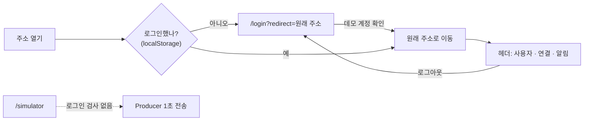
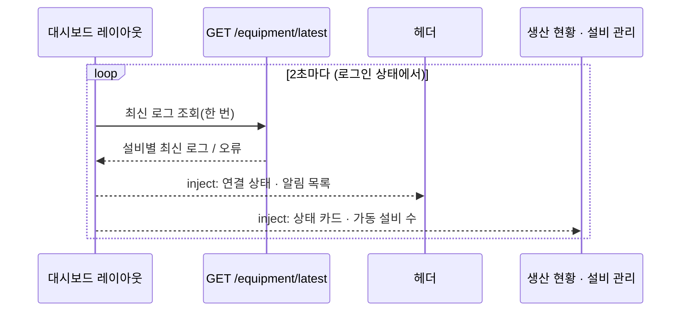
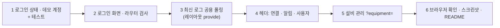

# 대시보드 계획: 헤더(사용자 · 서버 연결 · 설비 알림)와 로그인 화면

> 브랜치: `feature/dashboard-header` (`dev`에서 분기). 앞 단계: [dashboard-monitoring-api.md](dashboard-monitoring-api.md)

## 1. 목표

지금 헤더에는 페이지 제목만 있다. 실제 MES 대시보드처럼 **누가 보고 있는지, 서버와 이어져 있는지, 지금 손봐야 할 설비가 있는지**를 헤더에서 바로 보이게 한다.

```
┌ 설비 관리 ──────────────────────── ● 실시간 연결 │ 🔔 2 │ (김) 김관리 ▾ ┐
                                                       │       관리자
                                                       │       └ 로그아웃
                                                          └ 조립 셀 #1  ● 경고  3초 전
                                                            포장기 #1   ● 통신 끊김  12초 전
```

| 영역 | 보여 줄 것 |
|---|---|
| 사용자 메뉴 | 원형 프로필(사진, 없으면 성 한 글자) · 이름 · 역할. 누르면 로그아웃 |
| 서버 연결 | `● 실시간 연결` / `● 연결 끊김`(마지막 수신 시각) |
| 설비 알림 | 경고 · 고장 · 통신 끊김 설비 수 배지. 누르면 목록, 항목을 누르면 설비 관리에서 그 설비가 선택된 화면으로 이동 |
| 로그인 화면 (`/login`) | 아이디 · 비밀번호 입력, 데모 계정 안내 |

## 2. 결정 사항

| # | 항목 | 결정 |
|---|---|---|
| 1 | 로그인 수준 | **프론트 화면만.** 데모 계정은 프론트 코드에 고정하고, 로그인 상태는 브라우저(localStorage)에만 기억한다. 서버 API는 지금처럼 인증 없이 열려 있다 → 화면 흐름 학습용이고 보안 기능이 아니다 |
| 2 | 데모 계정 | `admin` / `admin1234` (김관리 · 관리자), `operator` / `operator1234` (이현장 · 생산 담당). 로그인 화면에 안내한다 |
| 3 | 로그인이 필요한 페이지 | 대시보드 페이지 전부. **자동 시뮬레이션(`/simulator`)은 로그인 없이 연다**(사람이 보는 화면이 아니라 설비 역할의 데이터 발생기라서) |
| 4 | 로그인 후 이동 | 로그인 전에 열려던 주소로(`/login?redirect=/equipment`). 이미 로그인했으면 `/login`은 `/`로 보낸다 |
| 5 | 헤더 정보 | 사용자 메뉴 · 서버 연결 상태 · 설비 알림. 시각 · 근무조 · 작업지시는 넣지 않는다 |
| 6 | 최신 로그 폴링 | 헤더와 두 페이지가 같은 "설비별 최신 로그"를 쓰므로 **레이아웃에서 한 번만 2초 폴링**하고 provide/inject로 나눠 쓴다(지금은 페이지마다 따로 부른다) |
| 7 | 알림 기준 | 최신 로그가 `WARN` · `DOWN`이거나, 5초 넘게 수신이 없는 설비(설비 관리 카드와 같은 기준) |
| 8 | 알림에서 설비 이동 | `/equipment?equipment=ASSEMBLY_01`. 설비 관리는 이 쿼리로 처음 선택할 설비를 정한다 |
| 9 | 프로필 사진 | 이름 왼쪽에 원형 아바타. 계정 정보에 `avatarUrl` 칸을 두되 지금은 비워 두고, 비었거나 사진을 불러오지 못하면 **성 한 글자**를 원 안에 보인다. 원 배경색은 아이디로 정해 늘 같은 색이 나오게 한다. 원은 장식(`aria-hidden`)이고 이름 텍스트를 바로 옆에 둔다 |

## 3. 화면 흐름





## 4. 만들 파일

```
frontend/src/
├── auth/
│   ├── accounts.ts          # 데모 계정(아이디 · 비밀번호 · 이름 · 역할 · avatarUrl)
│   ├── session.ts           # 로그인 · 로그아웃 · 현재 사용자(localStorage, 읽기 실패해도 동작)
│   └── session.test.ts
├── views/LoginView.vue      # 로그인 화면(전체 화면, 사이드바 없음)
├── router.ts                # /login 추가, 로그인 검사(beforeEach), meta.public
├── layout/
│   ├── DashboardLayout.vue  # 최신 로그 폴링을 여기서 하고 provide
│   ├── ConnectionBadge.vue  # 서버 연결 상태
│   ├── AlertMenu.vue        # 설비 알림 배지 + 목록
│   ├── UserAvatar.vue       # 원형 프로필(사진 → 실패하면 성 한 글자)
│   └── UserMenu.vue         # 아바타 · 이름 · 역할 · 로그아웃
├── dashboard/
│   ├── latestLogs.ts        # 최신 로그 provide/inject 키와 꺼내기 함수
│   ├── alerts.ts            # 알림 목록 계산(+ 테스트)
│   └── ...
└── views/ProductionView.vue, EquipmentView.vue   # 최신 로그를 inject로 받음, 설비 관리는 ?equipment= 지원
```

백엔드는 바꾸지 않는다.

## 5. 구현 순서



## 6. 완료 기준

- [x] 로그인하지 않고 대시보드 주소를 열면 `/login`으로 가고, 로그인하면 원래 주소로 돌아온다
- [x] 틀린 아이디 · 비밀번호는 "아이디 또는 비밀번호가 맞지 않습니다"를 보이고 넘어가지 않는다
- [x] `/simulator`는 로그인 없이 열리고 전송한다
- [x] 헤더에 원형 프로필(사진이 없으면 성 한 글자) · 이름 · 역할이 보이고, 로그아웃하면 `/login`으로 가며 뒤로 가기로 대시보드에 돌아가지 못한다
- [x] 서버를 끄면 헤더가 `연결 끊김`으로 바뀌고, 켜면 `실시간 연결`로 돌아온다
- [x] 설비가 경고 · 고장 · 통신 끊김이면 알림 배지 숫자가 늘고, 목록 항목을 누르면 설비 관리에서 그 설비가 선택된다
- [x] 최신 로그 조회가 페이지와 헤더를 합쳐 2초에 한 번만 나간다
- [x] 메뉴는 키보드(Tab · Enter · Esc)로도 열고 닫을 수 있다
- [x] `npm test` · `npm run lint` · `npm run build` 통과

### 구현 중 바뀐 점 (2026-10-27)

- **로그아웃 뒤 뒤로 가기**: 같은 페이지 안에서는 로그인 검사가 막았지만, 뒤로 가기로 **브라우저 캐시(bfcache)에서 예전 문서가 되살아나면** 그 문서가 기억하던 로그인 상태로 대시보드가 보였다. `pageshow`(persisted) · `storage` 이벤트에서 저장소의 로그인 상태를 다시 읽고, 로그아웃 상태가 되면 지금 화면에도 로그인 검사를 다시 걸게 했다. 다른 탭에서 로그아웃해도 같이 로그인 화면으로 간다.
- **로그아웃 이동**: 사용자 메뉴가 직접 이동하지 않고, 로그인 상태가 바뀌면 라우터가 로그인 검사와 같은 규칙으로 이동한다(`?redirect=`에 보던 화면이 남아 다시 로그인하면 돌아온다).
- 로그인 검사 · redirect 함수는 라우터와 로그인 화면이 서로를 불러오지 않게 `auth/guard.ts`로 뺐다.

## 7. 이번 단계에서 하지 않는 것

- 서버 인증(Spring Security · 사용자 테이블 · 토큰), 비밀번호 암호화, 역할별 권한 차이
- 알림 기록 · 확인 처리(읽음 표시), 소리 · 브라우저 알림
- 현재 시각 · 근무조 · 작업지시 표시
