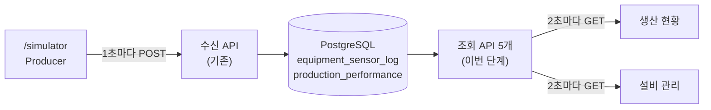
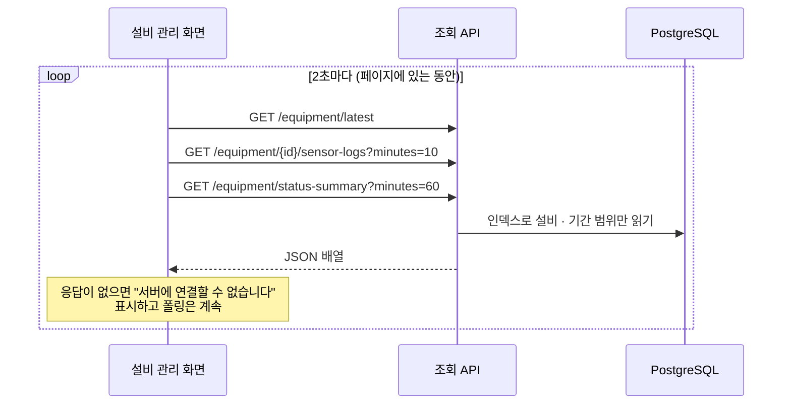
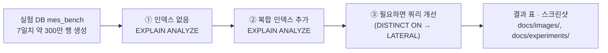
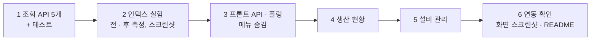

# 대시보드 계획: 저장된 센서 · 실적 데이터 조회

> 브랜치: `feature/dashboard-api`. 데이터는 `feature/sensor-log-api`에서 만든 두 테이블(`equipment_sensor_log`, `production_performance`)에 쌓인다.

## 1. 목표

자동 시뮬레이션 → 서버 → DB로 쌓인 데이터를 **대시보드에서 다시 읽어 보여 준다**. 이번 단계가 끝나면 Producer → 서버 → DB → 대시보드로 데이터 흐름이 처음으로 끝까지 이어진다.

| 페이지 | 보여 줄 것 | 데이터 |
|---|---|---|
| 생산 현황 (`/`) | KPI 카드, 설비별 실적 표, 설비별 양품/불량 막대 | `production_performance` + 최신 센서 로그 |
| 설비 관리 (`/equipment`) | 설비 상태 카드, 온도 · 진동 추이, 상태 비율(가동률), 상태 변경 이력 | `equipment_sensor_log` |

그리고 **센서 로그 인덱스를 넣기 전과 후의 조회 성능을 측정해 비교하고, 결과를 스크린샷으로 남긴다**(포트폴리오용, 7절).

## 2. 이 단계에서 익히는 개념

| 개념 | 한 줄 설명 | 이 단계에서 보는 곳 |
|---|---|---|
| 그룹별 최신 1건 | 설비마다 가장 최근 행 하나만 고른다 | 최신 상태 조회 SQL |
| 윈도 함수 `LAG()` | 바로 앞 행의 값을 같은 줄에서 본다. 상태가 바뀐 지점을 찾는다 | 상태 변경 이력 SQL |
| 복합 인덱스 | `(equipment_id, recorded_at)`처럼 여러 열을 순서대로 묶은 인덱스. 앞 열로 고르고 뒤 열 순서로 읽는다 | 7절 실험 |
| 실행 계획 | `EXPLAIN (ANALYZE, BUFFERS)`로 DB가 실제로 어떻게 읽었는지(Seq Scan / Index Scan, 읽은 페이지 수, 시간) 본다 | 7절 실험 |
| 폴링 | 일정 주기로 다시 조회해 화면을 갱신한다. 페이지를 떠나면 멈춘다 | 프론트 composable |

## 3. 결정 사항

| # | 항목 | 결정 |
|---|---|---|
| 1 | 데이터가 없는 메뉴 4개(작업지시 · 품질 · 자재 · 리포트) | 사이드바에서 숨긴다. 라우트와 빈 페이지 파일은 남긴다(라우트 `meta.hidden`) |
| 2 | 갱신 방식 | 2초 폴링(axios). WebSocket · SSE는 쓰지 않는다 |
| 3 | 차트 | ECharts를 다시 설치하고, 쓰는 차트(선 · 막대)만 등록한다 |
| 4 | 센서 로그 인덱스 | `(equipment_id, recorded_at DESC)` 복합 인덱스를 넣는다. 넣기 전 · 후를 측정해 비교한다(7절) |
| 5 | 상태 변경 이력 | 이번 범위에 넣는다(`LAG()`) |
| 6 | 브랜치 | 수신 API와 대시보드 정리를 커밋한 뒤 `feature/dashboard-api`를 새로 만든다 |
| 7 | 백엔드 형식 | 수신 API와 같게: Controller → Service → Mapper(XML), 응답은 `List<Map>`, DTO 없음 |
| 8 | 품질 | 따로 페이지를 만들지 않고 생산 현황에 설비별 불량률로 넣는다 |

## 4. 아키텍처



### 4.1 화면 한 번 갱신되는 흐름



## 5. 조회 API

| API | 응답(배열 한 항목) | SQL 요점 |
|---|---|---|
| `GET /api/v1/equipment/latest` | equipmentId, recordedAt, status, temperature, vibration | 설비 목록마다 `ORDER BY recorded_at DESC LIMIT 1` (`LATERAL`). 7절 실험에서 `DISTINCT ON`과 비교해 정한다 |
| `GET /api/v1/equipment/{id}/sensor-logs?minutes=10` | recordedAt, status, temperature, vibration | `equipment_id = ? AND recorded_at >= now() - 기간`, 시간순 |
| `GET /api/v1/equipment/status-summary?minutes=60` | equipmentId, status, seconds | 1행이 1초라 `GROUP BY equipment_id, status`의 `count(*)`가 곧 초 |
| `GET /api/v1/equipment/{id}/status-changes?minutes=60` | status, startedAt, endedAt, seconds | `LAG(status)`로 앞 행과 상태가 다른 행만 남겨 구간을 만든다 |
| `GET /api/v1/production-performance` | workOrderId, equipmentId, totalCount, goodCount, badCount, lastUpdatedAt | 단순 조회 |

- `minutes`는 1~1440만 받고, 벗어나면 400.
- 설비 목록은 `production_performance`의 `equipment_id`(5행)에서 얻는다. 설비 기준정보 테이블은 이번에 만들지 않는다.
- CORS는 GET도 허용하도록 `WebConfig`의 허용 메서드에 GET을 더한다.

## 6. 화면

**생산 현황 (`/`)**

```
┌ 총 생산(포장기) ┬ 양품률 ┬ 불량 합계 ┬ 가동 설비 4/5 ┬ 마지막 수신 3초 전 ┐
├──────────────── 설비별 실적 표 ─────────────────────────────────────┤
│ 설비 │ 총수량 │ 양품 │ 불량 │ 불량률 │ 마지막 갱신                       │
├──────────────── 설비별 양품/불량 막대 차트 ──────────────────────────┤
```

**설비 관리 (`/equipment`)**

```
┌ CNC #1 ┬ 권선기 ┬ 조립 셀 ┬ 검사기 ┬ 포장기 ┐  상태 색 · 온도 · 진동
│ ● 가동 │ ● 경고 │ ...                      │  5초 넘게 수신이 없으면 "통신 끊김"
├─ 선택한 설비의 온도 · 진동 추이 (최근 10분) ─┤
├─ 최근 1시간 상태 비율 (RUN/WARN/DOWN) → 가동률 ─┤
├─ 상태 변경 이력 (선택한 설비, 최근 1시간) ─┤
```

- 설비 이름 · 정상 범위는 `producer/equipment.ts`의 정의를 같이 쓴다.
- 상태 색은 3D 화면과 같게(RUN 초록 · WARN 노랑 · DOWN 빨강).

## 7. 인덱스 전 · 후 비교 실험 (포트폴리오용)

### 7.1 왜 지금 인덱스가 필요한가

수신 API만 있을 때는 INSERT뿐이라 인덱스가 필요 없었다(INSERT는 인덱스가 있으면 오히려 조금 느려진다). 이번에는 "설비별 최신 1건", "최근 10분" 같은 조회가 2초마다 들어온다. 센서 로그는 1초에 5행, 하루 약 43만 행이 쌓이므로, 인덱스가 없으면 조회할 때마다 테이블 전체를 읽는다(Seq Scan).

### 7.2 실험 방법



1. **데이터**: 개발 DB(`mes`)와 섞이지 않게 실험 전용 DB `mes_bench`를 만든다. `generate_series`로 설비 5대 × 7일 × 1초 ≈ 302만 행을 넣는다(상태 · 온도 · 진동은 무작위).
2. **측정 대상**: 5절의 센서 로그 조회 4개를 실제 API와 같은 SQL로 실행한다.
3. **측정 방법**: `EXPLAIN (ANALYZE, BUFFERS)`. 캐시 영향을 줄이려고 같은 쿼리를 여러 번 돌려 중앙값을 쓴다.
4. **단계**
   - ① 인덱스 없음
   - ② `CREATE INDEX idx_sensor_log_equipment_time ON equipment_sensor_log (equipment_id, recorded_at DESC)` 후 `ANALYZE`
   - ③ "설비별 최신 1건"은 `DISTINCT ON`이면 인덱스가 있어도 전체를 훑을 수 있다. 그렇다면 `LATERAL ... LIMIT 1`로 바꿔 다시 잰다
5. **기록**
   - 실험 SQL: `backend/sql/bench/` (데이터 생성, 측정 쿼리)
   - 실행 계획 원문: `docs/experiments/sensor-log-index/` (단계별 텍스트)
   - 결과 표와 해석: `docs/experiments/sensor-log-index/README.md`
   - 스크린샷: `docs/images/index-*.png`

| 비교 항목 | 의미 |
|---|---|
| 실행 시간(ms) | `Execution Time` |
| 읽는 방식 | Seq Scan / Index Scan / Index Only Scan |
| 읽은 페이지 수 | `Buffers: shared hit + read` (8KB 단위) |
| 인덱스 크기, INSERT 비용 | `pg_relation_size`, 5행 다중 INSERT 시간 전 · 후 |

### 7.3 스크린샷

| 파일 | 내용 |
|---|---|
| `index-before-plan.png` | ① 인덱스 없음: Seq Scan과 실행 시간이 보이는 실행 계획 |
| `index-after-plan.png` | ② 인덱스 추가: Index Scan과 실행 시간 |
| `index-comparison.png` | 쿼리 4개 × 단계별 실행 시간 막대 차트와 요약 표 |
| `dashboard-production.png` · `dashboard-equipment.png` | 완성된 두 화면 |

실행 계획 원문(psql 출력)을 그대로 터미널 모양의 페이지로 띄워 캡처한다. 원문 텍스트도 같이 남겨 숫자를 다시 확인할 수 있게 한다.

반영: 실험이 끝나면 인덱스를 `schema.sql`에 `CREATE INDEX IF NOT EXISTS`로 넣는다.

## 8. 만들 파일

```
backend/
├── sql/bench/                       # 실험용 SQL (서버가 실행하지 않음)
│   ├── 01-seed.sql                  # mes_bench에 7일치 데이터 생성
│   └── 02-queries.sql               # 측정 쿼리 (EXPLAIN ANALYZE)
└── src/main/
    ├── java/com/messtudy/backend/
    │   ├── controller/EquipmentQueryController.java     # /api/v1/equipment/*
    │   ├── controller/ProductionQueryController.java    # /api/v1/production-performance
    │   ├── service/EquipmentQueryService.java           # 기간 검사(1~1440분)
    │   └── mapper/SensorLogQueryMapper.java (+ XML)     # 조회 SQL 4개
    └── resources/schema.sql                             # 인덱스 추가

frontend/src/
├── api/                  # axios 인스턴스, 조회 함수
├── composables/usePolling.ts
├── charts/echarts.ts     # 선 · 막대만 등록
├── dashboard/            # 생산 현황 · 설비 관리 컴포넌트
└── views/ProductionView.vue, EquipmentView.vue

docs/experiments/sensor-log-index/   # 실행 계획 원문, 결과 표
docs/images/index-*.png, dashboard-*.png
```

## 9. 구현 순서



1. **조회 API**: 매퍼 SQL과 `mes_test` DB 테스트, 서비스 기간 검사, MockMvc 테스트
2. **인덱스 실험**: 7절 순서대로. 결과를 보고 "최신 1건" 쿼리 형태를 확정하고, 인덱스를 `schema.sql`에 넣는다
3. **프론트 기반**: axios 조회 함수, `usePolling`, ECharts 등록, 메뉴 4개 숨김
4. **생산 현황**
5. **설비 관리**
6. **연동 확인**: Producer · 서버 · 대시보드를 함께 띄워 값이 2초 안에 바뀌는지 보고, 화면 스크린샷과 README를 갱신한다

## 10. 완료 기준

- [ ] `./gradlew test`, `npm test` · `npm run lint` · `npm run build` 통과
- [ ] 조회 API 5개가 설계대로 응답하고, 잘못된 `minutes`는 400
- [ ] 인덱스 전 · 후 실행 계획 원문, 결과 표, 스크린샷이 `docs/`에 있다
- [ ] 생산 현황: Producer가 돌면 실적 표 수량이 택트 타임마다 바뀐다
- [ ] 설비 관리: 상태 카드가 2초 안에 바뀌고, 추이 차트가 최근 10분을 보여 준다
- [ ] 서버를 끄면 "서버에 연결할 수 없습니다"가 보이고, 다시 켜면 저절로 돌아온다
- [ ] 사이드바에는 생산 현황 · 설비 관리 · 자동 시뮬레이션만 보인다

## 11. 이번 단계에서 하지 않는 것

- 시간대별 생산량(실적 이력 테이블이 필요함), 작업지시 · 자재 · 리포트 화면
- 설비 기준정보 테이블, 오래된 센서 로그 정리(보관 기간 · 파티셔닝)
- WebSocket · SSE, 인증 · 권한
