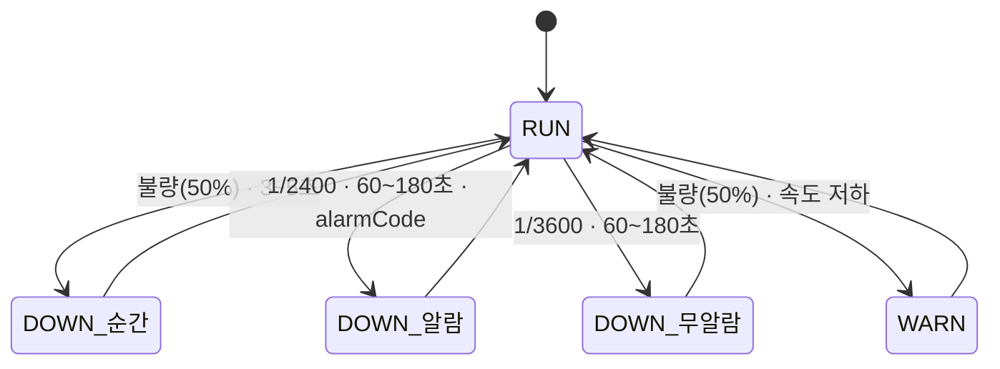
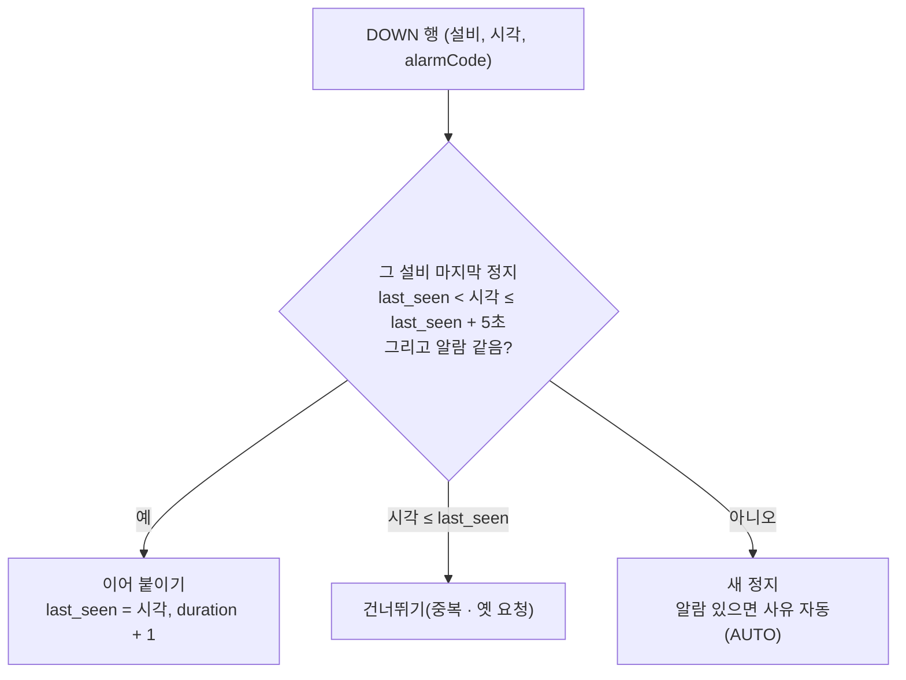
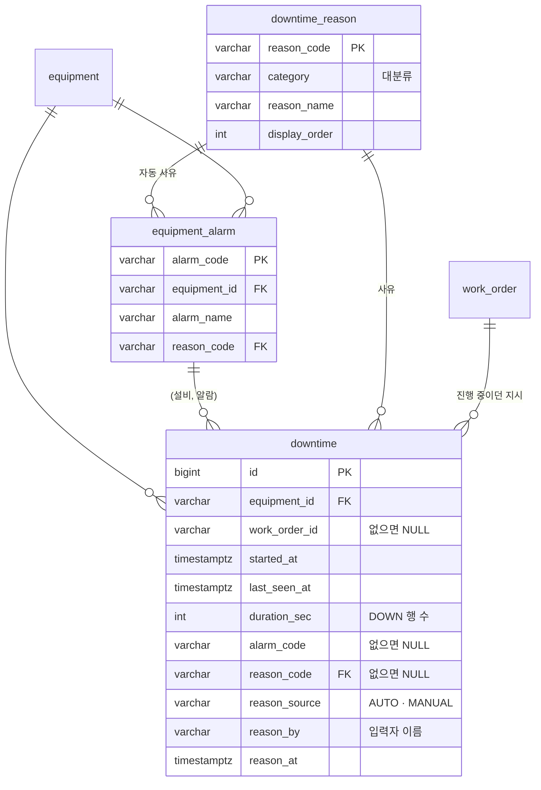
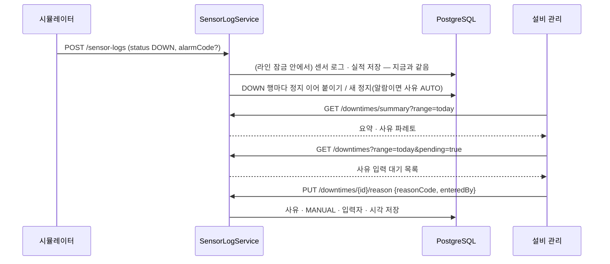
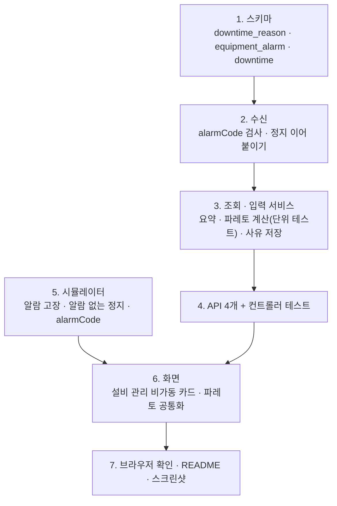

# 비가동 사유 계획

> 로드맵([mes-roadmap.md](mes-roadmap.md)) 7장 "이후 후보"의 첫 항목. 앞 단계: [oee.md](oee.md) · [quality.md](quality.md). 브랜치: `feature/downtime`

## 1. 목표

설비가 **왜 멈췄는지** 남기고, OEE 가동률 손실을 **사유별로** 나눠 보여 준다.

이번 단계가 끝나면 다음 질문에 답할 수 있다.

1. **멈춘 시간이 어디에 쓰였나?** → 비가동 사유 파레토(정지 시간 많은 순서)
2. **사유가 아직 없는 정지는 무엇인가?** → 설비 관리 화면의 "사유 입력 대기" 목록에서 작업자가 고른다
3. **알람으로 잡힌 고장은 무엇이었나?** → 알람 코드가 있는 정지는 사유가 자동으로 붙고, 틀렸으면 작업자가 고친다
4. **누가 언제 사유를 넣었나?** → 정지마다 입력 출처(자동 · 작업자) · 입력자 · 입력 시각

## 2. 정한 것

| # | 항목 | 결정 |
|---|---|---|
| 1 | 사유를 받는 방식 | **자동 + 작업자 입력을 섞는다.** 시뮬레이터가 고장 정지에 **알람 코드**를 같이 보내면 서버가 알람 → 사유로 자동 지정한다. 알람 없는 정지는 작업자가 화면에서 고른다 |
| 2 | 사유를 받는 정지 | **60초 이상** 멈춘 정지. 60초 미만(불량 뒤 3~5초 정지 등)은 사유 없이 **"순간 정지"**로 묶는다 |
| 3 | 대기(IDLE) | **이번에는 고장(DOWN)만** 다룬다. 앞 공정을 기다린 대기는 지금처럼 OEE 손실의 "대기"로 보인다 |
| 4 | 자동 사유 고치기 | **작업자가 고칠 수 있다.** 고치면 출처가 `MANUAL`이 되고 입력자 · 입력 시각이 남는다. 알람 코드는 그대로 남아 "알람은 A였는데 실제 원인은 B"를 볼 수 있다 |
| 5 | 입력 위치 | **설비 관리 화면.** 새 메뉴는 만들지 않는다. 비가동 카드에 요약 · 사유 파레토 · 사유 입력 대기 목록을 둔다 |
| 6 | 조회 구간 | OEE · 품질과 같은 구간(오늘 · 1시간 · 8시간)을 공유한다 |

## 3. 시뮬레이터: 정지 만들기

지금은 고장(DOWN)이 불량 뒤 3~5초짜리뿐이라 사유를 받을 정지가 없다. 가공 중에 가끔 긴 정지가 생기게 한다.

| 정지 | 확률(가공 중 1초마다) | 시간 | 알람 코드 | 사유 |
|---|---|---|---|---|
| 불량 뒤 정지(지금과 같음) | 불량의 50% | 3~5초 | 없음 | 순간 정지 |
| **알람 고장** | 1/2400 (평균 가공 40분에 한 번) | 60~180초 | 설비 알람 2개 중 하나 | 자동(알람 → 사유) |
| **알람 없는 정지** | 1/3600 (평균 가공 60분에 한 번) | 60~180초 | 없음 | 작업자가 입력 |

- 설비 5대를 합하면 몇 분에 한 번 긴 정지가 생긴다. 숫자는 브라우저로 보며 조정할 수 있다(구현 중 정한 점에 남긴다).
- 새 난수는 기존 난수(불량 → 경고 종류 → 시간 → 유형 → 속도 저하) **다음에** 굴린다. 기존 테스트의 난수 순서가 바뀌지 않게 한다.
- 전송 로그에 `alarmCode`를 더한다. DOWN이고 알람 고장일 때만 넣는다.
- 3D 화면은 바꾸지 않는다. 정지는 지금처럼 고장 색(빨강)으로 보인다.



## 4. 기준정보

### 비가동 사유 (작업자가 고르는 목록, 대분류 → 사유)

| 대분류 | 코드 | 사유 |
|---|---|---|
| 설비 고장 | `BREAKDOWN_MECH` | 기계 고장 |
| 설비 고장 | `BREAKDOWN_ELEC` | 전기 · 제어 고장 |
| 설비 고장 | `TOOL_JIG` | 공구 · 지그 문제 |
| 자재 | `MATERIAL_SHORTAGE` | 자재 결품 |
| 자재 | `MATERIAL_DEFECT` | 자재 불량 |
| 인원 | `OPERATOR_ABSENT` | 작업자 부재 |
| 준비 · 교체 | `CHANGEOVER` | 모델 교체 · 준비 |
| 준비 · 교체 | `CLEANING_CHECK` | 청소 · 점검 |
| 품질 | `QUALITY_HOLD` | 품질 확인 대기 |
| 기타 | `OTHER` | 기타 |

### 설비 알람 (알람 → 사유)

| 설비 | 알람 코드 | 알람 | 자동 사유 |
|---|---|---|---|
| CNC #1 | `CNC_SPINDLE_OVERLOAD` | 스핀들 과부하 | 기계 고장 |
| CNC #1 | `CNC_TOOL_BREAK` | 공구 파손 | 공구 · 지그 문제 |
| 권선기 #1 | `WINDER_WIRE_BREAK` | 선 끊김 | 기계 고장 |
| 권선기 #1 | `WINDER_TENSION` | 장력 제어 이상 | 전기 · 제어 고장 |
| 조립 셀 #1 | `ROBOT_SERVO` | 서보 알람 | 전기 · 제어 고장 |
| 조립 셀 #1 | `ROBOT_GRIPPER` | 그리퍼 이상 | 공구 · 지그 문제 |
| 검사기 #1 | `INSPECTION_SENSOR` | 측정 센서 이상 | 전기 · 제어 고장 |
| 검사기 #1 | `INSPECTION_JIG` | 검사 지그 이상 | 공구 · 지그 문제 |
| 포장기 #1 | `PACKER_JAM` | 포장재 걸림 | 기계 고장 |
| 포장기 #1 | `PACKER_FILM_EMPTY` | 포장재 소진 | 자재 결품 |

- 포장재 소진처럼 알람이 설비 고장이 아닌 사유(자재)로 이어지기도 한다. 실제 현장의 알람 매핑과 같은 모양이다.
- 시뮬레이터는 설비별 알람 코드를 안다(불량 유형처럼 서버 목록과 같아야 한다).

## 5. 정지 한 건(downtime) 만들기

센서 로그는 설비마다 1초에 1행이다. 서버가 수신할 때 **DOWN 행을 이어 붙여 정지 한 건**을 만든다.

- DOWN 행이 오면 그 설비의 마지막 정지를 본다.
  - 마지막으로 본 시각이 이 행보다 앞서고 5초 안이며, 알람 코드가 같으면 **이어 붙인다**(`last_seen_at` 갱신, `duration_sec + 1`).
  - 아니면 **새 정지**를 만든다. 알람 코드가 있으면 알람의 사유를 넣고 출처를 `AUTO`로 둔다.
  - 이 행 시각이 마지막으로 본 시각 이하면(같은 요청이 다시 왔거나 늦게 온 옛 요청) 아무것도 하지 않는다.
- 정지 시간 `duration_sec` = 이어 붙인 DOWN 행 수. OEE의 고장 초(DOWN 행 수)와 같은 기준이다.
- **진행 중**: 마지막으로 본 시각이 지금보다 10초 안이면 진행 중으로 보여 준다. 시뮬레이터가 꺼지면 그대로 끝난 정지가 된다.
- 수신은 이미 라인 잠금 안에서 하나씩 처리하므로 두 요청이 같은 정지를 동시에 만들지 않는다.
- 검사: `alarmCode`는 status가 DOWN일 때만 올 수 있다(아니면 400). 다른 설비의 알람이나 없는 알람은 외래 키 위반으로 400이고, 요청 전체를 저장하지 않는다.



## 6. 데이터



- 모두 새 테이블이라 **기존 DB를 지우지 않아도** 서버를 다시 켜면 생긴다. 기준정보는 `ON CONFLICT DO NOTHING`으로 넣는다.
- 이 기능 전의 정지는 `downtime`에 없다. 파레토 합계는 구간 안의 정지 건 기준이라, 기능 전 구간은 OEE 고장 초보다 작게 나올 수 있다.
- 인덱스: `(equipment_id, last_seen_at DESC)`(수신 때 마지막 정지 찾기), `last_seen_at`(구간 조회: 구간 시작 뒤에 끝난 정지).
- `reason_by`는 데모 로그인 사용자의 이름이다. 실제 인증이 없어 화면이 보낸 이름을 그대로 남긴다(보안 기능이 아니다).

## 7. 구간 계산

| 값 | 식 |
|---|---|
| 정지 시간(구간 안) | 정지 [started_at, last_seen_at + 1초)와 구간 [from, to)가 겹친 초 |
| 사유별 시간 | 사유가 있는 정지의 구간 안 시간 합 |
| 사유 미입력 | 사유가 없고 60초 이상인 정지 |
| 순간 정지 | 사유가 없고 60초 미만인 정지 |
| 누적 %(파레토) | 많은 순서로 더한 시간 ÷ 전체 정지 시간 |

- 파레토 순서: 사유는 시간 많은 순, 그 뒤에 **사유 미입력**, 맨 뒤에 **순간 정지**(품질의 미분류처럼 개선 순서에 넣지 않는다).
- 60초 기준은 정지 전체 길이로 판단한다(구간에 걸친 부분이 아니라).
- SQL은 합계만 내고 정렬 · 누적 %는 Java에서 계산해 단위 테스트로 검증한다(품질과 같은 방식).

## 8. 흐름



## 9. API

| 메서드 · 경로 | 설명 |
|---|---|
| `GET /api/v1/downtime-reasons` | 사유 목록(대분류 · 순서). 선택 상자에 쓴다 |
| `GET /api/v1/downtimes/summary?range=today\|1h\|8h` | 요약(정지 시간 · 60초 이상 정지 수 · 사유 미입력 수 · 순간 정지 시간)과 사유 파레토 |
| `GET /api/v1/downtimes?range=&pending=true` | 구간 안 정지 목록(60초 이상 또는 진행 중, 최근 순). `pending=true`면 사유 없는 것만 |
| `PUT /api/v1/downtimes/{id}/reason` | `{reasonCode, enteredBy}`. 출처를 `MANUAL`로 바꾼다. 없는 정지 404, 없는 사유 · 빈 입력자 400. 진행 중인 정지에도 넣을 수 있다 |

응답 예(`/downtimes/summary`)

```json
{
  "from": "2026-10-27T15:00:00Z",
  "to": "2026-10-28T03:00:00Z",
  "summary": { "downSec": 912, "stopCount": 6, "pendingCount": 2, "pendingSec": 300, "microSec": 84, "reasonSec": 528 },
  "reasons": [
    { "kind": "REASON", "reasonCode": "BREAKDOWN_MECH", "reasonName": "기계 고장", "category": "설비 고장",
      "seconds": 410, "count": 3, "cumulativeRatio": 0.45 },
    { "kind": "PENDING", "reasonCode": null, "reasonName": "사유 미입력", "category": null, "seconds": 300, "count": 2, "cumulativeRatio": 0.78 },
    { "kind": "MICRO", "reasonCode": null, "reasonName": "순간 정지", "category": null, "seconds": 84, "count": 21, "cumulativeRatio": 1.0 }
  ]
}
```

목록 한 건

```json
{ "id": 42, "equipmentId": "PACKER_01", "equipmentName": "포장기 #1", "workOrderId": "WO-20261027-006",
  "startedAt": "...", "durationSec": 134, "ongoing": false,
  "alarmCode": "PACKER_FILM_EMPTY", "alarmName": "포장재 소진",
  "reasonCode": "MATERIAL_SHORTAGE", "reasonName": "자재 결품", "reasonSource": "AUTO", "reasonBy": null, "reasonAt": null }
```

## 10. 화면 (설비 관리)

설비별 OEE 카드 아래에 **비가동** 카드를 둔다.

| 영역 | 내용 |
|---|---|
| 위 | 구간 선택(공유) + KPI 4개: 정지 시간 · 정지 수(60초 이상) · **사유 미입력** · 순간 정지 |
| 왼쪽 | **비가동 사유 파레토**: 가로 막대, "6분 50초 · 3건 · 누적 45%". 누적 80%까지 굵게, 사유 미입력은 주황 테두리, 순간 정지는 회색 |
| 오른쪽 | **정지 목록**: 설비 · 시작 시각 · 시간 · 알람 · 사유. "사유 입력 대기만" 거르기. 사유 칸은 선택 상자(대분류로 묶음) + 저장. 자동 사유에는 "자동" 표시, 작업자가 넣은 사유에는 입력자 이름 |

- 파레토는 품질의 HTML 막대를 같이 쓰도록 공통 컴포넌트로 뺀다(값 표시 형식만 다르게).
- 진행 중인 정지는 "진행 중" 표시와 함께 목록 맨 위에 둔다.
- 사유를 저장하면 목록 · 파레토를 바로 다시 읽는다(2초 폴링을 기다리지 않는다). 저장 실패는 그 줄에 오류 문구로 보인다.
- 색만으로 구분하지 않는다: "자동" · "사유 미입력" · "진행 중"은 글자로도 쓴다.

## 11. 작업 순서



## 12. 테스트

- **백엔드 단위**: 파레토 정렬(사유 → 미입력 → 순간 정지), 누적 %, 60초 경계(59초 = 순간, 60초 = 미입력), `alarmCode` 검사(DOWN이 아닌데 있음 → 400).
- **백엔드 DB**
  - DOWN 행이 이어지면 한 건, 5초 넘게 끊기거나 알람이 바뀌면 새 건, 같은 요청이 두 번 와도 시간이 늘지 않는다.
  - 알람이 있으면 사유가 자동으로 붙고 출처 `AUTO`, 다른 설비 알람은 400 · 전체 롤백.
  - 사유 입력: `MANUAL` · 입력자 · 시각이 남고, 자동 사유를 고쳐도 알람 코드는 그대로, 없는 정지 404 · 없는 사유 400.
  - 구간에 걸친 정지는 겹친 초만 센다.
- **프론트 단위**: 알람 고장 · 알람 없는 정지가 확률대로 시작되고 시간이 지나면 끝난다, 알람 고장 중에만 `alarmCode`가 있다, 기존 난수 순서가 그대로다, 파레토 표시 변환.
- **브라우저**: 시뮬레이터를 돌려 긴 정지를 만든 뒤 설비 관리에서 자동 사유가 붙은 정지와 사유 입력 대기를 본다. 사유를 넣으면 대기에서 빠지고 파레토가 바뀐다. 파레토 합계와 OEE 고장 손실(초)이 같은 구간에서 맞는지 본다.

## 13. 완료 기준

- [x] 알람 고장은 사유가 자동으로 붙고, 알람 없는 60초 이상 정지는 사유 입력 대기에 나온다
- [x] 작업자가 사유를 넣거나 자동 사유를 고치면 출처 · 입력자 · 시각이 남는다
- [x] 60초 미만 정지는 순간 정지로 묶이고 사유를 묻지 않는다
- [x] 비가동 사유 파레토가 시간 많은 순서이고 누적 %가 맞다. 미입력 · 순간 정지는 뒤에 따로 보인다
- [x] 같은 구간에서 파레토 합계 = OEE 고장 초(이 기능 뒤 구간)
- [x] 다른 설비 · 없는 알람, DOWN이 아닌 행의 alarmCode는 400이다
- [x] 기존 DB를 지우지 않고 서버 재시작만으로 적용되고, 구간 조회 · 마지막 정지 찾기가 인덱스를 쓸 수 있다(실행 계획. 지금은 행이 몇 건뿐이라 평소엔 전체 읽기를 고르고, 전체 읽기를 끄면 두 인덱스를 탄다)
- [x] 백엔드 · 프론트 테스트, lint, build 통과, README · 스크린샷 갱신

## 14. 구현 중 정한 점 (2026-10-28)

- **구간 인덱스는 `last_seen_at`**으로 바꿨다(계획은 `started_at`). 겹침 조건 중 "구간 시작 뒤에 끝났다"가 최근 구간에서 거르는 힘이 크다. 조건은 `last_seen_at > from - 1초`로 쓴다. 처음엔 `last_seen_at + 1초 > from`으로 써서 인덱스를 못 탔다(실행 계획으로 확인 후 고침).
- **겹친 초는 정지 길이(DOWN 행 수)를 넘지 않게** 자른다. 수신이 한두 초 빠지면 벽시계 길이가 행 수보다 길어지는데, OEE 고장 초는 행 수 기준이라 맞추려는 것이다.
- **정지 이어 붙이기 판단**(SKIP · EXTEND · START)은 `SensorLogService.downtimeAction`으로 떼어 DB 없이 단위 테스트한다. 수신 매퍼는 `DowntimeMapper`(만들기), 조회 · 입력은 `DowntimeQueryMapper`로 나눴다(센서 로그의 수신 · 조회 매퍼와 같은 나눔).
- **파레토 응답에 `kind`**(REASON · PENDING · MICRO)를 넣었다. 화면이 이름 글자 대신 이것으로 색 · 강조를 정한다.
- **파레토 막대를 공통 컴포넌트**(`ParetoBars.vue`, 강조 계산 `pareto.ts`)로 뺐다. 품질 불량 파레토도 같은 컴포넌트를 쓴다(화면은 그대로).
- **사유 칸은 늘 선택 상자**다. 사유가 있으면 그 값이 골라져 있고 바꾸면 저장 버튼이 켜진다(자동 사유 고치기와 미입력 넣기가 같은 조작). 고른 값은 정지 id마다 들고 있어 2초 폴링에도 지워지지 않는다.
- **사유 목록**은 기준정보라 1분마다만 다시 읽는다.
- CORS에 `PUT`을 더했다.
- **브라우저 확인(2026-10-28)**: 시뮬레이터를 약 1시간 돌려 알람 고장 3건(자동 사유) · 알람 없는 정지 1건 · 순간 정지 여러 건이 생겼다. 오늘 · 1시간 구간 모두 파레토 합계 = OEE 고장 초(440초 · 144초). 자동 사유 고치기와 미입력 사유 넣기가 출처 · 입력자 · 시각과 함께 저장되고, 입력 대기에서 빠지고 파레토가 바로 바뀌었다. 확률이 낮아 알람 없는 정지는 가공 약 40분 만에 처음 나왔다.

## 15. 이번에 하지 않는 것

- 대기(IDLE)의 사유(앞 공정 대기 · 작업지시 없음)
- 시뮬레이터 3D 화면에서 사유 입력(설비 옆 터치 패널처럼)
- 계획 정지(휴식 · 정기 점검) 일정 관리, 정지 알림 · 호출(안돈)
- 실제 로그인 · 권한(입력자 이름은 데모 로그인 그대로)
