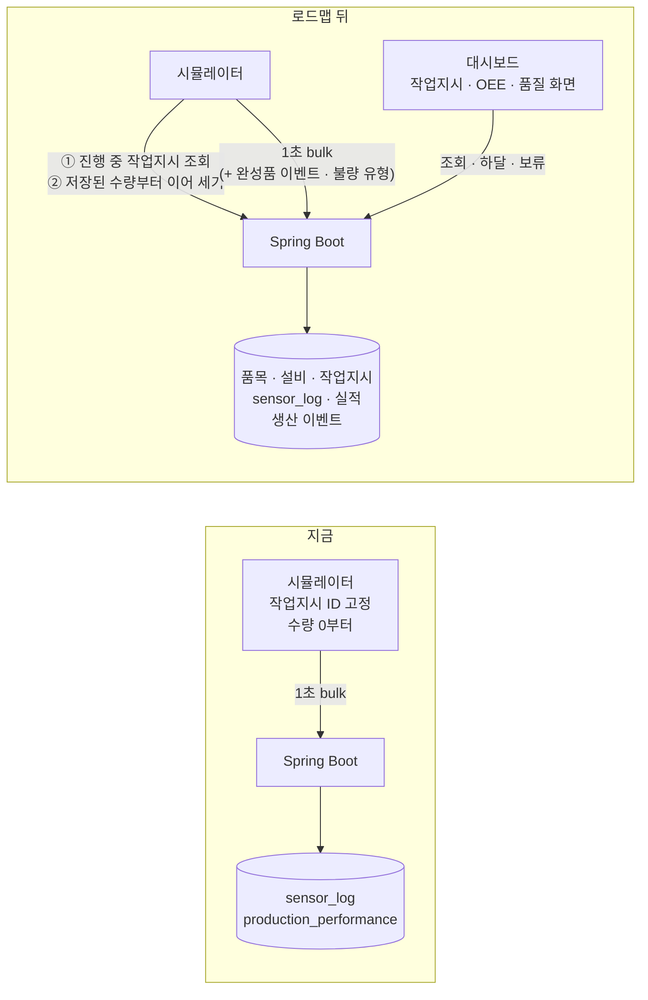
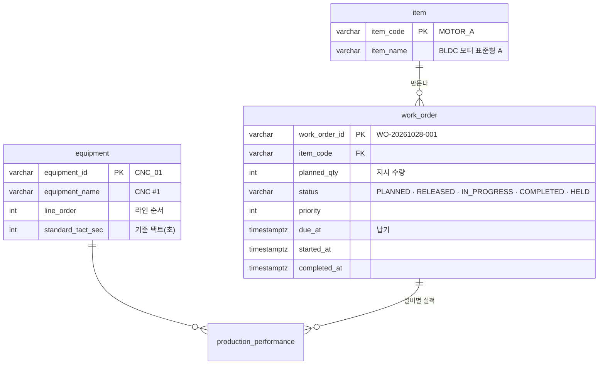
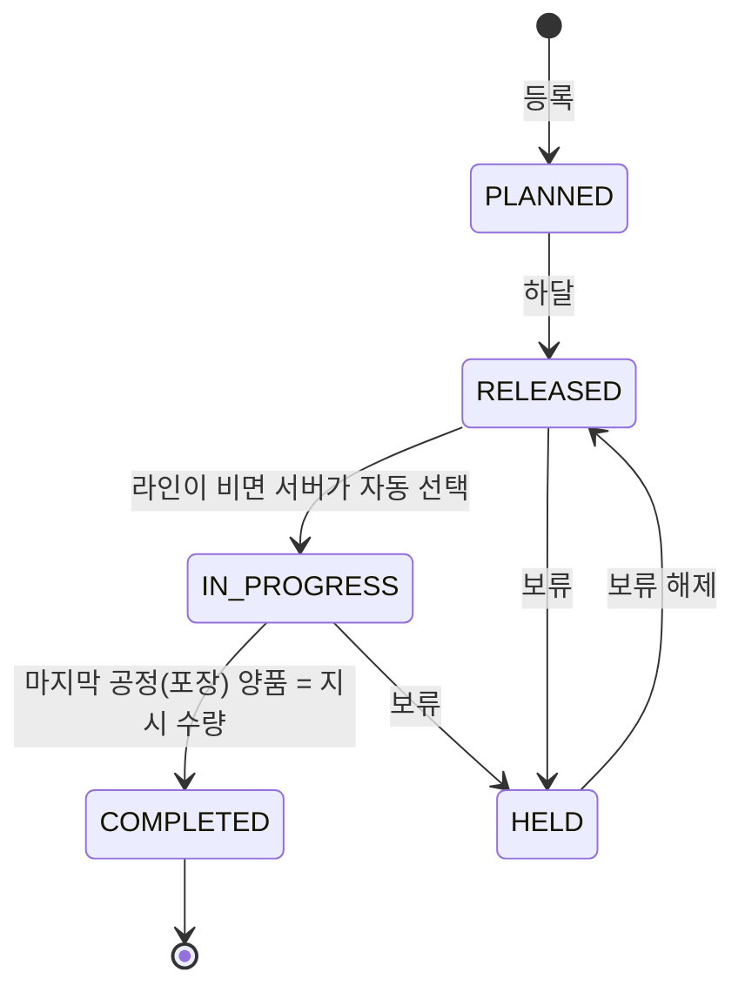
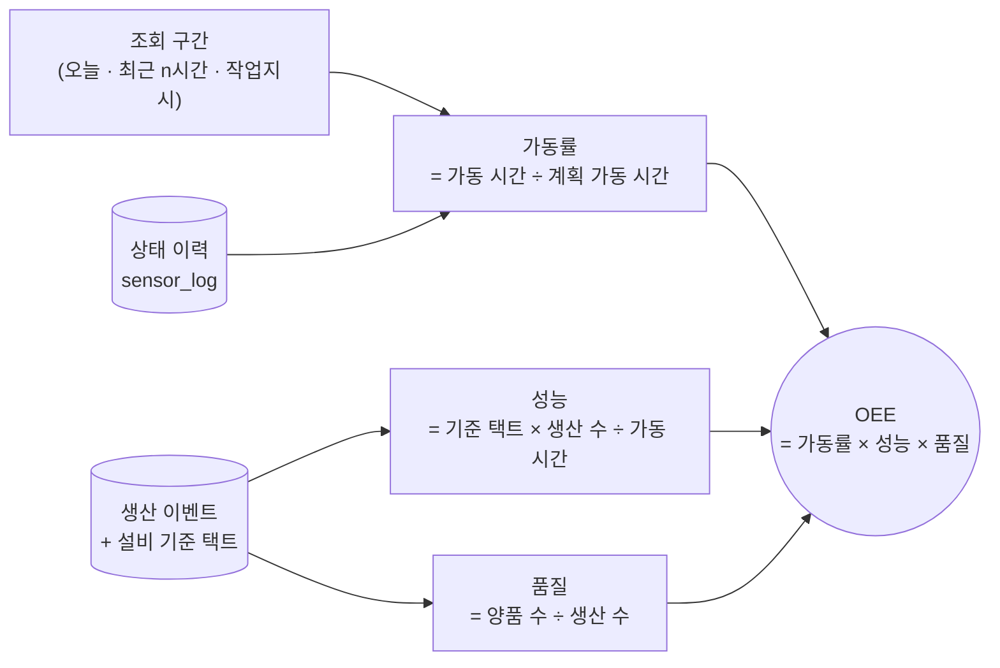

# MES 기능 로드맵: 작업지시 → OEE → 품질

> 작성 2026-10-27. 단계마다 시작 전에 이 문서를 바탕으로 상세 계획서(`docs/plans/`)를 따로 쓴다.
> `phase1~7-*.md`는 지금은 삭제된 브라우저 시뮬레이션 엔진 기준 계획서다. 개념 설명은 참고하되, 구현은 이 로드맵(시뮬레이터 → Spring Boot → PostgreSQL → 대시보드)을 따른다.

## 1. 왜 이 순서인가

지금 프로젝트는 MES 기능 중 **설비 모니터링**(상태 · 센서 · 수량 · 알림)만 있다. MES의 기본 흐름은 **"지시를 내리고 → 만들고 → 효율과 품질을 본다"**이므로 그 순서대로 채운다.

| 단계 | 기능 | 답하는 질문 | 앞 단계에서 받는 것 |
|---|---|---|---|
| 1 | 기준정보 · 작업지시 | 무엇을 몇 개 만들라고 했고, 어디까지 만들었나? | 지금의 생산 수량 |
| 2 | OEE | 설비가 제 능력의 몇 %를 냈나? 어디서 손실이 났나? | 작업지시(기준 택트 · 수량), 상태 이력 |
| 3 | 품질 | 불량이 얼마나, 무슨 이유로, 어느 설비에서 나나? | 생산 이벤트(2단계), OEE의 품질 항목 |

## 2. 지금 구조와 바뀌는 곳

시뮬레이터가 **서버에서 진행 중인 작업지시와 저장된 수량을 받아 이어 세게** 되므로, 지금 생기는 "시뮬레이터를 다시 열면 실적이 한참 멈춰 보이는 문제"(역전 방지에 막힘)도 1단계에서 함께 풀린다.

## 3. 1단계: 기준정보 · 작업지시

**목표**: 대시보드에서 작업지시를 만들고 하달하면, 시뮬레이터가 그 지시를 생산하고, 완료되면 다음 지시로 넘어간다.

### 데이터

- **설비 기준정보**: 지금 코드에 고정된 설비 5대(이름 · 라인 순서 · 택트)를 `equipment` 테이블로 옮긴다. 2단계 OEE의 기준 택트가 여기서 나온다.
- **품목**: 1~2종으로 시작한다(모터 표준형 A, 고출력형 B). 품목마다 택트가 다르게 할지는 상세 계획에서 정한다.

### 작업지시 상태

- 라인은 한 번에 작업지시 **하나**만 생산한다. 진행 중인 지시가 끝나거나 보류되면 하달된 지시 중 우선순위 → 하달 순으로 다음을 고른다.
- 완료 판정 기준은 **마지막 공정(포장기)의 양품 수**다. 앞 공정 수량은 공정별 진척으로만 보여 준다.

### API · 화면

| 구분 | 내용 |
|---|---|
| API | 작업지시 목록 · 등록 · 하달 · 보류 · 해제, 진행 중 작업지시와 설비별 저장 수량 조회(시뮬레이터용) |
| 화면 `/work-orders` | 상태별 목록(진척률 바), 등록 폼, 하달 · 보류 버튼, 선택한 지시의 공정별 진척 |
| 생산 현황 화면 | "지시 500개 중 320개 (64%) · 예상 완료 15:40" 카드 추가 |
| 시뮬레이터 | 고정 ID 대신 진행 중 작업지시를 몇 초마다 조회. 지시가 없으면 설비는 대기(생산 안 함) |

### 정한 것 (상세: [work-order.md](work-order.md))

- 지시가 없으면 새 상태 대기(IDLE), 뒤 공정은 앞 공정 양품만큼만 생산
- 수량은 누적값으로 보내고 서버 저장값부터 이어 센다
- 시뮬레이터가 여러 개면 나중에 연 탭이 넘겨받는다(실행 ID)

## 4. 2단계: OEE

**목표**: 설비별 · 라인 전체 OEE를 계산해 보여 주고, 손실이 가동률 · 성능 · 품질 중 어디서 났는지 보여 준다.

| 항목 | 데이터 | 지금 있나 |
|---|---|---|
| 가동률 | 상태 이력(RUN · WARN 시간, DOWN 시간) | 있음 |
| 성능 | 기준 택트(1단계 설비 기준정보) × 구간 안 생산 수 | 구간별 생산 수가 없음 |
| 품질 | 구간 안 양품 · 불량 수 | 구간별 수량이 없음 |

- 지금 실적 테이블은 **누적값 한 행**이라 "오늘 9시~10시에 몇 개"를 알 수 없다. 그래서 **생산 이벤트 테이블(완성품 1개 = 1행: 설비 · 작업지시 · 양품/불량 · 시각)**을 추가한다. 3단계 불량 유형도 이 테이블에 붙는다.
- 화면: 생산 현황에 라인 OEE 카드, 설비 관리에 설비별 OEE 분해(가동률 · 성능 · 품질 막대), 시간대별 OEE 추이.
### 정한 것 (상세: [oee.md](oee.md))

- 계획 가동 시간은 작업지시가 진행 중이던 시간만 센다. 앞 공정을 기다린 대기는 가동률 손실이다
- 시뮬레이터는 경고 중에 느리게 가공해 성능 손실을 만든다
- 라인 OEE = 포장기 양품 × 병목 기준 택트 ÷ 계획 가동 시간, 구간은 오늘 · 최근 1시간 · 8시간

## 5. 3단계: 품질

**목표**: 불량이 얼마나, 무슨 이유로, 어느 설비 · 작업지시에서 났는지 보여 준다.

- **시뮬레이터**: 불량이 날 때 불량 유형을 함께 보낸다(예: 가공 치수 불량, 권선 저항 불량, 조립 체결 불량, 검사 성능 미달, 포장 외관 불량). 설비마다 나올 수 있는 유형이 다르다.
- **불량 유형 기준정보** 테이블 추가, 생산 이벤트에 불량 유형 코드.
- 화면 `/quality`
  - 양품률 · 불량 수 · 직행률(공정별 합격률의 곱) 카드
  - 시간대별 불량률 추이
  - 불량 유형 파레토(큰 순서 막대 + 누적 % 선)
  - 설비별 · 작업지시별 불량 표
- 센서값과 불량의 관계(온도가 높을 때 불량이 느는지)는 시뮬레이터에 그런 규칙을 넣을지 상세 계획에서 정한다.

## 6. 공통 원칙

- 단계마다: `dev`에서 feature 브랜치 → 상세 계획서 → 구현 → 테스트 · 브라우저 확인 → README · 스크린샷 → 커밋 · 푸시(요청 시) → 사용자가 PR로 합침.
- 테이블 · 컬럼을 바꿀 때는 `schema.sql`을 고치고, 기존 데이터를 비워야 하면 미리 알린다.
- 조회 API는 지금처럼 기간 파라미터 범위를 검사하고(벗어나면 400), 새 조회는 실행 계획으로 인덱스 사용을 확인한다.
- 숨겨 둔 메뉴(작업지시 · 품질)는 그 단계에서 화면이 생길 때 보이게 한다.

## 7. 이번 로드맵에서 빼는 것 (이후 후보)

| 후보 | 이유 |
|---|---|
| 비가동 사유 입력 · 파레토 | OEE 가동률 손실을 나눠 보는 기능. OEE 이후에 붙이면 자연스럽다 |
| LOT 추적(자재 로트 → 제품) | 자재 데이터가 먼저 필요하다 |
| 자재 / 재고, 실적 리포트(교대) | 작업지시 · OEE · 품질 데이터가 쌓인 뒤가 의미 있다 |
| 실제 로그인(Spring Security) | MES 기능과 별개. 필요할 때 따로 진행 |
