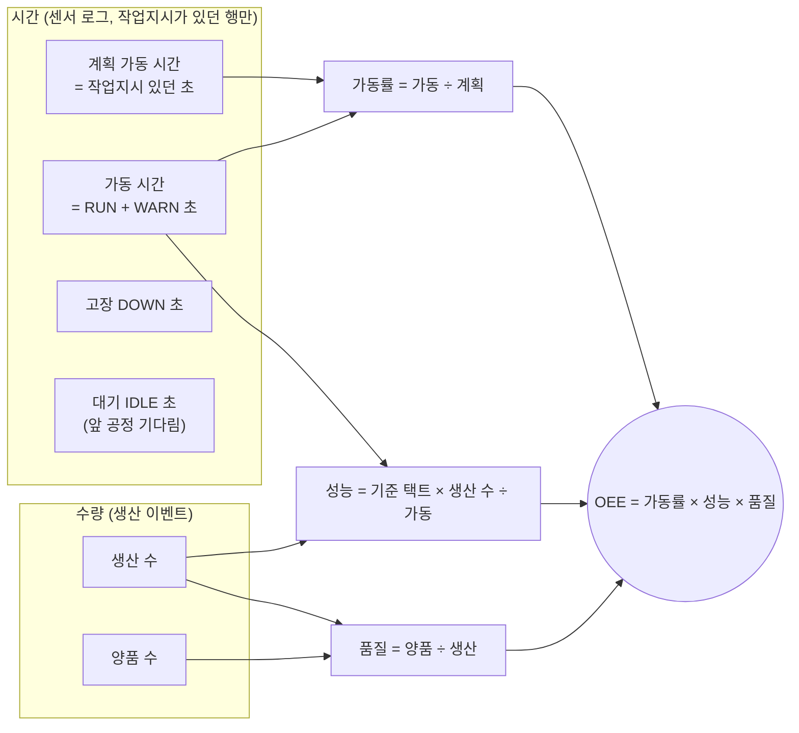
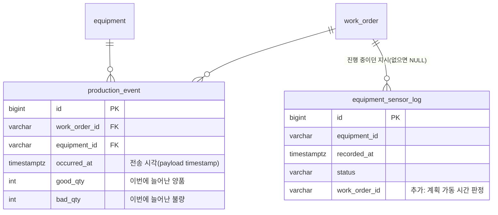
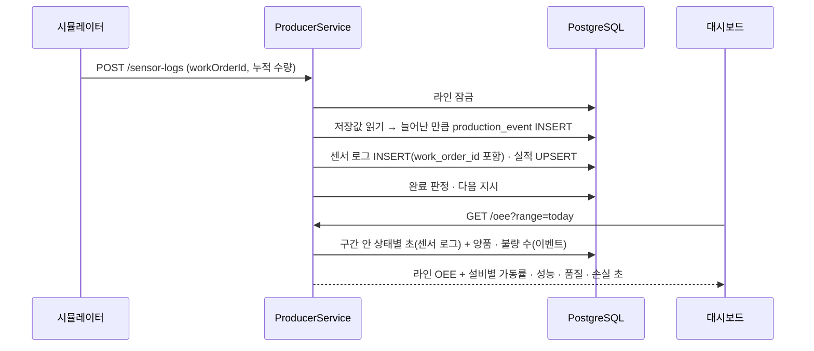
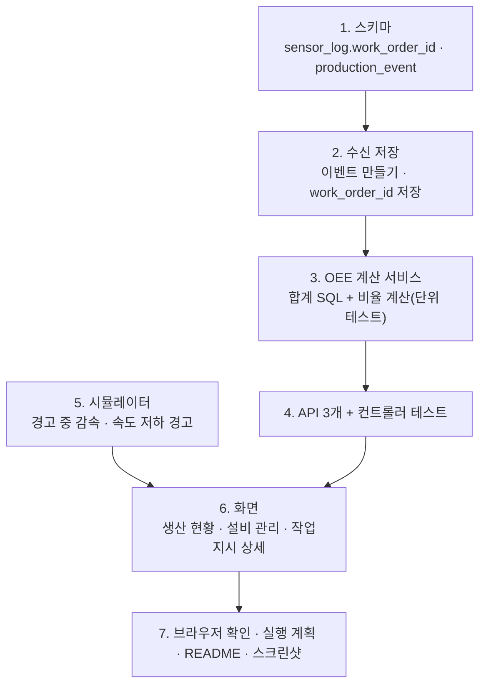

# 로드맵 2단계 계획: OEE

> 전체 순서는 [mes-roadmap.md](mes-roadmap.md) 참고. 앞 단계: [work-order.md](work-order.md). 브랜치: `feature/oee`

## 1. 목표

설비별 · 라인 전체 **OEE(설비 종합 효율)**를 계산해 보여 주고, 손실이 **가동률 · 성능 · 품질** 중 어디서 났는지 보여 준다.

이번 단계가 끝나면 다음 질문에 답할 수 있다.

1. **라인이 지금 얼마나 효율적으로 돌고 있나?** → 라인 OEE(오늘 · 최근 1시간 · 최근 8시간)
2. **어느 설비가 무엇 때문에 손해를 보나?** → 설비별 가동률 · 성능 · 품질 막대와 손실 시간(고장 · 대기 · 속도 저하 · 불량)
3. **언제 나빠졌나?** → 시간대별 라인 OEE 추이
4. **이 작업지시는 얼마나 효율적으로 만들었나?** → 작업지시 상세의 OEE

## 2. 정한 것

| # | 항목 | 결정 |
|---|---|---|
| 1 | 계획 가동 시간 | **작업지시가 진행 중이던 시간만** 센다. 지시가 없어 쉰 시간은 계획 정지라 빼고, 앞 공정을 기다린 대기(IDLE)는 **가동률 손실**로 센다. 이를 위해 센서 로그에 `work_order_id` 열을 추가한다 |
| 2 | 성능 손실 | 시뮬레이터가 **경고(WARN) 중에는 느리게** 가공한다(1초에 0.75초분, 택트 약 1.33배). 불량 뒤 경고만으로는 손실이 거의 없어서, 가공 중 가끔(평균 5분에 한 번) 30~60초짜리 **속도 저하 경고**가 생기게 한다 |
| 3 | 라인 OEE | **포장기 양품 수 × 병목(가장 느린) 기준 택트 ÷ 라인 계획 가동 시간**. 설비 OEE를 평균 내지 않는다 |
| 4 | 조회 구간 | **오늘**(Asia/Seoul 00시 ~ 지금), **최근 1시간**, **최근 8시간**. 작업지시별 OEE는 작업지시 상세에서 따로 본다 |
| 5 | 구간별 수량 | 실적 테이블은 누적값 한 행이라 구간을 나눌 수 없다. 서버가 실적을 저장할 때 **늘어난 만큼을 생산 이벤트로 한 행씩** 남긴다(시뮬레이터는 바꾸지 않는다) |
| 6 | 계산 위치 | SQL은 구간 안의 **초 · 개수 합계**만 낸다. 비율(가동률 · 성능 · 품질 · OEE)은 Java 서비스에서 계산해 단위 테스트로 검증한다 |

## 3. 계산식

센서 로그는 설비마다 1초에 1행이므로 **행 수 = 초**다(지금 상태 비율 조회와 같은 가정).



| 값 | 식 | 분모가 0일 때 |
|---|---|---|
| 가동률 | (RUN + WARN 초) ÷ 계획 가동 초 | 계획 0초 → 값 없음(`null`) |
| 성능 | 기준 택트 × 생산 수 ÷ 가동 초, **최대 100%** | 가동 0초 → `null` |
| 품질 | 양품 수 ÷ 생산 수 | 생산 0개 → `null` |
| 설비 OEE | 가동률 × 성능 × 품질 | 셋 중 하나라도 `null`이면 `null` |
| 라인 OEE | 포장기 양품 × 병목 기준 택트 ÷ 라인 계획 가동 초, 최대 100% | 계획 0초 → `null` |

- 성능을 100%로 자르는 이유: 구간 시작 직전에 가공을 시작한 1개가 구간 안에서 완성되면 가동 시간보다 생산 수가 조금 많게 잡힐 수 있다.
- 손실 시간은 함께 돌려준다: 고장(DOWN 초), 대기(IDLE 초), 속도 저하(가동 초 − 기준 택트 × 생산 수), 불량(기준 택트 × 불량 수). 화면에서 "어디서 잃었나"를 초로 보여 준다.
- 라인 계획 가동 초 = 설비 중 가장 큰 계획 가동 초(설비 5대가 같은 묶음으로 오므로 사실상 같다).

## 4. 데이터



- `equipment_sensor_log.work_order_id`: `ALTER TABLE ... ADD COLUMN IF NOT EXISTS`로 추가한다. **기존 DB를 지울 필요 없다.** 예전 로그는 NULL이라 계획 가동 시간에서 빠진다. 1초마다 쌓이는 테이블이라 외래 키는 걸지 않는다.
- `production_event`: 새 테이블이라 기존 DB도 서버를 다시 켜면 생긴다. 인덱스는 `occurred_at`(구간 조회)과 `(work_order_id, occurred_at)`(작업지시별).
- 이벤트 만들기: 실적을 저장하기 전에 같은 (작업지시, 설비)의 저장값을 읽어 **새 값 − 저장값**이 양수인 만큼 한 행을 넣는다. 수신은 이미 라인 잠금(advisory lock) 안에서 하나씩 처리하므로 두 요청이 같은 차이를 두 번 세지 않는다. 늦게 온 옛 요청(값이 더 작음)은 이벤트도 만들지 않는다.
- 구간 조회는 기존 `recorded_at` 인덱스를 쓴다. 작업지시별 조회도 그 지시의 시작 ~ 완료(또는 지금) 구간으로 범위를 좁혀 같은 인덱스를 탄다. 실행 계획으로 확인한다.

## 5. 흐름



## 6. API

| 메서드 · 경로 | 설명 |
|---|---|
| `GET /api/v1/oee?range=today\|1h\|8h` | 구간의 라인 OEE와 설비별 분해. 기본 `today`. 그 밖의 값은 400 |
| `GET /api/v1/oee/trend?range=today\|1h\|8h` | 시간대별 라인 OEE. 1시간은 5분 단위, 오늘 · 8시간은 1시간 단위 |
| `GET /api/v1/work-orders/{id}/oee` | 작업지시 하나의 OEE(그 지시가 진행 중이던 시간만). 없는 지시는 404 |

응답 예(`/oee`)

```json
{
  "from": "2026-10-27T15:00:00Z",
  "to": "2026-10-28T03:12:40Z",
  "line": { "oee": 0.62, "plannedSec": 3600, "goodCount": 45, "bottleneckTactSec": 50 },
  "equipment": [
    {
      "equipmentId": "CNC_01", "equipmentName": "CNC #1", "lineOrder": 1, "standardTactSec": 45,
      "plannedSec": 3600, "runSec": 3300, "downSec": 60, "idleSec": 240,
      "totalCount": 72, "goodCount": 68, "badCount": 4,
      "availability": 0.917, "performance": 0.982, "quality": 0.944, "oee": 0.85,
      "loss": { "downSec": 60, "idleSec": 240, "speedSec": 60, "defectSec": 180 }
    }
  ]
}
```

## 7. 화면

| 화면 | 추가 내용 |
|---|---|
| 생산 현황 | **라인 OEE 카드**: 큰 숫자(OEE %) + 구간 선택(오늘 · 1시간 · 8시간) + "포장 양품 45개 × 병목 50초 ÷ 계획 60분". 아래에 시간대별 라인 OEE 추이(막대) |
| 설비 관리 | **설비별 OEE 표**: 설비마다 OEE와 가동률 · 성능 · 품질 막대, 가장 큰 손실(예: "대기 4분"). 구간 선택은 생산 현황과 같은 값을 쓴다 |
| 작업지시 상세 | 그 지시의 라인 OEE와 설비별 가동률 · 성능 · 품질(진행 중이면 지금까지) |

- 숫자를 고르는 기준이 보이도록 막대에는 "가동률 92%"처럼 이름과 값을 같이 쓴다(색만으로 구분하지 않는다).
- 추이 막대는 값이 없는 구간(지시가 없던 시간)은 비워 둔다. 0%와 구분한다.
- 시뮬레이터 3D 화면은 바꾸지 않는다. 경고 중 감속은 상태 색(경고)으로 이미 보인다.

## 8. 작업 순서



## 9. 테스트

- **백엔드 단위**: 비율 계산(분모 0 → null, 성능 100% 자르기, 라인 OEE 병목 택트), 구간 파라미터 검사(400).
- **백엔드 DB**
  - 누적 수량이 늘면 늘어난 만큼 이벤트가 생기고, 같은 값 · 작은 값은 이벤트가 없다.
  - 센서 로그에 작업지시 ID가 저장되고, 지시 없는 로그는 계획 가동 시간에서 빠진다.
  - 작업지시별 OEE는 다른 지시의 로그 · 이벤트를 섞지 않는다.
- **프론트 단위**: 경고 중 감속(같은 택트에 더 오래 걸림), 속도 저하 경고가 가공 중에만 생김, OEE 표시용 변환(가장 큰 손실 고르기, null 표시).
- **브라우저**: 지시를 하달해 몇 분 돌린 뒤 생산 현황 OEE 카드 · 추이, 설비 관리 OEE 표, 작업지시 상세 OEE가 서로 맞는지 확인한다. 병목(조립) 뒤 공정의 대기 손실이 크게 나오는지 본다.

## 10. 완료 기준

- [x] 오늘 · 1시간 · 8시간 구간의 라인 OEE와 설비별 가동률 · 성능 · 품질이 보인다
- [x] 지시가 없던 시간은 계획 가동 시간에 들어가지 않는다
- [x] 앞 공정을 기다린 대기는 가동률 손실로 잡힌다
- [x] 경고 중 감속으로 성능이 100%보다 낮게 나온다
- [x] 불량이 나면 품질이 100%보다 낮게 나온다
- [x] 시간대별 라인 OEE 추이가 보이고, 지시 없는 구간은 비어 있다
- [x] 작업지시 상세에 그 지시만의 OEE가 보인다
- [x] 기존 DB를 지우지 않고 서버 재시작만으로 적용된다
- [x] 구간 조회가 인덱스를 쓴다(실행 계획)
- [x] 백엔드 · 프론트 테스트, lint, build 통과, README · 스크린샷 갱신

## 11. 구현 중 바뀐 점 (2026-10-27)

- **설비 관리의 "설비별 가동률" → "설비별 상태 비율"**: 기존 막대는 작업지시 없는 대기까지 분모에 넣은 단순 RUN 비율이라, 같은 화면의 OEE 가동률과 이름이 겹쳐 혼동됐다. 이름만 바꾸고 계산은 그대로 둔다.
- **작업지시별 조회 범위**: 그 지시의 시작 ~ 완료(진행 중이면 지금)에 **앞뒤 1분 여유**를 둔다. 시뮬레이터가 보낸 시각(브라우저 시계)과 서버 시각이 조금 달라 마지막 몇 초가 빠지지 않게 하려는 것이다. 작업지시 ID로도 거르므로 다른 지시가 섞이지 않는다.
- **추이 칸 맞춤**: `date_bin(칸, 시각, '2000-01-01 00:00+09')`으로 서울 기준 정각 · 5분에 맞춘다. 화면은 빈 칸까지 채워 그린다(`toTrendSlots`).
- **라인 응답**에 병목 설비 ID(`bottleneckEquipmentId`)를 함께 준다.
- **생산 이벤트 저장 순서**: 실적 UPSERT 전에 `INSERT ... SELECT (VALUES ...) LEFT JOIN production_performance`로 저장값과 비교해 한 번에 넣는다(행마다 읽지 않는다). 순서는 단위 테스트로 고정했다.

## 12. 이번 단계에서 하지 않는 것

- 비가동 사유 입력(고장 원인 분류) · 파레토 → 로드맵 7장 후보
- 품목마다 다른 기준 택트 → 지금은 설비 기준 택트 하나
- 교대(주간 · 야간) 구간 → 필요하면 조회 구간에 추가
