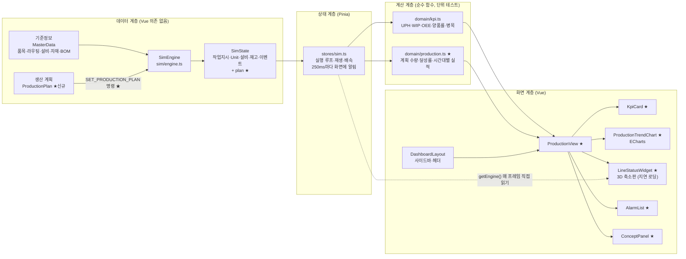
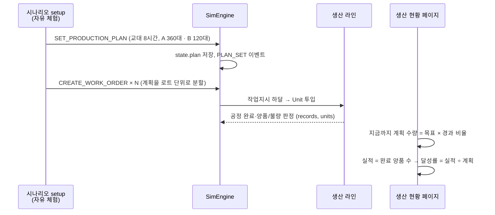

# 1단계 계획: 생산 현황 페이지

> 전체 계획은 [dashboard-plan.md](../dashboard-plan.md) 참고. 브랜치: `feature/production-overview`

## 1. 목표

대시보드의 첫 화면(`/`)인 **생산 현황** 페이지를 만든다. 생산관리자가 출근해서 가장 먼저 보는 화면으로, 한눈에 다음 세 가지에 답한다.

1. **오늘 계획대로 생산하고 있나?** → 계획 대비 실적, 달성률
2. **라인이 얼마나 잘 돌고 있나?** → UPH, OEE, 양품률, WIP, 리드타임
3. **지금 문제가 있나?** → 병목, 최근 알람, 라인 상태(3D)

이를 위해 시뮬 엔진에 **생산 계획(목표량)** 을 추가한다.

## 2. 이 단계에서 익히는 개념

| 개념 | 한 줄 설명 | 화면에서 보는 곳 |
|---|---|---|
| 생산 계획 → 작업지시 | 계획(무엇을 몇 개)을 실행 단위인 작업지시로 나눠 현장에 내린다 | 계획 카드, 개념 패널 |
| 계획 대비 실적 / 달성률 | 지금 시각까지 만들었어야 할 수량 대비 실제 양품 수 | KPI 카드, 생산 추이 차트 |
| UPH | 시간당 생산량(Units Per Hour) | KPI 카드, 시간대별 막대 |
| WIP | 라인 안에 있는 재공품 수 | KPI 카드 |
| 리드타임 | 투입부터 완료까지 걸린 시간 | KPI 카드 |
| Little의 법칙 | WIP = 처리율 × 리드타임. WIP가 늘면 리드타임도 늘어난다 | 개념 패널 |
| OEE | 가용성 × 성능 × 품질. 설비가 이론상 능력 대비 얼마나 생산했는지 | KPI 카드 |
| 양품률 | 완료된 제품 중 양품 비율 | KPI 카드 |
| 병목 | 라인 전체 속도를 정하는 가장 느린 공정 | 병목 표시, 3D 위젯 |

## 3. 화면 구성

```
┌──────────────────────────────────────────────────────────────────────┐
│ 생산 현황                              가상 데이터 🕒 01:23:45 ▶ 10× │
├──────────────────────────────────────────────────────────────────────┤
│ ┌ 계획 대비 실적 ┐ ┌ UPH ──┐ ┌ OEE ──┐ ┌ 양품률 ┐ ┌ WIP ──┐ ┌ 리드타임 ┐ │
│ │ 82 / 90 대     │ │ 58.2  │ │ 71%   │ │ 97.8%  │ │ 12    │ │ 11분 20초│ │
│ │ 달성률 91% ▼   │ │ 계획60│ │       │ │        │ │       │ │          │ │
│ └────────────────┘ └───────┘ └───────┘ └────────┘ └───────┘ └──────────┘ │
│ ┌ 시간대별 생산 추이 (ECharts) ─────────┐ ┌ 라인 현황 (3D) ──────────┐ │
│ │  막대: 시간대별 양품 수               │ │                          │ │
│ │  선: 누적 계획 / 누적 실적            │ │   [3D 공장 축소판]       │ │
│ │                                       │ │   병목: 조립 (50초/개)   │ │
│ └───────────────────────────────────────┘ └──────────────────────────┘ │
│ ┌ 최근 알람 ────────────────────────────┐ ┌ 개념 설명 ───────────────┐ │
│ │ 🔴 01:20 CNC #1 고장                  │ │ 계획 대비 실적이란? ...  │ │
│ │ 🟡 01:05 CNC #1 진동 경고             │ │ Little의 법칙 ...        │ │
│ └───────────────────────────────────────┘ └──────────────────────────┘ │
└──────────────────────────────────────────────────────────────────────┘
```

- **KPI 카드**: 큰 숫자 + 기준값(계획 UPH 등) + 좋음/주의/나쁨 색.
- **생산 추이**: 1시간 단위 막대(양품 수)와 누적 계획선·누적 실적선. 실적선이 계획선 아래로 벌어지면 계획 미달이 바로 보인다.
- **라인 현황**: 기존 3D 장면을 카드 안에 축소해 넣는다. 둘러보기(회전·확대)만 되고, 클릭 상세는 2단계 이후 각 관리 페이지로 연결한다.
- **최근 알람**: 경고·위험 이벤트만 최신순으로 최대 10건.
- **개념 설명**: 이 페이지 개념을 접었다 펼 수 있는 패널로 보여준다.

## 4. 아키텍처

### 4.1 전체 구조



★ 표시가 이번 단계에서 새로 만들거나 바꾸는 부분이다.

- **데이터 계층**: 엔진이 가상 공장을 1초 단위로 돌린다. 생산 계획은 명령으로 엔진에 넣는다(실제 MES에서 ERP/APS의 계획을 받아오는 자리).
- **계산 계층**: KPI는 상태에 저장하지 않고 스냅샷에서 매번 계산한다(기존 원칙 유지). 새 계산은 `domain/production.ts`에 두고 단위 테스트한다.
- **상태 계층**: 엔진은 매 프레임 돌지만 화면 갱신 알림은 250ms마다만 보낸다(기존 구조 유지).
- **화면 계층**: 페이지는 카드·차트·위젯 컴포넌트를 조립만 한다. 3D 위젯은 three.js가 커서(약 1MB) 지연 로딩한다.

### 4.2 생산 계획 → 작업지시 → 실적 흐름



## 5. 엔진 변경: 생산 계획 추가

### 5.1 타입 (`domain/types.ts`)

```ts
/** 생산 계획: 한 교대 동안 품목별로 몇 대를 만들지 정한 목표 */
export interface ProductionPlan {
  id: string
  /** 계획 시작 시각(시뮬 초) */
  startTime: number
  /** 계획 기간(초). 기본 8시간(1교대) */
  duration: number
  /** 품목별 목표 수량 */
  lines: { itemId: string; targetQty: number }[]
}

export interface SimState {
  // ...기존 필드
  plan: ProductionPlan | null
}
```

- 이벤트 타입에 `PLAN_SET` 추가.
- 명령에 `{ type: 'SET_PRODUCTION_PLAN'; plan: Omit<ProductionPlan, 'id'> }` 추가. 엔진은 계획을 저장하고 이벤트만 남긴다. **생산 동작은 바뀌지 않는다**(계획은 기준값일 뿐, 실제 생산은 작업지시가 움직인다).

### 5.2 목표량 정하기

- 병목인 조립 공정의 능력: A 50초/대, B 60초/대 → A:B = 3:1로 섞으면 평균 52.5초/대 ≈ **시간당 68대**.
- 계획은 능력의 약 88%인 **시간당 60대**, 8시간 **480대(A 360 · B 120)** 로 잡는다. 현업에서도 고장·자재 지연 여유를 두고 능력보다 낮게 계획한다.
- 기본 공장의 CNC는 1시간 반쯤 고장이 나도록 설정되어 있다. 따라서 그대로 두면 계획 미달이 생기고, 그 차이가 차트에 드러나는 것을 보는 것이 학습 포인트다.

### 5.3 자유 체험 작업지시를 계획에서 만들기

- 지금 자유 체험은 작업지시 5건(합계 200대)을 바로 하달한다. 계획(480대)과 맞지 않으므로, **계획을 로트(예: 40대) 단위 작업지시로 나눠 하달**하도록 바꾼다.
- 이것이 실제 MES의 "생산 계획 → 작업지시 분할" 흐름이다.
- 주의: 자유 체험은 교육 모드에서도 쓰인다. 바뀐 작업지시 구성이 교육 모드 안내 문구(예: "작업지시 5건")와 맞는지 확인하고 고친다. S1~S3 시나리오는 자기 작업지시를 따로 쓰므로 영향이 없다(테스트로 확인).

## 6. 계산 함수 (`domain/production.ts`, 신규)

| 함수 | 내용 |
|---|---|
| `planTotal(plan)` | 계획 총 목표 수량 |
| `plannedQtyAt(plan, time)` | 지금 시각까지 만들었어야 할 누적 수량 = 목표 × 경과 비율(기간 밖이면 0 또는 목표 전체) |
| `planAttainment(plan, state)` | 달성률 = 실적 양품 수 ÷ 지금까지 계획 수량. 계획이 없거나 0이면 `null` |
| `hourlyOutput(state, plan)` | 1시간 단위 버킷별 양품 수, 누적 계획, 누적 실적(차트 데이터) |
| `lineOee(state)` | 라인 OEE. 설비별 OEE(`kpi.ts`의 `oee`)의 단순 평균. 한계(병목 설비 OEE가 더 의미 있을 수 있음)는 개념 패널에 적는다 |
| `recentAlarms(state, limit)` | `warning`·`critical` 이벤트를 최신순으로 |

전부 순수 함수로 만들고 `production.test.ts`에서 단위 테스트한다.

## 7. 만들 파일

| 파일 | 내용 |
|---|---|
| `domain/types.ts` | `ProductionPlan`, `SimState.plan`, `PLAN_SET` 이벤트 (수정) |
| `sim/commands.ts`, `sim/engine.ts` | `SET_PRODUCTION_PLAN` 명령 처리 (수정) |
| `scenarios/index.ts`, `scenarios/demo.ts` | 자유 체험: 계획 설정 + 로트 분할 작업지시 (수정) |
| `domain/production.ts` (+ test) | 6장의 계산 함수 (신규) |
| `charts/echarts.ts` | ECharts에서 쓰는 차트·컴포넌트만 등록(번들 크기 절약) (신규) |
| `views/ProductionView.vue` | 생산 현황 페이지 (신규) |
| `dashboard/KpiCard.vue` | KPI 카드 (신규) |
| `dashboard/ProductionTrendChart.vue` | 시간대별 생산 추이 차트 (신규) |
| `dashboard/LineStatusWidget.vue` | 3D 축소판 + 병목 표시 (신규) |
| `dashboard/AlarmList.vue` | 최근 알람 (신규) |
| `dashboard/ConceptPanel.vue` | 개념 설명 패널, 다른 페이지에서도 재사용 (신규) |
| `scene/FactoryScene.vue` | `embedded` 옵션: 창 전체가 아니라 부모 크기에 맞춰 그리기 (수정) |
| `router.ts` | `/`를 `ProductionView`로 교체 (수정) |
| `README.md` | 아키텍처 표, 개발 기록 (수정) |

## 8. 구현 순서

각 단계마다 테스트·타입 검사·린트를 통과시키고 커밋한다.

1. **엔진**: 생산 계획 타입·명령·이벤트 + 엔진 테스트
2. **자유 체험**: 계획 설정과 로트 분할 작업지시 + 시나리오 테스트 확인
3. **계산 함수**: `domain/production.ts` + 단위 테스트
4. **KPI 카드 + 페이지 뼈대**: 숫자가 실시간으로 바뀌는 것 확인
5. **생산 추이 차트** (ECharts)
6. **최근 알람 + 개념 패널**
7. **3D 라인 위젯** (지연 로딩, embedded 모드)
8. **마무리**: 브라우저에서 확인(스크린샷), README 갱신, PR 준비

## 9. 완료 기준

- [x] 앱을 열면 생산 현황 페이지에 KPI 6개, 생산 추이, 3D 라인, 알람, 개념 패널이 보인다
- [x] 60배속으로 돌리면 CNC 고장 뒤 실적선이 계획선 아래로 벌어지고 달성률이 떨어진다
- [x] 대시보드 첫 화면 번들에 three.js가 들어가지 않는다(3D는 지연 로딩)
- [x] 교육 모드 시나리오(S1~S3) 결과가 이전과 같다(기존 테스트 통과)
- [x] `npm test`, `npm run typecheck`, `npm run lint`, `npm run build` 통과

## 10. 구현하면서 바뀐 점

- **생산 추이 차트**: 한 칸에 축 두 개 대신 위(누적)·아래(시간대별) 두 칸으로 나눴다. 진행 중인 시간대는 계획도 지금 시각 기준으로 비교한다.
- **최근 알람**: 개별 불량 폐기(`UNIT_SCRAPPED`)는 알람에서 뺐다. 설비·자재 이상만 알람으로 보고, 불량은 4단계 품질 관리에서 다룬다.
- **계획 미달**: 불량을 다시 만드는 작업지시가 없어, 8시간 계획 480대 중 양품은 약 450대에서 끝난다. 불량이 곧 계획 미달이라는 것을 보여 주는 예로 그대로 둔다.
- **첫 화면 번들**: three.js는 빠졌지만 ECharts 때문에 약 731KB(gzip 255KB)가 됐다.

## 11. 이번 단계에서 하지 않는 것

- 교대 여러 개, 날짜, 실제 시각(08:00 시작) 표시 → 6단계 실적 리포트
- 계획을 화면에서 수정하기 → 3단계 작업지시 관리에서 검토
- 3D 위젯 클릭으로 상세 보기 → 각 관리 페이지가 생긴 뒤 연결
- 관제판(TV) 모드 → 7단계
