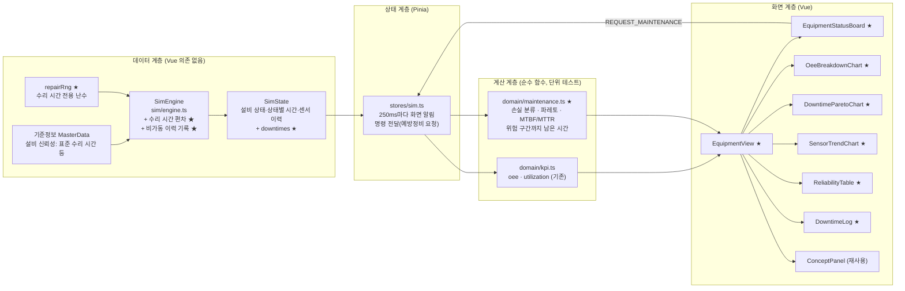
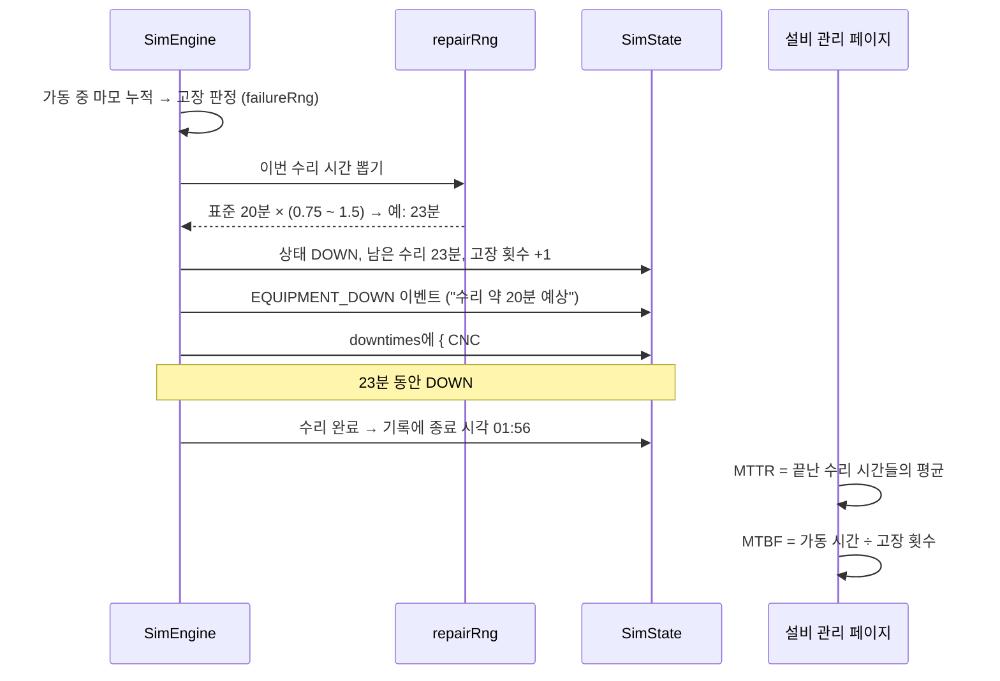

# 2단계 계획: 설비 관리 페이지

> 전체 계획은 [dashboard-plan.md](../dashboard-plan.md) 참고. 브랜치: `feature/equipment-management`

## 1. 목표

**설비 관리** 페이지(`/equipment`)를 만든다. 설비 보전 담당자가 보는 화면으로, 다음 세 가지에 답한다.

1. **어느 설비가, 왜, 얼마나 멈췄나?** → 설비 상태판, 비가동 사유 파레토, 비가동 이력
2. **설비가 제 능력을 내고 있나?** → 설비별 OEE 분해(가용성 · 성능 · 품질), MTBF · MTTR
3. **다음에 고장 날 설비는 어디인가?** → 마모도, 센서 추이, 고장 위험 구간까지 남은 가동 시간, 예방정비 요청

이를 위해 엔진에 두 가지를 더한다.

- **고장 수리 시간 편차**: 지금은 수리 시간이 고정(CNC 20분)이라 MTTR이 늘 같은 값이다. 실제처럼 수리할 때마다 시간이 조금씩 다르게 한다.
- **비가동 이력**: 설비가 멈출 때마다 "어느 설비가 · 왜 · 언제부터 언제까지" 멈췄는지 한 건씩 기록한다.

**OEE 정의는 바꾸지 않는다.** 공급 대기·막힘은 지금처럼 설비 OEE의 손실로 치지 않고, 화면에서 "라인 손실"로 따로 보여 준다.

## 2. 이 단계에서 익히는 개념

| 개념 | 한 줄 설명 | 화면에서 보는 곳 |
|---|---|---|
| 설비 상태 분류 | 가동 · 대기(공급 없음) · 막힘 · 자재 부족 · 고장 · 정비 · 휴지 | 설비 상태판 |
| OEE 분해 | OEE 숫자 하나가 아니라 가용성 · 성능 · 품질 중 어디서 손실이 났는지 본다 | OEE 분해 차트 |
| 6대 손실 | 고장 · 준비/조정 · 잠깐 멈춤 · 속도 저하 · 공정 불량 · 초기 불량. 이 공장의 상태와 대응시켜 본다 | 개념 패널 |
| 계획 정지 vs 비계획 정지 | 예방정비는 계획 정지(가용성 손실 아님), 고장·자재 부족은 비계획 정지 | 상태판, 파레토 색 구분 |
| 설비 손실 vs 라인 손실 | 설비 자체 문제(고장 등)와 앞뒤 공정 탓(공급 대기·막힘)을 나눠 봐야 원인을 제대로 짚는다 | 파레토 색 구분, 개념 패널 |
| 파레토 분석 | 사유를 큰 순서로 늘어놓으면 소수의 사유가 손실 대부분을 차지한다(80/20) | 비가동 파레토 |
| MTBF · MTTR | 평균 고장 간격(신뢰성)과 평균 수리 시간(보전성). 가용도 ≈ MTBF ÷ (MTBF + MTTR) | 고장 지표 표 |
| 상태 기반 보전 · 예지보전 | 정해진 주기가 아니라 센서·마모 상태를 보고 고장 전에 정비한다 | 센서 추이, 남은 가동 시간 |

## 3. 화면 구성

```
┌──────────────────────────────────────────────────────────────────────┐
│ 설비 관리                              가상 데이터 🕒 01:45:10 ▶ 60× │
├──────────────────────────────────────────────────────────────────────┤
│ ┌ CNC #1 ─────┐ ┌ 권선기 #1 ──┐ ┌ 조립 셀 #1 ┐ ┌ 검사기 #1 ┐ ┌ 포장기 #1 ┐│
│ │ ● 고장 12분 │ │ ● 대기      │ │ ● 가동     │ │ ● 가동    │ │ ● 대기    ││
│ │ OEE 88%     │ │ OEE 97%     │ │ OEE 98%    │ │ ...       │ │ ...       ││
│ │ 마모 ▓▓░ 0.2│ │ 마모 ▓░░    │ │            │ │           │ │           ││
│ │ 진동 경고   │ │ 위험까지 9h │ │            │ │           │ │           ││
│ │ [예방정비]  │ │ [예방정비]  │ │            │ │           │ │           ││
│ └─────────────┘ └─────────────┘ └────────────┘ └───────────┘ └───────────┘│
│ ┌ 설비별 OEE 분해 ─────────────────────┐ ┌ 비가동 사유 파레토 ─────────┐ │
│ │ 설비별 가용성·성능·품질·OEE 막대     │ │ 막대: 사유별 시간(큰 순)    │ │
│ │                                      │ │ 선: 누적 비율(%)            │ │
│ │                                      │ │ 색: 설비 손실 / 라인 손실   │ │
│ └──────────────────────────────────────┘ └─────────────────────────────┘ │
│ ┌ 센서 추이 (선택한 설비) ─────────────┐ ┌ 고장 지표 ──────────────────┐ │
│ │ 온도·진동 최근 1시간, 경고·위험선    │ │ 설비 | 고장 | MTBF | MTTR   │ │
│ └──────────────────────────────────────┘ └─────────────────────────────┘ │
│ ┌ 비가동 이력 ─────────────────────────┐ ┌ 개념 설명 ──────────────────┐ │
│ │ 01:33 CNC #1 고장  23분 (예상 20분)  │ │ MTBF · MTTR ...             │ │
│ └──────────────────────────────────────┘ └─────────────────────────────┘ │
└──────────────────────────────────────────────────────────────────────┘
```

- **설비 상태판**: 설비마다 카드 하나. 현재 상태(색 + 글자), 정지 중이면 남은 시간, OEE, 마모도 막대, 센서 경보 단계, 고장 위험 구간까지 남은 가동 시간, 예방정비 요청 버튼. 카드를 누르면 그 설비가 선택되어 센서 추이와 비가동 이력이 그 설비로 바뀐다.
- **설비별 OEE 분해**: 설비마다 가용성 · 성능 · 품질 · OEE 막대를 나란히 그린다. 어느 요소가 OEE를 깎는지 바로 보인다.
- **비가동 사유 파레토**: 라인 전체의 비가동 시간을 사유별로 큰 순서로 막대로 그리고, 누적 비율을 선으로 겹친다. 설비 손실(고장 · 자재 부족)과 라인 손실(공급 대기 · 막힘), 계획 정지(예방정비)를 색으로 구분한다.
- **센서 추이**: 선택한 설비의 온도 · 진동 최근 1시간(30초 간격 120점)과 경고 · 위험 임계선.
- **고장 지표**: 설비별 고장 횟수, MTBF, MTTR, MTBF·MTTR로 계산한 가용도. 고장이 없으면 "—"로 두고, 표본이 적다는 안내를 붙인다.
- **비가동 이력**: 고장 · 예방정비 · 자재 부족 정지를 최신순으로. 고장은 "실제 수리 시간 (표준 20분)"을 함께 보여 줘 편차가 보이게 한다.

## 4. 아키텍처

### 4.1 전체 구조



★ 표시가 이번 단계에서 새로 만들거나 바꾸는 부분이다.

### 4.2 고장 → 수리 → 기록 흐름



## 5. 엔진 변경

### 5.1 고장 수리 시간 편차

- 고장이 날 때마다 수리 시간을 **표준 수리 시간 × 0.75 ~ 1.5** 사이에서 뽑는다. 분포는 **삼각분포**(최빈값 1.0)로 한다.
  - 대부분 표준 근처에서 끝나지만, 가끔 부품 수배 등으로 길어지는 경우가 있는 **오른쪽 꼬리**를 흉내 낸다. 실제 수리 시간도 짧아지는 데는 한계가 있고 길어지는 쪽으로 늘어진다.
  - CNC(표준 20분): 15 ~ 30분, 평균 약 21.7분. 그 밖의 설비(표준 15분): 약 11 ~ 22.5분.
  - 초 단위로 반올림한다.
- **예방정비 시간은 그대로 고정**(5분)이다. 계획된 작업이라 시간이 예측 가능하다는 점이 고장 수리와의 차이이고, 이것도 화면 개념 설명에서 짚는다.
- **수리 시간 전용 난수(`repairRng`)** 를 따로 둔다. 고장 판정 난수(`failureRng`)에서 꺼내 쓰면 그 뒤의 고장 시각까지 함께 밀리기 때문이다. 기존처럼 용도별로 난수를 나눠 한 모델을 바꿔도 다른 모델이 흔들리지 않게 한다.
- 고장 이벤트 문구는 "수리 약 20분 예상"처럼 **표준 시간**을 보여 준다. 현장에서도 고장 직후에는 예상 시간만 알고, 실제 시간은 끝나야 안다. 실제 시간은 비가동 이력에 남는다.
- `Reliability.repairTime`의 뜻은 "표준(예상) 수리 시간"으로 바뀐다. 타입 주석과 교육 모드 설비 상세의 "수리 20분" 표시를 "표준 20분 (15~30분)"처럼 고친다.

### 5.2 비가동 이력

```ts
/** 설비 손실·계획 정지 사유 */
export type DowntimeReason = 'BREAKDOWN' | 'PM' | 'MATERIAL'

/** 비가동 한 건: 설비가 멈춘 구간 */
export interface DowntimeRecord {
  id: string
  equipmentId: string
  reason: DowntimeReason
  start: number
  /** 아직 멈춰 있으면 null */
  end: number | null
  /** 고장·정비의 표준(예상) 시간. 자재 부족은 null */
  expected: number | null
}

export interface SimState {
  // ...기존 필드
  downtimes: DowntimeRecord[]
}
```

- 설비가 `DOWN` · `PM` · `STARVED_MATERIAL`로 바뀌면 한 건을 열고, 그 상태를 벗어나면 종료 시각을 채운다.
  - tick 마지막(상태별 시간 누적 직전)에 설비마다 "열린 기록의 사유"와 "지금 상태"를 비교해서 열고 닫는다. 상태를 바꾸는 코드가 여러 곳에 흩어져 있어도 기록이 빠지지 않는다.
- **공급 대기(`STARVED`) · 막힘(`BLOCKED`)은 한 건씩 기록하지 않는다.** 가공 한 번마다 몇 초씩 생겼다 사라져서 기록이 수천 건이 되고, 설비 자체 사유도 아니다. 파레토에서는 기존 상태별 누적 시간(`statusTime`)으로 합계만 보여 준다.
- 기록은 최근 200건까지만 보관한다(8시간 자유 체험에서 실제로는 수십 건 이하).
- 엔진 동작(생산 결과)은 바뀌지 않는다. 기록만 더한다.

### 5.3 영향 범위

- **결과 수치가 바뀐다**: 수리 시간이 달라지므로 고장이 나는 경우의 생산량·정지 시간이 조금 바뀐다.
  - 교육 모드 S2 결과표("조치 없음"의 정지 20분 등)와 README 시나리오 표 수치를 다시 재서 고친다.
  - S2 안내·해설 문구의 "20분"을 "약 20분"으로 고친다.
  - 고장이 없는 실행(S1, S3, 정비 조치를 한 S2)은 그대로다.
- 시나리오 테스트(S1~S3 모범 조치가 조치 없음보다 나은지)는 그대로 통과해야 한다.

## 6. 계산 함수 (`domain/maintenance.ts`, 신규)

| 함수 | 내용 |
|---|---|
| `lossBreakdown(eq)` | 설비 시간을 가동 · 설비 손실(고장, 자재 부족) · 계획 정지(예방정비) · 라인 손실(공급 대기, 막힘) · 휴지로 나눈 값 |
| `downtimePareto(state)` | 라인 전체 비가동 시간을 사유별로 합쳐 큰 순서로 정렬하고 누적 비율과 손실 구분을 붙인다. 진행 중인 정지도 지금 시각까지 포함 |
| `reliabilityStats(state, equipmentId)` | 고장 횟수, MTBF(가동 시간 ÷ 고장 횟수), MTTR(끝난 수리 시간의 평균), 가용도(MTBF ÷ (MTBF + MTTR)). 값이 없으면 `null` |
| `hoursToFailureRisk(eq, reliability)` | 지금 마모 속도로 고장 위험 구간(마모도 0.7)까지 남은 **가동** 시간. 이미 넘었으면 0 |
| `downtimeLog(state, equipmentId?, limit)` | 비가동 이력을 최신순으로(설비 필터 선택) |

- MTBF의 "가동 시간"은 `RUN` 시간으로 한다. 이 엔진에서 고장은 가동 중에만 나기 때문이다.
- 전부 순수 함수로 만들고 `maintenance.test.ts`에서 단위 테스트한다.

## 7. 만들 파일

| 파일 | 내용 |
|---|---|
| `domain/types.ts` | `DowntimeReason`, `DowntimeRecord`, `SimState.downtimes`, `repairTime` 주석 (수정) |
| `sim/repair.ts` (+ test) | 수리 시간 뽑기(삼각분포) (신규) |
| `sim/engine.ts` | `repairRng`, 수리 시간 편차, 비가동 이력 열기·닫기 (수정) |
| `domain/maintenance.ts` (+ test) | 6장의 계산 함수 (신규) |
| `views/EquipmentView.vue` | 설비 관리 페이지 (신규) |
| `dashboard/EquipmentStatusBoard.vue` | 설비 상태판 카드 + 예방정비 요청 (신규) |
| `dashboard/OeeBreakdownChart.vue` | 설비별 OEE 분해 차트 (신규) |
| `dashboard/DowntimeParetoChart.vue` | 비가동 사유 파레토 차트 (신규) |
| `dashboard/SensorTrendChart.vue` | 선택한 설비의 센서 추이 차트 (신규) |
| `dashboard/ReliabilityTable.vue` | 고장 횟수 · MTBF · MTTR 표 (신규) |
| `dashboard/DowntimeLog.vue` | 비가동 이력 목록 (신규) |
| `concepts/equipment.ts` | 설비 관리 개념 설명 문구 (신규) |
| `charts/echarts.ts` | 필요하면 차트 컴포넌트 추가 등록 (수정) |
| `router.ts` | `/equipment`를 `EquipmentView`로 교체 (수정) |
| `scenarios/breakdown.ts`, `ui/detail/EquipmentDetail.vue` | "20분" → "약 20분", 표준 수리 시간 표시 (수정) |
| `README.md` | 기능 표 상태, 엔진 규칙(수리 시간 편차, 비가동 이력), S2 수치 (수정) |

## 8. 구현 순서

각 단계마다 테스트 · 타입 검사 · 린트를 통과시키고 커밋한다.

1. **수리 시간 편차**: `sim/repair.ts` + 엔진 적용 + 테스트(범위 안, 같은 seed면 같은 값, 정비 시간은 고정)
2. **비가동 이력**: 타입 + 엔진 기록 + 테스트(고장·정비·자재 부족이 각각 열리고 닫히는지, 생산 결과는 그대로인지)
3. **시나리오 수치 갱신**: S2 결과 다시 측정, 문구 수정, 시나리오 테스트 확인
4. **계산 함수**: `domain/maintenance.ts` + 단위 테스트
5. **페이지 뼈대 + 설비 상태판**: 예방정비 요청까지 동작 확인
6. **OEE 분해 · 비가동 파레토 차트**
7. **센서 추이 · 고장 지표 · 비가동 이력 · 개념 패널**
8. **마무리**: 브라우저 확인(스크린샷), README 갱신, PR 준비

## 9. 완료 기준

- [x] 사이드바의 설비 관리를 누르면 상태판, OEE 분해, 파레토, 센서 추이, 고장 지표, 비가동 이력, 개념 패널이 보인다
- [x] 60배속으로 돌리면 CNC 고장 시 상태판이 "고장"과 남은 시간을 보여 주고, 파레토에 고장 막대가 생기며, 이력에 실제 수리 시간과 표준 시간이 함께 남는다
- [x] 같은 seed에서 수리 시간은 늘 같고, 고장마다 값은 표준의 0.75 ~ 1.5배 안에서 달라진다
- [x] 상태판에서 예방정비를 요청하면 현재 제품을 마친 뒤 정비에 들어가고, 이력에 예방정비(계획 정지)로 남는다
- [x] 비가동 이력을 더해도 생산 결과는 같다(테스트로 확인)
- [x] 교육 모드 S1~S3 시나리오 테스트가 통과하고, 바뀐 S2 수치를 README에 반영했다
- [x] `npm test`, `npm run lint`, `npm run build`(타입 검사 포함) 통과

## 10. 구현하면서 바뀐 점

- **설비별 시간 구성 차트 추가**: 계획서에 없던 차트다. 설비마다 가동 · 비계획 정지 · 계획 정지 · 라인 손실 · 휴지를 100% 누적 막대로 보여 준다. "설비 OEE는 높은데 공급 대기가 많다"를 한눈에 보여 주려고 넣었다(OEE 정의를 유지하기로 한 결정을 화면에서 뒷받침).
- **고장 중 표시**: 상태판에 처음에는 "남은 수리 시간"을 보여 줬다. 현장에서는 수리가 끝나야 실제 시간을 알 수 있으므로 "경과 시간 · 예상(표준) 시간"으로 바꿨다. 예방정비는 계획된 시간이라 남은 시간을 그대로 보여 준다.
- **OEE 분해 세로축**: 값이 대부분 90% 이상이라 0부터 그리면 차이가 보이지 않는다. 가장 낮은 값을 10% 단위로 내린 곳에서 시작하고, 차트 아래에 그 사실을 적었다.
- **S2 수치**: 조치 없음 기준 정지 20분 → 22분 48초, 양품 190 → 187대. S1 · S3와 S2 모범 조치는 그대로다. 해설 문구는 실제 수리 시간을 보여 주도록 바꿨다.
- **자유 체험 고장 시각**: 첫 고장(약 1시간 34분)까지는 수리 난수를 쓰지 않아 그대로다. 그 뒤 결과만 수리 시간에 따라 달라진다.
- **생산 결과 보존 확인**: "비가동 이력을 넣어도 생산 결과가 같다"는 직접 비교 대신, 기본 공장 8시간 실행에서 사유별 기록 기간 합계가 설비 상태별 누적 시간과 정확히 같은지로 확인했다(기록은 상태를 읽기만 한다).
- **페이지 공통 클래스**: 생산 현황 전용이던 `.production`을 `.dash-page`로 바꿔 두 페이지가 함께 쓴다.
- **첫 화면 번들**: 약 751KB(gzip 262KB)로 1단계보다 약 20KB 늘었다.

## 11. 이번 단계에서 하지 않는 것

- 고장 유형 세부 코드(스핀들 베어링, 공구 파손 등)와 유형별 수리 시간 → 필요하면 이후 단계에서 검토
- 설비 가동 타임라인(간트 차트) → 6단계 실적 리포트에서 검토
- 정비 작업지시 · 보전 이력 관리(CMMS), 예비 부품 재고
- 교대별 · 일별 설비 지표 → 6단계 실적 리포트
- 관제판(TV) 모드 → 7단계
