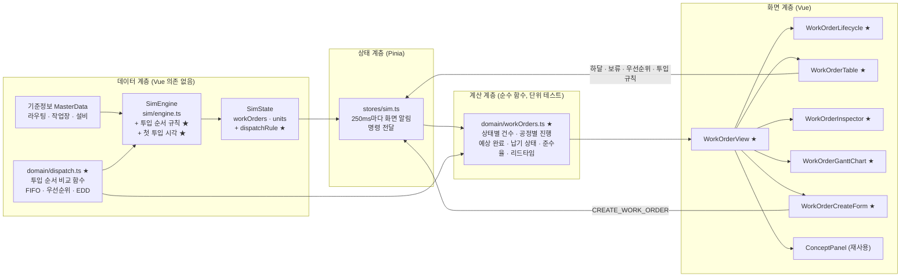
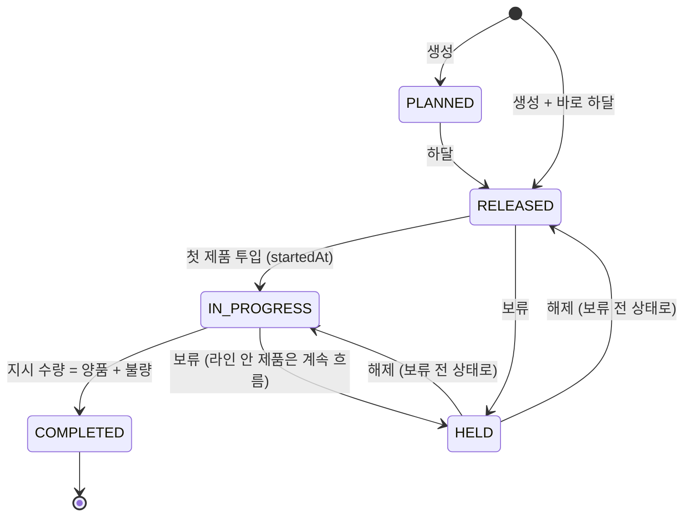
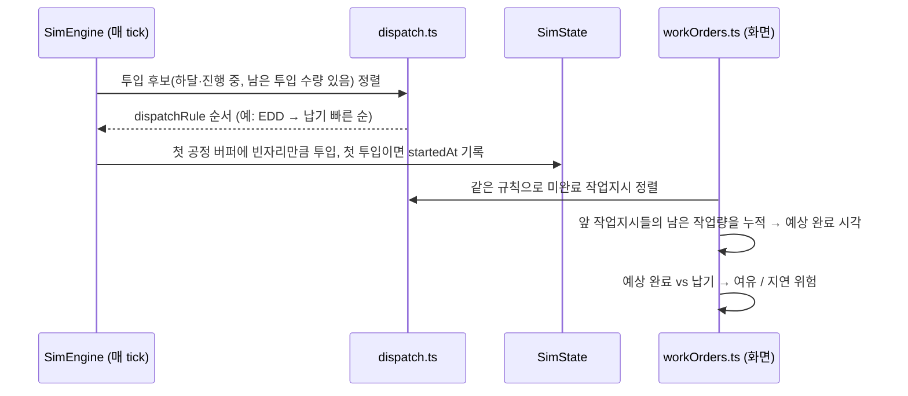

# 3단계 계획: 작업지시 관리 페이지

> 전체 계획은 [dashboard-plan.md](../dashboard-plan.md) 참고. 브랜치: `feature/work-order-management`

## 1. 목표

**작업지시 관리** 페이지(`/work-orders`)를 만든다. 생산 관리자(현장 반장)가 보는 화면으로, 다음 세 가지에 답한다.

1. **지금 어떤 작업지시가 어디까지 진행됐나?** → 상태 흐름, 작업지시 목록(진척률), 공정별 진행
2. **납기를 지킬 수 있나?** → 예상 완료 시각, 납기 여유·지연 위험, 납기 준수율, 작업지시 일정 차트
3. **무엇을 먼저 만들까?** → 하달 · 보류 · 우선순위 조정, 디스패칭(투입 순서) 규칙, 긴급 작업지시 생성

엔진에는 이미 작업지시 생명주기(계획 → 하달 → 진행 → 완료, 보류)와 하달 · 보류 · 우선순위 명령이 있다. 이번 단계에서는 다음만 더한다.

- **투입 순서 규칙(디스패칭 규칙)**: 지금은 "우선순위 높은 순 → 하달 순" 하나로 고정이다. 하달 순(FIFO) · 우선순위 · 납기 빠른 순(EDD) 중 고를 수 있게 한다. **기본값은 지금과 같은 우선순위**라 기존 결과는 바뀌지 않는다.
- **첫 투입 시각(`startedAt`)**: 작업지시의 첫 제품이 라인에 들어간 시각. 대기 시간(하달 → 첫 투입)과 작업 시간(첫 투입 → 완료)을 나눠 보기 위해 필요하다.
- **자유 체험 작업지시에 납기**: 지금은 12건 모두 납기가 없어 납기 관리 화면이 비어 있다. 생산 계획 속도에 맞춰 납기를 붙인다(5.3).

## 2. 이 단계에서 익히는 개념

| 개념 | 한 줄 설명 | 화면에서 보는 곳 |
|---|---|---|
| 생산 계획 → 작업지시 | 계획(무엇을 얼마나)은 로트 단위 작업지시(현장 실행 단위)로 나뉘어 내려온다 | 개념 패널, 목록의 계획 대비 지시 수량 |
| 작업지시 생명주기 | 계획(PLANNED) → 하달(RELEASED) → 진행(IN_PROGRESS) → 완료(COMPLETED), 그리고 보류(HELD) | 상태 흐름 |
| 하달과 투입 | 하달은 "만들어도 된다"는 허가, 투입은 실제로 첫 공정에 제품을 넣는 것. 하달됐어도 라인이 차 있으면 기다린다 | 목록의 대기 시간, 상세의 주요 시각 |
| 보류(Hold) | 품질 문제 · 자재 · 고객 요청으로 새 투입을 멈춘다. 이미 라인에 들어간 제품은 끝까지 흐른다 | 보류 버튼, 상태 흐름 |
| 라우팅과 공정 진행 | 작업지시는 라우팅(공정 순서)을 따라 흐른다. 공정마다 몇 개가 지나갔는지로 진행 위치를 안다 | 공정별 진행 |
| 디스패칭 규칙 | 다음에 무엇을 투입할지 정하는 규칙. FIFO · 우선순위 · EDD(납기 빠른 순). 규칙에 따라 납기 준수가 달라진다 | 투입 순서 규칙 선택, 개념 패널 |
| 납기 준수율(OTD) | 납기 안에 끝낸 작업지시 비율. 예상 완료 시각으로 지연을 미리 본다 | KPI 카드, 납기 열, 일정 차트 |
| 작업지시 리드타임 | 하달 → 완료 시간 = 대기 시간 + 작업 시간. 1단계의 제품 리드타임(투입 → 완료)과 구분한다 | KPI 카드, 상세 |

## 3. 화면 구성

```
┌──────────────────────────────────────────────────────────────────────────┐
│ 작업지시 관리                                  가상 데이터 🕒 02:10:00 ▶ 60× │
├──────────────────────────────────────────────────────────────────────────┤
│ [진행 1] [대기 8] [완료 3] [보류 0] [납기 준수율 100%] [지연 위험 2] [WO 리드타임] │
├──────────────────────────────────────────────────────────────────────────┤
│ 상태 흐름:  계획 0 ─▶ 하달 8 ─▶ 진행 1 ─▶ 완료 3        보류 0 (↕ 하달·진행)    │
│            (누르면 목록을 그 상태로 거름)                                  │
├──────────────────────────────────────────┬───────────────────────────────┤
│ 작업지시 목록           투입 순서 [우선순위▼] │ 작업지시 상세 (WO-0004)        │
│ ID   품목 수량 진척      상태 우선 납기  예상  │ 주요 시각: 생성·하달·첫 투입·완료 │
│ WO-4 A   40  ▓▓▓░ 62%  진행  0  02:55 02:41 │ 공정별 진행                     │
│ WO-5 B   40  ░░░░  0%  하달  0  03:35 03:24 │  가공 ▓▓▓▓▓▓ 30 / 40           │
│ ...                         [하달][보류][↑↓]│  권선 ▓▓▓▓▓░ 28 / 40 …         │
├──────────────────────────────────────────┴───────────────────────────────┤
│ 작업지시 일정 (간트)                                                      │
│ WO-1 ████████                   │ 실적(첫 투입 → 완료)                     │
│ WO-4        ██████▒▒▒  ◆        │ ▒ 예상(지금 → 예상 완료), ◆ 납기           │
├──────────────────────────────────────────┬───────────────────────────────┤
│ 작업지시 생성 (품목·수량·우선순위·납기)       │ 개념 설명                       │
└──────────────────────────────────────────┴───────────────────────────────┘
```

- **KPI 카드**: 상태별 건수, 납기 준수율(완료된 작업지시 중 납기 안에 끝낸 비율), 지연 위험 건수(예상 완료가 납기를 넘거나 이미 납기가 지난 미완료 작업지시), 평균 작업지시 리드타임(하달 → 완료).
- **상태 흐름**: 생명주기를 화살표로 그리고 상태마다 건수를 보여 준다. 상태를 누르면 목록이 그 상태로 걸러진다(다시 누르면 해제).
- **작업지시 목록**: 투입 순서대로 정렬한다(완료된 것은 아래). 진척 막대(양품 · 불량 · 라인 안), 상태, 우선순위, 납기, 예상 완료, 납기 여유(+12분 / 지연 8분). 행마다 하달 · 보류(해제) · 우선순위 ↑↓ 버튼. 행을 누르면 상세가 그 작업지시로 바뀐다.
- **투입 순서 규칙**: 목록 위 선택 상자. FIFO · 우선순위 · EDD.
- **작업지시 상세**: 주요 시각(생성 · 하달 · 첫 투입 · 완료)과 대기 시간 · 작업 시간, 라우팅 공정마다 통과 수 / 가공 중 / 대기 / 불량.
- **작업지시 일정**: 작업지시마다 가로 막대. 실적 구간(첫 투입 → 완료 또는 지금), 예상 구간(지금 → 예상 완료), 납기 표시(◆). 지금 시각 세로선.
- **작업지시 생성**: 품목, 수량, 우선순위, 납기(지금부터 N시간 후, 비우면 납기 없음), "바로 하달" 체크.

## 4. 아키텍처

### 4.1 전체 구조



★ 표시가 이번 단계에서 새로 만들거나 바꾸는 부분이다. 투입 순서 비교 함수를 `domain/dispatch.ts`에 두고 **엔진(실제 투입)과 예상 완료 계산이 같은 함수를 쓴다.** 화면의 목록 순서와 실제 투입 순서가 어긋나지 않게 하기 위해서다.

### 4.2 작업지시 생명주기



- 이 그림은 엔진이 이미 하는 동작이다. 이번 단계에서 바꾸지 않는다.
- 보류 중에 라인 안 제품이 모두 끝나면? 지금 엔진은 지시 수량을 모두 투입·처리해야 완료하므로 보류 상태로 남는다. 그대로 둔다.

### 4.3 투입과 예상 완료 계산



## 5. 엔진 변경

### 5.1 투입 순서 규칙

```ts
/** 다음에 투입할 작업지시를 고르는 규칙 */
export type DispatchRule = 'FIFO' | 'PRIORITY' | 'EDD'

export interface SimState {
  // ...기존 필드
  dispatchRule: DispatchRule   // 기본 'PRIORITY'
}

// commands.ts
| { type: 'SET_DISPATCH_RULE'; rule: DispatchRule }
```

| 규칙 | 정렬 기준 | 특징 |
|---|---|---|
| FIFO | 하달 순 → 생성 순 | 단순하고 공정하지만 급한 주문을 앞당기지 못한다 |
| PRIORITY (기본) | 우선순위 높은 순 → 하달 순 → 생성 순 | **지금 엔진과 같다.** 사람이 우선순위를 직접 관리해야 한다 |
| EDD | 납기 빠른 순(납기 없으면 맨 뒤) → 하달 순 → 생성 순 | 납기 지연을 줄이는 대표 규칙. 우선순위는 무시한다 |

- 비교 함수는 `domain/dispatch.ts`의 `compareForDispatch(rule)`로 만들고, 엔진의 `releaseWorkOrders()`가 이 함수로 정렬한다.
- 규칙은 **첫 공정 투입 순서만** 정한다. 투입된 뒤에는 라인이 FIFO라 순서가 바뀌지 않는다. 이것도 개념 패널에서 짚는다.
- 규칙이 바뀌면 `DISPATCH_RULE_CHANGED` 이벤트를 남긴다.

### 5.2 첫 투입 시각

- `WorkOrder.startedAt: number | null`을 더하고, 첫 제품을 투입할 때 기록한다(상태가 IN_PROGRESS로 바뀌는 그 순간).
- 대기 시간 = 첫 투입 − 하달, 작업 시간 = 완료 − 첫 투입, 작업지시 리드타임 = 완료 − 하달.

### 5.3 자유 체험 작업지시 납기

- 계획을 로트로 나눈 순서대로, **계획 속도(시간당 60대)로 그 로트까지 다 만들었어야 하는 시각 + 여유 15분**을 납기로 붙인다.
  - 1번 로트(40대): 40분 + 15분 = 0:55, 2번: 1:35, …, 12번(480대째): 8:15.
  - 라인 능력(시간당 약 68대)이 계획보다 조금 높아 평소에는 납기를 지키고, CNC 고장(20분 안팎) 직후 1~2건이 지연 위험으로 바뀌었다가 만회하는 모습을 볼 수 있게 하려는 값이다. 구현할 때 실제로 돌려 보고 여유 시간을 조정한다.
- 계산 함수는 `domain/production.ts`에 `lotDueTimes(plan, lots, margin)`으로 둔다(테스트 포함).
- 납기는 투입 순서(기본 우선순위 규칙)에 영향을 주지 않으므로 **생산 결과는 그대로다.**

### 5.4 영향 범위

- 기본 규칙이 지금과 같고 납기는 투입에 쓰이지 않으므로 S1~S3, 자유 체험의 생산 결과는 바뀌지 않는다. 시나리오 테스트와 기존 엔진 테스트가 그대로 통과해야 한다.
- 교육 모드 작업지시 패널(`ui/WorkOrderPanel.vue`)은 그대로 둔다. 자유 체험에서 납기 열이 채워지는 것만 달라진다.

## 6. 계산 함수 (`domain/workOrders.ts`, 신규)

| 함수 | 내용 |
|---|---|
| `statusCounts(state)` | 상태별 작업지시 건수 |
| `dispatchQueue(state)` | 미완료 작업지시를 현재 투입 규칙 순서로(보류 · 계획은 뒤로). 목록 정렬에 쓴다 |
| `routingProgress(state, master, woId)` | 라우팅 공정마다 통과(양품으로 다음 공정에 넘긴 수) · 가공 중 · 대기 · 불량 수 |
| `estimateCompletion(state, master)` | 작업지시별 예상 완료 시각. 아래 참고 |
| `dueStatus(wo, eta, now)` | 납기 없음 / 여유 N분 / 지연 위험 / 지연 / 준수 / 지연 완료 |
| `onTimeRate(state)` | 납기가 있는 완료 작업지시 중 납기 안에 끝낸 비율. 없으면 `null` |
| `workOrderTimes(wo)` | 대기 시간 · 작업 시간 · 리드타임 |
| `averageWorkOrderLeadTime(state)` | 완료된 작업지시의 평균 리드타임. 없으면 `null` |

**예상 완료 시각 계산 (근사)**

1. 하달 · 진행 중인 미완료 작업지시를 투입 순서대로 줄 세운다. 계획 · 보류 상태는 예상하지 않는다(화면에 "미하달" · "보류"로 표시).
2. 품목마다 **병목 시간** = 라우팅 공정 중 (사이클타임 ÷ 그 작업장 설비 대수)의 최댓값. 사이클타임 변경(사용자 조치)과 설비 추가를 반영한다. 기본 공장에서 A 50초, B 60초(조립).
3. 앞에서부터 남은 수량(지시 수량 − 양품 − 불량) × 병목 시간을 누적해 지금 시각에 더한다. 마지막 제품이 병목 뒤 공정을 지나는 시간(병목 다음 공정들의 사이클타임 합)을 더한다.
4. 고장 · 자재 부족 · 불량 재투입이 없다고 보는 **표준 능력 기준 예상**이다. 화면에도 그렇게 적는다.

전부 순수 함수로 만들고 `workOrders.test.ts`에서 단위 테스트한다. `dispatch.ts`도 테스트한다.

## 7. 만들 파일

| 파일 | 내용 |
|---|---|
| `domain/types.ts` | `DispatchRule`, `SimState.dispatchRule`, `WorkOrder.startedAt`, 이벤트 타입 (수정) |
| `domain/dispatch.ts` (+ test) | 투입 순서 비교 함수, 규칙 이름 (신규) |
| `sim/commands.ts` | `SET_DISPATCH_RULE` (수정) |
| `sim/engine.ts` | 규칙으로 투입 정렬, `startedAt` 기록, 규칙 변경 명령 (수정) |
| `domain/production.ts` (+ test) | `lotDueTimes` (수정) |
| `scenarios/demo.ts`, `scenarios/index.ts` | 자유 체험 작업지시에 납기 (수정) |
| `domain/workOrders.ts` (+ test) | 6장의 계산 함수 (신규) |
| `views/WorkOrderView.vue` | 작업지시 관리 페이지 (신규) |
| `dashboard/workOrders/WorkOrderLifecycle.vue` | 상태 흐름 + 상태 필터 (신규) |
| `dashboard/workOrders/WorkOrderTable.vue` | 목록, 조작 버튼, 투입 순서 규칙 선택 (신규) |
| `dashboard/workOrders/WorkOrderInspector.vue` | 선택한 작업지시 상세(주요 시각, 공정별 진행) (신규) |
| `dashboard/workOrders/WorkOrderGanttChart.vue` | 작업지시 일정 차트 (신규) |
| `dashboard/workOrders/WorkOrderCreateForm.vue` | 작업지시 생성 폼 (신규) |
| `concepts/workOrders.ts` | 개념 설명 문구 (신규) |
| `charts/echarts.ts` | 간트용 `CustomChart` 등록 (수정) |
| `router.ts` | `/work-orders`를 `WorkOrderView`로 교체 (수정) |
| `README.md`, `docs/dashboard-plan.md` | 기능 표 상태, 엔진 규칙(투입 순서 규칙, 납기), 스크린샷, 계획서 링크 (수정) |

## 8. 구현 순서

각 단계마다 테스트 · 타입 검사 · 린트를 통과시키고 커밋한다.

1. **투입 순서 규칙 + 첫 투입 시각**: `dispatch.ts` + 엔진 적용 + 테스트(규칙별 순서, 기본 규칙이면 기존 결과와 같음, `startedAt` 기록)
2. **자유 체험 납기**: `lotDueTimes` + 시나리오 적용 + 테스트, 60배속으로 돌려 여유 시간 확인
3. **계산 함수**: `domain/workOrders.ts` + 단위 테스트
4. **페이지 뼈대 + KPI 카드 + 상태 흐름 + 목록**: 하달 · 보류 · 우선순위 · 규칙 변경 동작 확인
5. **상세 + 일정 차트**
6. **생성 폼 + 개념 패널**
7. **마무리**: 브라우저 확인(스크린샷), README 갱신, PR 준비

## 9. 완료 기준

- [ ] 사이드바의 작업지시 관리를 누르면 KPI 카드, 상태 흐름, 목록, 상세, 일정 차트, 생성 폼, 개념 패널이 보인다
- [ ] 60배속으로 돌리면 작업지시가 하달 → 진행 → 완료로 넘어가고, 진척 막대 · 공정별 진행 · 일정 차트가 함께 움직인다
- [ ] CNC 고장 뒤 예상 완료가 늦어지고, 납기를 넘는 작업지시가 지연 위험으로 표시된다
- [ ] 보류하면 새 투입이 멈추고(라인 안 제품은 계속), 해제하면 이어서 투입된다
- [ ] 납기가 이른 긴급 작업지시를 만들고 EDD로 바꾸면 그 작업지시가 먼저 투입된다
- [ ] 기본 규칙에서 S1~S3 · 자유 체험 생산 결과가 바뀌지 않는다(기존 테스트 통과)
- [ ] `npm test`, `npm run lint`, `npm run build`(타입 검사 포함) 통과

## 10. 구현하면서 바뀐 점

(구현 후 기록)

## 11. 이번 단계에서 하지 않는 것

- 작업지시 취소 · 강제 종료(지시 수량을 다 못 채우고 마감), 수량 변경, 분할 · 병합
- 불량분 재투입(재작업 작업지시) → 4단계 품질 관리에서 검토
- 작업자 · 교대 배정, 작업 시작 · 종료 실적 입력(POP) → 6단계에서 교대 개념과 함께 검토
- 유한 능력 일정 계획(APS) 수준의 예상 완료(고장 · 자재 반영) → 근사만 한다
- 설비 선택 디스패칭(같은 작업장 여러 설비 중 어디에 줄지) → 지금처럼 비어 있는 설비 순
