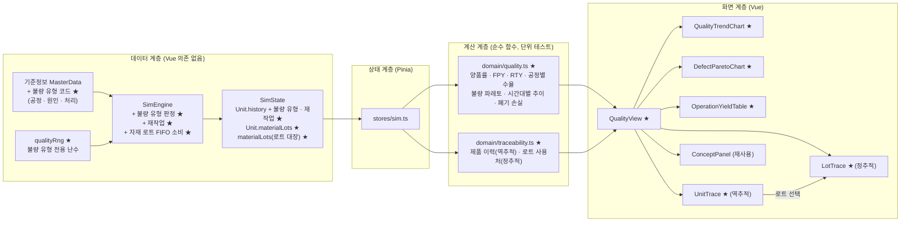
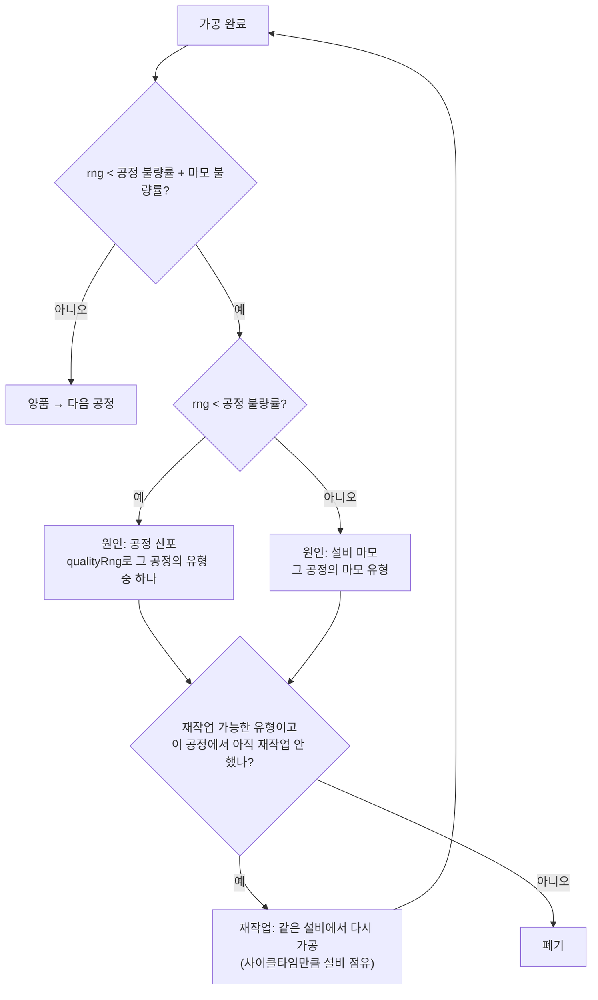
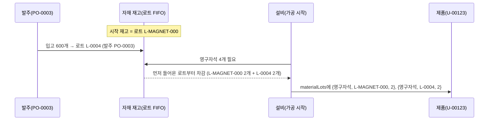

# 4단계 계획: 품질 관리 페이지

> 전체 계획은 [dashboard-plan.md](../dashboard-plan.md) 참고. 브랜치: `feature/quality-management`

## 1. 목표

**품질 관리** 페이지(`/quality`)를 만든다. 품질 담당자가 보는 화면으로, 다음 세 가지에 답한다.

1. **품질이 얼마나 좋은가?** → 최종 양품률, 직행률(FPY), 공정별 수율과 RTY, 시간대별 불량 추이
2. **무엇 때문에 불량이 나나?** → 불량 유형 파레토(공정 · 원인 · 처리 구분), 설비 마모와 불량의 관계
3. **문제가 생기면 어디까지 영향이 있나?** → 제품 이력 역추적(어느 설비 · 언제 · 어떤 자재 로트), 자재 로트 정추적(이 로트가 들어간 제품은)

지금 엔진은 불량이 나면 그 자리에서 폐기만 하고, 불량 유형과 자재 로트를 기록하지 않는다. 이번 단계에서 세 가지를 더한다.

- **불량 유형 코드**: 불량마다 "어느 공정에서 · 무슨 불량인지 · 원인(공정 산포 / 설비 마모)"을 남긴다.
- **재작업(Rework)**: 일부 불량은 그 자리에서 한 번 다시 가공해 살린다. 직행률(FPY)과 최종 양품률이 달라지는 이유, 재작업이 설비 능력을 갉아먹는 "숨은 공장"을 보여 주기 위해서다. **생산 결과가 바뀌므로 확인이 필요하다(8장 결정 1).**
- **자재 입고 로트**: 입고(발주)마다 로트 번호를 붙이고, 가공할 때 먼저 들어온 로트부터(FIFO) 쓰며 제품에 로트를 기록한다. 추적성의 핵심 데이터다.

## 2. 이 단계에서 익히는 개념

| 개념 | 한 줄 설명 | 화면에서 보는 곳 |
|---|---|---|
| 불량 처리(Disposition) | 불량이 나면 재작업 · 폐기 · 특채(그대로 사용) 중 하나로 처리한다. 이 공장은 재작업과 폐기 | 파레토 색 구분, 제품 이력 |
| 최종 양품률 vs 직행률(FPY) | 최종 양품률은 재작업으로 살린 것까지 양품, FPY는 한 번도 불량 없이 끝난 비율. 둘의 차이가 재작업량이다 | KPI 카드 |
| RTY(누적 수율) | 공정별 1차 합격률을 곱한 값. 공정이 많을수록 작은 불량률도 크게 쌓인다 | 공정별 수율 표 |
| 숨은 공장(Hidden Factory) | 재작업은 장부에 불량으로 안 남지만 설비 시간과 사람을 쓴다. 병목에서 재작업하면 생산량이 준다 | 공정별 수율 표의 재작업 시간 |
| 불량 파레토 · 4M | 불량 유형을 큰 순서로 보고, 원인을 사람 · 설비 · 자재 · 방법(4M)으로 나눠 대책을 정한다 | 불량 유형 파레토 |
| 설비 상태와 품질 | 설비 마모가 쌓이면 불량이 먼저 늘고 그 뒤 고장이 난다(2단계 예지보전과 연결) | 불량 추이(원인 구분) |
| LOT 추적성 | 역추적: 불량품 → 어느 설비 · 언제 · 어떤 자재 로트. 정추적: 문제 로트 → 그 로트가 들어간 제품 · 작업지시. 리콜 범위를 정하는 근거 | 제품 이력 조회, 자재 로트 추적 |
| 품질 비용(COPQ) | 폐기 자재비와 재작업 시간처럼 품질이 나빠서 드는 비용 | KPI 카드 |

## 3. 화면 구성

```
┌───────────────────────────────────────────────────────────────────────────┐
│ 품질 관리                                       가상 데이터 🕒 02:00:00 ▶ 60× │
├───────────────────────────────────────────────────────────────────────────┤
│ [최종 양품률] [직행률 FPY] [RTY] [재작업 N건] [폐기 N개] [폐기 손실 ₩]          │
├──────────────────────────────────────────┬────────────────────────────────┤
│ 시간대별 품질 추이                          │ 불량 유형 파레토                   │
│ 막대: 시간대별 불량 수(공정 산포/설비 마모)    │ 막대: 유형별 건수(큰 순)             │
│ 선: 시간대별 직행률                         │ 색: 재작업 / 폐기, 선: 누적 비율       │
├──────────────────────────────────────────┴────────────────────────────────┤
│ 공정별 수율                                                                  │
│ 공정 | 1차 가공 | 1차 합격 | 재작업 | 재작업 성공 | 폐기 | 1차 합격률 | 재작업 시간 │
│ ... | RTY = 가공 99% × 권선 99% × 조립 99.5% × 검사 98% × 포장 100% = 95.6%    │
├──────────────────────────────────────────┬────────────────────────────────┤
│ 제품 이력 조회 (역추적)                      │ 자재 로트 추적 (정추적)              │
│ [U-00123 ▼] 또는 최근 불량품 목록에서 선택     │ [자재 ▼] 로트 목록: 입고 시각·수량·사용량 │
│ 작업지시 · 공정별 설비 · 시각 · 결과 · 불량 유형  │ 로트 선택 → 사용 제품 수, 작업지시,    │
│ 사용 자재 로트 (누르면 정추적으로)              │ 그중 불량 · 폐기 수                  │
├──────────────────────────────────────────┴────────────────────────────────┤
│ 개념 설명                                                                    │
└───────────────────────────────────────────────────────────────────────────┘
```

- **KPI 카드**: 최종 양품률(완료 ÷ (완료 + 폐기)), 직행률(한 번도 불량 없이 완료 ÷ (완료 + 폐기)), RTY, 재작업 건수, 폐기 수, 폐기 손실(폐기품에 들어간 자재비).
- **시간대별 품질 추이**: 1시간 단위 불량 수를 원인(공정 산포 / 설비 마모)으로 나눠 쌓고, 시간대별 직행률을 선으로 겹친다. CNC 마모가 쌓이는 1시간대에 마모 불량이 늘고, 예방정비 · 수리 뒤 줄어드는 것이 보인다.
- **불량 유형 파레토**: 유형별 건수를 큰 순서로, 재작업 · 폐기를 색으로 구분하고 누적 비율을 겹친다. 막대에 마우스를 올리면 공정 · 원인(4M)이 보인다.
- **공정별 수율**: 공정마다 1차 가공 수, 1차 합격, 재작업(성공 · 실패), 폐기, 1차 합격률, 재작업에 쓴 설비 시간. 맨 아래에 RTY를 곱셈식으로 보여 준다.
- **제품 이력 조회(역추적)**: 제품 번호를 고르면(최근 불량 · 재작업 제품 목록 제공) 작업지시, 공정마다 설비 · 시작/종료 시각 · 결과 · 불량 유형, 사용한 자재 로트를 보여 준다. 로트를 누르면 오른쪽 정추적으로 넘어간다.
- **자재 로트 추적(정추적)**: 자재를 고르면 로트 목록(로트 번호, 입고 시각, 입고 수량, 사용량, 남은 수량). 로트를 고르면 그 로트를 쓴 제품 수, 작업지시별 수, 그중 불량 · 폐기 수.

## 4. 아키텍처

### 4.1 전체 구조



★ 표시가 이번 단계에서 새로 만들거나 바꾸는 부분이다.

### 4.2 가공 완료 시 품질 판정 흐름



- 불량 여부 판정은 지금과 같은 난수 한 번(`rng() < 불량률`)이다. 그 값을 공정 불량률과 비교해 원인을 나누므로 **원인 구분 자체는 결과를 바꾸지 않는다.**
- 유형 선택은 따로 둔 `qualityRng`를 쓴다.
- 재작업은 한 공정에서 한 번까지만 한다. 재작업한 제품이 또 불량이면 폐기한다.

### 4.3 자재 로트 흐름



## 5. 엔진 변경

### 5.1 불량 유형 코드 (기준정보)

```ts
/** 불량 원인: 공정 산포(평소 불량률) / 설비 마모 */
export type DefectCause = 'PROCESS' | 'WEAR'
/** 처리: 재작업(한 번 다시 가공) / 폐기 */
export type Disposition = 'REWORK' | 'SCRAP'

export interface DefectCode {
  id: string
  name: string
  workCenterId: string
  cause: DefectCause
  disposition: Disposition
  /** 같은 공정 · 같은 원인의 유형 중 뽑힐 비중 */
  weight: number
}
// MasterData.defectCodes: DefectCode[]
```

기본 공장의 불량 유형(안):

| 공정 | 유형 | 원인 | 처리 | 비중 |
|---|---|---|---|---|
| 하우징 가공 | 버(Burr) 잔존 | 공정 | 재작업(디버링) | 6 |
| 하우징 가공 | 표면 찍힘 | 공정 | 폐기 | 4 |
| 하우징 가공 | 치수 불량(내경) | 마모 | 폐기 | 1 |
| 스테이터 권선 | 권선 수 불량 | 공정 | 재작업(재권선) | 5 |
| 스테이터 권선 | 절연 피막 손상 | 공정 | 폐기 | 5 |
| 스테이터 권선 | 장력 불균일 | 마모 | 폐기 | 1 |
| 조립 | 체결 토크 불량 | 공정 | 재작업(재체결) | 7 |
| 조립 | 베어링 압입 불량 | 공정 | 폐기 | 3 |
| 조립 | 압입 위치 편차 | 마모 | 폐기 | 1 |
| 검사 | 외관 불량 | 공정 | 재작업(재세척 · 재도장) | 3 |
| 검사 | 소음 · 진동 초과 | 공정 | 폐기 | 4 |
| 검사 | 역기전력 미달 | 공정 | 폐기 | 3 |
| 검사 | 측정 지그 오차 | 마모 | 폐기 | 1 |

- 포장은 불량률 0이라 유형이 없다.
- 기준정보 검증: 불량률이 0보다 큰 공정에는 공정 원인 유형이 하나 이상, 마모 정보가 있는 설비의 공정에는 마모 원인 유형이 하나 있어야 한다.
- 검사 공정의 불량은 "검사에서 발견된 불량"이다. 실제로는 앞 공정에서 만들어진 불량을 검사가 잡는 것이지만, 이 엔진은 발견한 공정에 기록한다. 개념 패널에서 짚는다.

### 5.2 재작업

- 재작업 유형이면 제품을 폐기하지 않고 **같은 설비에서 사이클타임만큼 다시 가공**한다. 설비는 그동안 가동(`RUN`) 상태이고 새 제품을 받지 못한다(숨은 공장).
- 재가공 결과도 같은 방식으로 판정한다. 불량이면 유형과 관계없이 폐기한다(한 공정 재작업 1회).
- 재작업에는 자재를 다시 쓰지 않는다.
- 설비 OEE의 품질 요소는 지금처럼 "가공 횟수 중 양품 비율"이라, 재작업 가공은 불량 1회 + 다시 가공 1회로 센다.
- `UnitHistoryEntry`에 `defectCode`와 `rework`(재작업 가공인지)를 더한다. 같은 공정이 두 번 기록될 수 있다.
- `WorkOrder`에 `reworkQty`(재작업 횟수)를 더한다.

### 5.3 자재 입고 로트

```ts
export interface MaterialLot {
  id: string            // L-0001 (시작 재고는 L-<자재>-000)
  materialId: string
  qty: number           // 입고 수량
  remaining: number
  receivedAt: number
  purchaseOrderId: string | null  // 시작 재고는 null
}
// MaterialStock.lots: string[]       — 남은 로트 id, 먼저 들어온 순
// SimState.materialLots: Record<string, MaterialLot>  — 로트 대장(다 쓴 로트도 보관)
// Unit.materialLots: { materialId, lotId, qty }[]
```

- 입고 시 로트를 만들고, 가공 시작 시 먼저 들어온 로트부터 차감한다(FIFO). 한 번에 두 로트에 걸칠 수 있다.
- `onHand`는 지금처럼 유지하고, 로트 남은 수량의 합과 같아야 한다(테스트로 확인).

### 5.4 영향 범위

- **결과 수치가 바뀐다**: 재작업으로 폐기가 줄고 양품이 늘지만, 재가공이 설비 시간을 써서 병목(조립) 능력이 조금 줄고, 난수를 쓰는 순서도 달라진다.
  - 교육 모드 S1 ~ S3 결과(README 시나리오 표)와 해설 문구, 자유 체험 고장 시각, 3단계 납기 지연(WO-003) 설명을 다시 재서 고친다.
  - 시나리오 테스트(모범 조치가 조치 없음보다 나은지)는 통과해야 한다.
- 불량 유형 판정 · 자재 로트는 기록만 더하므로 결과를 바꾸지 않는다(재작업만 바꾼다).

## 6. 계산 함수

**`domain/quality.ts` (신규)**

| 함수 | 내용 |
|---|---|
| `qualitySummary(state, master)` | 최종 양품률, FPY, 재작업 건수 · 성공 수, 폐기 수, 폐기 손실(폐기품에 쓴 자재 수량 × 단가) |
| `operationYields(state, master)` | 공정별 1차 가공 · 1차 합격 · 재작업 · 재작업 성공 · 폐기 · 1차 합격률 · 재작업 시간, 그리고 RTY |
| `defectPareto(state, master)` | 유형별 건수(큰 순), 누적 비율, 처리 · 원인 · 공정 |
| `hourlyQuality(state)` | 시간대별 불량 수(원인별), 직행률 |

**`domain/traceability.ts` (신규)**

| 함수 | 내용 |
|---|---|
| `unitTrace(state, master, unitId)` | 제품 이력: 작업지시, 공정별(설비 · 시각 · 결과 · 불량 유형 · 재작업), 사용 자재 로트 |
| `lotsOf(state, materialId)` | 자재의 로트 목록(입고 순), 사용량 |
| `lotUsage(state, lotId)` | 로트를 쓴 제품 수, 작업지시별 수, 그중 완료 · 폐기 · 재작업 수 |
| `recentDefectUnits(state, limit)` | 최근 불량 · 재작업이 있었던 제품(조회 목록용) |

전부 순수 함수로 만들고 단위 테스트한다.

## 7. 만들 파일

| 파일 | 내용 |
|---|---|
| `domain/types.ts` | `DefectCode`, `DefectCause`, `Disposition`, `MaterialLot`, 이력 · 작업지시 · 재고 · 상태 필드 (수정) |
| `scenarios/baseline.ts` | 기본 공장 불량 유형 코드 (수정) |
| `sim/engine.ts` | 불량 유형 판정, 재작업, `qualityRng`, 자재 로트 FIFO, 기준정보 검증 (수정) |
| `sim/quality.test.ts` | 불량 유형 · 재작업 · 자재 로트 엔진 테스트 (신규) |
| `domain/quality.ts` (+ test) | 품질 지표 계산 (신규) |
| `domain/traceability.ts` (+ test) | 역추적 · 정추적 (신규) |
| `views/QualityView.vue` | 품질 관리 페이지 (신규) |
| `dashboard/quality/QualityTrendChart.vue` | 시간대별 품질 추이 (신규) |
| `dashboard/quality/DefectParetoChart.vue` | 불량 유형 파레토 (신규) |
| `dashboard/quality/OperationYieldTable.vue` | 공정별 수율 · RTY (신규) |
| `dashboard/quality/UnitTrace.vue` | 제품 이력 조회(역추적) (신규) |
| `dashboard/quality/LotTrace.vue` | 자재 로트 추적(정추적) (신규) |
| `concepts/quality.ts` | 개념 설명 문구 (신규) |
| `router.ts` | `/quality`를 `QualityView`로 교체(지연 로딩) (수정) |
| `ui/detail/UnitDetail.vue` | 교육 모드 제품 상세에 불량 유형 · 재작업 표시 (수정) |
| `scenarios/*.ts`, `README.md`, `docs/dashboard-plan.md` | 바뀐 수치 · 문구, 기능 표, 엔진 규칙, 스크린샷 (수정) |

## 8. 결정 사항

> 결정: **재작업은 넣고, SPC는 넣지 않는다.** SPC는 나중에 필요하면 추가한다.

1. **재작업을 넣을까?** → 넣는다
   - 넣으면: FPY와 최종 양품률이 달라져 "직행률", "숨은 공장"을 화면에서 볼 수 있다. 대신 S1 ~ S3, 자유 체험의 생산 결과가 바뀌어 README 수치 · 해설을 다시 맞춰야 한다.
   - 빼면: 결과는 그대로지만, 불량이 모두 폐기라 FPY = 최종 양품률이 되어 두 지표의 차이를 설명만 하고 보여 줄 수 없다.
2. **SPC(관리도, Cp/Cpk)** → 이번에 넣지 않는다. 측정값(치수 · 토크 등)을 엔진이 만들어야 하고 불량 판정 방식도 바꿔야 해서 범위가 크다. 필요하면 별도 단계로 검토한다.

## 9. 구현 순서

각 단계마다 테스트 · 타입 검사 · 린트를 통과시키고 커밋한다.

1. **불량 유형 코드**: 타입 + 기본 공장 코드 + 엔진 판정 + 테스트(원인 구분이 결과를 바꾸지 않음, 같은 seed면 같은 유형)
2. **자재 로트**: 로트 생성 · FIFO 소비 · 제품 기록 + 테스트(로트 합 = 재고, 두 로트에 걸친 소비)
3. **재작업**: 엔진 + 테스트(재작업 1회, 재실패 시 폐기, 설비 점유) → 시나리오 수치 다시 측정, 문구 수정
4. **계산 함수**: `quality.ts`, `traceability.ts` + 단위 테스트
5. **페이지 + KPI + 추이 · 파레토 · 공정별 수율**
6. **역추적 · 정추적 + 개념 패널**, 교육 모드 제품 상세
7. **마무리**: 브라우저 확인(스크린샷), README 갱신, PR 준비

## 10. 완료 기준

- [x] 사이드바의 품질 관리를 누르면 KPI 카드, 품질 추이, 불량 파레토, 공정별 수율, 제품 이력 조회, 자재 로트 추적, 개념 패널이 보인다
- [x] 직행률이 최종 양품률보다 낮고, 그 차이가 재작업으로 살린 제품 수와 맞는다
- [x] RTY가 공정별 1차 합격률의 곱과 같다
- [x] 60배속으로 돌리면 CNC 마모가 쌓이는 구간에 마모 불량(치수 불량)이 늘고, 수리 뒤 줄어드는 것이 추이 차트에 보인다
- [x] 불량품을 골라 역추적하면 공정별 설비 · 시각 · 불량 유형 · 자재 로트가 보이고, 로트를 누르면 그 로트가 들어간 제품 · 작업지시가 보인다
- [x] 자재 로트 남은 수량의 합이 재고와 항상 같다(테스트)
- [x] 교육 모드 S1 ~ S3 시나리오 테스트가 통과하고, 바뀐 수치를 README와 해설에 반영했다
- [x] `npm test`, `npm run lint`, `npm run build`(타입 검사 포함) 통과

## 11. 구현하면서 바뀐 점

- **생산 결과 변경 폭**: 재작업으로 자유 체험 8시간 기준 폐기 30 → 19개, 양품 450 → 461대. S2 조치 없음 187 → 190대 · 모범 조치 200 → 204대, S3 75 → 74대 · 115 → 116대, S1은 그대로다. 불량 유형 코드와 자재 로트만 넣었을 때는 모든 시나리오 결과가 이전과 완전히 같음을 스냅숏 비교로 확인한 뒤 재작업을 넣었다.
- **자유 체험 첫 고장 1:34 → 2:01, 납기 지연 사라짐**: 재작업이 CNC 가동 시간과 난수 순서를 바꿔 첫 고장 시각이 달라졌다(8시간 고장 3 → 2회). 3단계에서 보이던 WO-003 지연(약 4분)도 사라져 납기 준수율이 12/12가 됐다. seed 100개를 돌려 보니 첫 고장은 1.6 ~ 2.5시간(중앙값 2.1시간)이었고 지연 작업지시는 하나도 없었다. 원래 지연은 고장이 일찍 난 seed에서만 나온 장면이라 seed를 고르지 않고, README · 안내 문구를 바뀐 사실대로 고쳤다(라인이 계획보다 앞서 고장을 흡수한다). 작업지시 관리 스크린샷도 다시 찍었다.
- **마모 불량 빈도**: 3시간 테스트에서 마모 불량이 0건인 경우가 있어, 엔진 테스트는 마모가 큰 설비를 직접 만들어 확인하게 했다. 자유 체험 8시간 기준 마모 불량은 seed에 따라 9 ~ 18건으로 추이 차트에서 충분히 보인다.
- **포장 마모 유형 추가**: 포장기도 마모 정보가 있어 마모 불량이 날 수 있으므로 "포장 밀봉 불량(재작업)"을 더했다(계획 13종 → 14종). 기준정보 검증이 빠진 유형을 잡아냈다.
- **차트 축 오류로 시뮬레이션이 멈춤**: 직행률 축 최솟값을 함수로 넘겼더니, 첫 재작업 뒤 ECharts 축 계산 검사에서 오류가 나고 화면 갱신 중 예외가 시뮬레이션 루프까지 멈췄다. 최솟값을 미리 계산해 반올림한 숫자로 넘기도록 고쳤다.
- **역추적 ↔ 정추적 연결**: 제품 이력의 로트를 누르면 정추적으로, 로트 사용처의 제품을 누르면 역추적으로 넘어간다. 제품 번호 직접 조회(숫자만 입력 가능)를 더했다.
- **교육 모드 제품 상세**: 재작업하면 같은 공정이 두 번 기록되어 진행도가 틀어지므로, 양품으로 마친 공정 수로 세게 고쳤다. 불량 유형과 재작업 표시를 더했다.
- **번들**: 품질 관리 페이지는 지연 로딩(약 23KB, gzip 9KB). 첫 화면 크기는 3단계와 같다(약 757KB).

## 12. 이번 단계에서 하지 않는 것

- SPC(관리도, 공정 능력 Cp/Cpk), 측정값 수집 → 필요하면 별도 단계
- 특채(Use As Is) · 수리 대기 창고 · MRB(불량 심의) 같은 불량 처리 절차
- 검사 공정의 "발견 공정 ≠ 발생 공정" 구분(유출 불량 분석)
- 공급사(협력사) 품질, 수입 검사, 자재 로트 불량 주입 시나리오 → 5단계 자재에서 검토
- 고객 클레임 · 리콜 처리
