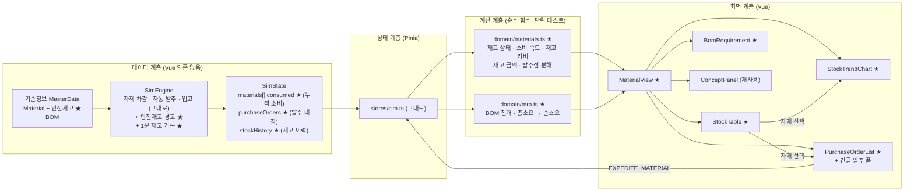
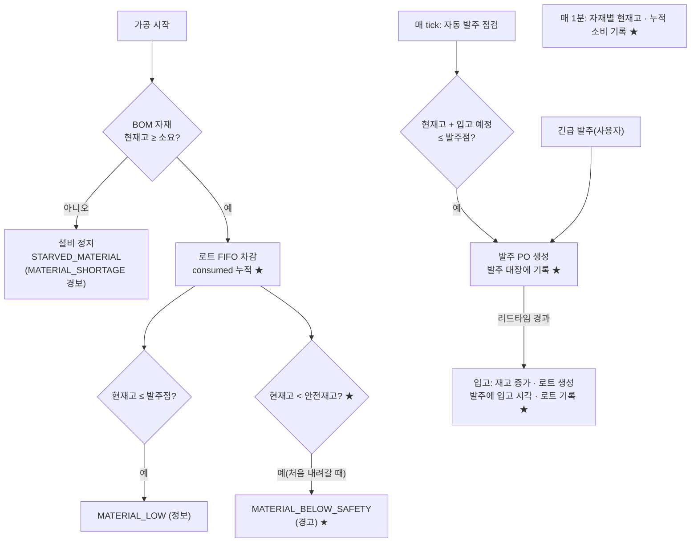
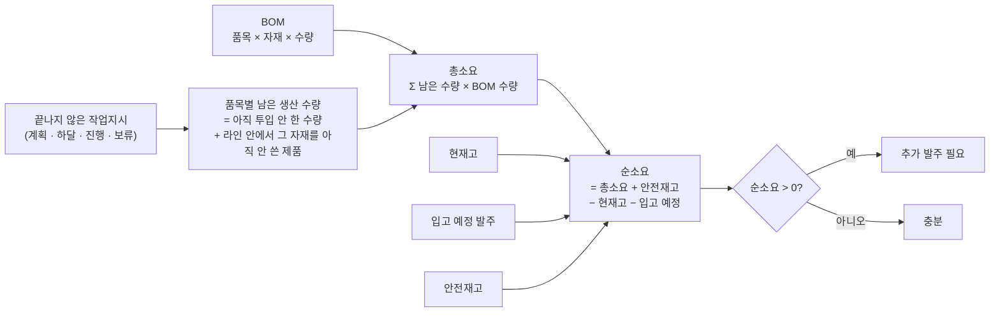

# 5단계 계획: 자재 / 재고 페이지

> 전체 계획은 [dashboard-plan.md](../dashboard-plan.md) 참고. 브랜치: `feature/material-management`

## 1. 목표

**자재 / 재고** 페이지(`/materials`)를 만든다. 자재(구매) 담당자가 보는 화면으로, 다음 세 가지에 답한다.

1. **지금 재고가 충분한가?** → 자재별 현재고 · 안전재고 · 발주점 · 재고 커버(지금 속도로 몇 시간 버티나), 재고 금액
2. **앞으로 얼마나 더 필요한가?** → BOM 전개로 계산한 남은 작업지시의 자재 소요량(총소요 → 순소요), 부족 예상 자재
3. **들어올 자재는 언제 오나?** → 발주 현황(발주 · 입고 예정 · 입고 완료), 긴급 발주와 할증

지금 엔진은 이미 자재를 꽤 갖고 있다: BOM, 가공 시작 때 자재 차감, 자재가 없으면 설비 정지(STARVED_MATERIAL), 발주점 자동 발주, 리드타임 뒤 입고, 긴급 발주(할증), 입고 로트(4단계). 이번 단계는 **엔진 동작은 바꾸지 않고**, 화면에 필요한 기록만 더한다.

- **안전재고**(기준정보): 발주점 = 리드타임 동안 예상 소요 + 안전재고. 발주점을 두 부분으로 나눠 보여 주고, 재고가 안전재고 아래로 내려가면 경고한다.
- **발주 대장**: 지금은 입고된 발주가 목록에서 사라진다. 입고 완료 발주도 남겨 발주 → 입고 이력을 본다.
- **재고 이력 · 누적 소비량**: 1분마다 재고를 기록해 톱니 모양 재고 추이를 그리고, 누적 소비량으로 시간당 소요(소비 속도)를 계산한다.

**생산 결과(양품 수, 고장 시각, 시나리오 수치)는 바뀌지 않는다.** 4단계처럼 스냅숏 비교로 확인한다.

## 2. 이 단계에서 익히는 개념

| 개념 | 한 줄 설명 | 화면에서 보는 곳 |
|---|---|---|
| BOM(자재 명세서) | 제품 1개에 어떤 자재가 몇 개, 어느 공정에서 들어가는지. 정전개(제품 → 자재), 역전개(자재 → 쓰는 제품) | BOM 소요량 |
| 소요량 계산(MRP 기초) | 총소요 = 남은 생산 수량 × BOM 수량. 순소요 = 총소요 + 안전재고 − 현재고 − 입고 예정. 순소요가 양수면 더 발주해야 한다 | BOM 소요량 |
| 조달 리드타임 | 발주부터 입고까지 걸리는 시간. 리드타임이 길수록 미리 발주해야 하고 재고를 더 들고 있어야 한다 | 발주 현황, 재고 표 |
| 발주점(ROP)과 안전재고 | 발주점 = 리드타임 동안 소요 + 안전재고. 안전재고는 소요가 예상보다 빠르거나 입고가 늦을 때를 버티는 완충 재고 | 재고 표, 재고 추이 |
| 재고 모형(톱니형) | 소비로 줄고 입고로 뛰어오르는 모양. 발주량이 클수록 평균 재고(주기 재고)가 커진다 | 재고 추이 차트 |
| 재고 커버리지 | 현재고 ÷ 소비 속도 = 지금 재고로 버틸 수 있는 시간. 회사에서는 보통 "재고 일수(DOS)"로 본다 | 재고 표, KPI |
| 결품과 라인 정지 | 자재가 없으면 설비는 멀쩡해도 멈춘다. 비가동 원인을 고장과 구분해야 대책이 맞다 | KPI(자재 부족 정지) |
| 재고 비용 트레이드오프 | 재고를 많이 들면 돈이 묶이고(재고 금액), 적게 들면 결품 · 긴급 발주 할증이 생긴다 | KPI(재고 금액, 할증) |

## 3. 화면 구성

```
┌───────────────────────────────────────────────────────────────────────────┐
│ 자재 / 재고                                     가상 데이터 🕒 02:00:00 ▶ 60× │
├───────────────────────────────────────────────────────────────────────────┤
│ [재고 금액 ₩] [최소 재고 커버 1.2h] [안전재고 이하 N종] [입고 대기 발주 N건]     │
│ [자재 부족 정지 0분] [긴급 발주 할증 ₩]                                        │
├───────────────────────────────────────────────────────────────────────────┤
│ 자재 재고 현황                                                               │
│ 자재 | 현재고(게이지) | 안전재고 | 발주점 | 입고 예정 | 시간당 소요 | 재고 커버 | 상태 │
│ 행을 누르면 아래 재고 추이 · 발주 현황이 그 자재로 바뀐다                         │
├──────────────────────────────────────────┬────────────────────────────────┤
│ 재고 추이 (선택 자재)                        │ 발주 현황                         │
│ 선: 현재고(톱니형)                          │ 발주 | 자재 | 수량 | 발주 시각 |      │
│ 점선: 발주점, 안전재고                       │ 입고(예정) | 구분 | 상태 | 금액       │
│ 표시: ▼발주 ▲입고                           │ [긴급 발주: 수량 ___ 발주] 할증 미리보기 │
├──────────────────────────────────────────┴────────────────────────────────┤
│ BOM 소요량 (남은 작업지시 기준)                                                │
│ 왼쪽: BOM 트리  MOTOR-A ─ 가공: 하우징 1 · 권선: 코일 1 · 조립: 자석 4, 표준 베어링 2 │
│ 오른쪽: 자재 | 총소요 | 현재고 | 입고 예정 | 안전재고 | 순소요 | 판정(충분/추가 발주) │
├───────────────────────────────────────────────────────────────────────────┤
│ 개념 설명                                                                    │
└───────────────────────────────────────────────────────────────────────────┘
```

- **KPI 카드**
  - 재고 금액: Σ 현재고 × 단가. 재고에 묶인 돈이다.
  - 최소 재고 커버: 자재마다 현재고 ÷ 최근 1시간 소비 속도를 구하고 가장 짧은 값(어떤 자재인지 함께). 소비가 없으면 "소비 없음".
  - 안전재고 이하: 현재고가 안전재고 이하인 자재 수.
  - 입고 대기 발주: 건수와 가장 빠른 입고까지 남은 시간.
  - 자재 부족 정지: 설비들의 STARVED_MATERIAL 누적 시간.
  - 긴급 발주 할증: 누계(원).
- **자재 재고 현황**: 현재고를 게이지로 보여 주고 안전재고 · 발주점 위치를 눈금으로 표시한다. 상태는 `결품`(1개분도 없음) · `안전재고 이하` · `발주점 이하` · `정상`. 발주점 칸에는 "리드타임 소요 + 안전재고" 분해를 툴팁으로 보여 준다.
- **재고 추이**: 선택한 자재의 1분 간격 재고 선(계단형), 발주점 · 안전재고 점선, 발주 · 입고 시점 표시. 소비로 줄고 입고로 뛰는 톱니 모양과, 발주 뒤 리드타임만큼 지나 입고되는 것이 보인다.
- **발주 현황**: 발주 대장(최신순). 입고 대기는 "남은 시간", 입고 완료는 입고 시각과 만든 로트 번호. 긴급 발주는 강조. 아래에 긴급 발주 폼(선택 자재, 수량, 할증 미리보기)을 둔다. 교육 모드의 자재 상세와 같은 명령(`EXPEDITE_MATERIAL`)을 쓴다.
- **BOM 소요량**: 왼쪽은 품목별 BOM 트리(작업장별 자재 × 수량). 오른쪽은 아직 끝나지 않은 작업지시(계획 · 하달 · 진행 · 보류)를 기준으로 계산한 자재별 소요량 표다. 순소요가 양수인 자재는 "추가 발주 필요"로 강조한다.

## 4. 아키텍처

### 4.1 전체 구조



★ 표시가 이번 단계에서 새로 만들거나 바꾸는 부분이다.

### 4.2 자재 흐름 (엔진, 바뀌는 곳은 ★)



### 4.3 소요량 계산 (MRP 기초)



라인 안에서 이미 그 공정을 지나 자재를 쓴 제품은 총소요에서 뺀다(제품의 사용 로트 기록으로 판단). 폐기로 다시 만드는 수량은 엔진이 보충 투입하지 않으므로 넣지 않는다.

## 5. 엔진 변경

### 5.1 안전재고 (기준정보)

`Material.safetyStock`을 더한다. 기존 발주점은 그대로 두고, 발주점을 "리드타임 동안 예상 소요 + 안전재고"로 설명할 수 있게 값을 정한다. 기준정보 검증: `0 ≤ safetyStock ≤ reorderPoint`.

자유 체험 8시간을 측정한 소비 속도로 정한 값:

| 자재 | 시간당 소요(측정) | 리드타임 | 발주점 | 안전재고(안) | 리드타임 소요 몫 |
|---|---|---|---|---|---|
| 하우징 소재 | 약 70 | 1시간 | 100 | 30 | 70 |
| 동선 코일 | 약 70 | 1시간 | 100 | 30 | 70 |
| 영구자석 | 약 260 | 1.5시간 | 500 | 110 | 390 |
| 표준 베어링 | 약 100 | 1.5시간 | 200 | 50 | 150 |
| 고급 베어링 | 약 35 (몰려서 씀) | 1.5시간 | 60 | 10 | 50 |

자유 체험에서는 결품이 나지 않지만 재고가 안전재고 근처까지 내려가는 때가 있다(최저 재고 측정: 하우징 27, 코일 29, 자석 80, 표준 베어링 24, 고급 베어링 20). 안전재고가 "다 쓰라고 있는 완충"이라는 점을 보여 주는 장면이 된다.

### 5.2 안전재고 경고

재고가 안전재고 아래로 처음 내려갈 때 `MATERIAL_BELOW_SAFETY`(경고) 이벤트를 낸다. 입고로 안전재고 이상이 되면 다시 낼 수 있다. 기존 `MATERIAL_LOW`(발주점 이하, 정보)는 그대로 둔다.

### 5.3 발주 대장 · 누적 소비 · 재고 이력

- `PurchaseOrder`에 `receivedAt: number | null`, `lotId: string | null`을 더하고, `SimState.purchaseOrders`에 모든 발주를 남긴다. `MaterialStock.orders`(입고 대기)는 지금처럼 쓴다.
- `MaterialStock.consumed`: 시작부터 쓴 누적 수량. 소비 속도 = 기간 동안 늘어난 consumed ÷ 기간. 입고와 소비가 같은 1분 안에 섞여도 정확하다.
- `SimState.stockHistory`: 60초마다 `{ time, onHand, consumed }`(자재별)를 기록한다. 8시간이면 480개, 상한 24시간분(1,440개)을 넘으면 오래된 것부터 버린다.

### 5.4 영향 범위

- 기록만 더하므로 생산 결과는 바뀌지 않는다. 엔진 변경 전후로 모든 시나리오(S1 ~ S3 조치 없음 · 모범 조치, 자유 체험 8시간)의 결과를 스냅숏으로 비교해 같음을 확인한다.
- 바뀌는 것은 이벤트(안전재고 경고가 알림 목록에 더해짐)뿐이다.

## 6. 계산 함수

**`domain/materials.ts` (신규)**

| 함수 | 내용 |
|---|---|
| `stockStatus(stock, material, master)` | `SHORTAGE`(가장 큰 BOM 소요 1개분도 없음) · `BELOW_SAFETY` · `BELOW_ROP` · `OK` |
| `consumptionRate(state, materialId, windowSec)` | 최근 기간 소비 속도(시간당). 재고 이력의 consumed 차이로 계산 |
| `stockCoverage(onHand, ratePerHour)` | 재고 커버(초). 소비가 없으면 null |
| `materialRows(state, master)` | 재고 표 한 번에: 현재고 · 안전재고 · 발주점 · 리드타임 소요 몫 · 입고 예정 · 소비 속도 · 커버 · 상태 · 재고 금액 |
| `inventorySummary(state, master)` | KPI: 재고 금액, 최소 커버(자재), 안전재고 이하 수, 입고 대기 발주 수 · 가장 빠른 입고, 자재 부족 정지 시간 |
| `stockTrend(state, materialId)` | 재고 추이 차트 데이터: 재고 선, 발주 · 입고 시점 |

**`domain/mrp.ts` (신규)**

| 함수 | 내용 |
|---|---|
| `bomTree(master)` | 품목 → 작업장(라인 순) → 자재 × 수량 |
| `remainingDemand(state, master)` | 품목 · 자재별 남은 생산 수량(미투입 + 라인 안에서 그 자재를 아직 안 쓴 제품) |
| `materialRequirements(state, master)` | 자재별 총소요 · 현재고 · 입고 예정 · 안전재고 · 순소요 |

전부 순수 함수로 만들고 단위 테스트한다.

## 7. 만들 파일

| 파일 | 내용 |
|---|---|
| `domain/types.ts` | `Material.safetyStock`, `PurchaseOrder.receivedAt · lotId`, `MaterialStock.consumed`, `SimState.purchaseOrders · stockHistory`, 이벤트 타입 (수정) |
| `scenarios/baseline.ts` | 기본 공장 안전재고 값 (수정) |
| `sim/engine.ts` | 안전재고 검증 · 경고, 발주 대장, 누적 소비, 재고 이력 (수정) |
| `sim/materials.test.ts` | 엔진 테스트 추가 (수정) |
| `domain/materials.ts` (+ test) | 재고 지표 계산 (신규) |
| `domain/mrp.ts` (+ test) | BOM 전개 · 소요량 계산 (신규) |
| `views/MaterialView.vue` | 자재 / 재고 페이지 (신규) |
| `dashboard/materials/StockTable.vue` | 자재 재고 현황 (신규) |
| `dashboard/materials/StockTrendChart.vue` | 재고 추이 (신규) |
| `dashboard/materials/PurchaseOrderList.vue` | 발주 현황 + 긴급 발주 (신규) |
| `dashboard/materials/BomRequirement.vue` | BOM 트리 + 소요량 (신규) |
| `concepts/materials.ts` | 개념 설명 문구 (신규) |
| `router.ts` | `/materials`를 `MaterialView`로 교체(지연 로딩) (수정) |
| `ui/detail/MaterialDetail.vue` | 교육 모드 자재 상세에 안전재고 표시 (수정) |
| `README.md`, `docs/dashboard-plan.md` | 기능 표, 엔진 규칙, 스크린샷 (수정) |

## 8. 결정 사항

> 결정: **공급사 품질은 이번에 넣지 않고 다음에 한다.** 나머지는 아래 안대로 진행한다.

1. **공급사 품질(수입 검사 · 불량 로트 주입 · 로트 보류)을 넣을까?** → 넣지 않는다(다음에)
   - 넣으면: 입고 로트를 검사해 불합격이면 보류(사용 금지)하고, 그 때문에 결품이 나는 장면을 만들 수 있다. 4단계 정추적과도 이어진다. 대신 엔진 동작(로트 소비 규칙)이 바뀌고 시나리오가 하나 더 필요해 범위가 크다.
   - 빼면: 이번 단계는 "재고 흐름(소요 · 발주 · 입고)"에 집중한다. 필요하면 나중에 별도로 추가한다.
2. **안전재고 경고 이벤트** → 넣는다. 실제 MES · ERP는 안전재고 침범을 경고로 알린다. 생산 결과는 바뀌지 않고 알림 목록에 경고가 더해진다(자유 체험 8시간 기준 몇 건 수준).
3. **안전재고로 발주점을 다시 계산할까?** → 하지 않는다. 발주점은 기준정보 값 그대로 두고, 화면에서 "리드타임 소요 몫 + 안전재고"로 나눠 설명만 한다. 발주점을 바꾸면 생산 결과가 바뀐다.

## 9. 구현 순서

각 단계마다 테스트 · 타입 검사 · 린트를 통과시키고 커밋한다.

1. **엔진 기록**: 안전재고(타입 · 기본값 · 검증 · 경고), 발주 대장, 누적 소비, 재고 이력 + 테스트 → 시나리오 결과 스냅숏 비교(변화 없음 확인)
2. **계산 함수**: `materials.ts`, `mrp.ts` + 단위 테스트
3. **페이지 + KPI + 재고 현황 표 + 재고 추이**
4. **발주 현황 · 긴급 발주 + BOM 소요량 + 개념 패널**, 교육 모드 자재 상세
5. **마무리**: 브라우저 확인(스크린샷), README 갱신, PR 준비

## 10. 완료 기준

- [x] 사이드바의 자재 / 재고를 누르면 KPI 카드, 재고 현황 표, 재고 추이, 발주 현황, BOM 소요량, 개념 패널이 보인다
- [x] 재고 추이에서 소비로 줄고 입고로 뛰는 톱니 모양과, 발주 뒤 리드타임만큼 지나 입고되는 것이 보인다
- [x] 재고 현황 표의 소비 속도 · 재고 커버가 재고 이력과 맞고, 상태가 안전재고 · 발주점 기준과 맞다
- [x] BOM 소요량의 총소요가 "남은 수량 × BOM 수량"과 같고(테스트), 순소요가 양수면 강조된다
- [x] 페이지에서 긴급 발주를 하면 발주 현황에 긴급 발주가 생기고 리드타임 뒤 입고된다
- [x] 교육 모드 S3(자재 부족)를 실행한 뒤 이 페이지에서 결품 · 자재 부족 정지 · 할증이 보인다
- [x] 엔진 변경 전후로 모든 시나리오 생산 결과가 같다(스냅숏 비교)
- [x] `npm test`, `npm run lint`, `npm run build`(타입 검사 포함) 통과

## 11. 구현하면서 바뀐 점

- **생산 결과 변화 없음 확인**: 엔진 변경 전후로 S1 ~ S3(조치 없음 · 모범 조치)와 자유 체험 8시간의 제품 · 재고 · 설비 · 작업지시 상태를 JSON 스냅숏으로 떠서 비교했고, 바이트 단위로 같았다.
- **안전재고 검증과 "자동 발주 끄기"**: 기준정보 검증(안전재고 ≤ 발주점) 때문에 발주점을 0으로 둬 자동 발주를 끄던 테스트 두 곳이 걸렸다. 그 테스트들은 안전재고도 0으로 두게 고쳤다.
- **안전재고 경고 빈도**: 자유 체험 8시간에 5건(2:42 표준 베어링, 4:43 하우징, 4:53 코일, 5:00 자석, 7:02 하우징). 결품은 없다.
- **결품 위험 판정 기준**: 처음에는 "재고 커버 < 정상 리드타임"이면 주의로 했는데, 입고가 몇 분 뒤인 자재까지 위험으로 떠서 "재고 커버 < 다음 입고까지 남은 시간(입고 예정이 없으면 정상 리드타임)"으로 바꿨다. 재고 표에서 ⚠로, KPI "최소 재고 커버"에서 결품 위험 자재 이름으로 보여 준다.
- **재고 추이 축**: 긴급 발주를 하면 리드타임 띠가 화면 밖으로 잘려, 축을 입고 예정 시각까지 늘렸다.
- **BOM 소요량 읽는 법**: 교대 시작에는 8시간치 소요가 한꺼번에 잡혀 모든 자재가 "더 확보 필요"로 나온다. 발주점 방식(소비 기반 보충)과 MRP(수요 기반 계획)의 차이가 드러나는 부분이라 그대로 두고, 패널 설명과 개념 설명에 읽는 법을 적었다.
- **번들**: 자재 / 재고 페이지는 지연 로딩(약 26KB, gzip 10KB). 첫 화면 크기는 4단계와 같다(약 757KB).

## 12. 이번 단계에서 하지 않는 것

- 공급사 품질 · 수입 검사 · 로트 보류(8장 결정 1)
- 다단계 BOM(반제품), 대체 자재, 자재 손실률(Scrap factor)
- 시간 단위 MRP 전개(기간별 소요 · 계획 발주), 발주 승인 절차, 공급사별 단가 · 리드타임
- 재고 실사(Cycle Count), 창고 위치(로케이션) 관리, 공정 투입 창고(라인 사이드 재고)
- 재고 회전율(한 교대 시뮬레이션에서는 의미가 작아 개념 설명으로만 다룬다)
