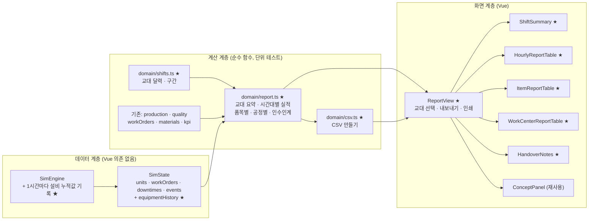
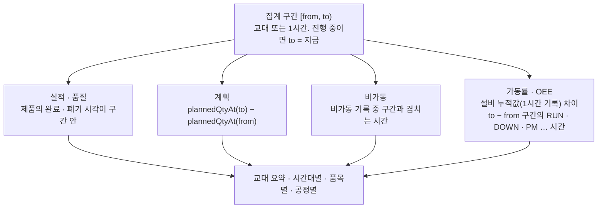

# 6단계 계획: 실적 리포트 페이지

> 전체 계획은 [dashboard-plan.md](../dashboard-plan.md) 참고. 브랜치: `feature/production-report`

## 1. 목표

**실적 리포트** 페이지(`/reports`)를 만든다. 교대가 끝날 때 생산관리자가 쓰고 공장장 · 다음 교대가 읽는 **교대 생산 보고서**다. 지금까지의 페이지가 "지금 무슨 일이 일어나나(실시간 모니터링)"였다면, 이 페이지는 "이번 교대를 숫자로 마감하고 넘겨준다(보고 · 인수인계)"를 다룬다.

1. **이번 교대 성적은?** → 계획 · 실적 · 달성률, 양품률, 라인 OEE, 비가동, 작업지시 납기 준수
2. **언제 · 어디서 계획과 벌어졌나?** → 시간대별 실적표(시간당 생산 관리표), 품목별 · 공정별 실적
3. **다음 교대가 알아야 할 것은?** → 이번 교대 주요 사건과 넘겨줄 일(인수인계 메모, 자동 생성)
4. **보고서로 남기기** → CSV 내보내기, 인쇄

지금 엔진은 설비 가동 시간 · 가공 수를 시작부터의 누적값으로만 갖고 있어, "몇 시 ~ 몇 시"의 가동률 · OEE를 구할 수 없다. **1시간마다 설비 누적값을 기록**하는 것만 더한다(기록만 더하므로 생산 결과는 바뀌지 않는다).

## 2. 이 단계에서 익히는 개념

| 개념 | 한 줄 설명 | 화면에서 보는 곳 |
|---|---|---|
| 교대(Shift) | 설비를 오래 돌리려고 사람이 나눠 일하는 단위. 2교대(12시간), 3교대(8시간)가 흔하다. 실적 · 책임 · 인수인계의 기본 단위다 | 교대 선택, 교대 요약 |
| 일일 · 교대 생산 보고 | 교대가 끝나면 계획 대비 실적, 품질, 설비, 이슈를 정해진 양식으로 마감해 보고한다. 숫자를 마감하면 그 뒤에는 고치지 않는다 | 페이지 전체, 마감 표시 |
| 시간당 생산 관리표(Hour-by-hour) | 시간마다 계획 · 실적 · 차이 · 사유를 적는 표. 현장 게시판의 기본이다. 차이가 난 시간에 사유를 바로 적어야 원인을 잃지 않는다 | 시간대별 실적표 |
| 달성률 vs 가동률 vs OEE | 달성률은 계획 대비 결과, 가동률은 설비가 돈 시간, OEE는 설비 효율. 셋이 다르게 움직이는 이유를 읽는다 | 교대 요약, 공정별 실적 |
| 품목별 · 공정별 실적 | 합계만 보면 묻히는 차이를 품목과 공정으로 나눠 본다 | 품목별 · 공정별 표 |
| 교대 인수인계 | 진행 중 작업지시, 설비 이상 징후, 자재 상황을 다음 교대에 넘긴다. 빠뜨리면 같은 문제를 다시 겪는다 | 인수인계 메모 |
| 실적 집계 기준 | 실적은 "양품으로 마지막 공정을 끝낸 시점"에 잡는다. 투입 · 가공 중 수량은 실적이 아니다(재공) | 시간대별 실적표 주석 |
| 보고 주기 | 시간(현장) → 교대 · 일(공장) → 주 · 월(경영). 위로 갈수록 요약된다 | 개념 설명 |

## 3. 화면 구성

```
┌───────────────────────────────────────────────────────────────────────────┐
│ 실적 리포트                                     가상 데이터 🕒 05:12:00 ▶ 60× │
├───────────────────────────────────────────────────────────────────────────┤
│ [1교대 (00:00~08:00) ▼]  진행 중 · 마감 전           [CSV 내보내기] [인쇄]      │
├───────────────────────────────────────────────────────────────────────────┤
│ [계획 대비 실적 312/360 · 87%] [양품률 · FPY] [라인 OEE] [UPH]                 │
│ [비가동 32분] [작업지시 완료 7건 · 납기 7/7]                                    │
├───────────────────────────────────────────────────────────────────────────┤
│ 시간대별 실적표                                                               │
│ 시간 | 계획 | 실적 | 차이 | 누적 계획 | 누적 실적 | 누적 차이 | 폐기 | 재작업 |  │
│      | 비가동(분) | 병목 가동률 | 비고(그 시간 주요 사건: CNC 고장 20분 …)       │
│ 합계 행                                                                       │
├──────────────────────────────────────────┬────────────────────────────────┤
│ 품목별 실적                                 │ 공정별 실적                        │
│ 품목 | 계획 | 실적 | 달성률 | 폐기 | 양품률   │ 공정 | 가공 | 불량 | 가동률 |       │
│                                          │ 고장 · 정비 · 자재 정지 | OEE        │
├──────────────────────────────────────────┴────────────────────────────────┤
│ 인수인계 메모 (자동 생성)                                                     │
│ ■ 이번 교대 주요 사건: 02:01 CNC #1 고장(23분), 02:42 표준 베어링 안전재고 이하 …  │
│ ■ 다음 교대로 넘기는 일: 진행 중 작업지시 WO-010(25/40), 입고 예정 발주 2건,      │
│   CNC #1 마모 0.62(진동 경고), 안전재고 이하 자재 …                              │
├───────────────────────────────────────────────────────────────────────────┤
│ 개념 설명                                                                    │
└───────────────────────────────────────────────────────────────────────────┘
```

- **교대 선택**: 시뮬레이션 시각을 8시간 단위(3교대)로 나눈다. 1교대 00:00 ~ 08:00, 2교대 08:00 ~ 16:00, 3교대 16:00 ~ 24:00, 다음 날 1교대 …. 지금 교대는 "진행 중 · 마감 전", 지난 교대는 "마감"으로 표시한다.
- **교대 요약 KPI**: 계획 대비 실적(교대 구간의 계획 수량, 진행 중이면 지금까지), 양품률(최종 · FPY), 라인 OEE(교대 구간), UPH, 비가동 시간(고장 · 정비 · 자재 부족), 작업지시 완료 수와 납기 준수.
- **시간대별 실적표**: 교대 안의 1시간마다 계획 · 실적 · 차이와 누적값, 폐기 · 재작업, 비가동 분, 병목 공정 가동률, 비고. 비고는 그 시간에 일어난 고장 · 정비 · 자재 부족 · 센서 경고를 자동으로 적는다. 차이가 음수인 칸은 강조한다. 맨 아래에 합계 행.
- **품목별 실적**: 품목마다 교대 계획 · 실적 · 달성률 · 폐기 · 양품률.
- **공정별 실적**: 작업장마다 가공 수, 불량, 가동률, 정지 시간(고장 · 정비 · 자재), OEE(교대 구간).
- **인수인계 메모**: 이번 교대 주요 사건(시각순)과 다음 교대로 넘기는 일(진행 중 작업지시, 입고 예정 발주, 마모가 높거나 경고 중인 설비, 안전재고 이하 자재, 지연 위험 작업지시).
- **CSV 내보내기**: 시간대별 실적표를 CSV(엑셀에서 열리게 UTF-8 BOM)로 받는다. **인쇄**: 사이드바 · 머리글 조작부 · 개념 설명을 빼고 밝은 배경으로 인쇄되게 인쇄용 스타일을 둔다.

## 4. 아키텍처

### 4.1 전체 구조



★ 표시가 이번 단계에서 새로 만들거나 바꾸는 부분이다.

### 4.2 구간 집계 방식



- 설비 누적값은 정시(1시간 단위)에 기록하므로 교대 · 시간대 경계와 맞는다. 진행 중인 구간의 끝은 지금 엔진 상태의 누적값을 쓴다.
- 이벤트(최근 200건 보관)와 비가동 기록(최근 200건)은 자유 체험 8시간 기준 각각 108건 · 2건이라 한 교대는 모두 남는다. 오래 돌려 잘린 구간은 "기록 보관 범위 밖"으로 표시한다.

## 5. 엔진 변경

### 5.1 설비 누적값 기록

`SimState.equipmentHistory`: 1시간(정시)마다 설비별 `{ statusTime, processedCount, defectCount, standardTime }`의 사본을 `{ time, equipment: Record<설비 id, …> }`로 남긴다. 시작 시각 0에도 하나 남긴다. 상한 7일분(168개).

- 기록만 더하므로 생산 결과는 바뀌지 않는다. 5단계처럼 엔진 변경 전후 모든 시나리오 결과를 스냅숏으로 비교한다.
- 실행 중 증설한 설비는 증설 뒤 기록부터 나타난다(그 전 구간은 0으로 본다).

## 6. 계산 함수

**`domain/shifts.ts` (신규)**

| 함수 | 내용 |
|---|---|
| `SHIFT_LENGTH` | 8시간(3교대) |
| `shiftOf(time)` | 그 시각이 속한 교대(번호, 이름 "1교대", 날짜 차수, 시작 · 끝) |
| `shiftsUntil(time)` | 지금까지 시작된 교대 목록(교대 선택용) |

**`domain/report.ts` (신규)**

| 함수 | 내용 |
|---|---|
| `rangeOutput(state, from, to)` | 구간 실적: 양품 · 폐기 · 재작업 · FPY, 품목별 |
| `rangePlan(state, from, to)` | 구간 계획 수량(품목별 포함) |
| `rangeDowntime(state, from, to)` | 구간 비가동(사유별 · 설비별, 겹치는 시간만) |
| `rangeEquipment(state, from, to)` | 구간 설비 상태 시간 · 가공 수 · 불량 · OEE(누적값 차이) |
| `shiftSummary(state, master, shift)` | 교대 요약 KPI |
| `hourlyReport(state, master, shift)` | 시간대별 실적표 행 + 합계, 비고(그 시간 주요 사건) |
| `itemReport`, `workCenterReport` | 품목별 · 공정별 실적 |
| `handoverNotes(state, master, shift)` | 주요 사건(시각순)과 넘기는 일 목록 |

**`domain/csv.ts` (신규)**: 표(머리글 + 행)를 CSV 문자열로(쉼표 · 따옴표 이스케이프, UTF-8 BOM).

전부 순수 함수로 만들고 단위 테스트한다. 특히 "교대 구간 합 = 전체 누적"(양품 · 비가동 · 설비 시간)을 테스트로 확인한다.

## 7. 만들 파일

| 파일 | 내용 |
|---|---|
| `domain/types.ts` | `EquipmentSample`, `SimState.equipmentHistory` (수정) |
| `sim/engine.ts` (+ test) | 1시간마다 설비 누적값 기록 (수정) |
| `domain/shifts.ts` (+ test) | 교대 달력 (신규) |
| `domain/report.ts` (+ test) | 구간 집계 · 교대 보고서 계산 (신규) |
| `domain/csv.ts` (+ test) | CSV 만들기 (신규) |
| `views/ReportView.vue` | 실적 리포트 페이지(교대 선택 · CSV · 인쇄) (신규) |
| `dashboard/report/ShiftSummary.vue` | 교대 요약 KPI (신규) |
| `dashboard/report/HourlyReportTable.vue` | 시간대별 실적표 (신규) |
| `dashboard/report/ItemReportTable.vue` | 품목별 실적 (신규) |
| `dashboard/report/WorkCenterReportTable.vue` | 공정별 실적 (신규) |
| `dashboard/report/HandoverNotes.vue` | 인수인계 메모 (신규) |
| `concepts/report.ts` | 개념 설명 문구 (신규) |
| `router.ts` | `/reports`를 `ReportView`로 교체(지연 로딩), 준비 중 페이지가 없어지면 `PlaceholderView` 삭제 (수정) |
| `style.css` | 리포트 표, 인쇄용 스타일 (수정) |
| `README.md`, `docs/dashboard-plan.md` | 기능 표, 엔진 규칙, 스크린샷 (수정) |

## 8. 결정 사항

1. **교대를 몇 개 보여 줄까?** → 추천: 자유 체험은 지금처럼 1교대(8시간)로 두고, 교대 달력만 만든다
   - 지금 자유 체험은 작업지시 12건이 약 7시간 반에 모두 끝나고, 8시간 이후에는 라인이 서 있다. 그래서 2교대부터는 실적이 0이다.
   - **A(추천) 1교대 그대로**: 엔진 · 자유 체험 · 다른 페이지 수치가 바뀌지 않는다. 보고서는 "이번 교대 보고서"가 중심이고, 교대 선택은 사용자가 작업지시를 더 만들어 계속 돌릴 때 쓴다. 교대 간 비교는 개념 설명으로 다룬다.
   - **B 자유 체험을 3교대(24시간)로 늘림**: 교대별 실적을 나란히 비교할 수 있다(고장이 난 교대와 아닌 교대). 대신 생산 계획을 교대별로 나누도록 데이터 구조를 바꾸고, 생산 현황 차트 · 작업지시 수(12 → 36건) · README 수치 · 스크린샷을 다시 맞춰야 해서 범위가 크다.
2. **시각 표시** → 시뮬레이션 경과 시각(00:00부터)을 그대로 쓴다. 실제 공장 시각(예: 주간 06:00 시작)으로 바꾸려면 모든 페이지의 시각 표시를 고쳐야 해서 하지 않는다. 개념 설명에서 실제 교대 시간표 예시를 든다.
3. **보고서 마감(확정 · 수정 금지) 기능** → 넣지 않는다. 지난 교대를 "마감"으로 표시만 하고, 실적 수정 · 승인 절차는 다루지 않는다.

## 9. 구현 순서

각 단계마다 테스트 · 타입 검사 · 린트를 통과시키고 커밋한다.

1. **엔진 기록**: 설비 누적값 1시간 기록 + 테스트 → 시나리오 결과 스냅숏 비교(변화 없음 확인)
2. **계산 함수**: `shifts.ts`, `report.ts`, `csv.ts` + 단위 테스트(구간 합 = 전체)
3. **페이지 + 교대 선택 + 요약 KPI + 시간대별 실적표**
4. **품목별 · 공정별 실적 + 인수인계 메모 + CSV · 인쇄 + 개념 패널**
5. **마무리**: 브라우저 확인(스크린샷 · 인쇄 미리보기 · CSV), README 갱신, PR 준비

## 10. 완료 기준

- [ ] 사이드바의 실적 리포트를 누르면 교대 선택, 요약 KPI, 시간대별 실적표, 품목별 · 공정별 실적, 인수인계 메모, 개념 패널이 보인다
- [ ] 1교대가 끝난 뒤(8:00) 보고서의 실적 · 폐기 · 비가동 합계가 생산 현황 · 품질 · 설비 페이지의 누적값과 같다
- [ ] 시간대별 실적표의 시간별 실적 합 = 교대 실적, 고장이 난 시간대의 비고에 고장이 적히고 실적 차이가 음수로 강조된다
- [ ] 교대 구간 OEE · 가동률이 설비 누적값 차이로 계산되고, 진행 중 교대는 지금까지로 계산된다(테스트)
- [ ] 인수인계 메모에 이번 교대 사건과 넘기는 일(진행 중 작업지시, 입고 예정, 설비 경고, 안전재고 이하)이 나온다
- [ ] CSV를 받으면 엑셀에서 한글이 깨지지 않고, 인쇄 미리보기에서 사이드바 없이 밝은 배경으로 나온다
- [ ] 엔진 변경 전후로 모든 시나리오 생산 결과가 같다(스냅숏 비교)
- [ ] `npm test`, `npm run lint`, `npm run build`(타입 검사 포함) 통과

## 11. 이번 단계에서 하지 않는 것

- 자유 체험 다교대 운영(8장 결정 1-B)
- 실제 공장 시각 · 근무 달력(휴식 시간, 주말, 공휴일), 교대조(A · B · C조) 편성과 인원
- 보고서 마감 · 승인 · 실적 수정 이력, 작업자별 실적
- 주간 · 월간 리포트, 기간 비교, PDF 파일 생성(인쇄 기능의 "PDF로 저장"으로 대신한다)
