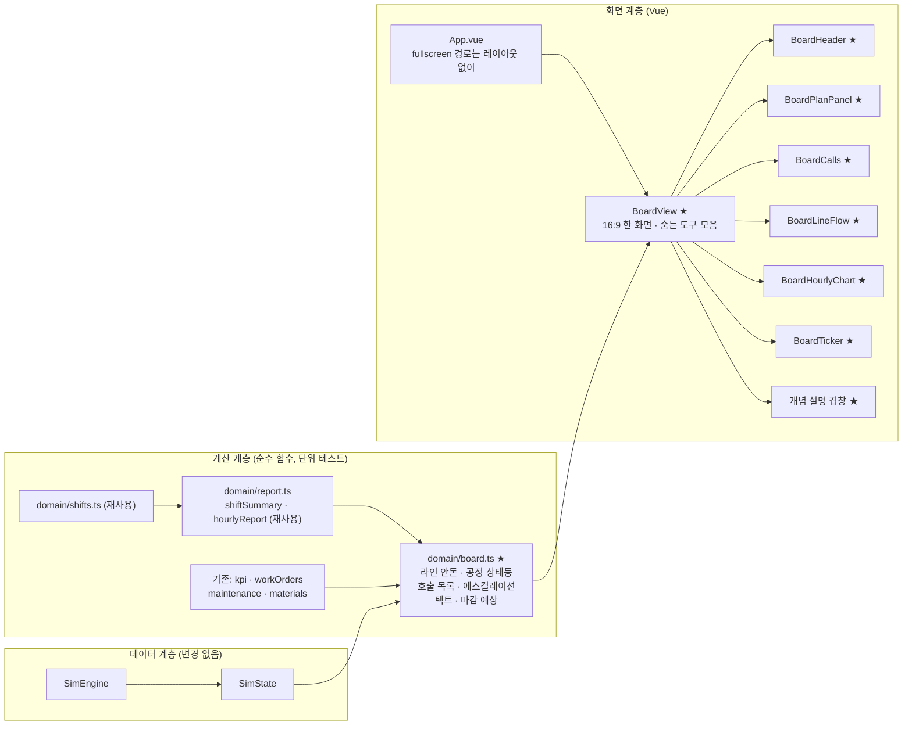
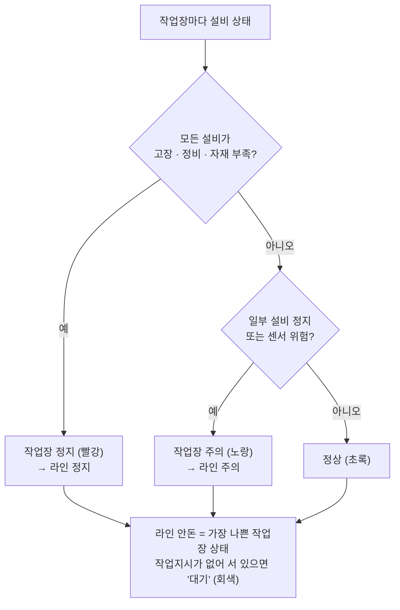

# 7단계 계획: 관제판 모드

> 전체 계획은 [dashboard-plan.md](../dashboard-plan.md) 참고. 브랜치: `feature/andon-board`

## 1. 목표

**관제판 모드**(`/board`)를 만든다. 라인 옆 벽면 TV에 띄워 두고, 작업자 · 반장 · 지나가는 관리자가 **5m 떨어져서 3초 안에** 라인 상태를 읽는 화면이다. 지금까지의 페이지가 "앉아서 조회 · 조작하는 관리자 화면"이었다면, 이 화면은 "조작 없이 보여 주기만 하는 현장 화면"이다.

1. **라인이 지금 도나, 서 있나?** → 라인 안돈(정상 · 주의 · 정지)과 공정별 상태등
2. **이번 교대 계획대로 가고 있나?** → 교대 목표 · 지금까지 계획 · 실적 · 차이를 큰 숫자로, 이대로면 교대 마감 예상
3. **누가 무엇을 해야 하나?** → 지금 걸려 있는 호출(고장 · 자재 부족 · 정비)과 경과 시간, 경과 시간에 따른 호출 단계(에스컬레이션)
4. **이번 교대 흐름은?** → 시간대별 계획 · 실적 막대(시간당 생산 관리표를 그림으로)

엔진은 바꾸지 않는다. 6단계에서 만든 교대 달력 · 구간 집계(`shifts.ts`, `report.ts`)를 그대로 쓰고, 관제판용 계산(라인 안돈, 호출 목록, 마감 예상)만 더한다.

## 2. 이 단계에서 익히는 개념

| 개념 | 한 줄 설명 | 화면에서 보는 곳 |
|---|---|---|
| 안돈(Andon) | 라인 이상을 색 등과 신호로 모두에게 바로 알리는 장치. 도요타 생산 방식에서 작업자가 줄을 당겨 라인을 세우고 도움을 부르는 데서 왔다 | 라인 안돈, 공정 상태등, 호출 목록 |
| 시각 관리(Visual Management) | 정상과 이상을 누구나 한눈에 구별하게 만드는 것. "보면 안다"가 목표다 | 화면 전체 |
| 관제판 설계 원칙 | 멀리서 읽히는 큰 숫자, 적은 지표, 색은 의미(정상 · 주의 · 정지)에만 쓴다. 조작 요소는 없다 | 화면 전체 |
| 예외 관리 | 정상은 조용히, 이상만 눈에 띄게. 모든 숫자에 색을 칠하면 진짜 이상이 묻힌다 | 정상일 때와 고장일 때 화면 비교 |
| 에스컬레이션(호출 단계) | 문제가 정해진 시간 안에 안 풀리면 더 윗사람 · 다른 부서를 부른다(작업자 → 반장 → 보전팀 → 생산팀장) | 호출 목록의 단계 표시 |
| 택트 타임 · 페이스 | 택트 타임 = 가용 시간 ÷ 필요 수량(고객이 원하는 속도). 지금 페이스가 택트보다 느리면 계획을 못 맞춘다 | 계획 패널(택트, 마감 예상) |
| 관리자 화면 vs 현장 화면 | 같은 데이터라도 보는 사람 · 거리 · 목적이 다르면 화면이 달라야 한다 | 관리자 모드와 비교 |

## 3. 화면 구성

1920 × 1080(16:9) TV 기준. 스크롤 없이 한 화면에 모두 들어간다.

```
┌──────────────────────────────────────────────────────────────────────────────┐
│ BLDC 모터 조립 라인   ● 가동 중          1교대 05:12  ████████░░ 65%   가상 데이터 │
├───────────────────────────────┬──────────────────────────────────────────────┤
│  실적        계획       차이   │  ⚠ 호출 1건                                    │
│  328    /   310       +18     │ ┌──────────────────────────────────────────┐ │
│  (아주 큰 숫자)                 │ │ ■ 하우징 가공 CNC #1  고장   12분 경과      │ │
│  교대 목표 480 · 달성률 106%    │ │   2단계: 보전팀 호출  · 예상 수리 20분       │ │
│  택트 60초 · 마감 예상 478 / 480 │ └──────────────────────────────────────────┘ │
│  UPH 63.5   OEE 97%  양품률 96% │  (호출이 없으면 "이상 없음"만 작게)              │
├───────────────────────────────┴──────────────────────────────────────────────┤
│  공정 흐름                                                                      │
│  [하우징 가공 ●] → [스테이터 권선 ●] → [조립 ● 병목] → [검사 ●] → [포장 ●]        │
│   고장 12분          가동                가동            가동         대기        │
├──────────────────────────────────────────────────────────────────────────────┤
│  시간대별 실적  00  01  02  03  04  05  06  07     (계획선 + 실적 막대, 미달 빨강)    │
├──────────────────────────────────────────────────────────────────────────────┤
│  ▶ 05:00 영구자석 재고 108개 — 안전재고 이하 · 04:58 CNC #1 진동 위험 …  (최근 사건) │
└──────────────────────────────────────────────────────────────────────────────┘
```

- **머리글**: 라인 이름, **라인 안돈**(가동 중 · 주의 · 라인 정지 — 초록 · 노랑 · 빨강 큰 점과 글자), 교대 이름과 시뮬 시각, 교대 진행 막대, 가상 데이터 표시.
- **계획 패널**: 실적 / 지금까지 계획 / 차이를 가장 큰 글자로. 그 아래 교대 목표 · 달성률, 택트 타임, 이대로면 교대 마감 예상(실적 + 남은 시간 × 최근 1시간 UPH, 남은 작업지시 수량을 넘지 않게), 그리고 UPH · OEE · 양품률(교대 구간).
- **호출 패널**: 지금 열려 있는 호출을 오래된 순으로. 종류(고장 · 자재 부족 · 예방정비 · 센서 위험), 설비 · 공정, 경과 시간, 호출 단계. 고장은 빨강, 자재 부족은 분홍, 정비는 파랑(계획된 정지라 경보가 아님). 호출이 없으면 "이상 없음"만 작게 보여 준다(예외 관리).
- **공정 흐름**: 작업장을 라우팅 순서대로 가로로 놓고 상태등 색으로 칠한다. 설비가 여러 대면 설비마다 작은 점. 병목 공정 표시, 정지 중이면 경과 시간.
- **시간대별 실적**: 이번 교대 8시간의 시간별 계획 · 실적 막대(ECharts). 미달 시간은 빨강, 진행 중 시간은 흐리게.
- **사건 띠**: 맨 아래 한 줄에 최근 주요 사건 몇 건.
- **조작 없음**: 버튼 · 입력이 없다. 마우스를 움직일 때만 오른쪽 위에 작은 도구 모음(관리자 모드로, 전체 화면, 개념 설명)이 나타나고 3초 뒤 사라진다. 개념 설명은 화면 위에 겹쳐 여는 창으로 보여 준다.
- **진입**: 사이드바 아래(교육 모드 위)에 "관제판 모드" 링크. 새 탭으로 열어 TV에 띄우는 것을 생각해 주소(`/board`)로 바로 들어와도 공장이 돌게 한다.

## 4. 아키텍처

### 4.1 전체 구조



★ 표시가 이번 단계에서 새로 만드는 부분이다.

### 4.2 라인 안돈 판정



- 라인은 직렬이라 한 작업장이라도 완전히 서면 곧 라인 전체가 선다. 그래서 "가장 나쁜 작업장"을 라인 상태로 본다.
- 예방정비는 계획된 정지라 호출 목록에서는 파랑(정보)으로 보이지만, 작업장이 완전히 서면 라인 상태는 정지로 보인다(실제로 생산이 서 있으므로).
- 앞뒤 공정 때문에 기다리는 상태(대기 · 막힘)는 결과이지 원인이 아니라 경보로 치지 않는다.

### 4.3 호출 단계(에스컬레이션)

정지가 길어질수록 부르는 사람을 늘린다. 실제 공장마다 기준이 다르므로 상수로 둔다.

| 경과 시간 | 단계 | 부르는 사람 |
|---|---|---|
| 0 ~ 5분 | 1단계 | 작업자 · 반장 대응 |
| 5 ~ 15분 | 2단계 | 보전팀(고장) · 자재 담당(자재 부족) 호출 |
| 15분 이상 | 3단계 | 생산팀장 보고 |

이 시뮬레이션의 고장 수리는 약 20분이라 고장이 나면 1 → 2 → 3단계로 올라가는 것을 볼 수 있다.

## 5. 엔진 변경

없다. 기존 상태(설비 상태 · 비가동 기록 · 사건 · 재고 · 작업지시)와 6단계의 구간 집계로 모두 계산한다.

## 6. 계산 함수

**`domain/board.ts` (신규)**

| 함수 | 내용 |
|---|---|
| `workCenterAndon(state, master)` | 라우팅 순서대로 작업장마다 상태(정상 · 주의 · 정지 · 대기), 설비별 상태, 정지 경과 시간 |
| `lineAndon(state, master)` | 라인 상태 = 가장 나쁜 작업장. 미완료 작업지시가 없으면 대기 |
| `openCalls(state, master)` | 열린 호출 목록(고장 · 자재 부족 · 정비 · 센서 위험): 시작 시각, 경과, 호출 단계, 예상 수리 · 남은 정비 시간 |
| `escalationLevel(elapsed)` | 경과 시간 → 1 · 2 · 3단계 |
| `taktTime(plan)` | 3600 ÷ 계획 UPH(초) |
| `shiftForecast(state, master, shift)` | 이대로면 교대 마감 예상 실적: 실적 + 남은 시간 × 최근 1시간 UPH, 남은 작업지시 수량이 상한 |

전부 순수 함수로 만들고 단위 테스트한다(고장 · 자재 부족 상황을 엔진으로 만들어 안돈 · 호출 단계 확인).

## 7. 만들 파일

| 파일 | 내용 |
|---|---|
| `domain/board.ts` (+ test) | 관제판 계산 (신규) |
| `views/BoardView.vue` | 관제판 페이지: 16:9 한 화면, 숨는 도구 모음, 전체 화면, 개념 겹창 (신규) |
| `board/BoardHeader.vue` | 라인 이름 · 라인 안돈 · 교대 · 시각 · 진행 막대 (신규) |
| `board/BoardPlanPanel.vue` | 실적 · 계획 · 차이, 택트 · 마감 예상, UPH · OEE · 양품률 (신규) |
| `board/BoardCalls.vue` | 호출 목록 (신규) |
| `board/BoardLineFlow.vue` | 공정 흐름 상태등 (신규) |
| `board/BoardHourlyChart.vue` | 시간대별 계획 · 실적 막대 (신규) |
| `board/BoardTicker.vue` | 최근 사건 띠 (신규) |
| `concepts/board.ts` | 개념 설명 문구 (신규) |
| `router.ts` | `/board` 추가(지연 로딩, `fullscreen`) (수정) |
| `layout/DashboardLayout.vue` | 사이드바에 관제판 모드 링크 (수정) |
| `style.css` | 관제판 스타일(화면 크기에 맞춰 커지는 글자) (수정) |
| `README.md`, `docs/dashboard-plan.md` | 기능 표, 스크린샷 (수정) |

관제판 컴포넌트는 관리자 화면 컴포넌트(`dashboard/`)와 보는 거리 · 글자 크기 · 조작 여부가 달라 `board/` 폴더로 나눈다. 계산은 함께 쓴다.

## 8. 결정 사항

아래는 추천안이다. 다르게 하고 싶은 것이 있으면 알려 주세요.

1. **한 화면 vs 여러 화면 자동 전환** → A: 한 화면
   - **A(추천) 한 화면 고정**: 언제 봐도 같은 자리에 같은 숫자가 있어 3초 안에 읽힌다. 라인 하나짜리 관제판은 보통 이렇게 한다.
   - B 여러 화면(생산 · 설비 · 품질)을 30초마다 돌림: 정보는 많지만 보고 싶은 숫자가 지나가 버리고, 이상이 있어도 다른 화면이 떠 있을 수 있다. 공장 전체 관제실에 맞는 방식이다.
2. **관제판에서 시뮬 조작** → 하지 않는다. 재생 · 배속은 관리자 모드 헤더에서만 바꾸고, 관제판은 같은 엔진을 보여 주기만 한다. 주소로 바로 들어오면 자유 체험 공장을 지금 배속(기본 10×)으로 돌린다.
3. **개념 설명 위치** → 관제판 화면에는 넣지 않고(현장 TV에 설명문은 맞지 않음), 마우스를 움직이면 나타나는 도구 모음의 "개념 설명"으로 겹창을 연다.
4. **소리 경보** → 넣지 않는다. 실제 안돈은 멜로디 · 경광등을 함께 쓰지만, 브라우저 자동 재생 제한이 있고 데모에서 소리가 나면 불편하다. 개념 설명에서 다룬다.

## 9. 구현 순서

각 단계마다 테스트 · 타입 검사 · 린트를 통과시키고 커밋한다.

1. **계산 함수**: `board.ts` + 단위 테스트(정상 · 고장 · 자재 부족 · 대기, 호출 단계, 마감 예상)
2. **페이지 뼈대**: 라우트 · 사이드바 링크 · 16:9 배치 · 머리글 · 계획 패널 · 숨는 도구 모음
3. **호출 · 공정 흐름 · 시간대별 막대 · 사건 띠 · 개념 겹창**
4. **마무리**: 브라우저 확인(1920 × 1080 · 1280 × 720, 정상일 때 · 고장일 때 · 8시간 뒤 대기), README 갱신, PR 준비

## 10. 완료 기준

- [ ] 사이드바의 관제판 모드를 누르면 사이드바 · 헤더 없이 한 화면(스크롤 없음)에 라인 안돈, 계획 패널, 호출, 공정 흐름, 시간대별 실적, 사건 띠가 보인다
- [ ] `/board` 주소로 바로 들어와도 공장이 돌고, 관리자 모드로 돌아가도 같은 시각에서 이어진다
- [ ] 고장이 나면 라인 안돈 · 해당 공정 · 호출 목록이 빨갛게 바뀌고, 경과 시간에 따라 호출 단계가 1 → 2 → 3으로 오른다. 수리가 끝나면 호출이 사라진다
- [ ] 계획 패널의 실적 · 계획 · 차이가 실적 리포트의 진행 중 교대 값과 같다
- [ ] 1920 × 1080과 1280 × 720 모두에서 잘리거나 스크롤이 생기지 않는다
- [ ] 8시간 뒤 작업지시가 없을 때 "대기"로 보이고 빨간 경보가 뜨지 않는다
- [ ] `npm test`, `npm run lint`, `npm run build`(타입 검사 포함) 통과, 첫 화면 번들 크기 유지(관제판은 지연 로딩)

## 11. 이번 단계에서 하지 않는 것

- 여러 라인 · 공장 전체 관제(라인이 하나뿐이다)
- 작업자가 누르는 안돈 버튼(호출 등록 · 응답 · 해제 기록), 호출 응답 시간 통계
- 소리 · 경광등 연동, TV 자동 켜기 · 화면 꺼짐 방지
- 관제판 배치 편집(위젯 고르기 · 옮기기)
