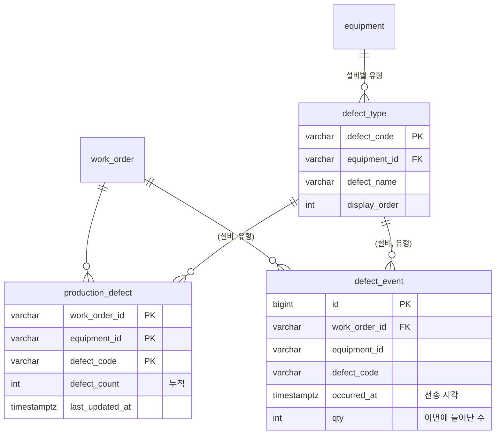
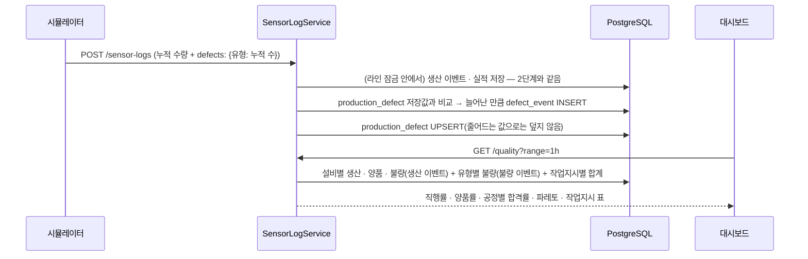
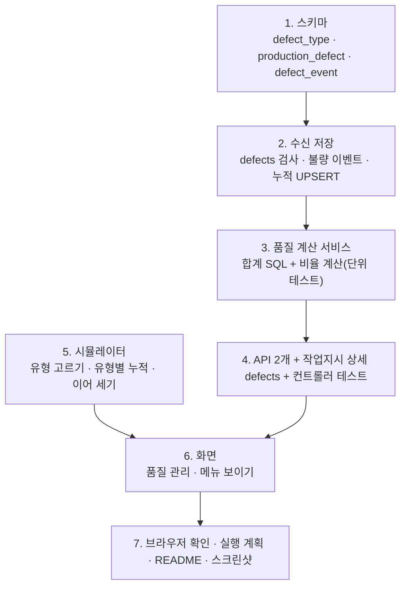

# 로드맵 3단계 계획: 품질

> 전체 순서는 [mes-roadmap.md](mes-roadmap.md) 참고. 앞 단계: [oee.md](oee.md). 브랜치: `feature/quality`

## 1. 목표

불량이 **얼마나**, **무슨 이유로**, **어느 설비 · 작업지시에서** 났는지 보여 준다.

이번 단계가 끝나면 다음 질문에 답할 수 있다.

1. **라인 품질이 지금 어떤가?** → 직행률 · 양품률 · 불량 수 · 완성품 수(오늘 · 최근 1시간 · 최근 8시간)
2. **무슨 불량이 가장 많은가?** → 불량 유형 파레토(많은 순서 막대 + 누적 %)
3. **어느 공정이 불량을 내나?** → 공정별 합격률 · 불량 수 표
4. **언제 나빠졌나?** → 시간대별 불량률 추이
5. **어느 작업지시에서 불량이 많았나?** → 작업지시별 불량 표

## 2. 정한 것

| # | 항목 | 결정 |
|---|---|---|
| 1 | 불량 유형 전송 | 시뮬레이터가 실적에 **유형별 누적 불량 수**(`production.defects`)를 함께 보낸다. 서버는 지금 수량처럼 저장값과 비교해 **늘어난 만큼 불량 이벤트**를 남긴다. 요청 하나가 빠져도 다음 요청에서 맞춰지고, 시뮬레이터를 다시 켜면 저장된 유형별 수부터 이어 센다 |
| 2 | 센서값과 불량 | **이번에는 넣지 않는다.** 불량률은 지금처럼 5% 고정이고, 유형만 설비별 비중대로 나눈다. 관계 분석은 이후 후보로 남긴다 |
| 3 | 직행률(FPY) | **공정별 합격률(양품 ÷ 생산)의 곱.** 구간 안에 생산이 없는 공정은 곱에서 빼고(표에 "—"), 모든 공정이 0이면 값 없음 |
| 4 | 조회 구간 | **OEE와 같은 구간(오늘 · 1시간 · 8시간)을 공유**한다. 생산 현황 · 설비 관리에서 고른 구간이 품질 화면에도 그대로 이어진다. 작업지시별 불량은 같은 구간 안의 표로 보여 준다 |

## 3. 불량 유형 (기준정보)

설비마다 나올 수 있는 유형이 다르다. 비중은 시뮬레이터에만 둔다(서버는 유형 목록만 안다).

| 설비 | 유형 코드 | 이름 | 시뮬레이터 비중 |
|---|---|---|---|
| CNC #1 | `MACHINING_DIMENSION` | 가공 치수 불량 | 60% |
| CNC #1 | `MACHINING_SURFACE` | 가공면 흠집 | 40% |
| 권선기 #1 | `WINDING_RESISTANCE` | 권선 저항 불량 | 60% |
| 권선기 #1 | `WINDING_INSULATION` | 절연 불량 | 40% |
| 조립 셀 #1 | `ASSEMBLY_FASTENING` | 조립 체결 불량 | 70% |
| 조립 셀 #1 | `ASSEMBLY_MISSING_PART` | 부품 누락 | 30% |
| 검사기 #1 | `INSPECTION_PERFORMANCE` | 성능 미달 | 60% |
| 검사기 #1 | `INSPECTION_NOISE` | 소음 · 진동 불량 | 40% |
| 포장기 #1 | `PACKING_APPEARANCE` | 포장 외관 불량 | 70% |
| 포장기 #1 | `PACKING_LABEL` | 라벨 불량 | 30% |

- 조립 체결 불량(조립 불량의 70%)이 비중이 가장 커서 파레토 맨 앞에 오는 일이 많다. 설비마다 불량률은 같으므로 앞 공정일수록 생산 수가 많아 불량도 조금 더 많다.
- 이 기능 전에 난 불량은 유형이 없다. 구간 안 불량 수(생산 이벤트) − 유형이 있는 불량 수는 파레토에 **"미분류"**로 따로 보여 준다.

## 4. 계산식

| 값 | 식 | 분모가 0일 때 |
|---|---|---|
| 공정 합격률 | 그 설비 양품 ÷ 그 설비 생산 수 | 생산 0개 → `null`("—") |
| 직행률(FPY) | 생산이 있는 공정들의 합격률 곱 | 모두 0개 → `null` |
| 완성품 | 포장기(마지막 공정) 양품 수 | — |
| 불량 수 | 전 공정 불량 수 합 | — |
| 양품률 | 완성품 ÷ (완성품 + 불량 수) — 구간 안에서 **결과가 정해진 것**(포장 완료 또는 폐기) 중 완성품 비율. 공정 사이 재공은 아직 결과가 없어 빠진다 | 둘 다 0 → `null` |
| 불량률(추이) | 칸 안 전 공정 불량 ÷ 전 공정 생산 수 | 생산 0 → 빈 칸 |
| 누적 %(파레토) | 많은 순서로 더한 불량 수 ÷ 전체 불량 수 | 불량 0 → 파레토 비움 |

- OEE와 같이 SQL은 합계만 내고, 비율은 Java에서 계산해 단위 테스트로 검증한다.
- 직행률과 양품률이 비슷하게 나오면 정상이다(공정마다 독립적으로 5% 불량).

## 5. 데이터



- `defect_type`: 기준정보. `schema.sql`에서 `ON CONFLICT DO NOTHING`으로 넣는다. `(equipment_id, defect_code)`에 UNIQUE를 두고 두 테이블이 이 쌍을 외래 키로 건다. **다른 설비의 유형 코드나 없는 코드를 보내면 저장하지 않고 400**이다.
- `production_defect`: 실적 테이블처럼 (작업지시, 설비, 유형)마다 누적값 한 행. 시뮬레이터가 다시 시작할 때 이어 셀 값이다.
- `defect_event`: 생산 이벤트처럼 늘어난 만큼 한 행. 인덱스는 `occurred_at`과 `(work_order_id, occurred_at)`.
- 모두 새 테이블이라 **기존 DB를 지우지 않아도** 서버를 다시 켜면 생긴다.
- 검사: 유형별 수는 0 이상의 정수, **합은 `badCount` 이하**여야 한다(넘으면 400). 합이 더 작은 것은 허용한다(기능 전 불량 = 미분류). `defects`가 없으면 빈 것으로 본다(이전 시뮬레이터와 호환).

## 6. 흐름



## 7. API

| 메서드 · 경로 | 설명 |
|---|---|
| `GET /api/v1/quality?range=today\|1h\|8h` | 구간의 요약(직행률 · 양품률 · 불량 수 · 완성품), 공정별 합격률, 불량 유형 파레토, 작업지시별 불량. 그 밖의 값은 400 |
| `GET /api/v1/quality/trend?range=` | 시간대별 불량률. 칸은 OEE 추이와 같다(1시간 = 5분, 오늘 · 8시간 = 1시간) |
| `GET /api/v1/work-orders/{id}` (기존) | 설비별 실적에 `defects`(유형별 누적 수)를 더한다. 시뮬레이터가 이어 셀 때 쓴다 |

응답 예(`/quality`)

```json
{
  "from": "2026-10-27T02:00:00Z",
  "to": "2026-10-27T03:00:00Z",
  "summary": { "fpy": 0.78, "yield": 0.80, "badCount": 9, "finishedCount": 36 },
  "equipment": [
    { "equipmentId": "CNC_01", "equipmentName": "CNC #1", "lineOrder": 1,
      "totalCount": 52, "goodCount": 49, "badCount": 3, "passRate": 0.942 }
  ],
  "defects": [
    { "defectCode": "ASSEMBLY_FASTENING", "defectName": "조립 체결 불량", "equipmentId": "ASSEMBLY_01",
      "equipmentName": "조립 셀 #1", "count": 3, "cumulativeRatio": 0.333 },
    { "defectCode": null, "defectName": "미분류", "equipmentId": null, "equipmentName": null,
      "count": 1, "cumulativeRatio": 1.0 }
  ],
  "workOrders": [
    { "workOrderId": "WO-007", "itemCode": "MOTOR_A", "status": "IN_PROGRESS",
      "finishedCount": 20, "badCount": 5, "topDefectName": "조립 체결 불량" }
  ]
}
```

## 8. 화면

`/quality`(품질 관리) 메뉴를 사이드바에 보이게 한다.

| 영역 | 내용 |
|---|---|
| 위 | 구간 선택(OEE와 공유) + 카드 4개: **직행률** · 양품률 · 불량 수 · 완성품 |
| 가운데 왼쪽 | **불량 유형 파레토**: 많은 순서의 가로 막대, 막대 끝에 "3개 · 누적 33%". 누적 80%까지 든 유형은 굵게 표시 |
| 가운데 오른쪽 | **시간대별 불량률** 막대(0%와 빈 칸을 구분) |
| 아래 | **공정별 합격률** 표(생산 · 양품 · 불량 · 합격률 막대) · **작업지시별 불량** 표(완성품 · 불량 · 가장 많은 유형) |

- **파레토의 누적 % 선은 그리지 않는다.** 막대(개수)와 선(%)을 한 차트에 두면 세로축이 두 개가 되어 읽기 어렵다. 누적 %는 막대 옆 숫자와 80% 강조로 보여 준다(로드맵 문구와 다른 점).
- 색만으로 구분하지 않는다: 막대에는 이름과 값을 같이 쓴다. "미분류"는 회색 막대로 맨 뒤에 둔다(개수와 상관없이).
- 구간 상태는 OEE 화면의 `useOeeRange`를 그대로 쓴다(이름은 바꾸지 않는다).

## 9. 작업 순서



## 10. 테스트

- **백엔드 단위**: 직행률(0 공정 빼기, 모두 0 → null), 양품률, 파레토 정렬 · 누적 % · 미분류 맨 뒤, defects 검사(음수 · 정수 아님 · 합 초과 → 400, 없음 → 빈 것).
- **백엔드 DB**
  - 유형별 누적이 늘면 늘어난 만큼 불량 이벤트가 생기고, 같은 값 · 작은 값은 이벤트도 누적 덮어쓰기도 없다.
  - 다른 설비의 유형 코드 · 없는 코드는 저장되지 않는다(트랜잭션 전체 롤백).
  - 구간 조회가 구간 밖 이벤트를 섞지 않고, 미분류 = 불량 − 유형 있는 불량.
  - 작업지시 상세에 유형별 누적이 나온다.
- **프론트 단위**: 불량이 나면 그 설비 유형 중 하나가 1 늘고 합이 `badCount`와 같다, 저장값에서 이어 센다, 파레토 표시 변환(80% 강조).
- **브라우저**: 지시를 하달해 몇 분 돌린 뒤 품질 화면의 불량 수 = 생산 현황 · 설비 관리의 불량 수, 파레토 합 = 불량 수, 공정별 합격률 곱 = 직행률인지 본다. 시뮬레이터를 새로 고친 뒤에도 유형별 수가 이어지는지 본다.

## 11. 완료 기준

- [x] 사이드바에 품질 관리가 보이고, 구간(오늘 · 1시간 · 8시간)이 OEE 화면과 공유된다
- [x] 직행률 · 양품률 · 불량 수 · 완성품 카드가 보인다
- [x] 불량 유형 파레토가 많은 순서이고 누적 %가 맞으며, 미분류는 맨 뒤에 따로 보인다
- [x] 공정별 합격률의 곱이 직행률과 같다
- [x] 시간대별 불량률이 보이고, 생산 없는 칸은 비어 있다
- [x] 작업지시별 불량 표가 보인다
- [x] 다른 설비 · 없는 유형 코드, 합이 불량 수를 넘는 defects는 400이다
- [x] 시뮬레이터를 다시 켜도 유형별 불량 수가 이어진다
- [x] 기존 DB를 지우지 않고 서버 재시작만으로 적용되고, 구간 조회가 인덱스를 쓸 수 있다(실행 계획. 지금은 테이블이 작아 평소엔 전체 읽기를 고르고, 전체 읽기를 끄면 `occurred_at` 인덱스를 탄다)
- [x] 백엔드 · 프론트 테스트, lint, build 통과, README · 스크린샷 갱신

## 12. 구현 중 정한 점 (2026-10-27)

- **유형별 불량 저장 위치**: 생산 이벤트에 유형 열을 붙이지 않고 별도 테이블(`production_defect` · `defect_event`)로 뒀다. 한 번의 전송에서 늘어난 불량이 여러 유형일 수 있어서다(요청이 빠졌다가 다음 요청에서 한꺼번에 맞춰질 때).
- **설비별 개수**는 OEE와 같은 합계 SQL(`OeeMapper.sumCounts`)을 다시 쓴다. 구간 enum(`OeeService.Range`) · 비율 함수(`ratio`) · 추이 칸 시각 변환도 OEE 것을 쓴다.
- **시뮬레이터 난수 순서**: 유형은 불량 → 경고 종류 → 경고 시간 다음에 고른다. 앞의 난수 순서가 그대로라 기존 테스트가 바뀌지 않는다.
- **파레토는 ECharts가 아닌 HTML 막대**로 그렸다. 가로 막대 몇 줄이라 글자(이름 · 설비 · 개수 · 누적 %)를 함께 두기 쉽고 화면 읽기 프로그램도 목록으로 읽는다.
- **불량률 추이 세로축**은 0~100%가 아니라 최소 10%까지(값이 크면 5% 단위로 늘림)로 그린다. 불량률은 보통 몇 %라 100%까지 그리면 막대가 보이지 않는다.
- **구간 선택 버튼**의 접근성 이름은 화면마다 다르게 준다(`OeeRangePicker`의 `label`, 품질은 "품질 조회 구간").

## 13. 이번 단계에서 하지 않는 것

- 센서값(온도 · 진동)과 불량의 관계 규칙 · 분석 → 이후 후보
- 불량품 재작업 · 폐기 처리 흐름, 검사 기준(SPC 관리도) → 이후 후보
- 작업자가 불량 유형을 직접 입력 · 수정하는 화면
