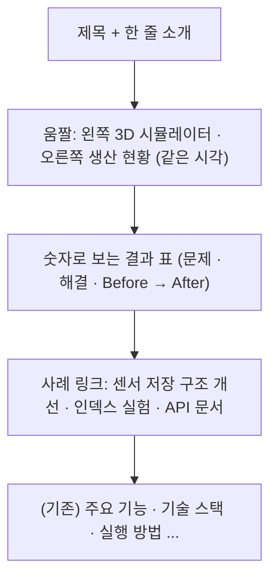

# README 첫 화면 정리 계획

> 브랜치: `feature/readme-intro`(`feature/project-review` 위에 쌓음)

## 1. 목표

데모 링크를 두지 않으므로 **README 첫 화면이 데모 역할**을 하게 한다. 레포를 연 사람이 스크롤하지 않고 다음 세 가지를 알 수 있어야 한다.

1. 무엇이 움직이는지: 시뮬레이터 → 대시보드가 실제로 도는 움짤
2. 무엇을 만들었는지: 한두 줄 소개
3. 무엇을 풀었는지: 이미 잰 Before/After 숫자와 사례 링크

기능 · 코드는 바꾸지 않는다. 새로 재는 숫자도 없다(모두 기존 실험 문서에서 가져온다).

## 2. 첫 화면 구성

## 3. 정한 것

| # | 항목 | 결정 | 이유 |
|---|---|---|---|
| 1 | 움짤 내용 | **시뮬레이터와 생산 현황을 나란히** 같은 시각에 녹화해 한 장으로 합친다 | "1초 POST → 서버 → 2초 조회" 흐름이 한 장면에 보인다 |
| 2 | 형식 | **GIF**, 가로 1200px 안팎 · 10fps · 15초 안팎 · 10MB 이하 | GitHub README에서 레포 안 파일로 바로 재생되는 형식. mp4는 상대 경로로 넣으면 재생되지 않는다 |
| 3 | 녹화 방법 | 헤드리스 Chrome 두 개에서 CDP 스크린샷을 같은 간격으로 찍고 ffmpeg로 이어 붙인다 | 화면 녹화 앱 없이 다시 만들 수 있다 |
| 4 | 숫자 | `docs/experiments/sensor-rollup` · `sensor-log-index`의 결과와 리뷰(번들 크기)에서 고른다 | 이미 근거(캡처 · CSV)가 있는 숫자만 쓴다 |
| 5 | 기존 본문 | 그대로 둔다. 첫 화면 아래로 밀린다 | 첫 화면만 바꾸는 작업 |

## 4. 바꾸는 파일

| 파일 | 내용 |
|---|---|
| `docs/images/demo.gif` (새) | 시뮬레이터 + 생산 현황 움짤 |
| `README.md` | 제목 · 소개 · 움짤 · 숫자 표 · 사례 링크를 맨 위에 |

## 5. 확인 기준

- [ ] GitHub 미리보기 크기(가로 약 900px)에서 움짤 글자가 읽힌다
- [ ] 움짤이 10MB 이하
- [ ] 표의 숫자가 모두 링크한 실험 문서의 숫자와 같다
- [ ] 링크가 모두 열린다
