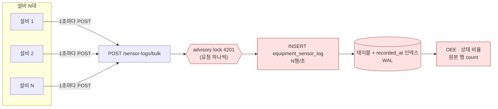
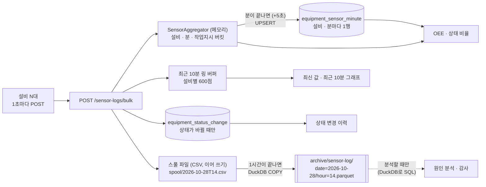
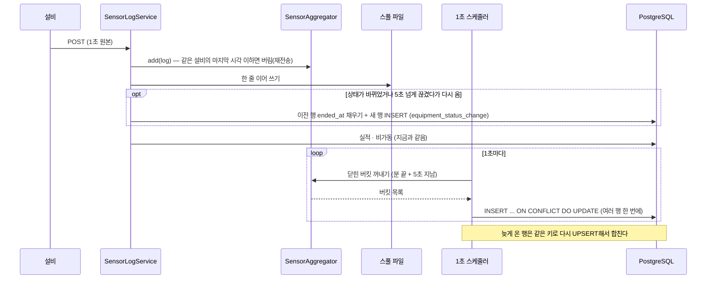
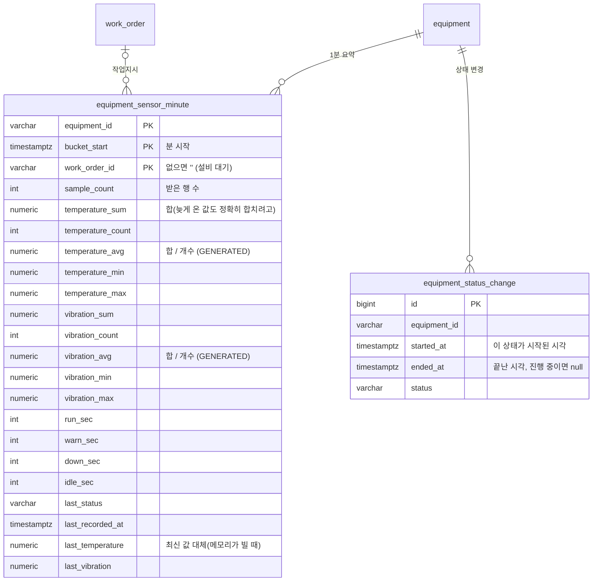
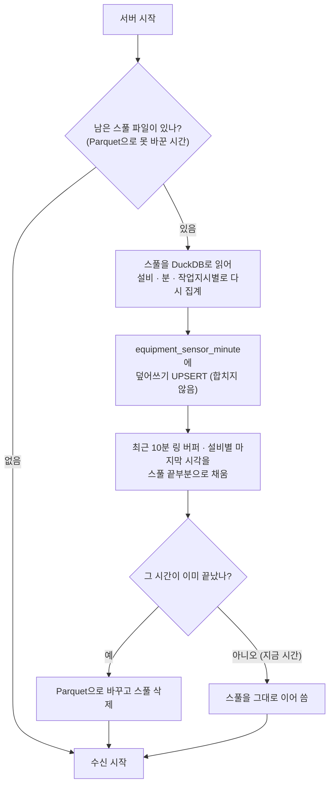
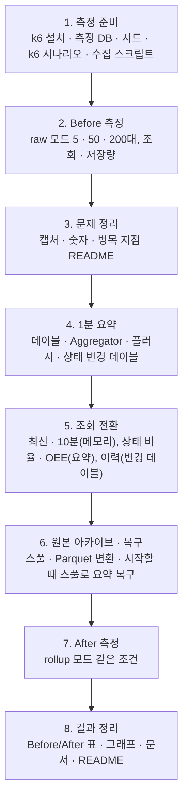

# 센서 로그 1분 요약 · 원본 아카이브 계획

> 앞 실험: [센서 로그 인덱스 실험](../experiments/sensor-log-index/README.md). 브랜치: `feature/sensor-rollup`

## 1. 목표

지금은 설비마다 **1초에 1행**이 `equipment_sensor_log`에 쌓인다. 설비 5대면 하루 43만 행이고, 수십 ~ 수백 대면 다음 문제가 생긴다.

1. **스토리지 급증**: 행이 설비 수 × 86,400개씩 매일 늘고, 인덱스도 같이 커진다
2. **쓰기 병목**: 1초마다 설비 수만큼 INSERT · 인덱스 갱신 · WAL 기록 · 커밋이 일어난다
3. **조회가 느려짐**: OEE · 상태 비율이 원본 행을 하나씩 센다(`count(*) FILTER ...`). 구간이 길면(오늘 · 7일) 읽을 행이 많다

이번 작업은 **문제를 먼저 재현해 숫자로 남기고(Before), 해결한 뒤 같은 조건으로 다시 재서(After) 비교한다.**

해결 방향:

- DB에는 **설비 · 1분마다 요약 1행**만 넣는다. 요약에는 온도 · 진동의 평균 · 최대 · 최소와 상태별 초를 담는다
- 1초 원본은 버리지 않고 **1시간마다 Parquet 파일**로 묶어 따로 보관한다(콜드 저장소)
- 실시간 화면(최신 값 · 최근 10분 1초 그래프)은 **서버 메모리**에서 읽는다. 화면은 지금 그대로다

## 2. 정한 것

| # | 항목 | 결정 |
|---|---|---|
| 1 | DB에 넣는 것 | **설비 · 1분 · 작업지시마다 요약 1행.** 서버 메모리에서 모았다가 분이 끝나면 넣는다 |
| 2 | 요약 값 | 온도 · 진동의 **평균 · 최대 · 최소**, **상태별 초**(RUN · WARN · DOWN · IDLE), **받은 행 수**, 그 분의 마지막 상태 |
| 3 | 1초 원본 | **1시간 단위 Parquet 파일**(zstd 압축). 받는 동안은 스풀 파일(CSV)에 이어 쓰고, 1시간이 끝나면 Parquet으로 바꾼다 |
| 4 | 실시간 화면 | **메모리에 설비별 최근 10분(600점)**을 둔다. 최신 값 · 최근 10분 API가 DB를 읽지 않는다 |
| 5 | 상태 변경 이력 | 1분 요약으로는 만들 수 없어서 **상태가 바뀔 때만 1행** 넣는 테이블을 둔다 |
| 6 | 부하 재현 | **설비 5 · 50 · 200대**, 설비마다 1초에 1번 요청. 도구는 **k6** |
| 7 | 비교 방법 | **같은 부하 스크립트**로 Before/After를 잰다. Before는 바꾸기 전 커밋(dev `db9fcad`)의 jar로 쟀다. 다시 재려면 그 커밋을 빌드한다(코드에 `raw` 모드를 두지 않는다 — 구현 중 바꿈, §14) |
| 8 | 서버가 죽었을 때 | **Redis 없이 스풀 파일로 복구한다.** 원본이 먼저 스풀에 남으므로, 다시 시작할 때 스풀로 빠진 분의 요약과 최근 10분 버퍼를 다시 만든다(§6) |
| 9 | 라인 잠금 범위 | **센서만 온 요청은 라인 잠금을 잡지 않는다.** 설비별 잠금만 잡는다. Before 측정에서 느린 요청(p99)의 원인이 라인 잠금으로 나와서 범위에 넣었다(§14) |

### 상태는 평균을 낼 수 없다

OEE와 상태 비율은 "상태별 몇 초"가 필요하다. 지금은 원본 행 수를 센다.

```sql
count(*) FILTER (WHERE status = 'DOWN') AS "downSec"   -- 1행 = 1초
```

그래서 요약에는 센서 값의 평균 · 최대 · 최소와 별도로 **상태별 초**를 넣는다. 요약에서는 `sum(down_sec)`으로 같은 값이 나온다.

| 지금 원본을 읽는 곳 | 바뀐 뒤 읽는 곳 |
|---|---|
| 설비별 최신 1건 (`GET /equipment/latest`) | 메모리 |
| 설비 하나의 최근 10분 (`GET /equipment/{id}/sensor-logs`) | 메모리(최근 10분 링 버퍼) |
| 최근 n분 상태별 초 (`GET /equipment/status-summary`) | 1분 요약 + 아직 안 넣은 이번 분(메모리) |
| 상태 변경 이력 (`GET /equipment/{id}/status-changes`) | 상태 변경 테이블 |
| OEE 가동률 (`OeeMapper.sumStatusSeconds`) | 1분 요약 + 이번 분(메모리) |
| 비가동 정지 추적 (`trackDowntime`) | 바뀌지 않음(수신 중에 처리) |

## 3. 지금 구조와 문제 지점



| 지점 | 예상되는 문제 | 재는 값 |
|---|---|---|
| ① 잠금 | 모든 수신 요청이 잠금 하나를 차례로 기다린다. 설비가 따로 보내면 요청 수 = 설비 수 | `pg_stat_activity`의 `Lock:advisory` 대기 수, 응답 지연 |
| ② INSERT | 설비 수만큼 행 · 인덱스 갱신 · WAL · 커밋 | 초당 처리 요청 수, `pg_stat_wal.wal_bytes`, `tup_inserted` |
| ③ 저장량 | 행이 설비 수 × 86,400개/일 | 테이블 + 인덱스 크기 → 하루 · 30일 · 1년 환산 |
| ④ 조회 | 구간이 길수록 읽는 행이 많다 | OEE 오늘 · 7일 쿼리 `EXPLAIN (ANALYZE, BUFFERS)` |

수신 요청에는 센서 로그 말고도 실적 UPSERT · 생산 이벤트 · 비가동 갱신이 있다. 이번에는 **센서 로그 저장만** 바꾸고, 나머지는 측정해서 몇 %를 차지하는지만 기록한다.

## 4. 바꾼 뒤 구조



### 수신 → 요약 → DB



## 5. 데이터



- **키에 작업지시를 넣는 이유**: OEE는 `work_order_id IS NOT NULL`인 시간만 계획 시간으로 센다. 한 분 안에서 작업지시가 바뀌면 버킷을 둘로 나눠야 지금과 같은 값이 나온다
- **늦게 온 행 합치기**: 평균 대신 합 · 개수를 저장하고 평균은 `GENERATED` 열로 계산한다(구현 중 바꿈: 가중 평균을 반복해 합치면 반올림 오차가 쌓인다). 최대 · 최소는 `GREATEST` · `LEAST`, 초는 더한다
- **인덱스**: 기본 키 `(equipment_id, bucket_start, work_order_id)`와 구간 조회용 `bucket_start` 인덱스
- **상태 변경 이력**: 상태가 바뀌는 순간 이전 행의 `ended_at`을 채우고 새 행을 넣는다. 실무 MES의 설비 상태 이력(시작 · 끝 · 상태)과 같은 모양이다. 끝 시각을 저장해 두면 구간 조회가 `started_at < to AND (ended_at IS NULL OR ended_at > from)`로 끝나고 `LEAD`가 필요 없다
  - 예: CNC_01이 14:00:00 RUN → 14:00:42 DOWN → 14:01:16 RUN이면 원본 77행 대신 3행이다
  - 수신이 5초 넘게 끊기면 마지막으로 받은 시각 + 1초로 `ended_at`을 채워 지금처럼 구간을 끊는다(끊긴 시간은 이력에 비어 보인다)
- **기존 `equipment_sensor_log`**: 지우지 않는다. 새로 넣지 않을 뿐이다. 기존 행을 1분 요약으로 옮기는 SQL을 한 번 돌린다

### 원본 아카이브 (Parquet)

| 항목 | 값 |
|---|---|
| 위치 | `backend/data/archive/sensor-log/date=YYYY-MM-DD/hour=HH.parquet` (설정으로 바꿀 수 있고 gitignore) |
| 열 | equipment_id, recorded_at, status, work_order_id, temperature, vibration, alarm_code |
| 압축 | zstd |
| 만드는 방법 | 받는 동안 `spool/YYYY-MM-DDTHH.csv`에 한 줄씩 이어 쓰고(순차 쓰기라 싸다), 1시간이 끝나고 5초 뒤 DuckDB로 `COPY (SELECT * FROM read_csv(...)) TO '...parquet' (FORMAT parquet, COMPRESSION zstd)` 한 뒤 스풀을 지운다 |
| 서버가 죽으면 | 스풀 파일이 남아 있어서 다음 시작 때 Parquet으로 바꾼다 |
| 라이브러리 | `org.duckdb:duckdb_jdbc` 하나. `parquet-java`는 Hadoop 의존성이 딸려 와서 쓰지 않는다. DuckDB는 나중에 파일을 SQL로 조회할 때도 쓴다 |

Parquet은 이어 쓰기가 안 돼서 1초마다 Parquet에 쓸 수 없다. 그래서 스풀을 거친다. 파일을 설비마다 나누면 한 시간에 3,600행짜리 작은 파일이 설비 수만큼 생긴다(작은 파일 문제). 그래서 **한 시간에 파일 하나**로 둔다.

## 6. 메모리에서 지켜야 할 것

| 상황 | 처리 |
|---|---|
| 같은 요청이 다시 옴(재전송) | 설비마다 마지막 `recorded_at`을 기억하고, 그 이하는 요약 · 스풀 · 링 버퍼에 넣지 않는다(비가동 추적과 같은 규칙) |
| 분 경계 | 버킷은 `recorded_at`(설비 시각)의 분으로 나눈다. 닫는 기준은 서버 시각으로 "분 끝 + 5초" |
| 닫은 뒤 늦게 온 행 | 새 버킷을 만들어 다음 플러시 때 같은 키로 UPSERT해서 합친다 |
| 이번 분 조회 | 상태 비율 · OEE는 DB 요약 + 메모리에서 아직 안 넣은 버킷을 더한다 |
| 서버 종료 | `@PreDestroy`에서 열린 버킷을 모두 넣고, 스풀을 Parquet으로 바꾼다 |
| 서버가 갑자기 죽음 | 메모리의 요약(최대 1분 + 5초)과 최근 10분 버퍼는 잃지만, 원본은 스풀에 남는다. 아래 "시작할 때 복구"로 다시 만든다 |
| 동시성 | 버킷 맵은 `ConcurrentHashMap`, 버킷 하나에 쓰는 것은 그 버킷으로 `synchronized` |
| 서버 여러 대 | 메모리 집계라 **서버 한 대**가 전제다. 여러 대면 설비별로 같은 서버에 보내거나 Kafka 같은 스트림 처리가 필요하다(§12) |

### 시작할 때 복구 (스풀 → 요약)

원리는 Kafka와 같다. **받은 원본을 먼저 디스크(스풀)에 남기고, 집계는 나중에 한다.** 그래서 메모리의 집계를 잃어도 스풀을 다시 읽으면 같은 결과가 나온다.



| 항목 | 처리 |
|---|---|
| 왜 덮어쓰나 | 스풀에는 그 시간의 원본이 **전부** 있다. 그래서 다시 집계한 값이 정답이다. 평소처럼 합치면(가중 평균 · 초 더하기) 죽기 전에 이미 넣은 분이 두 번 더해진다 |
| 덮어쓰는 범위 | 스풀에 있는 분만. 스풀이 없는(이미 Parquet으로 바뀐) 시간은 건드리지 않는다 |
| 상태 변경 테이블 | 수신할 때 바로 DB에 넣으므로 잃지 않는다. 설비별 현재 상태는 DB의 열린 행(`ended_at IS NULL`)에서 다시 읽는다 |
| 비가동 · 실적 | 지금처럼 수신할 때 바로 DB에 넣으므로 복구할 것이 없다 |
| 스풀 쓰기 | 요청마다 `flush()`(OS 버퍼까지)만 하고 `fsync`는 하지 않는다. **앱이 죽어도 남고**, 컴퓨터 전원이 나가면 마지막 몇 초는 잃을 수 있다. 1초마다 `fsync`하는 비용은 측정해서 기록한다 |
| Parquet으로 바뀐 뒤 늦게 온 행 | 그 시간의 늦은 행만 `hour=HH-late-<번호>.parquet`로 따로 남기고, 요약에는 평소처럼 합친다 |

## 7. 측정 방법

### 환경

- 측정 전용 DB `mes_bench_ingest`를 만들고, 백엔드를 `--spring.datasource.url=...mes_bench_ingest`로 띄운다(개발 DB를 건드리지 않는다)
- 설비 `BENCH_001` ~ `BENCH_200`을 기준정보에 넣는 시드 SQL
- k6 시나리오: `constant-arrival-rate`로 **설비 수 = 초당 요청 수**. 설비마다 1행씩 따로 보낸다(실제 공장처럼 설비 · 게이트웨이가 각자 보냄). 상태 분포는 앞 실험과 같게 RUN 85% · IDLE 7% · WARN 5% · DOWN 3%
- 설비 5 · 50 · 200대를 각 5분. 첫 1분은 데우기로 버린다

### 재는 값

| 분류 | 값 | 출처 |
|---|---|---|
| 수신 | 응답 시간 p50 · p95 · p99(빠른 순서로 50 · 95 · 99번째 백분위 값), 실제 처리 요청 수/초, 실패율, 밀린 요청(dropped_iterations) | k6 요약(JSON) |
| DB 쓰기 | 초당 INSERT 행 수, WAL 바이트/초, 커밋 수/초 | `pg_stat_database`, `pg_stat_wal` 측정 전후 차이 |
| 잠금 | 잠금 대기 중인 연결 수(1초마다 샘플) | `pg_stat_activity.wait_event` |
| 저장량 | 5분 동안 늘어난 테이블 + 인덱스 크기 → 하루 · 30일 · 1년 환산. Parquet 파일 크기 | `pg_total_relation_size`, 파일 크기 |
| 조회 | OEE 오늘 · 7일, 상태 비율 1시간 | 설비 50대 × 7일 데이터를 넣고 `EXPLAIN (ANALYZE, BUFFERS)` 5회 중앙값 |
| 정확도 | 같은 입력으로 원본 count와 요약 sum의 OEE 가동률이 같은가 | 테스트 + 측정 DB에서 비교 SQL |

### 남기는 것 (캡처)

- k6 웹 대시보드 HTML 리포트(`K6_WEB_DASHBOARD_EXPORT`)와 화면 캡처 → `docs/experiments/sensor-rollup/images/`
- 숫자는 CSV, 실행 계획은 `plans/*.txt`
- README에 Before/After 표와 막대 그래프(mermaid `xychart-beta`)
- 캡처 목록과 파일 이름은 §13에 정리했다. Before 캡처는 코드를 바꾸기 **전에** 찍는다(나중에 다시 만들 수 없다)

### 예상치 (측정 전 계산)

앞 실험에서 원본 1행이 테이블 + 인덱스로 약 100바이트였다.

| 설비 | 원본 행/일 | 원본 DB/일 | 요약 행/일 | 줄어드는 비율 |
|---|---:|---:|---:|---:|
| 5 | 432,000 | 약 43MB | 7,200 | 1/60 |
| 50 | 4,320,000 | 약 430MB | 72,000 | 1/60 |
| 200 | 17,280,000 | 약 1.7GB(1년 약 630GB) | 288,000 | 1/60 |

요약 1행은 원본 1행보다 넓어서, 실제 줄어드는 크기는 1/60보다 작을 것이다. 측정으로 확인한다.

## 8. 작업 순서



2단계가 끝나면 숫자를 먼저 보여 드리고, 잠금(①)이 가장 큰 병목으로 나오면 해결 범위를 다시 상의한다. → 2026-10-29 상의해서 잠금 범위 줄이기를 넣었다(§14).

## 9. 설정

| 속성 | 기본값 | 뜻 |
|---|---|---|
| `mes.sensor.flush-grace` | `5s` | 분이 끝나고 이만큼 기다린 뒤 넣는다 |
| `mes.sensor.archive-dir` | `data/archive/sensor-log` | Parquet 위치 |
| `mes.sensor.spool-dir` | `data/spool` | 스풀 위치 |

## 10. 테스트

| 대상 | 내용 |
|---|---|
| `SensorAggregator` (DB 없음) | 평균 · 최대 · 최소, 상태별 초, 분 경계, 작업지시가 바뀌면 버킷 나눔, 재전송 버림, 닫힌 버킷만 꺼냄 |
| 요약 UPSERT (DB) | 늦게 온 행을 가중 평균으로 합침, 최대 · 최소 · 초 합 |
| 정확도 (DB) | 같은 로그를 raw · rollup 두 방식으로 넣고 OEE 가동률 · 상태 비율이 같은가 |
| 상태 변경 | 바뀔 때만 1행 · 이전 행 `ended_at` 채움, 5초 끊기면 구간을 끊음, 이력 API 응답 모양이 그대로인가 |
| 복구 | 몇 분 받고 메모리를 버린 뒤(죽은 것처럼) 스풀로 복구하면, 끝까지 정상으로 받은 경우와 요약이 같은가. 두 번 복구해도 같은가 |
| 링 버퍼 | 600점을 넘으면 오래된 것부터 버림, 최신 값 |
| 아카이브 | 스풀 → Parquet 변환 뒤 행 수가 같은가, 남은 스풀을 시작 때 변환하는가 |
| 기존 테스트 | 97개(백엔드) · 78개(프론트) 그대로 통과 |

## 11. 완료 기준

- [x] Before 측정 결과(5 · 50 · 200대, 한계 찾기 500 · 1,000 · 2,000대)와 캡처가 `docs/experiments/sensor-rollup/`에 있다
- [x] DB 센서 행이 1/60 수준으로 준다: 200대 200행/초 → 3.8행/초(요약 3.3 + 상태 이력 0.8), 같은 7일 데이터 3,024만 행 → 50.4만 행
- [x] 200대에서 수신 p95 · WAL이 나아졌다: p95 3.44 → 1.88ms, WAL 57.8 → 2.1KB/초. 2,000대 p99 715 → 2.7ms
- [x] OEE 7일 조회가 빨라졌다: 2,563 → 47ms
- [x] 같은 입력에서 OEE 초가 원본과 같다: 7일 · 50대 차이 0(`history-accuracy.sql`), 테스트 `SensorRollupServiceDbTest`
- [x] 1시간 Parquet 파일이 생기고 DuckDB로 행 수를 확인할 수 있다: 개발 서버 02:02에 `hour=01.parquet`(1,750행), DB 요약과 설비별로 같다
- [x] 부하 중에 백엔드를 강제 종료(`kill -9`)하고 다시 띄워도 그 분의 요약이 빠지지 않는다: 직후 2,950 → 복구 4,745(= 스풀), 끝 8,811 = 스풀 8,811
- [x] 대시보드 화면이 그대로 동작한다(최신 값 · 10분 그래프 · 상태 이력 · OEE · 비가동): `images/after-dashboard.png`
- [x] 테스트 · lint · build 통과(백엔드 108 · 프론트 78), README · 계획서 갱신
- [x] 결과 문서가 §13 구성(문제 → 근거 → 원인 → 선택지 → 해결 → 결과 → 한계)을 갖추고 캡처가 있다(Before 7장 · After 9장, 계획의 11장 + 잠금 대기 · pgbench · 2,000대 · 실제 Parquet)

## 12. 이번에 하지 않는 것 (후보)

| 후보 | 이유 |
|---|---|
| Redis로 집계 상태 분리 | 서버 한 대에서는 스풀 복구로 충분하다. 백엔드를 여러 대로 늘릴 때 다시 본다 |
| S3 · MinIO에 아카이브 | 로컬 폴더로 구조를 먼저 보인다. 경로만 바꾸면 된다 |
| 오래된 요약 지우기 · 1시간 요약 | 1분 요약은 200대 1년에도 수십 GB 이하라 당장은 필요 없다 |
| 서버 여러 대 · Kafka | 메모리 집계는 서버 한 대 전제. 규모가 더 커질 때의 다음 단계 |
| TimescaleDB 연속 집계 | 같은 문제를 DB 확장으로 푸는 방법. 이번에는 애플리케이션에서 직접 풀어 원리를 보인다 |
| 실적 · 비가동 쓰기 줄이기 | 이번엔 센서 로그만. Before 측정에서 비중만 기록한다 |
| 실적이 온 요청의 라인 잠금 | 작업지시 완료 · 다음 지시 시작을 한 줄로 처리하려면 필요하다. 실적을 보내는 것은 라인 시뮬레이터 하나라 그대로 둔다 |

## 13. 포트폴리오 정리

이 작업은 포트폴리오에 쓴다. 그래서 결과 문서는 **"문제 → 근거 → 원인 → 선택지 비교 → 해결 → 결과 숫자 → 한계"** 순서로 읽히게 쓴다. 읽는 사람이 "왜 이렇게 했는지"를 코드 없이도 따라올 수 있어야 한다.

### 결과 문서 구성 (`docs/experiments/sensor-rollup/README.md`)

| # | 절 | 담을 내용 |
|---|---|---|
| 1 | 한눈에 보기 | 3줄 요약 + 핵심 숫자 4개(DB 쓰기 행/초, 하루 저장량, 200대 p95, OEE 7일 조회). 예: "200대에서 DB 쓰기 N행/초 → M행/초, 하루 X GB → Y MB" |
| 2 | 문제 상황 | 설비가 늘면 무엇이 문제인지. 1초 × 설비 수 계산과 지금 구조 그림 |
| 3 | 재현과 근거 | k6로 5 · 50 · 200대를 재현한 결과. 응답 시간 그래프 · 잠금 대기 · 테이블 크기 캡처 |
| 4 | 원인 분석 | 숫자로 본 병목 순위(INSERT · WAL · 잠금 · 인덱스 · 조회). "예상과 달랐던 점"도 쓴다 |
| 5 | 선택지 비교 | 아래 표. 각 방법의 장단점과 고르지 않은 이유 |
| 6 | 해결 방법 | 1분 요약 · 상태 변경 이력 · 메모리 링 버퍼 · 스풀 → Parquet · 스풀 복구. 구조 그림과 핵심 결정 이유 |
| 7 | 결과 | 같은 조건 Before/After 표와 막대 그래프, k6 리포트 캡처 나란히 |
| 8 | 정확도 · 복구 확인 | raw와 rollup의 OEE가 같다는 비교, `kill -9` 뒤 복구 확인 |
| 9 | 한계와 다음 단계 | 서버 한 대 전제, 전원 손실 시 수 초, 분 단위 경계 오차. 규모가 더 커지면 Kafka · TimescaleDB · S3 |
| 10 | 다시 돌리기 | 명령어와 파일 목록 |

### 선택지 비교 (결과 문서 5절의 뼈대)

| 방법 | 쓰기 I/O | 스토리지 | 조회 속도 | 추가 인프라 | 고르지 않은 이유 / 고른 이유 |
|---|---|---|---|---|---|
| 지금 그대로 + 인덱스 조정 | 그대로 | 그대로 | 조금 나아짐 | 없음 | 앞 실험에서 이미 인덱스를 맞췄다. 행 수 자체가 문제다 |
| 여러 요청을 모아 배치 INSERT | 커밋 수는 줄어듦 | 그대로 | 그대로 | 없음 | 행과 WAL은 그대로라 스토리지가 해결되지 않는다 |
| 날짜 파티션 + 오래된 원본 삭제 | 그대로 | 보관 기간만큼 | 조금 나아짐 | 없음 | 원본을 버리게 되고 쓰기 I/O는 그대로다 |
| TimescaleDB 연속 집계 | 원본 쓰기는 그대로 | 압축으로 줄어듦 | 빠름 | DB 확장 | 좋은 방법이지만 원본 INSERT가 남는다. 원리를 직접 구현해 보여 주려고 다음 단계로 둔다 |
| Redis에 집계 | 크게 줄어듦 | 줄어듦 | 빠름 | Redis | 서버 한 대에서는 스풀 복구로 같은 안전성을 얻는다. 서버를 늘릴 때 다시 본다 |
| Kafka + 스트림 집계 | 크게 줄어듦 | 줄어듦 | 빠름 | Kafka 클러스터 | 대규모 표준 구조지만 지금 규모에 비해 무겁다 |
| **메모리 1분 요약 + 스풀 + Parquet (선택)** | **약 1/60** | **약 1/60 + 압축 파일** | **빠름** | **없음** | 쓰기 · 스토리지를 함께 줄이고, 원본도 남기며, 스풀로 Kafka와 같은 "먼저 남기고 나중에 집계" 원리를 작게 구현한다 |

선택지 표의 "쓰기 I/O · 스토리지" 칸은 예상이다. 측정 뒤 결과 숫자로 바꾼다. 측정하지 않은 방법은 "측정 안 함"으로 적는다.

### 캡처 목록 (`docs/experiments/sensor-rollup/images/`)

| 파일 | 언제 | 무엇 |
|---|---|---|
| `before-k6-200.png` | Before | 200대 k6 웹 대시보드(응답 시간 · 처리량 · 실패) |
| `before-k6-summary.png` | Before | 5 · 50 · 200대 k6 터미널 요약 |
| `before-lock-wait.png` | Before | 부하 중 `pg_stat_activity` 잠금 대기 조회 결과 |
| `before-table-size.png` | Before | 5분 부하 뒤 테이블 · 인덱스 크기 조회 결과 |
| `before-oee-explain.png` | Before | OEE 7일 쿼리 `EXPLAIN ANALYZE`(읽은 행 수 · 시간) |
| `after-k6-200.png` | After | 같은 조건 200대 k6 웹 대시보드 |
| `after-table-size.png` | After | 요약 테이블 · 상태 변경 테이블 크기 |
| `after-oee-explain.png` | After | 같은 OEE 7일 쿼리 실행 계획 |
| `after-parquet.png` | After | Parquet 폴더와 DuckDB로 행 수 · 크기를 확인한 결과 |
| `after-recovery.png` | After | `kill -9` 전후 요약 행이 같다는 조회 결과 |
| `after-dashboard.png` | After | 대시보드가 그대로 동작하는 화면(최신 값 · 10분 그래프 · 상태 이력) |

캡처는 숫자를 보여 주는 보조 자료다. 숫자는 항상 CSV와 README 표에도 적는다.

### 포트폴리오용 요약 (README 1절과 같은 내용)

결과가 나오면 아래 틀로 채워서 루트 `README.md`의 "성능 개선" 항목에도 짧게 링크한다.

> **문제** 설비마다 1초 1행 저장 → 200대면 하루 약 1,700만 행 · N GB, 수신 p95 N ms
> **원인** (측정으로 찾은 병목)
> **해결** 서버 메모리에서 1분 요약(평균 · 최대 · 최소 · 상태별 초)만 DB에 넣고, 원본은 스풀을 거쳐 1시간 Parquet으로 보관. 서버가 죽으면 스풀로 복구
> **결과** DB 쓰기 N → M행/초, 하루 저장량 N → M, p95 N → M ms, OEE 7일 조회 N → M ms. 정확도 차이 0
> **배운 점** (측정하며 알게 된 것)

## 14. Before 측정 뒤 정한 점 (2026-10-29)

Before 결과: [`docs/experiments/sensor-rollup/README.md`](../experiments/sensor-rollup/README.md) 3 · 4절.

| 항목 | 결정 | 이유 |
|---|---|---|
| 라인 잠금 범위 | 실적(`workOrderId` · `production`)이 하나도 없는 요청은 라인 잠금(`pg_advisory_xact_lock(4201)`)과 작업지시 완료 · 시작 확인을 건너뛴다. 대신 **설비별 잠금** `pg_advisory_xact_lock(4202, hashtext(설비))`을 설비 이름 순서로 잡는다. 실적이 있는 요청은 라인 잠금 뒤 설비별 잠금을 잡는다 | 2,000대에서 p99 715ms일 때 연결 10개 중 9개가 라인 잠금을 기다렸다. 센서만 온 요청은 작업지시를 바꾸지 않으므로 줄 설 이유가 없다. 같은 설비의 정지 · 상태 변경은 여전히 한 줄로 처리해야 해서 설비별 잠금을 둔다. 순서를 정해 잡으므로 교착이 없다 |
| `raw` 모드 | 두지 않는다 | Before는 이미 바꾸기 전 커밋으로 쟀다. 두 저장 방식을 코드에 같이 두면 조회도 두 갈래가 된다 |
| 메모리 갱신 시점 | 저장 트랜잭션 안에서 DB 쓰기가 모두 끝난 뒤(설비별 잠금을 잡은 채) 요약 · 링 버퍼 · 스풀에 넣는다 | 커밋 뒤에 넣으면 잠금이 풀린 사이에 같은 설비의 다음 요청이 옛 상태를 읽는다. 그 뒤 커밋만 실패하는 경우는 드물어서, 그때 스풀에 남은 행은 "받은 원본"으로 둔다 |
| 최근 n분 로그 API | 10분 이하는 메모리(1초 점), 10분 초과는 1분 요약(분마다 평균 1점) | 화면은 10분만 쓴다. API는 1440분까지 받으므로 긴 구간은 요약으로 돌려준다 |
| 설비별 최신 1건 | 메모리. 서버를 막 띄워 메모리가 비었으면 1분 요약의 마지막 행(마지막 상태 · 마지막 온도 · 진동) | 요약에 마지막 값 열(`last_temperature` · `last_vibration`)을 더한다 |
| 경계 오차 | OEE · 상태 비율의 구간(`from`)은 분 단위로 내림해서 센다. 최대 1분 차이 | 요약이 분 단위라 피할 수 없다. 작업지시 기준 OEE는 작업지시로 거르므로 오차가 없다 |
| 기존 데이터 | 시작할 때 요약 · 상태 변경 테이블이 비어 있으면 기존 `equipment_sensor_log`로 한 번 채운다. 원본 테이블은 지우지 않는다 | 개발 DB의 지난 OEE · 이력이 그대로 보이게 |

