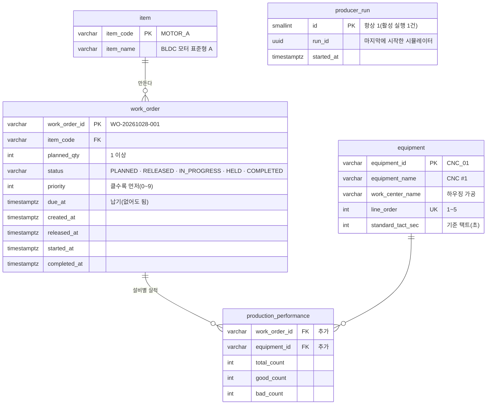
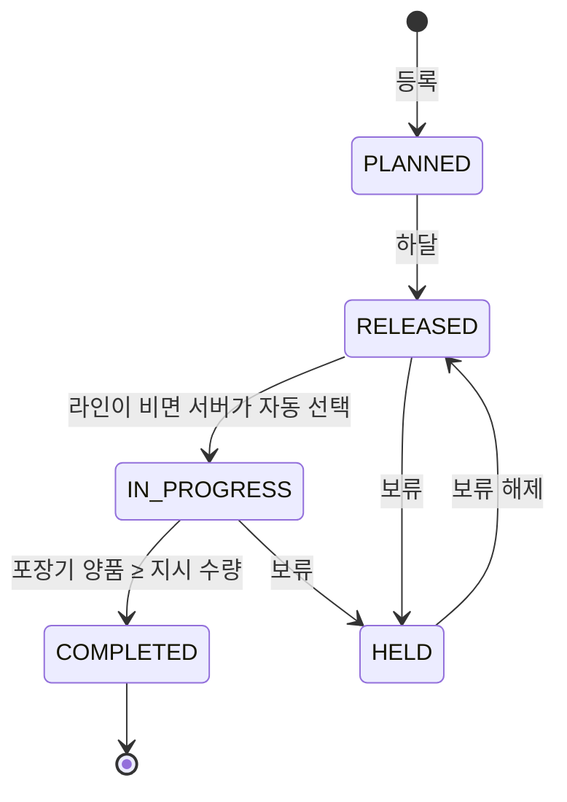
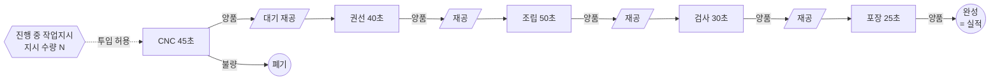
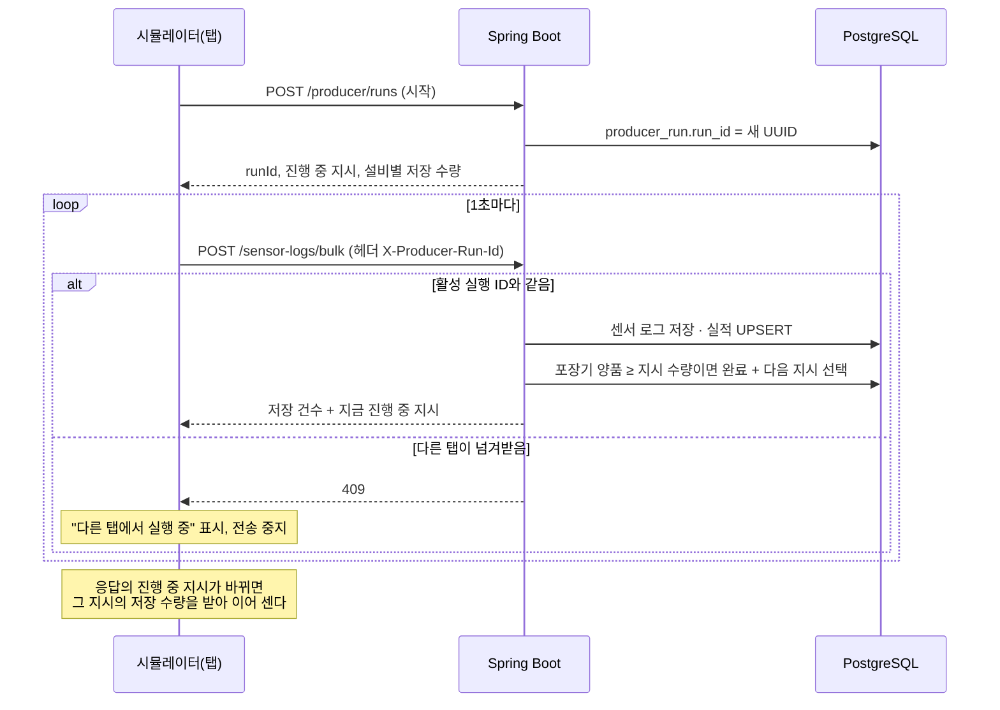

# 로드맵 1단계 계획: 기준정보 · 작업지시

> 전체 순서는 [mes-roadmap.md](mes-roadmap.md) 참고. 브랜치: `feature/work-order`

## 1. 목표

대시보드에서 작업지시를 **등록 → 하달**하면 시뮬레이터 라인이 그 지시를 생산하고, 마지막 공정(포장기) 양품이 지시 수량에 이르면 **완료**되며 다음 지시로 넘어간다.

이번 단계가 끝나면 다음 질문에 답할 수 있다.

1. **무엇을 몇 개 만들라고 했나?** → 작업지시 목록(품목 · 수량 · 우선순위 · 납기 · 상태)
2. **지금 어디까지 만들었나?** → 진척률, 공정별 진척(공정 사이에 쌓인 재공 포함)
3. **언제 끝나나?** → 남은 수량 × 병목 기준 택트로 계산한 예상 완료 시각

함께 풀리는 문제

- 시뮬레이터를 다시 열면 수량이 0부터 세어져 실적이 멈춰 보이던 문제 → 서버에 저장된 수량부터 이어 센다.
- 옛 Chrome 탭이 1분마다 데이터를 보내 상태 이력에 1초짜리 구간이 생기던 문제 → 마지막에 연 시뮬레이터 하나만 데이터를 보낼 수 있다.

## 2. 정한 것

| # | 항목 | 결정 |
|---|---|---|
| 1 | 진행 중 작업지시가 없을 때 | 새 상태 **대기(IDLE)**. 생산하지 않고, 상태 비율 · 이력 · 3D에 "대기"로 보인다. 알림은 아니다 |
| 2 | 공정 연결 | 뒤 공정은 **앞 공정이 넘겨준 양품이 있어야** 1개를 만든다. 없으면 대기(IDLE). 앞 공정 불량은 뒤로 넘어가지 않는다 |
| 3 | 수량 전송 | 지금처럼 **누적값**. 시뮬레이터가 시작하거나 작업지시가 바뀌면 서버에 저장된 설비별 수량을 받아 거기서부터 센다 |
| 4 | 시뮬레이터 여러 개 | **나중에 연 탭이 넘겨받는다.** 시작할 때 실행 ID를 받고, 서버는 마지막 실행 ID의 데이터만 받는다. 밀려난 탭은 "다른 탭에서 실행 중"을 띄우고 전송을 멈춘다 |
| 5 | 라인과 작업지시 | 라인 하나는 한 번에 작업지시 **하나**만 생산한다(진행 중은 DB에서 최대 1건으로 보장) |
| 6 | 다음 작업지시 고르기 | 라인이 비면(진행 중 지시가 완료 · 보류됐거나 처음 하달됐을 때) 하달된 지시 중 **우선순위 높은 순 → 하달 빠른 순**으로 서버가 자동으로 고른다 |
| 7 | 완료 기준 | 마지막 공정(포장기) **양품 수 ≥ 지시 수량**. 서버가 실적을 저장할 때 판정한다 |
| 8 | 기준 택트 vs 실제 택트 | 설비 기준정보의 **기준 택트**는 DB에, 시뮬레이터의 실제 택트는 코드에 둔다(지금 값 유지). 둘이 달라도 된다. 2단계 OEE 성능이 이 차이로 계산된다 |
| 9 | 작업지시 번호 | 서버가 만든다. `WO-YYYYMMDD-NNN`(그날 순번) |

## 3. 데이터



- `schema.sql`에 테이블을 추가하고, 품목 2종 · 설비 5대를 `INSERT ... ON CONFLICT DO NOTHING`으로 넣는다.
- 진행 중 1건 보장: `CREATE UNIQUE INDEX ... ON work_order ((true)) WHERE status = 'IN_PROGRESS'`.
- 하달된 지시 고르기용 인덱스: `(status, priority DESC, released_at)`.
- `production_performance`에 작업지시 · 설비 외래 키를 건다. **지금 쌓인 실적(`WO-20261024-001`)은 작업지시 테이블에 없어 비워야 한다.** 구현 전에 다시 확인받는다. 센서 로그는 그대로 둔다.
- `equipment_sensor_log.status`에 `IDLE` 값이 새로 들어온다(열 타입은 그대로).

## 4. 작업지시 상태



- 허용되지 않은 전환(예: 완료된 지시 보류)은 **409**로 거절한다.
- 상태가 바뀌는 곳(하달 · 보류 · 해제 · 완료)마다 같은 `라인 비었으면 다음 지시 고르기`를 부른다. 한 트랜잭션 안에서 처리한다.
- 진행 중 지시를 보류해도 그 지시의 저장 수량은 남는다. 해제 후 다시 진행되면 그 수량부터 이어 생산한다(가공 중이던 1개는 앞 재공으로 돌아가 처음부터 다시 가공한다).
- 이번 단계에서는 수정 · 삭제를 하지 않는다(8장).

## 5. 시뮬레이터 라인 동작



- **첫 공정(CNC)**: `완성 + 라인 안 양품 재공 + 가공 중` 이 지시 수량보다 적을 때만 새로 투입한다. 그래서 불량이 나면 그만큼 더 투입해 결국 지시 수량을 채운다.
- **뒤 공정**: 앞 공정 양품 수 − 내가 가져간 수 > 0 이면 1개를 가져가 택트를 시작한다. 없으면 **IDLE**.
- 재공 수는 저장된 누적값(`앞 공정 양품 − 뒤 공정 투입`)으로 계산되므로, 시뮬레이터를 다시 열어도 재공이 그대로 이어진다.
- 진행 중 작업지시가 없으면 모든 설비가 IDLE이고 실적은 보내지 않는다(센서 로그만 보낸다).
- 불량 시 WARN · DOWN이 3~5초 생기는 지금 규칙, 온도 · 진동 움직임은 그대로 둔다.
- 결과적으로 가장 느린 조립(50초)이 라인 속도를 정하고, 뒤 공정(검사 · 포장)은 자주 IDLE이 된다. 병목이 화면에 보이는 것이 의도다.
- 구현은 지금 `step()`(설비 1대)을 감싸는 순수 함수 `stepLine(states, workOrder, random)`로 만들어 테스트한다.

## 6. 시뮬레이터 ↔ 서버 흐름



- 실행 ID 헤더가 없는 요청(옛 코드의 탭)도 409로 거절된다.
- 밀려난 탭에는 "다시 시작" 버튼을 둔다. 누르면 다시 넘겨받는다.

## 7. API

| 메서드 | 경로 | 내용 |
|---|---|---|
| GET | `/api/v1/items` | 품목 목록 |
| GET | `/api/v1/equipment` | 설비 기준정보(라인 순서) |
| GET | `/api/v1/work-orders?status=` | 작업지시 목록 + 진척(포장기 양품). 상태는 여러 개 가능 |
| GET | `/api/v1/work-orders/{id}` | 상세 + 설비별 수량 · 재공 |
| GET | `/api/v1/work-orders/current` | 진행 중 지시(없으면 204). 생산 현황 화면용 |
| POST | `/api/v1/work-orders` | 등록 `{itemCode, plannedQty, priority, dueAt?}` → 201 |
| POST | `/api/v1/work-orders/{id}/release` · `hold` · `resume` | 상태 전환. 안 되는 전환이면 409 |
| POST | `/api/v1/producer/runs` | 시뮬레이터 시작(넘겨받기) |
| POST | `/api/v1/sensor-logs/bulk` | 기존. 실행 ID 헤더 필수, IDLE 허용, 지시가 없으면 `workOrderId` · `production` 생략 가능 |

- 입력 검사: 수량 1~10,000, 우선순위 0~9, 없는 품목이면 400. 없는 작업지시면 404.
- 지금처럼 Controller → Service → MyBatis Mapper(XML), 결과는 `Map`.

## 8. 화면

### 작업지시 관리 `/work-orders` (사이드바에 보이게)

```
┌──────────────────────────────────────────────────────────────────────────┐
│ 작업지시 관리                                         [+ 작업지시 등록]      │
├──────────────────────────────────────────────────────────────────────────┤
│ [진행 1] [하달 3] [계획 2] [보류 0] [오늘 완료 4]                           │
├──────────────────────────────────────────────────────────────────────────┤
│ 상태 ▼ 전체   │ 번호            품목     수량  진척          우선 납기   상태 │
│               │ WO-20261028-003 표준형A   20  ███████░ 14  5   15:00  진행 │
│               │ WO-20261028-004 고출력B   10  ░░░░░░░░  0  7   16:00  하달 │
│               │ ...                                    [하달] [보류] [해제] │
├──────────────────────────────────────────────────────────────────────────┤
│ WO-20261028-003 공정별 진척                    예상 완료 15:12 (기준 택트)   │
│ CNC     ██████████ 17 (불량 1)                                             │
│   재공 2                                                                    │
│ 권선    █████████░ 16                                                      │
│ ...                                                                        │
│ 포장    ███████░░░ 14 / 20                                                 │
└──────────────────────────────────────────────────────────────────────────┘
```

- 등록 폼: 품목 선택 · 수량 · 우선순위 · 납기(선택). 등록하면 계획(PLANNED) 상태.
- 버튼은 그 상태에서 가능한 것만 보인다. 결과는 바로 목록에 반영(2초 폴링 + 버튼 누른 직후 다시 조회).
- 선택한 지시는 주소에 남긴다(`?workOrder=`), 설비 관리의 `?equipment=`와 같은 방식.

### 다른 화면

- **생산 현황**: "가장 최근에 갱신된 작업지시"로 추정하던 것을 `/work-orders/current`로 바꾸고, 지시 수량 대비 진척 · 예상 완료 카드를 넣는다. 진행 중 지시가 없으면 "진행 중인 작업지시가 없습니다 · 작업지시 관리로 가기".
- **설비 관리 · 헤더 알림**: 상태 IDLE(대기)을 색 · 이름에 추가한다. 상태 비율 · 이력에 대기가 보인다. 알림에는 넣지 않는다.
- **시뮬레이터 `/simulator`**: 화면 위에 지금 생산 중인 지시(번호 · 진척)를 띄운다. IDLE인 설비는 3D 동작을 멈추고 상태등을 대기 색으로. 밀려났을 때 안내와 "다시 시작".

## 9. 진행 순서

| # | 작업 | 확인 |
|---|---|---|
| 1 | 스키마 · 기준정보 시드, 품목 · 설비 조회 API | Mapper DB 테스트 |
| 2 | 작업지시 등록 · 조회 · 상태 전환 · 다음 지시 선택 | 서비스 테스트(전환표 전부, 진행 중 1건 보장) |
| 3 | 실행 ID(넘겨받기), bulk 변경(IDLE · 지시 없음 · 완료 판정) | 컨트롤러 · 서비스 테스트(409, 완료 → 다음 지시) |
| 4 | 시뮬레이터 `stepLine` · 서버 연동 · 밀려남 처리 | 단위 테스트(포장기가 앞 공정을 넘지 않음, 불량만큼 더 투입, 지시 수량에서 멈춤, 재공 이어짐) |
| 5 | 작업지시 관리 화면, 생산 현황 · 설비 관리 · 3D의 IDLE 반영 | 프론트 테스트, 브라우저 확인 |
| 6 | 통합 확인(아래 완료 기준) · README · 스크린샷 | |

## 10. 완료 기준

브라우저 두 개(시뮬레이터 · 대시보드, headless Chrome)로 확인했다(2026-10-27).

- [x] 작업지시 2건 등록 → 하달하면 우선순위 높은 것이 바로 진행 중이 되고, 시뮬레이터가 그 번호로 생산한다
- [x] 포장기 양품이 지시 수량에 이르면 완료되고, 다음 하달 지시가 자동으로 진행된다(우선순위 8이 5보다 먼저)
- [x] 포장기 수량이 앞 공정 양품 수를 넘지 않고, 불량이 나도 결국 지시 수량을 정확히 채운다(불량은 단위 테스트 `line.test.ts`로 확인. 브라우저 확인 중에는 불량이 나지 않았다)
- [x] 하달된 지시가 없으면 모든 설비가 대기(IDLE)이고 실적이 늘지 않는다
- [x] 진행 중 지시를 보류하면 다음 지시로 넘어가고, 해제 후 다시 진행되면 저장된 수량부터 이어진다
- [x] 시뮬레이터를 새로 고쳐도 수량이 0부터 시작하지 않는다
- [x] 시뮬레이터 탭 두 개: 나중 탭만 전송, 먼저 탭은 "다른 탭에서 실행 중". 실행 ID 없는 요청은 409
- [x] 완료된 지시 보류처럼 안 되는 전환은 409, 화면에는 버튼이 보이지 않는다
- [x] 생산 현황에 진행 중 지시의 진척과 예상 완료가 보인다
- [x] 백엔드 · 프론트 테스트, lint, build 통과

## 11. 이번 단계에서 하지 않는 것

- 작업지시 수정 · 삭제 · 취소(필요하면 다음에 "취소(CANCELLED)" 상태로)
- 여러 라인, 품목별 다른 택트 · 라우팅
- 디스패칭 규칙 선택(FIFO · 납기 빠른 순 등)
- 권한별 버튼 제한(관리자만 하달 등). 지금 로그인은 프론트 전용이라 의미가 적다
- 생산 이벤트 테이블(2단계 OEE에서 추가)

## 12. 구현 중 바뀐 점 (2026-10-27)

- **서비스 나눔**: 실행 ID 확인 · 라인 잠금 · 완료 판정은 `ProducerService`가 맡고, `SensorLogService`는 지금처럼 검증 · 저장만 한다. 수신 컨트롤러는 `ProducerService.receive`를 부른다.
- **동시성**: 상태를 바꾸는 트랜잭션(등록 번호 매기기 · 하달 · 보류 · 해제 · 1초 전송의 완료 판정)은 `pg_advisory_xact_lock`으로 한 번에 하나씩 돈다. 진행 중 1건은 부분 유니크 인덱스로도 막는다.
- **가공 중이던 1개**: 시뮬레이터를 다시 열면 가공 중 표시가 사라지는데, 그 1개는 버려지는 것이 아니라 재공 계산(앞 공정 양품 − 내 투입)에 따라 앞 재공으로 돌아가 다시 가공된다.
- **늦은 응답 무시**: 작업지시를 갈아탄 뒤 그 전에 보낸 요청의 응답(옛 지시 정보)이 늦게 와도 다시 갈아타지 않도록, 설비 상태를 다시 만들 때마다 세대 번호를 올리고 이전 세대의 응답은 무시한다.
- **대기 색**: `#388bfd`(파랑). 가동 · 경고 · 고장 · 통신 끊김 회색과 색각 이상 시뮬레이션에서도 구별되는지 팔레트 검사로 확인했다(ΔE 15 이상). 경광등의 파랑 칸이 대기다.
- **시뮬레이터 안내 z-index**: 3D 라벨(z-index 0~10)이 안내창 위에 그려져 20으로 올렸다.
- **개발 DB**: `production_performance`를 지우고 다시 만들었다(옛 실적 5행 삭제, 사용자 확인). 센서 로그는 그대로 뒀다.
